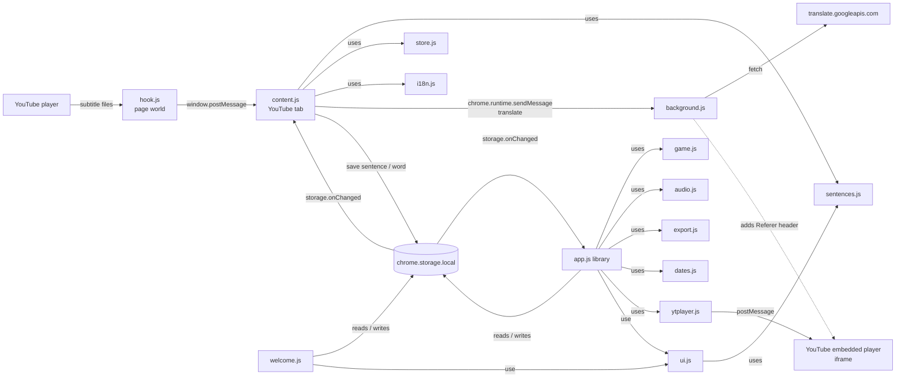

# Code Guide: Learn languages with YouTube (dual captions & sentence capture)

This guide explains the whole extension: what it does, what every file is for, how the files talk to each other, and then **every line of code**, file by file. The code is shown in blocks with its real line numbers, and under each block you find what those lines do and why.

How to read it:

1. Read **Part 1** (overview, the big picture, and the JavaScript ideas the code uses). That is enough to find your way around.
2. Then read the files in the order of **Part 2**. It follows the way the data flows: from YouTube, into sentences, onto the screen, into storage, into the library and the games.
3. Keep the real file open next to the guide. The line numbers match version 1.8.0.

---

# Part 1: The big picture

## What the extension does

* On **YouTube**, it reads the subtitles of the language you are learning, joins the subtitle lines into real **sentences**, and shows each sentence on the video with its **translation** under it.
* It works out **when each sentence starts and ends**, as exactly as it can. When a video has subtitles written by a person and also automatic ones, it uses the text of the first and the word times of the second.
* Keys: **W** save the sentence, **S** hear it again, **A** sentence before, **D** next sentence, **C** show/hide. When the video is **paused**, S (and A/D) play exactly one sentence and pause again, so you can listen to a sentence as often as you like.
* Buttons under the text do the same for people who use the mouse.
* **Click a word** on the video to see its meaning and save it with a difficulty (easy / medium / hard).
* The **library** (click the extension icon) shows your saved sentences and words, five **games**, the **settings** (languages, colour palette, sentence length, caption size and colour), **help**, and **about me**: who made the extension and how to reach him.
* The games come in two groups. **Word games** (word cards, find the pairs) use only your saved words. **Sentence games** (listen, fill the gap, put in order) use only your saved sentences and train your ears: the sentence is always heard first. Before every game you choose how many words or sentences to practise (hard ones are picked more often); after it you get the list of what you practised, to change the meaning or difficulty, or delete an item.
* Every saved sentence can be heard with its **original sound**: a small YouTube player in the corner plays exactly that sentence of the video. The games can use the original sound too. A computer voice is the alternative (and the fallback).
* Sentences and words can be **downloaded** as an Excel table, plain text, Anki flashcards, CSV or JSON.
* After installation a **welcome wizard** explains everything in six short steps, with a little pretend video to try dragging the text, ⚙, Space and S. Every step fits on one screen.
* The whole interface is shown **in your own language**: the English texts are translated once with Google Translate and kept.
* Everything is stored **only in your browser** (`chrome.storage.local`).

## The files

| File | Runs where | What it is for |
|---|---|---|
| `manifest.json` | (read by Chrome) | Tells Chrome what the extension is, which files to run where, and what it may access. |
| `background.js` | Service worker (background) | Translation requests to Google, translation of the interface texts, opening the library / welcome page, the toolbar tooltip, the rule that lets YouTube's player run on our pages. |
| `hook.js` | YouTube page itself (MAIN world) | Catches YouTube's own subtitle downloads, switches on the subtitles of the learned language, and also fetches the automatic subtitles (for the word times). |
| `content.js` | YouTube tab (isolated world) | Everything you see on the video: the caption box, keys, buttons, menus, word panel, the paused-S replay, saving. |
| `sentences.js` | YouTube tab + library + wizard | Turns subtitle lines into sentences of the right length and works out when each one starts and ends. Pure logic. |
| `store.js` | YouTube tab + library + wizard | Settings, saved sentences and words, colour palettes, languages, word splitting. |
| `i18n.js` | YouTube tab + library + wizard | All interface texts (English) and the code that shows them in the user's language. |
| `audio.js` | library + wizard | The computer voice (speech synthesis). |
| `game.js` | library | The rules of the five games. Pure logic. |
| `ui.js` | library + wizard | Small shared building blocks for the pages (create elements, button groups, palette chooser, the sentence-length example). |
| `export.js` | library | Writes the download files: Excel, text, Anki, CSV, JSON. Pure logic. |
| `dates.js` | library | Days and time windows: "saved in the past week", the days of a calendar month, dates written the user's way. Pure logic. |
| `ytplayer.js` | library | The "original sound": YouTube's embedded player in a corner window, steered with messages so it plays exactly one sentence. |
| `app.html`, `app.js` | library page | The library: sentences, words, games, settings, help, about me. |
| `about-sami.jpg` | library page | The photo on the "About me" tab. |
| `welcome.html`, `welcome.js` | welcome page | The six-step introduction. |
| `app.css` | library + wizard | The design of both pages. |
| `docs/` | (website) | Privacy policy and support page for the Chrome Web Store. Not part of the running extension. |

## How the files work together



The same in words:

1. **YouTube loads a video.** `hook.js` (which lives inside YouTube's own page) asks the player to switch on the subtitles of the learned language, and copies the subtitle file when the player downloads it. If those subtitles were written by a person, it also gets the automatic subtitles of the same language. It hands every file to `content.js` with `window.postMessage`.
2. **`content.js`** reads the subtitle files into "cues" (lines with times), and `sentences.js` turns them into sentences (`build`): the text from the written subtitles, the word times from the automatic ones. Long sentences are cut so that none is longer than the chosen length.
3. Five times per second `content.js` checks the video time (`tick`) and shows the sentence that is being spoken. For the translation it sends a message to **`background.js`**, which asks Google Translate.
4. Pressing **W** or clicking a word saves into `chrome.storage.local` through **`store.js`**. A saved sentence remembers its video and the exact piece to play (`time`, `lead`, `end`, `stop`).
5. The **library** (`app.html` + `app.js`) reads the same storage. When something changes (for example you save a sentence on YouTube while the library is open), Chrome fires `storage.onChanged` and both sides redraw.
6. **Original sound:** `ytplayer.js` puts YouTube's embedded player into an `<iframe>` and tells it with messages which piece to play. YouTube only plays when the request says which page embeds it (the `Referer` header), and Chrome sends none from extension pages, so a rule set by `background.js` adds one.
7. **Downloads:** `export.js` turns the lists into files; `app.js` hands them to the browser.
8. **Saved when?** Every saved sentence and word has `savedAt` (the moment it was saved). `dates.js` works out which of them fall into a time window ("Past week", or days picked in the calendar); `app.js` shows only those in the lists, the downloads and the games.
9. All texts go through **`i18n.js`**: `t('key')` returns the text in the user's language. The translations are made once by `background.js` and cached.

### Two "worlds" on the YouTube page

A Chrome extension's content script runs in an **isolated world**: it sees the same page (the DOM) as YouTube, but not YouTube's JavaScript variables. To talk to YouTube's player (`movie_player.setOption(...)`) and to catch its network requests, code must run in YouTube's own **MAIN world**. That is `hook.js`. The two worlds cannot call each other's functions, but they can send messages with `window.postMessage`, which is what they do.

### What is stored (`chrome.storage.local`)

| Key | Content |
|---|---|
| `settings` | `{ lang, learn, de:{size,color}, tr:{size,color}, pos, uiScale, game:{direction,counts:{cards,match,listen,gap,build},sound}, palette, len }` |
| `sentences` | list of `{ id, text, translation, lang, learn, videoId, videoTitle, time, end, lead, stop, url, savedAt, got?, missed?, difficulty? }` (`time` = start of the first word, `end` = end of the last word, `lead` = how much earlier a replay starts, `stop` = where a replay stops, `difficulty` = how hard it is to understand, set after a game) |
| `words` | list of `{ id, word, translation, lang, learn, difficulty, correct, wrong, sentenceDe, sentenceTr, videoTitle, url, savedAt }` |
| `i18n_<code>` | the interface texts translated into that language: `{ v: version, s: { key: text } }` |

The chosen time window ("Past week" …) is **not** stored: it lives only while the library page is open, so the library always opens showing everything.

(`de` / `sentenceDe` are old names from when the extension was only for German; they mean "the language being learned".)

## JavaScript ideas used in this code

You will meet these again and again. If one is new, read it here once.

* **IIFE** `(() => { ... })();` — a function that is created and run at once. Everything inside is private, so variables of one file cannot clash with another file's. `globalThis.GSTStore = (() => { ...; return {...}; })();` runs the function and keeps only what it returns: that is a "module" without a build tool.
* **`globalThis`** — the global object (`window` on a page). Files share their modules through it: `globalThis.GST`, `GSTStore`, `GSTI18n`, `GSTGame`, `GSTAudio`, `GSTUi`, `GSTExport`, `GSTDates`, `GSTYt`. That is why the order of the `<script>` tags and of the `js` list in the manifest matters.
* **Arrow functions** `(a, b) => a + b` — short functions. `x => ({...})` returns an object.
* **Destructuring** `const { t, tn } = I18n;` takes properties out of an object; `const [a, b] = list;` out of an array.
* **Spread** `{ ...base, ...patch }` copies an object and overrides fields; `[...a]` copies an array; `f(...list)` passes a list as separate arguments.
* **Optional chaining / nullish** `a?.b` is `undefined` instead of an error when `a` is missing; `x ?? y` gives `y` only when `x` is `null`/`undefined`.
* **Promises and `async`/`await`** — work that finishes later (storage, network). `await p` waits for the promise inside an `async` function. `.then(fn)` / `.catch(fn)` / `.finally(fn)` do the same with callbacks.
* **`Map` / `Set`** — a dictionary with any kind of keys / a list without duplicates.
* **Template strings** `` `${a} and ${b}` `` — text with values inside.
* **Regular expressions** `/.../g` — text patterns. `\p{L}` means "any letter in any language" (needs the `u` flag).
* **`Intl.Segmenter`** — built into the browser: splits text into words or sentences in any language, also Japanese or Chinese, which have no spaces.
* **`Intl.DateTimeFormat`** — writes dates the way a language writes them ("Monday, 9 November", "Montag, 9. November"); `formatRange` writes two dates as one window ("3–16 Nov 2026"). `Intl.Locale(...).getWeekInfo()` tells on which day the week starts in a country (Monday in Germany, Sunday in the USA).
* **`Intl.DisplayNames`** — gives the name of a language in another language ("German" → "Deutsch", "alemán").
* **Chrome extension APIs**: `chrome.storage.local` (storage), `chrome.runtime.sendMessage` / `onMessage` (messages between parts of the extension), `chrome.tabs` (open tabs), `chrome.action` (the toolbar icon).
* **DOM**: `document.createElement`, `el.append(...)`, `el.replaceChildren(...)`, `addEventListener('click', fn)`, `getBoundingClientRect()` (where an element is on the screen).
* **Pointer events** (`pointerdown`, `pointermove`, `pointerup`) work for mouse, pen and touch alike; `setPointerCapture` keeps sending the moves to the element even when the pointer leaves it (needed for dragging).
* **`requestAnimationFrame(fn)`** runs `fn` before the next screen refresh (about 60 times a second). Used to stop a replayed sentence at exactly the right moment.
* **`<iframe>` and `postMessage`** — an iframe shows another website inside a page. The two cannot touch each other's code, but they can send each other messages with `window.postMessage`. That is how the library steers YouTube's player, and how `hook.js` talks to `content.js`.
* **`chrome.declarativeNetRequest`** — lets an extension change requests with fixed rules ("for requests like this, set that header"). Used for one rule: the `Referer` header YouTube's embedded player needs.
* **`<dialog>`** — the browser's own pop-up window element: `showModal()` opens it, keeps the keyboard inside it and closes it with Esc.
* **Binary search** — finding something in a sorted list by halving the range each step. Used wherever a time or a text position is looked up (sentences, word marks).
* **`Uint8Array` / `DataView` / `TextEncoder`** — raw bytes. Needed to write the Excel file (a ZIP archive) by hand.

---

# Part 2: Every file, line by line


---

## `manifest.json`

The manifest is the extension's identity card. Chrome reads it when the extension is loaded. It is JSON: no comments allowed, so the explanations are here.


#### Lines 1–5

```json
{
  "manifest_version": 3,
  "name": "Learn languages - youtube dual captions and sentense capture",
  "version": "1.8.0",
  "description": "This extension allows you to learn languages by watching YouTube videos with dual captions and capturing sentences for practice.",
```

`manifest_version: 3` is the current format of Chrome extensions (Manifest V3: background code runs as a service worker). `name`, `version` and `description` are shown in Chrome and in the Web Store. The version is 1.8.0 for this release.


#### Lines 6–13

```json
  "permissions": [
    "storage",
    "declarativeNetRequestWithHostAccess"
  ],
  "host_permissions": [
    "https://translate.googleapis.com/*",
    "https://www.youtube.com/*"
  ],
```

`permissions`:

* `storage` lets the extension use `chrome.storage.local`.
* `declarativeNetRequestWithHostAccess` lets it change request headers, but only for sites it already has access to. It is used for one rule: the `Referer` header on requests for YouTube's embedded player from our own library page (see `background.js`). This permission shows no extra warning to the user.

`host_permissions`: `translate.googleapis.com` allows `background.js` to fetch translations; `www.youtube.com` is what the header rule above needs (the extension already runs on YouTube, so this adds no new warning either).


#### Lines 14–25

```json
  "icons": {
    "16": "icon16.png",
    "48": "icon48.png",
    "128": "icon128.png"
  },
  "action": {
    "default_title": "Open my library",
    "default_icon": {
      "16": "icon16.png",
      "48": "icon48.png"
    }
  },
```

The icons in three sizes (16 px in the toolbar, 48 px on the extensions page, 128 px in the Web Store). `action` is the toolbar button: its tooltip and icon. Because there is no `default_popup`, a click fires `chrome.action.onClicked` in `background.js`, which opens the library.


#### Lines 26–32

```json
  "options_ui": {
    "page": "app.html",
    "open_in_tab": true
  },
  "background": {
    "service_worker": "background.js"
  },
```

`options_ui` makes the library also the extension's "Options" page (right-click the icon → Options). `open_in_tab` opens it as a full tab instead of a small box. `background.service_worker` names the background script.


#### Lines 33–57

```json
  "content_scripts": [
    {
      "matches": [
        "https://www.youtube.com/*"
      ],
      "js": [
        "hook.js"
      ],
      "run_at": "document_start",
      "world": "MAIN"
    },
    {
      "matches": [
        "https://www.youtube.com/*"
      ],
      "js": [
        "sentences.js",
        "store.js",
        "i18n.js",
        "content.js"
      ],
      "run_at": "document_start"
    }
  ]
}
```

Two groups of scripts run on every `https://www.youtube.com/*` page:

1. `hook.js` with `"world": "MAIN"`: it runs **inside YouTube's own JavaScript**, so it can wrap `fetch` and talk to the player. `run_at: document_start` makes it run before YouTube's scripts, so it can catch the very first subtitle request.
2. `sentences.js`, `store.js`, `i18n.js`, `content.js` in the normal isolated world, in this order: each file uses what the ones before it put on `globalThis` (`content.js` needs all three).


---

## `background.js`

The background service worker. It has no page and no DOM. Chrome starts it when it is needed (a message arrives, the icon is clicked) and stops it when it is idle, so it keeps nothing important in variables: everything that must last is in `chrome.storage`.


#### Lines 1–2

```js
// Runs in the background: translation (Google's unofficial free endpoint), the interface-language
// translations, and opening the library page. Swap gtx() for DeepL etc. if you like.
```

Comment: what this file does.


#### Lines 4–16

```js
async function gtx(text, sl, tl) {
  const url =
    'https://translate.googleapis.com/translate_a/single?client=gtx&sl=' +
    encodeURIComponent(sl || 'de') +
    '&tl=' +
    encodeURIComponent(tl || 'en') +
    '&dt=t&q=' +
    encodeURIComponent(text);
  const r = await fetch(url);
  if (!r.ok) throw new Error('HTTP ' + r.status);
  const j = await r.json();
  return j[0].map((x) => x[0]).join('');
}
```

`gtx(text, sl, tl)` translates `text` from language `sl` to language `tl`. It builds the address of Google's free translation endpoint (`client=gtx`, the one the Google Translate website itself uses). `encodeURIComponent` makes the text safe inside a web address (spaces, umlauts, `&`). `fetch` downloads the answer; if the server says no (`!r.ok`, e.g. too many requests) it throws an error. The answer is JSON shaped like `[[["Hallo","Hello",...],["Welt","world",...]], ...]`: one entry per piece of the text. `j[0].map((x) => x[0]).join('')` takes the translated part of every piece and glues them together.


#### Lines 18–21

```js
// ---- interface texts in the user's language ----
// Every English text is translated once, checked, and cached ("i18n_<language>").
const uiJobs = new Map();
const placeholders = (s) => (String(s).match(/\{\w+\}/g) || []).sort().join('|');
```

Section: translating the interface (buttons, labels, messages) into the user's language.

`uiJobs` remembers a translation job that is already running, so that the library and the YouTube tab asking at the same moment do not translate everything twice.

`placeholders(s)` lists the `{name}` markers in a text, sorted, e.g. `"{lang}|{word}"`. It is used to check that Google did not break or translate a marker.


#### Lines 23–27

```js
function uiTranslate(msg) {
  const id = msg.lang + '|' + msg.version;
  if (!uiJobs.has(id)) uiJobs.set(id, runUiTranslate(msg).finally(() => uiJobs.delete(id)));
  return uiJobs.get(id);
}
```

One job per language + version. If there is no job yet, start `runUiTranslate` and store its promise; `.finally` removes it from the map when it is done. Everyone asking gets the same promise.


#### Lines 29–32

```js
async function runUiTranslate({ lang, strings, version }) {
  const key = 'i18n_' + lang;
  const cached = (await chrome.storage.local.get(key))[key];
  if (cached && cached.v === version && cached.s) return { ok: true, strings: cached.s };
```

The actual work. `key` is the storage key (`i18n_de`, `i18n_fr` ...). If this language was already translated **for this version of the English texts** (`cached.v === version`), return it at once.


#### Lines 34–46

```js
  const entries = Object.entries(strings);
  const out = {};
  const one = async ([k, en]) => {
    try {
      const tr = (await gtx(en, 'en', lang)).trim();
      // a text whose {values} got lost or changed would show broken: keep English for that one
      if (tr && placeholders(tr) === placeholders(en)) out[k] = tr;
    } catch {}
  };
  const run = async (list) => {
    let i = 0;
    await Promise.all(Array.from({ length: 6 }, async () => { while (i < list.length) await one(list[i++]); }));
  };
```

`entries` is the list of `[key, englishText]`. `one([k, en])` translates one text; it is only kept when the `{placeholders}` are still exactly the same (otherwise the English text is used for that one, so nothing shows broken). Errors are swallowed: a missing text simply stays English.

`run(list)` translates a list with **6 workers in parallel**: six little loops that each take the next index `i++` until the list is done. That is much faster than one by one and much gentler than 250 requests at once.


#### Lines 47–54

```js
  await run(entries);
  const missing = entries.filter(([k]) => !(k in out));
  if (missing.length) await run(missing); // one more try for the ones that failed

  if (Object.keys(out).length < entries.length * 0.8) return { ok: false }; // too many failed: do not cache
  await chrome.storage.local.set({ [key]: { v: version, s: out } });
  return { ok: true, strings: out };
}
```

Translate everything; then try once more for those that failed (`missing`).

If fewer than 80 % worked (no internet, Google blocking) nothing is cached and `ok: false` is returned, so the page shows English and tries again next time. Otherwise the result is stored as `{ v: version, s: out }` and returned.


#### Lines 56–73

```js
// the tooltip of the toolbar icon, in the user's language
async function updateActionTitle() {
  try {
    const { settings } = await chrome.storage.local.get('settings');
    const lang = (settings && settings.lang) || 'en';
    let title = 'Open my library';
    if (lang !== 'en') {
      const c = (await chrome.storage.local.get('i18n_' + lang))['i18n_' + lang];
      if (c && c.s && c.s['action.title']) title = c.s['action.title'];
    }
    await chrome.action.setTitle({ title });
  } catch {}
}
chrome.runtime.onInstalled.addListener(updateActionTitle);
chrome.runtime.onStartup.addListener(updateActionTitle);
chrome.storage.onChanged.addListener((changes, area) => {
  if (area === 'local' && (changes.settings || Object.keys(changes).some((k) => k.startsWith('i18n_')))) updateActionTitle();
});
```

`updateActionTitle` sets the tooltip of the toolbar icon in the user's language ("Open my library"), taken from the cached interface translation. It runs when the extension is installed or Chrome starts, and whenever the settings or a cached translation change (`storage.onChanged`).


#### Lines 75–87

```js
// ---- open (or focus) one of our pages: the library (app.html) or the introduction (welcome.html) ----
async function openPage(page) {
  const url = chrome.runtime.getURL(page);
  try {
    const [existing] = await chrome.tabs.query({ url });
    if (existing) {
      await chrome.tabs.update(existing.id, { active: true });
      await chrome.windows.update(existing.windowId, { focused: true });
      return;
    }
  } catch {}
  chrome.tabs.create({ url });
}
```

`openPage(page)` opens the library (`app.html`) or the introduction (`welcome.html`). `chrome.runtime.getURL` gives its full address (`chrome-extension://<id>/app.html`). If a tab with that page is already open, it is brought to the front (`tabs.update` + `windows.update`) instead of opening a second one. `tabs.query({url})` needs no special permission for the extension's own pages.


#### Lines 88–107

```js
// ---- the original sound: YouTube's player on our library page ----
// YouTube's embedded player only plays when the request for it says which page it is shown on (the "Referer"
// header); without it the player shows "Error 153". Chrome sends no Referer from extension pages, so this
// rule adds one, only to player requests that come from our own pages.
const PLAYER_RULE = 1;
function allowPlayer() {
  const rule = {
    id: PLAYER_RULE,
    priority: 1,
    action: {
      type: 'modifyHeaders',
      requestHeaders: [{ header: 'referer', operation: 'set', value: `https://${chrome.runtime.id}.chromiumapp.org/` }],
    },
    condition: { initiatorDomains: [chrome.runtime.id], requestDomains: ['www.youtube.com'], resourceTypes: ['sub_frame'] },
  };
  return chrome.declarativeNetRequest
    .updateDynamicRules({ removeRuleIds: [PLAYER_RULE], addRules: [rule] })
    .catch((e) => console.warn('[GST] player rule', e));
}
allowPlayer(); // every time the background starts; setting the same rule again does no harm
```

**The rule for the original sound.** YouTube's embedded player only plays when the request for it says which page it is shown on (the `Referer` header); without it the player shows "Error 153". Chrome sends no `Referer` from extension pages. So `allowPlayer()` sets one rule with `chrome.declarativeNetRequest`:

* `action`: set the request header `referer` to `https://<our extension id>.chromiumapp.org/` (an address that belongs to this extension).
* `condition`: only requests that **our own pages** start (`initiatorDomains` = the extension's id), only to `www.youtube.com`, and only for iframes (`sub_frame`). Nothing you do on YouTube itself or on other websites is touched.

`updateDynamicRules` removes the rule with this id and adds it again, so calling it every time the background starts does no harm.


#### Lines 109–115

```js
const openLibrary = () => openPage('app.html');
chrome.action.onClicked.addListener(openLibrary);

// right after the installation: show the short introduction (not after updates)
chrome.runtime.onInstalled.addListener((details) => {
  if (details.reason === 'install') openPage('welcome.html');
});
```

A click on the toolbar icon opens the library.

`chrome.runtime.onInstalled` fires on installation, on updates, and when Chrome updates. `details.reason === 'install'` is only the very first installation: then the welcome wizard opens.


#### Lines 117–135

```js
chrome.runtime.onMessage.addListener((msg, _sender, sendResponse) => {
  if (!msg) return;
  if (msg.type === 'translate') {
    gtx(msg.text, msg.sl, msg.tl)
      .then((text) => sendResponse({ text }))
      .catch((e) => sendResponse({ error: String(e) }));
    return true; // async response
  }
  if (msg.type === 'ui-translate') {
    uiTranslate(msg)
      .then(sendResponse)
      .catch((e) => sendResponse({ ok: false, error: String(e) }));
    return true;
  }
  if (msg.type === 'open-library' || msg.type === 'open-welcome') {
    openPage(msg.type === 'open-library' ? 'app.html' : 'welcome.html').then(() => sendResponse({ ok: true }));
    return true;
  }
});
```

The messages other parts of the extension send:

* `translate` — translate a sentence or word (from `content.js`, `app.js`, `welcome.js`). `return true` tells Chrome "I will answer later" (the answer comes after the `fetch`); without it the message channel would close at once.
* `ui-translate` — translate all interface texts (from `i18n.js`).
* `open-library` / `open-welcome` — from the menu on the video.


---

## `hook.js`

This file runs in YouTube's own page (MAIN world). It has three jobs: catch the subtitle files the player downloads, make the player download the subtitles of the learned language, and (new in 1.6) also get the **automatic** subtitles of that language, because only those say when every single word is spoken.


#### Lines 1–7

```js
// Runs in the page context (MAIN world).
// 1) Reads the player's own caption responses (YouTube guards the caption files with tokens
//    that only the player's request carries, so we copy the response instead of re-downloading).
// 2) Switches the subtitle track of the language being learned on through the player API, retrying until the player
//    really delivers the file, then puts the player back the way it was.
// 3) When the subtitles were written by a person, also gets the automatic subtitles of the same language:
//    only those say when every single word is spoken, which makes the sentence times exact.
```

Comment: the three jobs. Why copy instead of download ourselves: YouTube protects the subtitle address with tokens that only the player's own request carries.


#### Lines 8–10

```js
(() => {
  const TAG = '[GST]';
  const isTT = (u) => typeof u === 'string' && u.includes('/api/timedtext');
```

`TAG` prefixes console messages. `isTT(u)` is true for a subtitle download address (`/api/timedtext`).


#### Lines 12–19

```js
  // the language being learned (set by the content script when it asks for the captions)
  let want = 'de';
  // main part of a language code; old / alternative codes YouTube and Google use are mapped together
  const base = (c) => {
    c = String(c || '').toLowerCase().split(/[-_]/)[0];
    return { iw: 'he', in: 'id', nb: 'no', nn: 'no', jw: 'jv' }[c] || c;
  };
  const isWanted = (t) => !!t && base(t.languageCode) === base(want);
```

`want` is the language whose subtitles we want; `content.js` tells it with a message. `base(c)` reduces a language code to its main part (`de-DE` → `de`) and maps old codes Google/YouTube still use (`iw` = Hebrew, `in` = Indonesian, `nb`/`nn` = Norwegian, `jw` = Javanese). `isWanted(t)` checks if a subtitle track has that language.


#### Lines 21–24

```js
  // ---------- read caption responses ----------
  // what has arrived in the language being learned: subtitles written by a person (manual) and automatic ones (asr)
  const got = { manual: false, asr: false };
  let manualUrl = ''; // the address the written subtitles came from
```

`got` remembers what has arrived in the wanted language: subtitles written by a person (`manual`) and automatic ones (`asr`, "automatic speech recognition"). `manualUrl` is the address the written ones came from (needed in a moment).


#### Lines 26–41

```js
  function onBody(url, body) {
    let lang = '', tlang = '', kind = '';
    try {
      const u = new URL(url, location.origin);
      lang = u.searchParams.get('lang') || '';
      tlang = u.searchParams.get('tlang') || '';
      kind = u.searchParams.get('kind') || '';
    } catch {}
    if (!body || !body.trim()) { console.log(TAG, 'empty caption response', lang, kind); return; }
    console.log(TAG, 'caption response', lang || '?', kind, body.length, 'chars');
    if (base(lang) === base(want) && !tlang) {
      if (kind === 'asr') got.asr = true;
      else { got.manual = true; manualUrl = url; }
    }
    window.postMessage({ source: 'gst-timedtext-body', url, body }, '*');
  }
```

Called for every subtitle download. It reads `lang` (subtitle language), `tlang` (YouTube's own automatic translation, which we do not want) and `kind` (`asr` for automatic subtitles) from the address. Empty answers are only logged. If it is the wanted language and not a YouTube translation, it notes which kind arrived. Then the whole file is sent to `content.js` with `window.postMessage` (the only way between the two worlds); `content.js` reads the kind from the address too.


#### Lines 43–53

```js
  const origFetch = window.fetch;
  window.fetch = function (input, ...rest) {
    const p = origFetch.call(this, input, ...rest);
    try {
      const url = typeof input === 'string' ? input : input && input.url ? input.url : String(input);
      if (isTT(url)) {
        p.then((res) => res.clone().text().then((b) => onBody(url, b)).catch(() => {})).catch(() => {});
      }
    } catch {}
    return p;
  };
```

**Wrapping `fetch`**: the original `fetch` is kept, and `window.fetch` is replaced by our function, which calls the original and returns its result unchanged (so YouTube does not notice anything). If the address is a subtitle download, it also takes a **copy** of the answer (`res.clone()`, because an answer body can only be read once) and passes the text to `onBody`. Every step is wrapped in `try` / `.catch` so that a problem here can never break YouTube.


#### Lines 55–72

```js
  const origOpen = XMLHttpRequest.prototype.open;
  XMLHttpRequest.prototype.open = function (method, url, ...rest) {
    try {
      const u = String(url);
      if (isTT(u)) {
        this.addEventListener('load', () => {
          try {
            let body = '';
            if (this.responseType === '' || this.responseType === 'text') body = this.responseText;
            else if (this.responseType === 'json') body = JSON.stringify(this.response);
            else if (this.responseType === 'arraybuffer') body = new TextDecoder().decode(this.response);
            onBody(u, body);
          } catch {}
        });
      }
    } catch {}
    return origOpen.call(this, method, url, ...rest);
  };
```

The same for the older `XMLHttpRequest` (YouTube uses both, depending on the version). `open` is wrapped: for subtitle addresses a `load` listener reads the answer, whatever its type (text, JSON or binary).


#### Lines 74–85

```js
  // The automatic subtitles have the same address as the written ones, with "kind=asr" added.
  // Asking for them directly is quick and changes nothing in the player; if YouTube does not answer,
  // the track is switched in the player instead (see step below).
  function fetchAsrDirect() {
    try {
      const u = new URL(manualUrl, location.origin);
      u.searchParams.set('kind', 'asr');
      u.searchParams.delete('name');
      const url = u.toString();
      origFetch.call(window, url).then((res) => (res.ok ? res.text() : '')).then((b) => onBody(url, b)).catch(() => {});
    } catch {}
  }
```

`fetchAsrDirect` — the quick way to the automatic subtitles: take the address of the written ones, add `kind=asr`, remove the track's `name`, and ask for it with the original `fetch`. Nothing changes in the player. If YouTube answers, `onBody` gets the file like any other. If not, nothing happens here and the track is switched in the player instead (below).


#### Lines 87–94

```js
  // ---------- switch the track of the language being learned on ----------
  const player = () => document.getElementById('movie_player');

  let running = false;
  let runId = 0;
  let touched = false;
  let prevTrack = null;
  let wasOn = false;
```

Section 2: switching the subtitles of the learned language on. `player()` finds YouTube's player element (it has extra functions like `getOption`/`setOption`).

`running` / `runId`: one switching run at a time; `runId` changes when a run ends so its old timers stop. `touched`, `prevTrack`, `wasOn`: what the subtitles were before we touched them, so they can be put back.


#### Lines 96–101

```js
  function trackList(p) {
    let list = [];
    try { list = p.getOption('captions', 'tracklist', { includeAsr: true }) || []; } catch {}
    if (!list.length) { try { list = p.getOption('captions', 'tracklist') || []; } catch {} }
    return list;
  }
```

Asks the player for the list of available subtitle tracks, including automatic ones (`includeAsr`). Some player versions do not know that option, hence the second try without it.


#### Lines 103–115

```js
  function restore() {
    if (!touched) return;
    touched = false;
    const p = player();
    if (!p) return;
    try {
      if (wasOn && prevTrack) p.setOption('captions', 'track', prevTrack);
      else {
        p.setOption('captions', 'track', {});
        if (p.unloadModule) p.unloadModule('captions');
      }
    } catch {}
  }
```

Puts the player's subtitles back the way they were: the old track if subtitles were on, otherwise switched off (`track: {}`) and the captions module unloaded. Our own text is shown instead, so YouTube's subtitles are not needed once we have the files.


#### Lines 117–124

```js
  function finish(ok, reason) {
    if (!running) return;
    running = false;
    runId++;
    restore();
    console.log(TAG, 'caption switch finished', ok ? 'ok' : 'failed: ' + reason);
    if (!ok) window.postMessage({ source: 'gst-captions-result', ok: false, reason }, '*');
  }
```

Ends a run: marks it stopped, invalidates its timers (`runId++`), restores the player, and on failure tells `content.js` why (`no-language`, `no-tracklist`, ...).


#### Lines 126–138

```js
  function start() {
    if (running) { window.postMessage({ source: 'gst-captions-result', stage: 'started' }, '*'); return; }
    running = true;
    const id = ++runId;
    got.manual = got.asr = false;
    manualUrl = '';
    touched = false;
    let attempt = 0;
    let tries = 0;
    let lastSet = 0;
    let extraSince = 0; // the attempt at which the search for the automatic subtitles began
    let reason = 'no-player';
    window.postMessage({ source: 'gst-captions-result', stage: 'started' }, '*');
```

Starts a run (or, if one is running, just confirms it). It resets what has arrived and its counters: `attempt` (seconds so far), `tries` and `lastSet` (track switches), `extraSince` (when the search for the automatic subtitles began). It sends `stage: 'started'` so `content.js` knows the message arrived.


#### Lines 140–203

```js
    const step = () => {
      if (id !== runId || !running) return;
      const haveText = got.manual || got.asr;
      if (++attempt > 60) return haveText ? finish(true) : finish(false, reason === 'ok' ? 'no-response' : reason);

      const p = player();
      if (!p || typeof p.getOption !== 'function') { reason = 'no-player'; return setTimeout(step, 1000); }
      try {
        if (p.loadModule) p.loadModule('captions');
        const list = trackList(p);
        if (!list.length) { reason = 'no-tracklist'; return setTimeout(step, 1000); }
        const manual = list.find((t) => isWanted(t) && t.kind !== 'asr');
        const asr = list.find((t) => isWanted(t) && t.kind === 'asr');
        if (!manual && !asr) return finish(false, 'no-language');

        // what is still missing? First the text (written by a person, if there is one),
        // then the automatic subtitles for the word times
        let target;
        if (manual && !got.manual) target = manual;
        else if (asr && !got.asr) {
          target = asr;
          if (manual) {
            if (!extraSince) {
              // the text is there: first ask for the word times directly, and give that two seconds
              extraSince = attempt;
              tries = 0;
              lastSet = Date.now() - 1500;
              fetchAsrDirect();
            }
            if (attempt - extraSince > 14) return finish(true); // no word times: the text alone has to do
          }
        } else return finish(true);

        const cur = p.getOption('captions', 'track');
        if (!touched) {
          prevTrack = cur;
          wasOn = !!(cur && cur.languageCode);
          touched = true;
        }
        reason = 'no-response';

        if (Date.now() - lastSet > 3500) {
          lastSet = Date.now();
          // alternate between the exact track object and a minimal one
          const minimal = { languageCode: target.languageCode };
          if (target.kind) minimal.kind = target.kind;
          const wanted = tries % 2 === 0 ? target : minimal;
          console.log(TAG, 'switching track to', target.languageCode, target.kind || '', 'try', tries + 1);
          if (isWanted(cur) || tries > 0) {
            // make the player request the file again
            p.setOption('captions', 'track', {});
            setTimeout(() => { try { p.setOption('captions', 'track', wanted); } catch {} }, 300);
          } else {
            p.setOption('captions', 'track', wanted);
          }
          tries++;
        }
      } catch (e) {
        console.warn(TAG, 'player API error', e);
      }
      setTimeout(step, 1000);
    };
    step();
  }
```

`step` runs once per second, up to 60 times:

* stop if this run is no longer the current one; after 60 tries finish: successfully if any text arrived, otherwise with the reason.
* no player yet, or no track list yet → try again in a second.
* find the wanted language's track written by a person (`manual`) and its automatic one (`asr`). Neither → this video has no subtitles in that language: finish with `no-language`.
* **decide what is still missing** (`target`): first the text, written by a person if there is such a track. Then, if there is an automatic track and it has not arrived, that one, for the word times. When both are there (or there is nothing more to get): finish.
* looking for the automatic subtitles after the written ones: the first time, `fetchAsrDirect()` is tried and gets a head start of two seconds before the player's track is touched (`lastSet` is set so that the first switch comes 2 s later). If they have not arrived after 14 seconds, finish anyway: the text alone has to do, with estimated times.
* the first time a track is touched, remember the current track (`prevTrack`) and whether subtitles were on.
* every 3.5 seconds, set the track to `target`: alternately the full track object and a minimal `{languageCode, kind}` (different player versions accept different forms). If it is already on or this is a retry, switch off first and on again after 300 ms, which forces the player to download the file again.


#### Lines 205–217

```js
  window.addEventListener('message', (e) => {
    if (e.source !== window) return;
    const s = e.data && e.data.source;
    if (s === 'gst-enable-captions') {
      const l = e.data.lang || 'de';
      // another language than before: stop the old run and start again for the new one
      if (running && base(l) !== base(want)) finish(true);
      want = l;
      start();
    }
    else if (s === 'gst-cancel-captions') finish(true);
  });
})();
```

Listens for `content.js`: `gst-enable-captions` (with the language) starts a run, stopping a run for another language first; `gst-cancel-captions` (a new video) stops the current run. `e.source !== window` ignores messages from frames/ads.


---

## `sentences.js`

The heart of the extension: it turns YouTube's subtitle lines into sentences and works out **when each sentence starts and ends**. It uses no page and no Chrome API, so it can be tested on its own with Node (`node tests/test-sentences.js`, `node tests/test-timing.js`). It puts its functions on `globalThis.GST`. The library and the wizard load it too (for the sentence-length example).

Subtitle lines ("cues") rarely match sentences: one sentence is spread over three lines, or one line holds the end of a sentence and the start of the next. So the file

1. glues all lines into one long text and makes one **mark** per word: where the word is in the text and when it is spoken,
2. cuts the text into sentences, and long sentences into shorter parts,
3. reads each sentence's start and end from the marks of its first and last word.

Step 1 is where accuracy comes from. Automatic subtitles tell the start of every word. Subtitles written by a person only tell when a whole line appears, so their word times are **estimated**, and then, if the video also has automatic subtitles, **corrected** with the real word times from there.


#### Lines 1–75

```js
globalThis.GST = (() => {
  // Per language (edit these to taste):
  //  abbr  = abbreviations whose full stop does not end a sentence
  //  conj  = connectors that start a new sentence when they follow a comma
  //  and   = the word for "and", which only counts as a connector when one of the words in `next` follows
  //  month = (German) "3. März": the full stop after a number does not end the sentence
  //  prep  = prepositions: a good place to cut a long sentence is in front of one ("... | mit dem Fahrrad")
  //  art   = articles: a bad place to cut is right after one, or right after a preposition ("in den | Supermarkt")
  //  glue  = little words that tie two nouns together: no cut in front of them ("a bottle | of milk")
  // A language without an entry is simply split at sentence ends and, where long enough, at commas.
  const PROFILES = {
    de: {
      prep: 'mit|nach|für|in|im|an|am|auf|von|vom|zu|zum|zur|bei|beim|aus|über|unter|vor|seit|ohne|gegen|durch|bis|während|wegen|trotz',
      art: 'der|die|das|den|dem|des|ein|eine|einen|einem|einer|eines|mein|meine|meinen|meinem|meiner|sein|seine|ihr|ihre|unser|unsere|kein|keine|sehr',
      abbr: 'z|B|d|h|u|a|ca|bzw|vgl|ggf|evtl|Nr|Dr|Prof|Str|inkl|bspw|sog|Tel|Abb',
      month: /^(Januar|Februar|März|April|Mai|Juni|Juli|August|September|Oktober|November|Dezember)(?![\p{L}])/u,
      conj: 'und|aber|oder|sondern|denn|doch|jedoch|allerdings|weil|obwohl|damit|sodass',
      and: 'und',
      next: 'ich|du|er|sie|es|wir|ihr|man|um|dann|jetzt|da|dort|hier|deshalb|deswegen|darum|so|das|dies|heute|also|natürlich|vielleicht|später|zuerst|danach|dabei|was|wie|wer|wo|wann|warum|wieso|weshalb|welche|welcher|welches|wenn|dass|ob',
    },
    en: {
      prep: 'in|on|at|to|for|with|from|by|about|after|before|into|over|under|without|during|through',
      glue: 'of',
      art: 'the|a|an|my|your|his|her|its|our|their|some|very',
      abbr: 'Mr|Mrs|Ms|Dr|Prof|St|vs|etc|Jr|Sr|Inc|Ltd|No|e\\.g|i\\.e',
      conj: 'and|but|or|so|because|although|though|while|whereas|yet|however',
      and: 'and',
      next: 'I|you|he|she|it|we|they|then|now|there|here|so|this|that|what|how|who|where|when|why|if',
    },
    es: {
      prep: 'en|a|con|por|para|sin|sobre|desde|hasta|entre',
      glue: 'de|del',
      art: 'el|la|los|las|un|una|unos|unas|mi|tu|su|del|al|muy',
      abbr: 'Sr|Sra|Srta|Dr|Dra|etc|pág|núm|Ud|Uds',
      conj: 'y|pero|o|sino|porque|aunque|mientras|así que|sin embargo',
      and: 'y',
      next: 'yo|tú|él|ella|nosotros|ellos|ellas|ahora|entonces|aquí|allí|eso|esto|qué|cómo|quién|dónde|cuándo|por qué|si',
    },
    fr: {
      prep: 'à|en|dans|avec|pour|sur|sans|chez|par|vers|depuis',
      glue: 'de|du|des',
      art: 'le|la|les|un|une|des|du|au|aux|mon|ma|mes|ton|ta|son|sa|ses|notre|votre|leur|très',
      abbr: 'M|Mme|Mlle|Dr|Pr|etc|cf|env',
      conj: 'et|mais|ou|car|donc|parce que|bien que|alors que|pourtant',
      and: 'et',
      next: 'je|tu|il|elle|on|nous|vous|ils|elles|puis|alors|ici|là|ça|ce|cela|que|comment|qui|où|quand|pourquoi|si',
    },
    it: {
      prep: 'a|in|con|per|su|da|tra|fra|senza|verso',
      glue: 'di|del|della|dei|delle',
      art: 'il|lo|la|i|gli|le|un|uno|una|del|della|al|alla|nel|nella|mio|mia|tuo|tua|suo|sua|molto',
      abbr: 'Sig|Sig\\.ra|Dott|Prof|ecc|pag',
      conj: 'e|ma|o|però|perché|anche se|mentre|quindi|tuttavia',
      and: 'e',
      next: 'io|tu|lui|lei|noi|voi|loro|poi|ora|qui|là|questo|quello|che|come|chi|dove|quando|perché|se',
    },
    pt: {
      prep: 'em|a|com|por|para|sem|sobre|desde|até|entre',
      glue: 'de|do|da|dos|das',
      art: 'o|os|as|um|uma|uns|umas|do|da|dos|das|no|na|ao|meu|minha|seu|sua|muito',
      abbr: 'Sr|Sra|Dr|Dra|etc|pág',
      conj: 'e|mas|ou|porque|embora|enquanto|então|porém|contudo',
      and: 'e',
      next: 'eu|tu|ele|ela|nós|eles|elas|então|agora|aqui|ali|isso|isto|que|como|quem|onde|quando|porque|se',
    },
    nl: {
      prep: 'in|op|aan|met|voor|naar|bij|uit|over|onder|zonder|door|tot|tijdens',
      glue: 'van',
      art: 'de|het|een|mijn|jouw|je|zijn|haar|ons|onze|hun|heel',
      abbr: 'bv|mevr|dhr|enz|bijv|nr|dr',
      conj: 'en|maar|of|want|omdat|hoewel|terwijl|dus|echter',
      and: 'en',
      next: 'ik|jij|je|hij|zij|ze|wij|we|jullie|dan|nu|hier|daar|dit|dat|wat|hoe|wie|waar|wanneer|waarom|als',
    },
  };
```

**Language profiles.** For some languages it knows extra rules:

* `abbr` — abbreviations whose full stop does not end a sentence ("z.B.", "Dr.").
* `month` — German "3. März": a number with a full stop before a month name is a date, not a sentence end.
* `conj` — connectors ("und", "aber", "weil" …): after a comma they start a new part.
* `and` + `next` — "und" only counts as a connector when a word from `next` follows ("und dann", "und ich"), not in lists ("Brot und Milch"). `next` is also used by the length limit as "words that often start a clause".
* `prep` — prepositions: a good place to cut a long sentence is in front of one ("… | mit dem Fahrrad").
* `art` — articles and similar little words: a bad place to cut is right after one ("in den | Supermarkt").
* `glue` — words like English "of" that tie two nouns together: no cut in front of them ("a bottle | of milk").

The `|` separates words because the lists are put into regular expressions as alternatives. A language without a profile still works: it is cut at sentence ends, commas and pauses.


#### Lines 76–80

```js
  const NO_SPACES = ['ja', 'zh', 'th']; // no spaces between words: clause splitting by word count makes no sense
  const baseOf = (lang) => String(lang || 'de').toLowerCase().split(/[-_]/)[0];
  const profileOf = (lang) => PROFILES[baseOf(lang)] || {};
  const U = '(?![\\p{L}\\p{M}])'; // "the word ends here" (works for letters with accents too)
  const abbrRe = (pr) => (pr.abbr ? new RegExp(`(?:^|[\\s(])(?:${pr.abbr})\\.$`, 'u') : null);
```

`NO_SPACES` — languages written without spaces (Japanese, Chinese, Thai): counting words by spaces makes no sense there. `baseOf` reduces `de-DE` to `de`. `profileOf` gives the profile or an empty one. `U` is a regex piece meaning "the word ends here" (not followed by a letter or accent mark). `abbrRe` builds a regex that tests "the text ends with an abbreviation and a full stop".


#### Lines 82–86

```js
  // seeking with s / a / d lands a little BEFORE the sentence start, so the first word is not cut off:
  // LEAD_IN seconds when there is silence before the sentence, down to MIN_LEAD when the speaker does not pause
  const LEAD_IN = 0.3;
  const MIN_LEAD = 0.1;
  const EST_LEAD = 0.2; // ... but not below this when the start is only estimated (better a bit early than a cut first word)
```

**The lead-in.** A jump to a sentence lands a little *before* its first word, so that word is not cut off. `LEAD_IN` (0.3 s) is used when there is silence before the sentence. When the speaker does not pause, 0.3 s would replay the end of the sentence before, so the lead shrinks: down to `MIN_LEAD` (0.1 s) when the start time is really known, but only down to `EST_LEAD` (0.2 s) when it is an estimate (if we are not sure, starting a little early is better than cutting the first word).


#### Lines 88–89

```js
  // ---- reading caption data ----
  const clean = (s) => String(s).replace(/\s+/g, ' ').trim();
```

`clean` turns every run of spaces/newlines into one space and trims the ends.


#### Lines 91–108

```js
  // segs: [{txt, off}] ; off = word offset in ms inside the cue, undefined when the format has no word timing
  function makeCue(startMs, durMs, segs) {
    const base = startMs / 1000;
    const timed = segs.some((s) => s.off !== undefined && s.off !== null);
    let raw = '';
    const parts = [];
    for (const sg of segs) {
      const txt = sg.txt || '';
      const lead = (txt.match(/^\s*/) || [''])[0];
      if (timed && txt.trim()) {
        // character position (in the cleaned text) where this word starts
        const pre = (raw + lead).replace(/\s+/g, ' ').replace(/^ /, '');
        parts.push({ pos: pre.length, start: base + (sg.off || 0) / 1000 });
      }
      raw += txt;
    }
    return { start: base, end: (startMs + (durMs || 0)) / 1000, text: clean(raw), parts };
  }
```

`makeCue(startMs, durMs, segs)` makes one subtitle line: `{start, end, text, parts}` in seconds. `segs` are its pieces; automatic subtitles have one piece per word with `off` = when that word starts (ms after the line's start). For every timed word it remembers `pos` (where the word starts in the cleaned text) and `start` (its time). `lead` is the space in front of a piece; `pre` is the cleaned text up to that word, so `pre.length` is the position. Without word timing, `parts` stays empty.


#### Lines 110–115

```js
  function cuesFromJson3(data) {
    return (data.events || [])
      .filter((e) => e.segs)
      .map((e) => makeCue(e.tStartMs, e.dDurationMs, e.segs.map((s) => ({ txt: s.utf8, off: s.tOffsetMs }))))
      .filter((c) => c.text);
  }
```

YouTube's `json3` subtitle format: `{events: [{tStartMs, dDurationMs, segs: [{utf8, tOffsetMs}]}]}`. Events without `segs` (style or window events) are skipped; each event becomes a cue; empty cues are dropped.


#### Lines 117–126

```js
  // ---- splitting long sentences at connectors (see PROFILES above) ----
  const MIN_WORDS = 3;
  const words = (t) => (t.match(/\S+/g) || []).length;

  // after a comma, a clause of at least this many words (up to the next comma) starts a new sentence;
  // short bits (2-3 words) and list items stay attached
  const MIN_COMMA_CLAUSE = 3;
  const MIN_COMMA_REST = 4;

  // text -> [{offset, text}] ; offset = character position of the piece in the original text
```

Settings for `splitClauses`: a part must have at least `MIN_WORDS` words; after a comma, a new part needs a clause of `MIN_COMMA_CLAUSE` words, and the rest at least `MIN_COMMA_REST` words. `words(t)` counts words (runs of non-spaces).


#### Lines 127–172

```js
  function splitClauses(text, lang = 'de') {
    if (NO_SPACES.includes(baseOf(lang))) return [{ offset: 0, text }];
    const pr = profileOf(lang);
    const cand = new Map(); // position -> 'conj' | 'comma'
    let m;
    if (pr.conj) {
      const reComma = new RegExp(`,\\s+(?=(?:${pr.conj})${U})`, 'giu');
      while ((m = reComma.exec(text))) cand.set(m.index + m[0].length, 'conj');
    }
    if (pr.and && pr.next) {
      const reUnd = new RegExp(`\\s+(?=${pr.and}\\s+(?:${pr.next})${U})`, 'giu');
      while ((m = reUnd.exec(text))) cand.set(m.index + m[0].length, 'conj');
    }
    const reAnyComma = /,\s+(?=\S)/g;
    while ((m = reAnyComma.exec(text))) {
      const pos = m.index + m[0].length;
      if (!cand.has(pos)) cand.set(pos, 'comma');
    }

    const cuts = [];
    let last = 0;
    for (const pos of [...cand.keys()].sort((a, b) => a - b)) {
      if (pos === last) continue;
      const rest = text.slice(pos);
      // the new sentence (connector included) must have at least MIN_COMMA_REST words
      if (words(text.slice(last, pos)) < MIN_WORDS || words(rest) < MIN_COMMA_REST) continue;
      if (cand.get(pos) === 'comma') {
        const clause = rest.split(',')[0];
        if (words(clause) < MIN_COMMA_CLAUSE) continue;
        // the part before the comma must be clause-sized too, otherwise it is a list item ("..., Eier, Butter und Milch")
        const prevParts = text.slice(last, pos).replace(/,\s*$/, '').split(',');
        if (words(prevParts[prevParts.length - 1]) < MIN_COMMA_CLAUSE) continue;
      }
      cuts.push(pos);
      last = pos;
    }
    const bounds = [0, ...cuts, text.length];
    const out = [];
    for (let i = 0; i < bounds.length - 1; i++) {
      let piece = text.slice(bounds[i], bounds[i + 1]).trim().replace(/,$/, '');
      if (!piece) continue;
      if (i > 0) piece = piece[0].toLocaleUpperCase(lang) + piece.slice(1);
      out.push({ offset: bounds[i], text: piece });
    }
    return out;
  }
```

`splitClauses` cuts one sentence at "natural" places and returns the parts with their `offset` (where they start in the text).

1. Languages without spaces: no cutting here.
2. `cand` collects candidate cut positions: after a comma followed by a connector (`'conj'`), before "und" + a clause word (`'conj'`), and after any comma (`'comma'`). `regex.exec` in a `while` loop finds all matches; `m.index + m[0].length` is the position right after the match.
3. The candidates are checked from left to right. A cut is only made when the part before has at least 3 words and the rest at least 4. For a plain comma it must also start a clause of at least 3 words, and the piece before the comma must be clause-sized too (so lists like "Eier, Butter und Milch" stay together).
4. The text is cut at the accepted positions; each part is trimmed, loses its trailing comma, and parts after the first get a capital letter.


#### Lines 174–188

```js
  // ---- the length limit: no sentence on the screen may be longer than maxWords ----
  // A sentence can come out very long: captions without full stops, a speaker who never stops,
  // or captions that only have a full stop every few lines. Such a piece is cut in two at the best
  // place near its middle, again and again, until every part is short enough.
  const DEFAULT_MAX_WORDS = 15;
  const MIN_PART = 3; // a part must keep at least this many words
  const _wordSeg = {};
  function wordSegmenter(lang) {
    const key = baseOf(lang);
    if (!_wordSeg[key]) {
      try { _wordSeg[key] = new Intl.Segmenter(key, { granularity: 'word' }); }
      catch { _wordSeg[key] = new Intl.Segmenter('en', { granularity: 'word' }); }
    }
    return _wordSeg[key];
  }
```

**The length limit.** No sentence on the video may be longer than the chosen number of words. `DEFAULT_MAX_WORDS` is 15; `MIN_PART` = 3 words so no tiny leftovers appear. `wordSegmenter(lang)` creates (once per language, then cached in `_wordSeg`) an `Intl.Segmenter` that finds the words of any language.


#### Lines 190–204

```js
  // piece = {text, index}; returns a list of pieces, each at most limit.maxWords long
  function splitLong(piece, limit) {
    const { maxWords, unpunctuated, cueStarts, pauseAt, lang } = limit;
    const noSpaces = NO_SPACES.includes(baseOf(lang));
    const text = piece.text;

    // the words of the piece: where each starts and ends, and how much it "weighs"
    // (one word = 1; in languages without spaces two characters count as one word)
    const ws = [];
    for (const s of wordSegmenter(lang).segment(text)) {
      if (!s.isWordLike) continue;
      ws.push({ off: s.index, end: s.index + s.segment.length, size: noSpaces ? s.segment.length / 2 : 1 });
    }
    const total = ws.reduce((a, w) => a + w.size, 0);
    if (total <= maxWords || ws.length < MIN_PART * 2) return [piece];
```

`splitLong(piece, limit)` takes one sentence (`text` and `index` = where it starts in the full subtitle text) and returns it unchanged or cut into parts of at most `maxWords` words.

First it lists the words with their start/end in the text and a `size`: 1 per word, or for Japanese/Chinese/Thai half a character per character (two characters ≈ one word). If the whole thing is short enough, or too short to cut safely, it is returned as it is.


#### Lines 206–241

```js
    // how good a place is "just before word k" for a cut (higher = better)
    const pr = profileOf(lang);
    const asSet = (list) => new Set(String(list || '').split('|').filter((c) => c && !c.includes(' ')).map((c) => c.toLowerCase()));
    const conj = asSet(pr.conj); // connectors: "und", "aber", "because", ...
    const starters = asSet(pr.next); // words that often start a clause: "ich", "you", "dass", ...
    const preps = asSet(pr.prep); // prepositions
    const arts = asSet(pr.art); // articles and other little words that belong to the word after them
    const glue = asSet(pr.glue); // "of": belongs to the word before it and the word after it
    const pauses = ws.map((w) => pauseAt(piece.index + w.off)); // the silence in front of every word, in seconds
    const score = ws.map((w, k) => {
      if (k === 0) return -Infinity;
      const prev = ws[k - 1];
      const between = text.slice(prev.end, w.off); // spaces and punctuation between the two words
      const word = text.slice(w.off, w.end).toLowerCase();
      let sc = 0;
      if (/[.!?。！？｡؟…]/.test(between)) sc += 9; // end of a sentence
      else if (/[,;:、，；：–—]|\s-\s/.test(between)) sc += 6; // comma, colon, dash
      const nextWord = ws[k + 1] ? text.slice(ws[k + 1].off, ws[k + 1].end).toLowerCase() : '';
      if (word === String(pr.and || '').toLowerCase()) {
        // "und" only starts a new part when a new clause follows ("und dann", "und ich"), not in "Brot und Milch"
        if (starters.has(nextWord)) sc += 4;
      } else if (conj.has(word)) sc += 4; // "aber", "weil", "because", ...
      else if (starters.has(word)) sc += 2; // "ich", "you", "dass", ...
      else if (preps.has(word)) sc += 2; // "mit", "for", ...: a new group of words begins
      // never between an article or preposition and its noun: "in den | kleinen Supermarkt"
      const prevWord = text.slice(prev.off, prev.end).toLowerCase();
      if (arts.has(prevWord) || preps.has(prevWord) || glue.has(prevWord)) sc -= 4;
      if (glue.has(word)) sc -= 3;
      // a pause of the speaker
      const pause = pauses[k];
      if (pause >= 0.7) sc += 7;
      else if (pause >= 0.4) sc += 4;
      else if (pause >= 0.2) sc += 2;
      if (cueStarts.has(piece.index + w.off)) sc += 3; // the captioner started a new line here
      return sc;
    });
```

**Scoring every possible cut.** For each word `k`, `score[k]` says how good it is to cut just **before** that word:

* `asSet` turns a profile list into a `Set` of single words: connectors, clause starters, prepositions, articles, glue words.
* `pauses[k]` is the silence in front of word `k` in seconds (from `pauseAt`, see `build`; it is 0 where nothing is really known).
* +9 if a sentence end (`.!?…` and the Asian full stops) lies between the two words; +6 for a comma, colon, semicolon or dash.
* +4 before a connector ("aber", "weil"); for "and/und/y/et" only when a clause word follows; +2 before a clause starter ("ich", "you", "dass"); +2 before a preposition ("mit", "for": a new group of words begins).
* −4 right after an article, a preposition or a glue word ("in den | kleinen" would tear a group apart); −3 in front of a glue word.
* A **pause** of the speaker: ≥ 0.7 s +7, ≥ 0.4 s +4, ≥ 0.2 s +2.
* +3 if the subtitle author started a new line there (`cueStarts`).


#### Lines 243–246

```js
    // prefix sums of the word sizes, so the size of any part is quick to get
    const before = [0];
    for (const w of ws) before.push(before[before.length - 1] + w.size);
    const sizeOf = (a, b) => before[b] - before[a]; // words a .. b-1
```

`before[i]` is the total size of the first `i` words (a "prefix sum"); `sizeOf(a, b)` gives the size of words `a … b-1` with one subtraction instead of a loop.


#### Lines 248–255

```js
    const cuts = [];
    // without punctuation, a long silence always ends a sentence (when both sides are big enough)
    if (unpunctuated) {
      let lastCut = 0;
      for (let k = 1; k < ws.length; k++) {
        if (pauses[k] >= 1.2 && sizeOf(lastCut, k) >= MIN_PART && sizeOf(k, ws.length) >= MIN_PART) { cuts.push(k); lastCut = k; }
      }
    }
```

Text without punctuation: a **silence of 1.2 s or more** always ends a part (when both sides have at least 3 words). These are fixed cuts.


#### Lines 256–275

```js
    // cut the words a .. b-1 until every part fits
    const cut = (a, b) => {
      const size = sizeOf(a, b);
      if (size <= maxWords) return;
      const half = size / 2;
      let best = -1, bestVal = -Infinity;
      for (let k = a + 1; k < b; k++) {
        if (sizeOf(a, k) < MIN_PART || sizeOf(k, b) < MIN_PART) continue;
        // a good place near the middle wins; far from the middle costs up to 8 points
        const val = score[k] - 8 * (Math.abs(sizeOf(a, k) - half) / half);
        if (val > bestVal) { bestVal = val; best = k; }
      }
      if (best < 0) return; // too short to cut safely
      cut(a, best);
      cuts.push(best);
      cut(best, b);
    };
    const fixed = [0, ...cuts, ws.length];
    for (let i = 0; i < fixed.length - 1; i++) cut(fixed[i], fixed[i + 1]);
    cuts.sort((x, y) => x - y);
```

`cut(a, b)` is **recursive**: if words `a…b-1` are too long, it picks the best cut and then calls itself for both halves, until every part fits. The best cut has the highest `score − distance penalty`: a cut exactly in the middle costs 0 points, one at the very edge 8 points. So a comma near the middle wins over a pause near the end, and the parts come out balanced. Each half must keep at least 3 words.

It runs between the fixed cuts, then all cuts are sorted.


#### Lines 277–286

```js
    const out = [];
    const bounds = [0, ...cuts.map((k) => ws[k].off), text.length];
    for (let i = 0; i < bounds.length - 1; i++) {
      const raw = text.slice(bounds[i], bounds[i + 1]);
      const lead = raw.length - raw.trimStart().length;
      const part = raw.trim().replace(/\s*[,;:、，；：–—-]$/, ''); // no comma / dash at the end of a part
      if (part) out.push({ text: part, index: piece.index + bounds[i] + lead });
    }
    return out;
  }
```

Turns the cut word positions into text parts. `lead` counts spaces removed at the start so `index` stays exact. A comma/dash left at the end of a part is removed. Each part keeps its absolute `index`, which `build` uses to find its time.


#### Lines 288–301

```js
  // ---- timing: when is every word spoken? ----
  // Auto-captions tell the start of every word. Captions written by a person only tell when a whole
  // line appears and disappears, and a line often stays on the screen after the speaker has finished it.
  // So for those lines the word times are estimated (spread), and, when the video also has auto-captions,
  // corrected with the real word times from there (alignMarks).

  // letters of a word (a Japanese or Chinese character counts as one, too)
  const lettersOf = (t) => Math.max(1, [...t].length);
  // how long the speaker pauses between two words, measured in "letters": more after a full stop or a comma
  function gapWeight(between) {
    if (/[.!?。！？｡؟…]/.test(between)) return 5;
    if (/[,;:、，；：–—]|\s-\s/.test(between)) return 2;
    return 0.5;
  }
```

**Timing (new in 1.6).** The problem this solves: a replay of one sentence also played the first words of the next one ("… thront. *Dann weiter*"). The reason: subtitles written by a person say when a **line** appears, not when a **word** is spoken, and a line often stays on the screen after the speaker has finished it. Version 1.5 spread the words evenly over the whole time the line was shown, so every time inside a line came out too late.

`lettersOf` counts the letters of a word (at least 1). `gapWeight` says how long the speaker pauses between two words, measured in "letters": about 5 letters after a full stop, 2 after a comma, half a letter between normal words.


#### Lines 302–314

```js
  // the words of one caption line: [{off, end, len, before}] ; before = pause in front of the word (in letters)
  function lineWords(text, lang) {
    const out = [];
    let lastEnd = 0;
    for (const s of wordSegmenter(lang).segment(text)) {
      if (!s.isWordLike) continue;
      const end = s.index + s.segment.length;
      out.push({ off: s.index, end, len: lettersOf(s.segment), before: out.length ? gapWeight(text.slice(lastEnd, s.index)) : 0 });
      lastEnd = end;
    }
    return out;
  }
  const lineWeight = (ws) => ws.reduce((a, w) => a + w.len + w.before, 0);
```

`lineWords(text, lang)` lists the words of one subtitle line: where each starts and ends, its length in letters, and the pause in front of it (`before`). `lineWeight` is the "length" of a line when spoken: all letters plus all pauses.


#### Lines 316–330

```js
  // seconds per letter of this speaker: taken from the lines that are spoken fastest
  // (in those the speech fills the whole line; slower lines are mostly lines that stay on the screen longer)
  function speakingRate(lines, lang) {
    const noSpaces = NO_SPACES.includes(baseOf(lang));
    const ratios = [];
    for (const l of lines) {
      const weight = lineWeight(l.ws);
      const dur = l.cue.end - l.cue.start;
      if (weight >= (noSpaces ? 5 : 12) && dur > 0.3) ratios.push(dur / weight);
    }
    ratios.sort((a, b) => a - b);
    const r = ratios.length ? ratios[Math.floor(ratios.length / 4)] : noSpaces ? 0.18 : 0.065;
    const [lo, hi] = noSpaces ? [0.08, 0.3] : [0.035, 0.11];
    return Math.min(hi, Math.max(lo, r));
  }
```

`speakingRate(lines, lang)` — how fast this speaker talks, in seconds per letter. For every line it computes "time on screen ÷ weight". Lines that stay on the screen after the speaker finished look slow, so the rate is taken from the **fastest quarter** of the lines (in those, the speech fills the whole line). Very short lines are ignored; the result is kept inside sensible limits (different ones for languages without spaces).


#### Lines 332–347

```js
  // one caption line without word times -> the estimated time of each of its words
  function spread(line, rate) {
    const { cue, ws } = line;
    const weight = Math.max(1, lineWeight(ws));
    const dur = cue.end - cue.start;
    // the speech fills the line from its start, but not longer than this many letters take to say
    const speech = Math.min(dur > 0 ? dur : Infinity, weight * rate * 1.25 + 0.2);
    const unit = speech / weight;
    let at = 0;
    return ws.map((w) => {
      at += w.before;
      const start = cue.start + at * unit;
      at += w.len;
      return { off: w.off, end: w.end, len: w.len, start, spEnd: cue.start + at * unit };
    });
  }
```

`spread(line, rate)` — estimates when each word of a written line is spoken. The speech starts when the line appears, and takes no longer than its letters need at the speaker's rate (× 1.25 + 0.2 s of tolerance), even if the line stays on the screen much longer. Inside that time the words are placed by their letters and pauses. Each word gets `start` and `spEnd` (when it has been said).


#### Lines 349–360

```js
  // the words of auto-captions with their times: [{text, start}]
  function wordsOf(cues) {
    const out = [];
    for (const c of cues) {
      const parts = c.parts && c.parts.length ? c.parts : [{ pos: 0, start: c.start }];
      parts.forEach((p, i) => {
        const text = c.text.slice(p.pos, parts[i + 1] ? parts[i + 1].pos : c.text.length);
        for (const w of text.split(/\s+/)) if (w) out.push({ text: w, start: p.start });
      });
    }
    return out;
  }
```

`wordsOf(cues)` — turns automatic subtitles into a plain list of words with their start times: `[{text, start}]`. This is the "ruler" the written subtitles are measured against.


#### Lines 362–363

```js
  // a word without capitals and punctuation, for comparing
  const plain = (s) => s.toLowerCase().replace(/ß/g, 'ss').replace(/[^\p{L}\p{N}]/gu, '');
```

`plain(s)` — a word reduced for comparing: lower case, "ß" as "ss", only letters and digits. So "Thront." equals "thront".


#### Lines 365–375

```js
  // Give the estimated words (marks) the real times of the same words in the auto-captions (aw).
  // Both texts say the same thing in the same order, but not word for word, so the longest chain of
  // equal words in the same order is searched ("longest common subsequence"). Returns false when the
  // two texts do not fit together.
  const ALIGN_WINDOW = 8; // a word is searched at most this many seconds from its estimated time
  function alignMarks(marks, full, aw) {
    const M = marks.map((m) => plain(full.slice(m.pos, m.wEnd)));
    const A = aw.map((w) => ({ n: plain(w.text), t: w.start })).filter((w) => w.n);
    if (A.length < 5) return false;
    const where = new Map(); // word -> its places in A
    A.forEach((w, j) => { if (!where.has(w.n)) where.set(w.n, []); where.get(w.n).push(j); });
```

**`alignMarks(marks, full, aw)`** — gives our estimated words the real times of the same words in the automatic subtitles. Both texts say the same thing in the same order, but not word for word (the automatic ones hear some words wrongly, the written ones leave out "äh" and "und"). `M` = our words reduced with `plain`, `A` = theirs with times. Fewer than 5 automatic words → give up. `where` maps each word to all its places in `A`. `ALIGN_WINDOW`: a word is only searched within 8 seconds of its estimated time.


#### Lines 377–391

```js
    // every possible pair (word i of ours, word j of theirs): the same word, near in time,
    // and the word before or after is the same too (so a lonely "die" is not matched to a wrong "die")
    const pairs = [];
    for (let i = 0; i < M.length; i++) {
      const list = M[i] && where.get(M[i]);
      if (!list) continue;
      for (let q = list.length - 1; q >= 0; q--) {
        const j = list[q];
        const dt = A[j].t - marks[i].start;
        if (dt > ALIGN_WINDOW) continue;
        if (dt < -ALIGN_WINDOW) break;
        const inRun = (i > 0 && j > 0 && M[i - 1] === A[j - 1].n) || (i + 1 < M.length && j + 1 < A.length && M[i + 1] === A[j + 1].n);
        if (inRun) pairs.push([i, j]);
      }
    }
```

Collects every possible pair "our word `i` = their word `j`": the same word, near in time, and the word before or after is the same too (so a lonely "die" is not matched to some other "die"). For one `i` the `j`s are added from high to low, which the next step needs.


#### Lines 392–404

```js
    // the longest chain of pairs in which both i and j grow (pairs are sorted by i, and by j downwards inside one i)
    const tails = []; // tails[k] = the pair that ends the best chain of length k+1
    const prev = new Array(pairs.length).fill(-1);
    pairs.forEach(([, j], p) => {
      let lo = 0, hi = tails.length;
      while (lo < hi) { const mid = (lo + hi) >> 1; if (pairs[tails[mid]][1] < j) lo = mid + 1; else hi = mid; }
      if (lo > 0) prev[p] = tails[lo - 1];
      tails[lo] = p;
    });
    const anchors = []; // [i, real time]
    for (let p = tails.length ? tails[tails.length - 1] : -1; p >= 0; p = prev[p]) anchors.push([pairs[p][0], A[pairs[p][1]].t]);
    anchors.reverse();
    if (anchors.length < M.filter(Boolean).length * 0.4) return false; // not the same text
```

Of all those pairs, it finds the **longest chain in which both `i` and `j` only grow** — the largest set of matches that keeps the order in both texts. This is the classic "longest increasing subsequence" method: `tails[k]` is the pair that ends the best chain of length `k+1`; for each pair a binary search finds where it extends a chain; `prev` remembers the pair before it, so the chain can be read backwards at the end. The result, `anchors`, is a list of `[our word, real time]`. If fewer than 40 % of our words found a partner, the two texts are not the same speech: nothing is changed and `false` is returned.


#### Lines 406–423

```js
    // matched words get the real time; the words between two matched words keep their place between them
    const est = marks.map((m) => m.start);
    let a = 0;
    marks.forEach((m, i) => {
      while (a < anchors.length && anchors[a][0] < i) a++;
      const next = anchors[a];
      const before = anchors[a - 1];
      const dur = m.spEnd - m.start;
      if (next && next[0] === i) { m.start = next[1]; m.exact = true; }
      else if (before && next) {
        const span = est[next[0]] - est[before[0]];
        m.start = before[1] + (span > 0 ? ((est[i] - est[before[0]]) / span) * (next[1] - before[1]) : 0);
      } else if (before) m.start = Math.max(before[1], est[i] + before[1] - est[before[0]]);
      else if (next) m.start = Math.min(next[1], est[i] + next[1] - est[next[0]]);
      m.spEnd = m.start + dur;
    });
    return true;
  }
```

Applies the anchors. A matched word gets the real time and is marked `exact`. A word between two matched words keeps its relative place between them (interpolation). Words before the first or after the last anchor are shifted by the same amount as their nearest anchor. `spEnd` moves along with `start`.


#### Lines 425–435

```js
  // cues: [{start, end, text, parts?}] in seconds -> [{start, end, lead, text}]   (lang = language of the captions)
  //   start = when the first word begins, end = when the last word has been said,
  //   lead  = how much earlier a replay may start without playing the sentence before
  // opts.maxWords: the longest sentence allowed on the screen (see splitLong)
  // opts.words: the words of the auto-captions of the same video with their times (see wordsOf), if there are any
  function build(cues, lang = 'de', opts = {}) {
    const pr = profileOf(lang);
    const abbr = abbrRe(pr);
    cues = cues.filter((c) => c.text && !/^\[.*\]$/.test(c.text));
    if (!cues.length) return [];
    const noSpaces = NO_SPACES.includes(baseOf(lang));
```

**`build(cues, lang, opts)`** — from subtitle lines to timed sentences `{start, end, lead, text}`. `opts.maxWords` is the chosen sentence length; `opts.words` are the words of the automatic subtitles (from `wordsOf`), if the video has them. Lines that are only a sound description like `[Musik]` are dropped.


#### Lines 437–462

```js
    // one joined text, plus one "mark" per word: where the word is in the text and when it is spoken
    const timed = cues.some((c) => c.parts && c.parts.length); // auto-captions: every word has its time
    const lines = timed ? [] : cues.map((cue) => ({ cue, ws: lineWords(cue.text, lang) }));
    const rate = timed ? 0 : speakingRate(lines, lang);
    const marks = [];
    const cuePos = [];
    let full = '';
    cues.forEach((c, ci) => {
      if (full) full += ' ';
      const base = full.length;
      cuePos.push(base);
      if (timed) {
        const parts = c.parts && c.parts.length ? c.parts : [{ pos: 0, start: c.start }];
        parts.forEach((p, i) => {
          const word = c.text.slice(p.pos, parts[i + 1] ? parts[i + 1].pos : c.text.length).trimEnd();
          marks.push({ pos: base + p.pos, wEnd: base + p.pos + word.length, len: lettersOf(word), start: p.start, spEnd: 0, exact: true, line: ci });
        });
      } else {
        for (const w of spread(lines[ci], rate)) {
          marks.push({ pos: base + w.off, wEnd: base + w.end, len: w.len, start: w.start, spEnd: w.spEnd, exact: false, line: ci });
        }
      }
      full += c.text;
    });
    if (!marks.length) return [];
    if (!timed && opts.words && opts.words.length) alignMarks(marks, full, opts.words);
```

All lines are glued into one text `full`. `cuePos` remembers where each line starts. `timed` = the lines have word times (automatic subtitles). Then one **mark per word**: `pos`/`wEnd` (its place in `full`), `len` (letters), `start`, `spEnd` (when it has been said), `exact` (is the time real or estimated?), `line`. With word times the marks come straight from the data; without, from `spread` using the speaker's `rate`. If the times are estimated and automatic words are available, `alignMarks` corrects them.


#### Lines 464–479

```js
    // times never go backwards
    for (let k = 1; k < marks.length; k++) if (marks[k].start < marks[k - 1].start) marks[k].start = marks[k - 1].start;
    // when is a word with a real time finished? Its start + the time its letters take, at the usual speed of this speaker
    const steps = [];
    for (let k = 0; k + 1 < marks.length; k++) {
      if (marks[k].exact && marks[k + 1].exact) steps.push((marks[k + 1].start - marks[k].start) / marks[k].len);
    }
    steps.sort((a, b) => a - b);
    const [lo, hi] = noSpaces ? [0.1, 0.35] : [0.04, 0.12];
    const perLetter = Math.min(hi, Math.max(lo, steps.length ? steps[steps.length >> 1] : rate || lo));
    marks.forEach((m, k) => {
      if (m.exact) m.spEnd = m.start + 0.12 + m.len * perLetter * 1.2;
      const next = marks[k + 1];
      if (next && m.spEnd > next.start) m.spEnd = next.start; // the next word has started: this one is over
      if (m.spEnd < m.start) m.spEnd = m.start;
    });
```

Tidying the marks: a word never starts before the word in front of it. Then, **when is a word with a real time finished?** Automatic subtitles only give word starts. `perLetter` is the middle value (median) of "time to the next word ÷ letters" over all words, kept inside sensible limits: the usual speed of this speaker. A word ends at `start + 0.12 s + letters × perLetter × 1.2`, but never after the next word starts. That gives real silences between words: a word followed by a pause ends well before the next one begins.


#### Lines 481–509

```js
    // the mark of the word at (or after) character `index` of `full`
    const markAt = (index) => {
      // binary search for the first mark whose word ends after index
      let lo = 0, hi = marks.length - 1, k = marks.length - 1;
      while (lo <= hi) {
        const mid = (lo + hi) >> 1;
        if (marks[mid].wEnd > index) { k = mid; hi = mid - 1; } else lo = mid + 1;
      }
      return k;
    };
    // when that word starts
    const timeAt = (index) => marks[markAt(index)].start;
    // how long the speaker is silent in front of that word. Only real knowledge counts: word times from
    // auto-captions, or the gap between two caption lines (inside an estimated line there is nothing to know)
    const pauseAt = (index) => {
      const k = markAt(index);
      const m = marks[k], before = marks[k - 1];
      if (!before || !((m.exact && before.exact) || m.line !== before.line)) return 0;
      return Math.max(0, m.start - before.spEnd);
    };
    // when the last word before character `index` has been said
    const endAt = (index) => {
      let lo = 0, hi = marks.length - 1, k = 0;
      while (lo <= hi) {
        const mid = (lo + hi) >> 1;
        if (marks[mid].pos < index) { k = mid; lo = mid + 1; } else hi = mid - 1;
      }
      return marks[k].spEnd;
    };
```

Four small helpers that answer questions about a position in the text, each with a binary search over the marks:

* `markAt(index)` — the word at (or after) that character.
* `timeAt(index)` — when that word starts.
* `pauseAt(index)` — the silence in front of that word. Only real knowledge counts: two words with real times, or the gap between two subtitle lines. Inside an estimated line it is 0 (we would only be measuring our own guess).
* `endAt(index)` — when the last word before that character has been said.


#### Lines 511–518

```js
    let segs = [];
    const punct = (full.match(/[.!?。！？｡।؟…]/g) || []).length;
    const unpunctuated = punct < full.split(/\s+/).length / 40;
    if (unpunctuated) {
      // auto-captions without punctuation: everything is one long text for now;
      // splitLong (below) cuts it at the pauses of the speaker
      segs.push({ text: full, index: 0 });
    } else {
```

**Cutting into sentences.** If there is less than 1 sentence mark per 40 words, the subtitles have (almost) no punctuation: then the whole text is one piece and `splitLong` cuts it at the speaker's pauses.


#### Lines 519–533

```js
      let sentenceSeg;
      try { sentenceSeg = new Intl.Segmenter(lang, { granularity: 'sentence' }); } catch { sentenceSeg = new Intl.Segmenter('en', { granularity: 'sentence' }); }
      for (const s of sentenceSeg.segment(full)) {
        const text = s.segment.trim();
        if (!text) continue;
        const prev = segs[segs.length - 1];
        const joinPrev =
          prev &&
          ((abbr && abbr.test(prev.text)) ||
            (pr.month && /\d\.$/.test(prev.text) && pr.month.test(text)) ||
            /^\p{Ll}/u.test(text));
        if (joinPrev) prev.text += ' ' + text;
        else segs.push({ text, index: s.index });
      }
    }
```

Otherwise `Intl.Segmenter` with `granularity: 'sentence'` finds the sentences (falls back to English rules if the language is unknown). A new segment is glued to the previous one when: the previous ends with an abbreviation ("z.B."), or it is a German date ("3." + "März"), or the new one starts with a lowercase letter (then it was not really a new sentence, e.g. after "…").


#### Lines 535–539

```js
    const cueStarts = new Set(cuePos);
    const limit = { maxWords: opts.maxWords || DEFAULT_MAX_WORDS, unpunctuated, cueStarts, pauseAt, lang };
    const pieces = segs
      .flatMap((s) => splitClauses(s.text, lang).map((p) => ({ text: p.text, index: s.index + p.offset })))
      .flatMap((p) => splitLong(p, limit)); // nothing may stay longer than maxWords
```

`limit` bundles what `splitLong` needs. Every sentence goes through `splitClauses` (natural cuts at connectors and commas) and then `splitLong` (the hard length limit). `flatMap` turns "list of lists" into one flat list.


#### Lines 541–561

```js
    const r2 = (x) => Math.round(x * 100) / 100;
    let last = -Infinity;
    const out = pieces.map((s) => {
      let start = timeAt(s.index);
      if (start <= last) start = last + 0.01;
      last = start;
      return { start: r2(start), text: s.text };
    });
    pieces.forEach((s, i) => {
      // the end: when the last word has been said (never later than the next sentence starts)
      let end = Math.max(out[i].start + 0.25, endAt(s.index + s.text.length));
      const next = out[i + 1];
      if (next && end > next.start) end = Math.max(out[i].start + 0.05, next.start);
      out[i].end = r2(end);
      // the lead: a replay starts a little before the first word, but not inside the sentence before
      const gap = i ? out[i].start - out[i - 1].end : LEAD_IN;
      const sure = marks[markAt(s.index)].exact; // do we really know when the first word starts?
      out[i].lead = r2(Math.min(LEAD_IN, Math.max(sure ? MIN_LEAD : EST_LEAD, gap)));
    });
    return out;
  }
```

**The times of each sentence.**

* `start` — when its first word starts (`timeAt`), rounded to 1/100 s. Starts always increase (two parts never get the same time), which the binary search in `indexAt` needs.
* `end` — when its **last word has been said** (`endAt`), at least 0.25 s after the start and never after the next sentence starts. This is the important change: the end is no longer "where the next sentence begins" but where this one is really over, so the pause between two sentences belongs to neither.
* `lead` — how much earlier a replay may start: the silence in front of the sentence, at most `LEAD_IN`, and at least `MIN_LEAD` (when the start is exact) or `EST_LEAD` (when it is estimated).


#### Lines 563–572

```js
  // index of the sentence that is playing at time t (-1 = before the first)
  function indexAt(ss, t) {
    let lo = 0, hi = ss.length - 1, ans = -1;
    while (lo <= hi) {
      const m = (lo + hi) >> 1;
      // a sentence counts as "current" from a moment before its lead, so that after a jump to it, it is shown at once
      if (ss[m].start - (ss[m].lead ?? LEAD_IN) - 0.05 <= t) { ans = m; lo = m + 1; } else hi = m - 1;
    }
    return ans;
  }
```

`indexAt(ss, t)` — binary search for the sentence that counts as "current" at time `t`: the last one whose start (minus its lead and a small tolerance) is not after `t`. So right after a jump to a sentence it is shown at once. Returns -1 before the first sentence.


#### Lines 574–583

```js
  // key: 's' repeat, 'a' previous, 'd' next -> time to seek to
  function targetFor(key, ss, t) {
    if (!ss.length) return null;
    const cur = indexAt(ss, t);
    let i = cur;
    if (key === 's') i = Math.max(cur, 0);
    else if (key === 'a') i = Math.max(cur - 1, 0);
    else if (key === 'd') i = Math.min(cur + 1, ss.length - 1);
    return Math.max(0, ss[i].start - (ss[i].lead ?? LEAD_IN));
  }
```

`targetFor(key, ss, t)` — the time to jump to for S (this sentence), A (the one before) or D (the next one): its start minus its lead. (`content.js` uses its own `action()`, which also knows the replay; `targetFor` is kept for tests.)


#### Lines 585–591

```js
  // a replay of sentence i stops here: shortly after its last word, and just before the next sentence starts
  function stopFor(ss, i) {
    const s = ss[i];
    const next = ss[i + 1];
    const stop = next ? Math.min(s.end + 0.2, next.start - 0.05) : s.end + 0.2;
    return Math.max(stop, s.start + 0.2);
  }
```

`stopFor(ss, i)` — where a replay of sentence `i` stops: 0.2 s after its last word (so the word is not clipped), but at the latest 0.05 s before the next sentence starts, and never earlier than 0.2 s after its own start. `content.js` uses it for the paused-S replay, and saves it with a sentence so the library can play the same piece.


#### Lines 593–594

```js
  return { build, indexAt, targetFor, stopFor, wordsOf, makeCue, cuesFromJson3, clean, splitClauses, splitLong, PROFILES, LEAD_IN, DEFAULT_MAX_WORDS };
})();
```

What other files can use: `globalThis.GST.build`, etc.


---

## `store.js`

Shared by the YouTube tab, the library and the wizard: settings, saved sentences and words, colour palettes, the list of languages, and splitting text into words. Everything is in `chrome.storage.local`. (Writing download files moved to `export.js` in 1.6.)


#### Lines 1–4

```js
// Shared by the video script and the library page: settings, saved sentences, saved words.
// Everything lives in chrome.storage.local; the library page can export it as .json / .csv files.
globalThis.GSTStore = (() => {
  // the language the user's browser is set to, when we can translate into it (else English)
```

Comments.


#### Lines 5–16

```js
  function detectLang() {
    try {
      const full = navigator.language || 'en';
      const base = full.split('-')[0];
      const codes = LANGS.map((l) => l[0]);
      if (codes.includes(full)) return full;
      if (base === 'zh') return 'zh-CN';
      if (base === 'nb' || base === 'nn') return 'no';
      if (codes.includes(base)) return base;
    } catch {}
    return 'en';
  }
```

`detectLang` picks the user's language from the browser (`navigator.language`, e.g. `de-AT`): the full code if it is in our list, else the main part (`de`), with special cases for Chinese and Norwegian. Unknown → English.


#### Lines 17–29

```js
  const DEFAULT_SETTINGS = {
    lang: 'en', // language of the interface and the translations (replaced by the browser language below)
    learn: 'de', // the language being learned (the language of the videos)
    de: { size: 100, color: '#ffffff' }, // German line on the video (size in %)
    tr: { size: 100, color: '#ffd54f' }, // translation line on the video
    pos: null, // where the captions sit on the video: {x, y} = centre as a share of the video size; null = default place
    uiScale: 1, // text size of the library page
    // the games: direction of the word cards; how many words / sentences each game practises (counts);
    // sound: 'video' = original sound of the video, 'voice' = computer voice
    game: { direction: 'mixed', counts: { cards: 10, match: 6, gap: 5, build: 5, listen: 10 }, sound: 'video' },
    palette: 'ocean', // the colours of the library, the introduction and the menus on the video (see PALETTES)
    len: 'normal', // how long a sentence on the video may be (see LENGTHS)
  };
```

The default settings. Every field is explained by its comment. In `game`: `direction` of the word cards; `counts` = how many words / sentences each game practises (remembered per game, so the start screen shows your last choice); `sound`: `'video'` = the sentence games play the original sound of the video, `'voice'` = the computer voice. `palette` and `len` are the colour palette and the sentence length.


#### Lines 31–32

```js
  // the longest sentence (in words) shown on the video, per choice in the settings
  const LENGTHS = { short: 10, normal: 15, long: 24 };
```

`LENGTHS` — the three choices for the sentence length and how many words each allows.


#### Lines 34–53

```js
  // ---- colour palettes ----
  // Every palette fills the same CSS variables, so the pages only ever use var(--primary) etc.
  // bg = page, card = boxes, soft = light tint of the main colour, ink = text, tr = colour of translations
  const PALETTES = [
    { id: 'ocean', dark: false, c: { bg: '#f3f6fb', card: '#ffffff', ink: '#14202e', muted: '#5a6b80', line: '#dde5f0', primary: '#2563eb', onPrimary: '#ffffff', soft: '#e3ecfe', accent: '#f59e0b', tr: '#9a5b00', ok: '#15803d', okBg: '#dcf5e4', bad: '#c0262d', badBg: '#fde7e7', note: '#fff6d8' } },
    { id: 'forest', dark: false, c: { bg: '#f2f6f1', card: '#ffffff', ink: '#16241a', muted: '#58705d', line: '#d7e5d6', primary: '#2f7d4f', onPrimary: '#ffffff', soft: '#ddf0e3', accent: '#c98a16', tr: '#8a5a00', ok: '#1f7a3e', okBg: '#dcf2e2', bad: '#b4282e', badBg: '#fbe6e6', note: '#fbf4d9' } },
    { id: 'sunset', dark: false, c: { bg: '#fdf5ef', card: '#ffffff', ink: '#2b1c14', muted: '#7d6152', line: '#f1dccd', primary: '#c2410c', onPrimary: '#ffffff', soft: '#fde5d6', accent: '#7c3aed', tr: '#7c3aed', ok: '#15803d', okBg: '#dcf5e4', bad: '#b91c1c', badBg: '#fde4e4', note: '#fff1d6' } },
    { id: 'lavender', dark: false, c: { bg: '#f6f4fc', card: '#ffffff', ink: '#1f1a2e', muted: '#685f80', line: '#e3ddf3', primary: '#6d28d9', onPrimary: '#ffffff', soft: '#ece3ff', accent: '#db2777', tr: '#a3266a', ok: '#15803d', okBg: '#dcf5e4', bad: '#be123c', badBg: '#fde4ea', note: '#fbf1dc' } },
    { id: 'rose', dark: false, c: { bg: '#fdf3f5', card: '#ffffff', ink: '#2a1419', muted: '#7d5a63', line: '#f2d9df', primary: '#be185d', onPrimary: '#ffffff', soft: '#fce1ec', accent: '#0f766e', tr: '#0f766e', ok: '#15803d', okBg: '#dcf5e4', bad: '#b91c1c', badBg: '#fde4e4', note: '#fff3dc' } },
    { id: 'night', dark: true, c: { bg: '#0f1420', card: '#18202f', ink: '#e8edf5', muted: '#9babbf', line: '#2a364b', primary: '#60a5fa', onPrimary: '#0b1220', soft: '#1d3352', accent: '#fbbf24', tr: '#fcd34d', ok: '#4ade80', okBg: '#12321f', bad: '#f87171', badBg: '#3a181b', note: '#2b2814' } },
    { id: 'contrast', dark: false, c: { bg: '#ffffff', card: '#ffffff', ink: '#000000', muted: '#222222', line: '#000000', primary: '#0033cc', onPrimary: '#ffffff', soft: '#e3e9ff', accent: '#b45309', tr: '#7a2e00', ok: '#006b1f', okBg: '#d9f7e1', bad: '#b00000', badBg: '#ffe0e0', note: '#fff3c4' } },
  ];
  const paletteOf = (id) => PALETTES.find((p) => p.id === id) || PALETTES[0];
  // put the colours of a palette on an element as CSS variables (--bg, --primary, ...)
  function applyPalette(el, id) {
    const p = paletteOf(id);
    for (const [k, v] of Object.entries(p.c)) el.style.setProperty('--' + k, v);
    el.style.setProperty('color-scheme', p.dark ? 'dark' : 'light');
    if (el.dataset) el.dataset.palette = p.id;
  }
```

**The palettes.** Each has an `id`, `dark` (dark mode or not) and colours `c`. All pages use only CSS variables like `var(--primary)`; a palette just fills those variables, so a new palette is one line here plus a name in `i18n.js`.

`paletteOf(id)` finds a palette (unknown → the first). `applyPalette(el, id)` writes every colour as a CSS variable on an element (`--bg`, `--primary` …) and sets `color-scheme` (so Chrome draws scrollbars and form controls dark in the night palette). Applied to `<html>` it colours the whole page; applied to one button (the palette chooser) only that button.


#### Lines 55–75

```js
  // [Google Translate code, name in its own language, English name]
  const LANGS = [
    ['en', 'English', 'English'], ['ar', 'العربية', 'Arabic'], ['tr', 'Türkçe', 'Turkish'],
    ['es', 'Español', 'Spanish'], ['fr', 'Français', 'French'], ['ru', 'Русский', 'Russian'],
    ['uk', 'Українська', 'Ukrainian'], ['fa', 'فارسی', 'Persian'], ['ku', 'Kurdî', 'Kurdish'],
    ['nl', 'Nederlands', 'Dutch'], ['it', 'Italiano', 'Italian'], ['pl', 'Polski', 'Polish'],
    ['pt', 'Português', 'Portuguese'], ['ro', 'Română', 'Romanian'], ['el', 'Ελληνικά', 'Greek'],
    ['sv', 'Svenska', 'Swedish'], ['da', 'Dansk', 'Danish'], ['no', 'Norsk', 'Norwegian'],
    ['fi', 'Suomi', 'Finnish'], ['cs', 'Čeština', 'Czech'], ['sk', 'Slovenčina', 'Slovak'],
    ['hu', 'Magyar', 'Hungarian'], ['bg', 'Български', 'Bulgarian'], ['hr', 'Hrvatski', 'Croatian'],
    ['sr', 'Српски', 'Serbian'], ['sq', 'Shqip', 'Albanian'], ['zh-CN', '中文（简体）', 'Chinese (Simplified)'],
    ['ja', '日本語', 'Japanese'], ['ko', '한국어', 'Korean'], ['hi', 'हिन्दी', 'Hindi'],
    ['ur', 'اردو', 'Urdu'], ['bn', 'বাংলা', 'Bengali'], ['vi', 'Tiếng Việt', 'Vietnamese'],
    ['th', 'ไทย', 'Thai'], ['id', 'Bahasa Indonesia', 'Indonesian'], ['he', 'עברית', 'Hebrew'],
    ['sw', 'Kiswahili', 'Swahili'], ['am', 'አማርኛ', 'Amharic'],
    ['de', 'Deutsch', 'German'], ['ca', 'Català', 'Catalan'], ['lt', 'Lietuvių', 'Lithuanian'], ['lv', 'Latviešu', 'Latvian'],
    ['et', 'Eesti', 'Estonian'], ['sl', 'Slovenščina', 'Slovenian'], ['ms', 'Bahasa Melayu', 'Malay'], ['tl', 'Filipino', 'Filipino'],
    ['af', 'Afrikaans', 'Afrikaans'],
  ];
  const RTL = ['ar', 'fa', 'ur', 'he', 'ku'];
  DEFAULT_SETTINGS.lang = detectLang(); // (LANGS is known from here on)
```

`LANGS`: every language you can learn or use, as `[code, own name, English name]`. `RTL`: languages written right-to-left. After `LANGS` exists, the default interface language is detected.


#### Lines 77–89

```js
  // ---- language helpers ----
  // the main part of a language code, with the old / alternative codes YouTube and Google use mapped together
  const baseLang = (c) => {
    c = String(c || '').toLowerCase().split(/[-_]/)[0];
    return { iw: 'he', in: 'id', nb: 'no', nn: 'no', jw: 'jv' }[c] || c;
  };
  const sameLang = (a, b) => !!a && !!b && baseLang(a) === baseLang(b);
  // a code the browser (speech, word splitting) understands
  const bcp47 = (c) => ({ no: 'nb', 'zh-CN': 'zh-CN', he: 'he', id: 'id' }[c] || c);
  const langEnglish = (code) => (LANGS.find((l) => l[0] === code) || [code, code, code])[2];
  const langNative = (code) => (LANGS.find((l) => l[0] === code) || [code, code, code])[1];
  // languages written without spaces between words
  const NO_SPACES = ['ja', 'zh', 'th'];
```

`baseLang` (same as in hook.js), `sameLang(a, b)`, `bcp47` (the code the browser's speech and word splitting understand), `langEnglish` / `langNative` (names), `NO_SPACES`.


#### Lines 91–104

```js
  // text -> [{t, w}] ; w = true for the words (to click on), false for spaces / punctuation / numbers
  const _seg = {};
  function tokens(text, lang) {
    text = String(text || '');
    const key = bcp47(lang || 'en');
    let seg = _seg[key];
    if (!seg) {
      try { seg = new Intl.Segmenter(key, { granularity: 'word' }); } catch { seg = new Intl.Segmenter('en', { granularity: 'word' }); }
      _seg[key] = seg;
    }
    const out = [];
    for (const s of seg.segment(text)) out.push({ t: s.segment, w: !!s.isWordLike && /\p{L}/u.test(s.segment) });
    return out;
  }
```

`tokens(text, lang)` splits a text into pieces `{t, w}`: `w` is true for real words (they become clickable), false for spaces, punctuation and numbers. It uses `Intl.Segmenter` with `granularity: 'word'`, created once per language and kept in `_seg`. `/\p{L}/u` makes sure a "word" contains at least one letter.


#### Lines 106–113

```js
  const isObj = (v) => v && typeof v === 'object' && !Array.isArray(v);
  function merge(base, patch) {
    const out = { ...base };
    for (const [k, v] of Object.entries(patch || {})) out[k] = isObj(v) && isObj(base[k]) ? merge(base[k], v) : v;
    return out;
  }
  const uid = () => Date.now().toString(36) + Math.random().toString(36).slice(2, 7);
  const norm = (w) => String(w || '').trim().toLowerCase();
```

`merge(base, patch)` combines settings: `patch` overrides `base`, and objects inside (like `de: {size, color}`) are merged field by field instead of replaced. `uid()` makes a unique id from the time and a random part. `norm` = trimmed lowercase, for comparing words.


#### Lines 115–130

```js
  function create(area) {
    const get = (keys) => new Promise((res) => area.get(keys, res));
    const set = (obj) => new Promise((res) => area.set(obj, res));
    // one change at a time, so two quick saves cannot overwrite each other
    let queue = Promise.resolve();
    const run = (fn) => {
      const p = queue.then(fn);
      queue = p.catch(() => {});
      return p;
    };
    const list = async (key) => {
      const o = await get(key);
      return Array.isArray(o[key]) ? o[key] : [];
    };

    return {
```

`create(area)` returns the store object for a storage area. `get` / `set` turn Chrome's callback style into promises.

**The queue** (`run`): every change waits for the previous one. Without it two quick saves could both read the old list, and the second would overwrite the first. `queue = p.catch(() => {})` keeps the queue going even if one change fails. `list(key)` reads a list (or `[]`).


#### Lines 131–141

```js
      async getSettings() {
        const { settings } = await get('settings');
        return merge(DEFAULT_SETTINGS, settings || {});
      },
      setSettings: (patch) =>
        run(async () => {
          const { settings } = await get('settings');
          const next = merge(merge(DEFAULT_SETTINGS, settings || {}), patch);
          await set({ settings: next });
          return next;
        }),
```

`getSettings` — the stored settings merged over the defaults (so a new setting always has a value). `setSettings(patch)` — read, merge the patch in, save, return the new settings.


#### Lines 143–165

```js
      listSentences: () => list('sentences'),
      addSentence: (s) =>
        run(async () => {
          const items = await list('sentences');
          const dup = items.find((i) => i.videoId === s.videoId && i.text === s.text && Math.abs(i.time - s.time) < 1);
          if (dup) return { added: false, item: dup };
          const item = { id: uid(), savedAt: Date.now(), learn: 'de', ...s };
          await set({ sentences: [item, ...items] });
          return { added: true, item };
        }),
      updateSentence: (id, patch) =>
        run(async () => {
          const items = await list('sentences');
          const i = items.findIndex((x) => x.id === id);
          if (i < 0) return null;
          items[i] = { ...items[i], ...patch };
          await set({ sentences: items });
          return items[i];
        }),
      removeSentence: (id) =>
        run(async () => {
          await set({ sentences: (await list('sentences')).filter((i) => i.id !== id) });
        }),
```

Sentences: `addSentence` refuses duplicates (same video, same text, within 1 second) and puts new ones first; `updateSentence(id, patch)` changes fields; `removeSentence(id)` deletes.


#### Lines 167–191

```js
      listWords: () => list('words'),
      addWord: (w) =>
        run(async () => {
          const items = await list('words');
          const dup = items.find((i) => i.lang === w.lang && (i.learn || 'de') === (w.learn || 'de') && norm(i.word) === norm(w.word));
          if (dup) return { added: false, item: dup };
          const item = { id: uid(), savedAt: Date.now(), learn: 'de', difficulty: 2, correct: 0, wrong: 0, ...w };
          await set({ words: [item, ...items] });
          return { added: true, item };
        }),
      updateWord: (id, patch) =>
        run(async () => {
          const items = await list('words');
          const i = items.findIndex((x) => x.id === id);
          if (i < 0) return null;
          items[i] = { ...items[i], ...patch };
          await set({ words: items });
          return items[i];
        }),
      removeWord: (id) =>
        run(async () => {
          await set({ words: (await list('words')).filter((i) => i.id !== id) });
        }),
    };
  }
```

Words: the same. A word is a duplicate if word, learned language and translation language are the same. New words start with difficulty 2 (medium) and 0 right / 0 wrong.


#### Lines 193–194

```js
  return { create, DEFAULT_SETTINGS, LENGTHS, PALETTES, paletteOf, applyPalette, LANGS, RTL, NO_SPACES, merge, norm, baseLang, sameLang, bcp47, langEnglish, langNative, tokens };
})();
```

Everything other files can use as `GSTStore.xxx`.


---

## `i18n.js`

The interface texts. English is the source; every other language is the English translated once by `background.js` and cached. `{name}` marks a value that is filled in later.


#### Lines 1–4

```js
// Interface texts. English is the source; every other language is the English text translated once
// (Google Translate, done by background.js) and cached in chrome.storage.local ("i18n_<language>").
// {name} marks a value that is filled in later. Keep the keys short and the English plain and simple.
globalThis.GSTI18n = (() => {
```

Comments.


#### Lines 5–389

```js
  const EN = {
    // ---- shared ----
    'common.cancel': 'Cancel',
    'common.close': 'Close',
    'common.smaller': 'Smaller',
    'common.bigger': 'Bigger',
    'common.other': 'Other:',
    'common.translating': 'Translating…',
    'common.translationFailed': '(translation failed)',
    'common.meaning': 'Meaning',
    'common.howHard': 'How hard is this word for you?',
    'diff.easy': '🙂 Easy',
    'diff.medium': '😐 Medium',
    'diff.hard': '😣 Hard',
    'color.white': 'White',
    'color.yellow': 'Yellow',
    'color.green': 'Green',
    'color.blue': 'Blue',
    'color.pink': 'Pink',
    'color.orange': 'Orange',
    'text.de': '{learn} text',
    'text.tr': 'Translation text',
    'action.title': 'Open my library',
    'i18n.preparing': 'Preparing your language…',
    'i18n.failed': 'Could not load your language. Showing English for now.',
    'word.to': '{word} → {lang}',
    'word.failed': 'The translation did not work. Check your internet connection, or type the meaning yourself.',
    'word.save': '✓ Save this word',
    'word.typeFirst': 'Please type the meaning first',
    'word.saved': '✓ Word saved',

    // ---- the library page ----
    'app.title': 'My {learn} Library',
    'app.heading': 'My {learn} Library',
    'app.loadFail': 'Could not load your data',
    'tabs.aria': 'Sections',
    'tab.sentences': '💬 Sentences',
    'tab.words': '🔤 Words',
    'tab.practice': '🎮 Practice',
    'tab.settings': '⚙️ Settings',

    'sent.title': 'Your saved sentences',
    'sent.emptyTitle': 'Nothing saved yet',
    'sent.step1': 'Open a {learn} video on YouTube.',
    'sent.step2': 'When you hear a sentence you want to keep, press the {key} key.',
    'sent.step3': 'Come back here and tap any word you did not understand.',
    'sent.download': '⬇ Download',
    'sent.original': '🎬 Original sound',
    'sent.voice': '🔊 Computer voice',
    'sent.hint': '👆 Tap any {learn} word you did not understand. You can then save it for the card game.',
    'sent.lookup': 'Tap to look up this word',
    'sent.watch': '▶ Watch this moment ({time})',
    'sent.delete': '🗑 Delete',
    'sent.confirmDelete': 'Delete this sentence?',
    'sent.deleted': 'Sentence deleted',
    'word.aria': 'Word',
    'word.dup': 'This word is already saved',

    'keys.title': 'Keys to use on YouTube',
    'keys.word': '👆 Click a {learn} word on the video to save it to your words.',
    'keys.drag': '🖱 Drag the black part or the translation to move the text. Right-click it, or use the ⚙ button, for its settings.',

    'words.title': 'Your saved words',
    'words.emptyTitle': 'No words yet',
    'words.emptyText': 'Go to the Sentences tab, tap a word you did not understand, then press “Save this word”.',
    'words.download': '⬇ Download',
    'words.hint': 'The harder a word is, the more often it comes up in the game.',
    'words.stats': 'Right: {right} · Wrong: {wrong}',
    'words.confirmDelete': 'Delete the word “{word}”?',
    'words.deleted': 'Word deleted',

    'prac.goSentences': 'Go to my sentences',
    'prac.intro': 'Guess the meaning of your saved words. You have {n} words. Words you rated Hard are chosen most often.',
    'prac.see': 'What do you want to see?',
    'prac.both': '🔀 Both ways',
    'prac.de2tr': '{learn} → {lang}',
    'prac.tr2de': '{lang} → {learn}',
    'prac.start': '▶ Start',
    'prac.finished': 'Finished!',
    'prac.great': '🎉 Great job!',
    'prac.good': '👍 Good, keep going!',
    'prac.keep': '💪 Keep practising, it gets easier!',
    'prac.again': '↻ Play again',
    'prac.q': 'Question {n} of {total}',
    'prac.askDe': 'What does this {learn} word mean in {lang}?',
    'prac.askTr': 'How do you say this in {learn}?',
    'prac.correct': '✓ Correct!',
    'prac.wrong': '✗ Not quite',
    'prac.answerIs': 'The answer is: {answer}',
    'prac.howHardWord': 'How hard is this word?',
    'prac.score': 'See my score',
    'prac.next': 'Next →',
    'prac.enter': 'or press Enter',
    'prac.tip': 'Tip: you can also press the keys 1, 2, 3 or 4.',

    'set.title': 'Settings',
    'set.langTitle': '🌍 My language',
    'set.langText': 'Everything is shown in this language, and the sentences and words you learn are translated into it.',
    'set.learnTitle': '📚 The language I am learning',
    'set.learnText': 'The videos you watch are in this language. The sentences and words you save are kept for it.',
    'set.learnAria': 'The language I am learning',
    'set.learnNow': 'You are now learning {learn}',
    'lib.hidden': '{n} saved items in other languages are hidden. Change the language you are learning in Settings to see them.',
    'set.langAria': 'My language',
    'set.langNow': 'Your language is now {lang}',
    'set.previewTitle': '👀 How the text looks on the video',
    'set.lenDemo': 'With this length, this long sentence is shown in {n} parts, one after another.',
    'set.previewAria': 'Preview',
    'set.customColour': 'Custom colour',
    'set.uiTitle': '🔎 Text size of this page',
    'set.filesTitle': '💾 My files',
    'set.filesText': 'Everything is stored in your browser. You can also download it: for Excel, as text, as Anki flashcards and more.',
    'set.dlSentences': '⬇ Download my sentences',
    'set.dlWords': '⬇ Download my words',
    'set.noSentences': 'No saved sentences yet',
    'set.noWords': 'No saved words yet',
    'set.reset': 'Reset settings',
    'set.confirmReset': 'Put all settings back to normal? Your saved sentences and words are kept.',
    'set.resetDone': 'Settings reset',

    // ---- audio and the listening game ----
    'audio.voiceTitle': 'Hear a computer voice read the sentence',
    'audio.noVoice': 'No {learn} computer voice is installed on this device.',
    'audio.noSpeech': 'This browser cannot read text aloud.',
    'listen.intro': 'You hear a sentence. Try to understand it, then press “Show” to check. You have {n} sentences. The ones you missed are chosen more often.',
    'listen.q': 'Sentence {n} of {total}',
    'listen.question': 'Listen. What is being said?',
    'listen.play': '▶ Listen',
    'listen.replay': '🔁 Hear it again',
    'listen.show': '👁 Show the sentence',
    'listen.got': '✓ I understood it',
    'listen.miss': '↻ Again later',
    'listen.tip': 'Keys: Enter = show, R = hear again, 1 = understood, 2 = again later.',
    'listen.result': '{got} of {total} understood',

    // ---- header, help tab, keys ----
    'app.sub': '{s} sentences · {w} words',
    'tab.help': '❓ Help',
    'tab.about': '👤 About me',
    'about.title': 'About me',
    'about.role': 'Web developer in Germany',
    'about.text': 'Hi, I am Sami. I made this extension because I learn German from YouTube videos myself.',
    'about.contact': 'Get in touch',
    'about.email': 'Email',
    'about.phone': 'Phone',
    'about.madeBy': 'This extension was made by',
    'keys.saveText': 'Save the sentence you see',
    'keys.repeatText': 'Hear the sentence again',
    'keys.prevText': 'Go to the sentence before',
    'keys.nextText': 'Go to the next sentence',
    'keys.toggleText': 'Show or hide the text',
    'keys.paused': '⏸ Tip: pause the video, then press {key}. The sentence plays once and the video stops again by itself. Press it as often as you like.',
    'keys.mouse': '🖱 No keyboard? Move the mouse over the text: buttons appear under it for the same things.',
    'help.title': 'How it works',
    'help.s1': 'Open a video',
    'help.s1Text': 'Open a YouTube video in the language you are learning. It needs subtitles in that language.',
    'help.s2': 'Read along',
    'help.s2Text': 'Each sentence appears on the video, with its translation under it.',
    'help.s3': 'Keep what you like',
    'help.s3Text': 'Press W (or the ⭐ button) to save a sentence. Click a word on the video to save the word.',
    'help.s4': 'Practise',
    'help.s4Text': 'Come back here and play the games with your sentences and words. With “📅 Saved when?” you can practise only what you saved today, this week or on the days you choose.',
    'help.intro': '👋 Show the introduction',
    'help.problems': 'Something does not work?',
    'help.p1': 'No text on the video: the video has no subtitles in the language you are learning. Try another video.',
    'help.p2': 'The text stays on “Loading”: press the CC button of the video once, or reload the page.',
    'help.p3': 'No voice in the games: your computer has no voice for this language. You can add one in your computer’s language settings.',

    // ---- games ----
    'games.title': 'Games',
    'games.intro': 'Pick a game. First you choose how many words or sentences you want to practise.',
    'games.play': '▶ Play',
    'games.back': '← All games',
    'games.cards': 'Word cards',
    'games.cardsDesc': 'See a word and choose what it means.',
    'games.match': 'Find the pairs',
    'games.matchDesc': 'Turn over two cards and find a word and its meaning.',
    'games.gap': 'Fill the gap',
    'games.gapDesc': 'Hear a sentence. One word is missing: which one?',
    'games.build': 'Put in order',
    'games.buildDesc': 'Hear a sentence, then put its words in the right order.',
    'games.listen': 'Listen',
    'games.listenDesc': 'Hear a sentence. Did you understand it?',
    'games.needWords2': 'Save 2 words first',
    'games.needWords3': 'Save 3 words first',
    'games.needSentences2': 'Save 2 sentences first',
    'games.needSentence': 'Save a sentence first',
    'match.how': 'Tap two cards. If they are a word and its meaning, they stay open.',
    'match.status': 'Pairs found: {found} of {total} · Tries: {moves}',
    'match.moves': 'You needed {moves} tries.',
    'match.hidden': 'Hidden card',
    'gap.ask': 'Which word is missing?',
    'build.ask': 'Tap the words in the right order.',
    'build.empty': 'Your sentence appears here',
    'build.hint': '💡 Help me',
    'build.listen': '🔊 Listen',
    'build.clear': '↺ Start again',
    'build.notYet': 'Not quite yet. Tap a word above to take it back.',
    'build.tip': 'Tap a word in your sentence to take it back.',

    // ---- look ----
    'set.palTitle': '🎨 Colours',
    'set.palText': 'Choose the colours you like. They are used here, in the introduction and in the menus on the video.',
    'pal.ocean': 'Ocean',
    'pal.forest': 'Forest',
    'pal.sunset': 'Sunset',
    'pal.lavender': 'Lavender',
    'pal.rose': 'Rose',
    'pal.night': 'Night',
    'pal.contrast': 'Strong contrast',
    'set.lenTitle': 'Sentence length',
    'set.lenText': 'Long sentences are cut into smaller parts. Short parts are easier to read.',
    'len.short': 'Short',
    'len.normal': 'Normal',
    'len.long': 'Long',

    // ---- buttons under the text on the video ----
    'v.btnPrev': 'Sentence before (A)',
    'v.btnAgain': 'Hear it again (S)',
    'v.btnNext': 'Next sentence (D)',
    'v.btnSave': 'Save this sentence (W)',
    'v.btnSaveShort': 'Save',
    'm.help': '❓ How does this work?',

    // ---- the introduction (welcome.html) ----
    'wz.title': 'Welcome',
    'wz.step': 'Step {n} of {total}',
    'wz.next': 'Next →',
    'wz.back': '← Back',
    'wz.skip': 'Skip',
    'wz.youtube': '▶ Open YouTube',
    'wz.d1': 'I would like a cup of coffee, please.',
    'wz.d2': 'Where is the train station?',
    'wz.d3': 'We are going to the beach tomorrow.',
    'wz.1.title': '👋 Welcome!',
    'wz.1.text': 'Learn a language with YouTube videos. Let’s set it up in a few small steps.',
    'wz.1.speak': 'My language',
    'wz.1.learn': 'The language I am learning',
    'wz.2.title': 'Two lines on every video',
    'wz.2.text': 'On top: the sentence you hear. Below: what it means in your language.',
    'wz.3.title': 'A few keys, that is all',
    'wz.3.text': 'Try it: press Space to pause, then S. The sentence plays once, then the video pauses again by itself.',
    'wz.3.space': 'Pause / play',
    'wz.3.spaceKey': 'Space',
    'wz.3.isPlaying': '▶ Playing',
    'wz.3.isPaused': '⏸ Paused',
    'wz.3.once': '🔁 Playing this sentence once …',
    'wz.3.pausedAgain': '⏸ Paused again by itself. Press S as often as you like.',
    'wz.3.w': 'Save',
    'wz.3.a': 'Before',
    'wz.3.s': 'Again',
    'wz.3.d': 'Next',
    'wz.3.again': '🔁 Playing the sentence again',
    'wz.3.mouse': '🖱 No keyboard? Move the mouse over the text on YouTube: buttons appear.',
    'wz.4.title': 'Click a word you do not know',
    'wz.4.text': 'Click any word on the video. You see what it means and you can save it.',
    'wz.4.note': 'Say how hard the word is for you. Hard words come up more often in the games.',
    'wz.5.title': 'Your library and games',
    'wz.5.text': 'Click the extension’s icon at the top of Chrome to open your library: your sentences, your words and five games.',
    'wz.5.pin': 'Tip: click the puzzle piece 🧩 at the top right of Chrome, then the pin 📌, so the icon is always there.',
    'wz.6.title': 'Make it yours',
    'wz.6.text': 'Pick your colours and the sentence length. You can change both later in Settings.',
    'wz.6.part': 'Part {n} of {total}',

    // ---- the original sound (YouTube's player on the library page) ----
    'yt.title': '🎬 Original sound',
    'yt.again': 'Play it again',
    'yt.close': 'Close',
    'yt.note': 'Only this sentence is played.',
    'yt.failed': 'This video cannot be played here. You hear the computer voice instead.',
    'yt.open': 'Open on YouTube',
    'games.sound': 'Sound of the sentences in the games',
    'games.soundVideo': '🎬 Original sound of the video',
    'games.soundVoice': '🔊 Computer voice',

    // ---- before a game: how many ----
    'setup.matchIntro': 'Find each word and its meaning. You have {n} words. Words you rated Hard are chosen most often.',
    'setup.gapIntro': 'You hear one of your sentences. One word is missing: which one? You have {n} sentences.',
    'setup.buildIntro': 'You hear one of your sentences, then you put its words in the right order. You have {n} sentences.',
    'setup.howManyWords': 'How many words do you want to practise?',
    'setup.howManySentences': 'How many sentences do you want to practise?',
    'setup.all': 'All ({n})',
    'setup.whichWords': 'Which words? (by the day you saved them)',
    'setup.whichSentences': 'Which sentences? (by the day you saved them)',
    'setup.tooFewWords': 'There are only {n} words in these days. This game needs at least {min}. Please choose more days.',
    'setup.tooFewSentences': 'There are only {n} sentences in these days. This game needs at least {min}. Please choose more days.',
    'games.onlyWindow': '📅 Only what you saved: {when}',

    // ---- days: show and practise only what was saved in some days ----
    'date.saved': '📅 Saved when?',
    'date.all': 'All',
    'date.today': 'Today',
    'date.yesterday': 'Yesterday',
    'date.week': 'Past week',
    'date.month': 'Past month',
    'date.3months': 'Past 3 months',
    'date.pick': '📅 Choose days…',
    'date.earlier': 'Earlier',
    'date.of_words': '{n} of {total} words',
    'date.of_sentences': '{n} of {total} sentences',
    'date.practise': '🎮 Practise these',
    'date.showAll': '✕ Show all',
    'date.none_words': 'No words saved in these days ({when})',
    'date.none_sentences': 'No sentences saved in these days ({when})',
    'cal.title': '📅 Which days?',
    'cal.quick': 'Quick choice',
    'cal.prev': 'Previous month',
    'cal.next': 'Next month',
    'cal.first': 'Tap the first day.',
    'cal.last': 'Now tap the last day. (Tap the same day again for just one day.)',
    'cal.nWords': '{n} words',
    'cal.nSentences': '{n} sentences',
    'cal.dotWords': 'You saved words on this day',
    'cal.dotSentences': 'You saved sentences on this day',
    'cal.showWords': '✓ Show {n} words',
    'cal.showSentences': '✓ Show {n} sentences',
    'cal.choose': 'Choose a day first',
    'cal.clear': 'Start again',
    'games.withWords': '🔤 Practise your words',
    'games.withWordsText': 'These games only use the words you saved.',
    'games.withSentences': '🎧 Train your ears with your sentences',
    'games.withSentencesText': 'These games play your saved sentences, with the sound of the video.',

    // ---- after a game: what was practised ----
    'review.titleWords': 'The {n} words you practised',
    'review.titleSentences': 'The {n} sentences you practised',
    'review.textWords': 'You can change them here: the meaning, how hard the word is, or delete it.',
    'review.textSentences': 'You can change them here: how hard the sentence is to understand, or delete it.',
    'review.right': 'Right',
    'review.wrong': 'Practise this one more',
    'review.hardToHear': 'How hard is it to understand?',
    'review.saved': '✓ Saved',
    'review.empty': 'Nothing left in this list.',

    // ---- fill the gap: listen first ----
    'gap.listenFirst': '🎧 Listen to the sentence first.',
    'gap.listening': '🔊 Listening …',
    'gap.heard': 'I heard it →',
    'gap.tip': 'The answers appear when the sentence has been played. Keys: R = hear it again, Enter = I heard it.',

    // ---- the introduction, step 2: the little video can be tried ----
    'wz.2.try': 'Try it: click the video to pause it, drag the text, and click ⚙.',
    'wz.2.size': 'Size',
    'wz.2.colour': 'Colour',
    'wz.2.saved': 'Your choice is also used on YouTube.',

    // ---- download: choose the kind of file ----
    'dl.titleSentences': 'Download my sentences ({n})',
    'dl.titleWords': 'Download my words ({n})',
    'dl.text': 'Which kind of file would you like?',
    'dl.xlsx': 'Excel table',
    'dl.xlsxText': 'Opens in Excel, Numbers or Google Sheets.',
    'dl.txt': 'Text to read or print',
    'dl.txtText': 'A simple list. Opens on every computer.',
    'dl.anki': 'Anki flashcards',
    'dl.ankiText': 'For the Anki app: File → Import.',
    'dl.csv': 'CSV table',
    'dl.csvText': 'A table as plain text, for other programs.',
    'dl.json': 'JSON data',
    'dl.jsonText': 'For programmers.',
    'dl.done': 'Saved: {name}',

    // ---- on the video ----
    'v.loading': 'Loading the {learn} transcript…',
    'v.noLearn': 'This video has no {learn} subtitles.',
    'v.failed': 'Could not load the {learn} transcript ({reason}). Try the CC button once.',
    'v.noSentence': 'No sentence to save yet',
    'v.sentenceSaved': '✓ Sentence saved',
    'v.sentenceDup': 'This sentence is already saved',
    'v.saveFailed': 'Could not save (reload the page once)',
    'v.wordUpdated': '✓ Word updated',
    'v.wordDup': 'Already in your words',
    'v.boxTip': 'Drag to move · ⚙ or right-click for settings',
    'v.wordTip': 'Click a word to save it',
    'm.title': 'Caption settings',
    'm.tip': 'Tip: drag the black part or the translation to move the text.',
    'm.translateInto': 'My language',
    'm.learn': 'The language I am learning',
    'm.reset': '↺ Put the text back in its usual place',
    'm.library': '📖 Open my library',
    'w.aria': 'Save a word',
    'w.already': '✓ Already in your words',
    'w.failed': 'The translation did not work. You can type the meaning yourself.',
    'w.update': '✓ Update this word',
  };
```

**All English texts**, grouped by where they appear (shared, library, games, settings, video, wizard …). The key (left) is what the code asks for: `t('prac.next')`. Emojis are part of the texts so they survive translation. To change a wording, change it here: the version changes automatically and every language is translated again.


#### Lines 391–397

```js
  const hash = (s) => {
    let h = 5381;
    for (let i = 0; i < s.length; i++) h = ((h << 5) + h + s.charCodeAt(i)) | 0;
    return (h >>> 0).toString(36);
  };
  // changes whenever an English text changes, so old cached translations are not reused
  const VERSION = hash(JSON.stringify(EN));
```

`hash` — a quick fingerprint of a text (the "djb2" method: multiply by 33, add the character). `VERSION` is the fingerprint of all English texts: when any text changes, the version changes and old cached translations are not used.


#### Lines 399–402

```js
  let lang = 'en';
  let dict = {};

  const raw = (key) => (dict[key] !== undefined ? dict[key] : EN[key] !== undefined ? EN[key] : key);
```

`lang` = current interface language, `dict` = its texts. `raw(key)` — the text in that language, else English, else the key itself (so a missing text shows its key, which is easy to spot).


#### Lines 404–416

```js
  // {learn} is always the name of the language being learned, written in the interface language
  let learnCode = 'de';
  const learnName = () => {
    const code = String(learnCode).split('-')[0];
    for (const l of [lang, 'en']) {
      try {
        const n = new Intl.DisplayNames([l], { type: 'language' }).of(code);
        if (n && n !== code) return n;
      } catch {}
    }
    return code;
  };
  const setLearn = (code) => { learnCode = code || 'de'; };
```

`{learn}` is special: it is filled automatically with the name of the language being learned, in the interface language ("German", "Deutsch", "alemán"), using `Intl.DisplayNames`. `setLearn` tells which language that is.


#### Lines 417–423

```js
  // the value for {k}; at the very start of a text a language name gets a capital letter (Spanish: "alemán" -> "Alemán")
  const valueOf = (k, vars, idx) => {
    if (vars && k in vars) return vars[k];
    if (k !== 'learn') return null;
    const n = learnName();
    return idx === 0 ? n.charAt(0).toLocaleUpperCase(lang) + n.slice(1) : n;
  };
```

`valueOf` — the value for a placeholder: from `vars` if given, `{learn}` automatically; at the very start of a text a language name gets a capital letter (Spanish "alemán" → "Alemán").


#### Lines 424–443

```js
  // text with {name} values filled in
  const t = (key, vars) =>
    raw(key).replace(/\{(\w+)\}/g, (m, k, idx) => {
      const v = valueOf(k, vars, idx);
      return v === null ? m : String(v);
    });
  // same, but values may be page elements (for example a <kbd>): returns a list of strings / nodes
  const tn = (key, vars) => {
    const str = raw(key);
    const out = [];
    let last = 0;
    str.replace(/\{(\w+)\}/g, (m, k, idx) => {
      const v = valueOf(k, vars, idx);
      out.push(str.slice(last, idx), v === null ? m : v);
      last = idx + m.length;
      return m;
    });
    out.push(str.slice(last));
    return out.filter((x) => x !== '');
  };
```

`t(key, vars)` — the text with every `{name}` replaced. `tn(key, vars)` — the same, but values may be page elements (like a `<kbd>W</kbd>`), so it returns a list of texts and elements to put into the page.


#### Lines 445–446

```js
  const getCached = (code) =>
    new Promise((res) => chrome.storage.local.get('i18n_' + code, (o) => res((o && o['i18n_' + code]) || null)));
```

`getCached` reads a cached translation from storage.


#### Lines 448–464

```js
  // Make `code` the interface language. Resolves true when its texts are ready (English is always ready).
  async function load(code) {
    lang = code || 'en';
    dict = {};
    if (lang === 'en') return true;
    const want = lang;
    let c = await getCached(want);
    if (!(c && c.v === VERSION && c.s)) {
      let res = null;
      try { res = await chrome.runtime.sendMessage({ type: 'ui-translate', lang: want, strings: EN, version: VERSION }); } catch {}
      c = res && res.ok && res.strings ? { s: res.strings } : null;
    }
    if (lang !== want) return false; // the language changed again while we were waiting
    if (!c) return false;
    dict = c.s;
    return true;
  }
```

`load(code)` switches the interface language: English needs nothing; otherwise use the cache if its version matches, else ask `background.js` to translate (`ui-translate`). If the language changed again while waiting, the result is thrown away. Returns `true` when the texts are ready.


#### Lines 466–467

```js
  return { EN, VERSION, t, tn, load, setLearn, learnName, get lang() { return lang; } };
})();
```

What other files use: `GSTI18n.t`, `tn`, `load`, `setLearn`, and the current `lang`.


---

## `audio.js`

The computer voice. Uses the browser's built-in speech synthesis (`speechSynthesis`), which uses the voices installed on the computer.


#### Lines 1–12

```js
// Computer voice playback for saved sentences.
// Uses the browser's built-in Speech Synthesis API.
globalThis.GSTAudio = (() => {
  const base = (c) => {
    c = String(c || '').toLowerCase().split(/[-_]/)[0];
    return { iw: 'he', in: 'id', nb: 'no', nn: 'no' }[c] || c;
  };
  const synth = () => (typeof speechSynthesis !== 'undefined' ? speechSynthesis : null);
  const voices = () => {
    const sy = synth();
    try { return (sy && sy.getVoices && sy.getVoices()) || []; } catch { return []; }
  };
```

`base` — main language code (as elsewhere). `synth()` — the speech engine or `null`. `voices()` — the installed voices (`getVoices` can throw in rare cases, hence `try`).


#### Lines 13–24

```js
  // A voice for this language: null when voices are known but none fits,
  // undefined when the browser has not loaded its voice list yet.
  function findVoice(lang) {
    const all = voices();
    if (!all.length) return undefined;
    const b = base(lang);
    const fits = all.filter((v) => base(v.lang) === b);
    if (!fits.length) return null;
    const exact = fits.find((v) => String(v.lang).toLowerCase().replace('_', '-') === String(lang).toLowerCase());
    return exact || fits.find((v) => v.localService) || fits[0];
  }
  const speechLang = (code) => ({ no: 'nb-NO' }[code] || code);
```

`findVoice(lang)` — a voice for the language: `undefined` if the browser has not loaded its voice list yet (then we speak anyway and let the browser choose), `null` if no voice fits (then we tell the user). It prefers the exact variant (`de-DE`), then a voice installed on the computer (`localService`), then any.


#### Lines 26–28

```js
  function canSpeak() {
    return !!synth() && typeof SpeechSynthesisUtterance !== 'undefined';
  }
```

`canSpeak` — does this browser have speech at all?


#### Lines 29–43

```js
  // Speaks text; returns {ok} or {ok:false, reason:'unsupported'|'no-voice'}.
  function speak(text, lang, opts = {}) {
    const sy = synth();
    if (!canSpeak()) return { ok: false, reason: 'unsupported' };
    const voice = findVoice(lang);
    if (voice === null) return { ok: false, reason: 'no-voice' };
    try { sy.cancel(); } catch {}
    const u = new SpeechSynthesisUtterance(String(text));
    u.lang = speechLang(lang);
    if (voice) u.voice = voice;
    u.rate = opts.rate || 1;
    if (opts.onend) { u.onend = opts.onend; u.onerror = opts.onend; }
    try { sy.speak(u); } catch { return { ok: false, reason: 'unsupported' }; } // a voice problem must never stop the game
    return { ok: true };
  }
```

`speak(text, lang, opts)` — stops what is being said, creates an "utterance" with the text, language, voice and speed, optionally a callback when it ends, and speaks it. Returns `{ok:true}` or the reason it could not. The `try` around `sy.speak` is new: a voice problem returns "unsupported" instead of throwing, so a game never freezes because of the voice.


#### Lines 44–49

```js
  function stopSpeaking() {
    try { const sy = synth(); if (sy) sy.cancel(); } catch {}
  }

  return { canSpeak, findVoice, speak, stopSpeaking, speechLang };
})();
```

`stopSpeaking` — stop at once (when leaving a game).


---

## `game.js`

The rules of the games, without any page code (so they can be tested with Node). The library (`app.js`) draws the games; this file decides which word comes next, makes the questions and checks answers.


#### Lines 1–6

```js
// Card game logic (no page code in here, so it can be tested on its own).
globalThis.GSTGame = (() => {
  // the harder a word is rated, the more often it shows up
  const WEIGHTS = { 1: 1, 2: 3, 3: 6 };
  const weight = (w) => WEIGHTS[w.difficulty] ?? WEIGHTS[2];
  const norm = (s) => String(s || '').trim().toLowerCase();
```

**Weights**: the harder a word, the more often it comes: easy 1, medium 3, hard 6 tickets in the lottery. `weight(w)` reads a word's tickets (medium if unknown).


#### Lines 8–11

```js
  // words that can be played: words of the language being learned (old items are German), with a translation in the chosen language
  const pool = (words, lang, learn = 'de') =>
    words.filter((w) => w.lang === lang && (w.learn || 'de') === learn && norm(w.translation));
  const canPlay = (words) => words.length >= 2;
```

`pool(words, lang, learn)` — the words that can be played: right learned language, translated into the user's language, with a translation. `canPlay` — at least 2 words.


#### Lines 13–20

```js
  function shuffle(a, rng = Math.random) {
    const x = [...a];
    for (let i = x.length - 1; i > 0; i--) {
      const j = Math.floor(rng() * (i + 1));
      [x[i], x[j]] = [x[j], x[i]];
    }
    return x;
  }
```

`shuffle` — the Fisher–Yates shuffle: walk from the end, swap each item with a random earlier one. Every order is equally likely. `rng` can be replaced by a fixed function in tests.


#### Lines 22–31

```js
  function pickWord(words, rng = Math.random, avoidId = null) {
    const list = avoidId && words.length > 1 ? words.filter((w) => w.id !== avoidId) : words;
    const total = list.reduce((s, w) => s + weight(w), 0);
    let r = rng() * total;
    for (const w of list) {
      r -= weight(w);
      if (r < 0) return w;
    }
    return list[list.length - 1];
  }
```

`pickWord` — weighted lottery: draw a random number up to the total weight, then walk through the words subtracting their weights until it drops below 0. `avoidId` prevents the same word twice in a row.


#### Lines 33–58

```js
  // direction: 'de2tr' (the learned language shown), 'tr2de' (own language shown) or 'mixed' (random each time)
  function makeQuestion(words, word, direction = 'mixed', rng = Math.random) {
    const dir = direction === 'mixed' ? (rng() < 0.5 ? 'de2tr' : 'tr2de') : direction;
    const answerOf = (w) => (dir === 'de2tr' ? w.translation : w.word);
    const correct = answerOf(word);
    const seen = new Set([norm(correct)]);
    const distractors = [];
    for (const w of shuffle(words.filter((x) => x.id !== word.id), rng)) {
      const a = answerOf(w);
      if (!norm(a) || seen.has(norm(a))) continue;
      // two words can share a translation: do not offer the other one as a wrong answer
      if (dir === 'tr2de' && norm(w.translation) === norm(word.translation)) continue;
      seen.add(norm(a));
      distractors.push(a);
      if (distractors.length === 3) break;
    }
    const options = shuffle([correct, ...distractors], rng);
    return {
      dir,
      wordId: word.id,
      prompt: dir === 'de2tr' ? word.word : word.translation,
      correct,
      options,
      correctIndex: options.indexOf(correct),
    };
  }
```

`makeQuestion` — a multiple-choice question. `dir`: show the learned word and ask the meaning (`de2tr`) or the other way (`tr2de`), or randomly. Three wrong answers come from other words; duplicates are skipped, and in `tr2de` a word with the same meaning is never offered as "wrong". The options are shuffled; `correctIndex` remembers where the right one is.


#### Lines 60–79

```js
  // ---- listening game: sentences ----
  // sentences of the language being learned. A sentence you rated hard to understand comes up more often,
  // and one you missed more often than you got it ("Again later") twice as often again.
  const listenPool = (sentences, learn = 'de') => sentences.filter((s) => (s.learn || 'de') === learn && norm(s.text));
  function listenWeight(s) {
    const missed = s.missed || 0;
    const got = s.got || 0;
    const base = s.difficulty ? WEIGHTS[s.difficulty] ?? WEIGHTS[2] : missed > 0 ? WEIGHTS[2] : WEIGHTS[1];
    return base * (missed > got ? 2 : 1);
  }
  function pickSentence(list, rng = Math.random, avoidId = null) {
    const cand = avoidId && list.length > 1 ? list.filter((s) => s.id !== avoidId) : list;
    const total = cand.reduce((a, s) => a + listenWeight(s), 0);
    let r = rng() * total;
    for (const s of cand) {
      r -= listenWeight(s);
      if (r < 0) return s;
    }
    return cand[cand.length - 1];
  }
```

`listenPool` — the saved sentences of the learned language. `listenWeight` — how likely a sentence is chosen: a sentence you rated hard to understand (after a game) gets the weight of a hard word (6), medium 3, easy 1; without a rating, one you ever missed counts as medium. And if you missed it more often than you got it ("Again later"), twice as much again. `pickSentence` — the same weighted lottery as `pickWord`, for sentences.


#### Lines 81–103

```js
  // ---- memory game ("Find the pairs"): word cards and meaning cards, turned face down ----
  // words: the pool of the word game. Returns a shuffled list of cards: {key, pair, side: 'w'|'t', text}
  function makeMatch(words, n = 6, rng = Math.random) {
    const chosen = [];
    const seenW = new Set();
    const seenT = new Set();
    let left = [...words];
    // hard words first in line (pickWord), and never two cards that look the same
    while (chosen.length < n && left.length) {
      const w = pickWord(left, rng);
      left = left.filter((x) => x.id !== w.id);
      if (seenW.has(norm(w.word)) || seenT.has(norm(w.translation))) continue;
      seenW.add(norm(w.word));
      seenT.add(norm(w.translation));
      chosen.push(w);
    }
    const cards = chosen.flatMap((w) => [
      { key: w.id + ':w', pair: w.id, side: 'w', text: w.word },
      { key: w.id + ':t', pair: w.id, side: 't', text: w.translation },
    ]);
    return shuffle(cards, rng);
  }
  const canMatch = (words) => makeMatch(words, 3, () => 0.5).length >= 6; // at least 3 different pairs
```

**Find the pairs.** `makeMatch(words, n)` picks up to `n` words (hard words first thanks to `pickWord`), skipping words whose word or meaning looks like one already chosen (two identical cards would be confusing). Each word gives two cards: the word (`side 'w'`) and its meaning (`side 't'`), both with the same `pair`. Then all cards are shuffled. `canMatch` — are there at least 3 different pairs?


#### Lines 105–134

```js
  // ---- "Put the words in order": a sentence cut into tiles ----
  // tokens: GSTStore.tokens(text, lang) = [{t, w}] (w = a word). Punctuation sticks to the word before it,
  // so the tiles are "Ich", "habe", "Hunger." Returns null when the sentence is too short.
  function makeBuild(tokens, rng = Math.random, maxTiles = 10, joiner = ' ') {
    let tiles = [];
    let lead = ''; // punctuation before the first word (Spanish "¿", quotes)
    for (const tk of tokens) {
      if (tk.w) { tiles.push(lead + tk.t); lead = ''; }
      else if (!tk.t.trim()) continue; // spaces
      else if (tiles.length) tiles[tiles.length - 1] += tk.t.trim();
      else lead += tk.t.trim();
    }
    if (tiles.length < 3) return null;
    // a long sentence: put two words on one tile until it is short enough
    while (tiles.length > maxTiles) {
      const merged = [];
      for (let i = 0; i < tiles.length; i += 2) merged.push(tiles.slice(i, i + 2).join(joiner)); // joiner '' for languages without spaces
      tiles = merged;
    }
    const answer = tiles.map((text, i) => ({ id: i, text }));
    // shuffle until the order is really different (gives up for sentences like "ja ja ja")
    let order = answer;
    for (let i = 0; i < 20 && order.every((x, k) => norm(x.text) === norm(answer[k].text)); i++) order = shuffle(answer, rng);
    if (order.every((x, k) => norm(x.text) === norm(answer[k].text))) return null;
    return { answer, tiles: order };
  }
  // is the order the user made right? (the same word twice may be swapped)
  const buildIsRight = (puzzle, ids) =>
    ids.length === puzzle.answer.length &&
    ids.every((id, k) => norm(puzzle.answer[id].text) === norm(puzzle.answer[k].text));
```

**Put in order.** `makeBuild(tokens)` turns a sentence into tiles. Punctuation sticks to the word before ("Hunger,"), punctuation before the first word sticks to it ("¿Dónde"), spaces are dropped. Fewer than 3 tiles → `null` (too easy). More than `maxTiles` → two words per tile, until it fits (`joiner` is `''` for Japanese/Chinese/Thai so no space appears). Then it shuffles until the order really differs; if that never happens ("ja ja ja") → `null`.

`buildIsRight(puzzle, ids)` — is the user's order right? It compares the **texts**, so two identical words may be swapped.


#### Lines 136–171

```js
  // ---- "Fill the gap": one word of a sentence is hidden, choose it from 4 ----
  // tokens: the sentence's tokens; savedWords: the user's saved words (those are hidden first);
  // otherWords: words from other sentences, used as the wrong answers. Returns null when it does not work.
  function makeGap(tokens, savedWords, otherWords, rng = Math.random) {
    const saved = new Set(savedWords.map((w) => norm(w.word)));
    const idx = tokens.map((tk, i) => (tk.w && [...tk.t].length >= 2 ? i : -1)).filter((i) => i >= 0);
    if (idx.length < 2) return null;
    const mine = idx.filter((i) => saved.has(norm(tokens[i].t)));
    let gap;
    if (mine.length) gap = mine[Math.floor(rng() * mine.length)];
    else {
      // otherwise one of the longer words (short ones like "a", "es" are too easy to guess)
      const byLen = [...idx].sort((a, b) => [...tokens[b].t].length - [...tokens[a].t].length);
      const top = byLen.slice(0, Math.max(1, Math.ceil(byLen.length / 3)));
      gap = top[Math.floor(rng() * top.length)];
    }
    const correct = tokens[gap].t;
    const inSentence = new Set(idx.map((i) => norm(tokens[i].t)));
    const len = [...correct].length;
    const seen = new Set([norm(correct)]);
    const cand = shuffle(otherWords.filter((w) => [...w].length >= 2 && !inSentence.has(norm(w))), rng)
      // words of a similar length first, so the answer does not stand out
      .sort((a, b) => Math.abs([...a].length - len) - Math.abs([...b].length - len));
    const wrong = [];
    for (const w of cand) {
      if (seen.has(norm(w))) continue;
      seen.add(norm(w));
      // same capital letter as the answer (a capital alone should not give it away)
      const first = correct[0] === correct[0].toLocaleUpperCase() && correct[0] !== correct[0].toLocaleLowerCase();
      wrong.push(first ? w[0].toLocaleUpperCase() + w.slice(1) : w[0].toLocaleLowerCase() + w.slice(1));
      if (wrong.length === 3) break;
    }
    if (!wrong.length) return null;
    const options = shuffle([correct, ...wrong], rng);
    return { gap, correct, options, correctIndex: options.indexOf(correct) };
  }
```

**Fill the gap.** `makeGap(tokens, savedWords, otherWords)`:

* candidates are words with at least 2 letters (`[...tk.t].length` counts real characters, also emoji/Asian ones).
* a word you saved is hidden first (that is the one you are learning); otherwise one of the longest third of the words (short words like "a" are too easy).
* wrong answers come from other sentences and your saved words: not a word of this sentence, no duplicates, preferably of similar length so the answer does not stand out, and with the same capital/small first letter as the answer.
* returns the position of the gap, the answer, and the shuffled options.


#### Lines 173–205

```js
  // ---- what to practise: n different items, the harder ones more likely ----
  // A weighted draw without putting back: every item can be chosen once, an item with weight 6 is
  // six times as likely as one with weight 1. The chosen ones are shuffled, so the hard ones do not all come first.
  function pickSet(items, n, weightOf, rng = Math.random) {
    const left = [...items];
    const out = [];
    while (out.length < n && left.length) {
      const total = left.reduce((a, x) => a + weightOf(x), 0);
      let r = rng() * total;
      let k = left.length - 1;
      for (let i = 0; i < left.length; i++) {
        r -= weightOf(left[i]);
        if (r < 0) { k = i; break; }
      }
      out.push(left[k]);
      left.splice(k, 1);
    }
    return shuffle(out, rng);
  }
  const pickWords = (words, n, rng) => pickSet(words, n, weight, rng);
  const pickSentences = (sentences, n, rng) => pickSet(sentences, n, listenWeight, rng);

  // the choices for "how many?": the usual steps that are smaller than what there is, then "all"
  // (max: some games cannot show more, e.g. 10 pairs of cards)
  function countChoices(available, steps = [5, 10, 20], max = Infinity) {
    const all = Math.min(available, max);
    return [...steps.filter((x) => x < all), all];
  }
  // the choice that fits a number saved earlier: the same one, or the next bigger one, or "all"
  function countChoice(choices, saved) {
    if (choices.includes(saved)) return saved;
    return choices.find((c) => c >= saved) ?? choices[choices.length - 1];
  }
```

**What to practise.** `pickSet(items, n, weightOf)` chooses `n` **different** items, the harder ones more likely: a weighted lottery *without putting back*. Each round it adds up the weights of what is left, draws, removes the winner from `left`, and goes on. An item with weight 6 is six times as likely as one with weight 1, but no item comes twice. The result is shuffled, so the hard ones do not all come first. `pickWords` / `pickSentences` use it with the weights of words and sentences.

`countChoices(available, steps, max)` — the buttons of "How many?": the usual steps (5, 10, 20 — or 4, 6, 8 for the pairs) that are smaller than what there is, then "All". `max` limits it (find the pairs shows at most 10 pairs). `countChoice(choices, saved)` — which button is chosen: the number saved last time, or the next bigger one, or "All".


#### Lines 207–212

```js
  return {
    WEIGHTS, pool, canPlay, pickWord, makeQuestion, shuffle, listenPool, listenWeight, pickSentence,
    pickSet, pickWords, pickSentences, countChoices, countChoice,
    makeMatch, canMatch, makeBuild, buildIsRight, makeGap,
  };
})();
```

What `app.js` uses (and the tests).


---

## `ui.js`

Small building blocks shared by the library (`app.js`) and the wizard (`welcome.js`).


#### Lines 1–19

```js
// Small building blocks shared by the library page (app.js) and the introduction (welcome.js).
globalThis.GSTUi = (() => {
  const GS = globalThis.GSTStore;

  // h('p', {class: 'x', onclick: fn}, 'text', otherElement) -> a <p> element
  function h(tag, attrs, ...kids) {
    const e = document.createElement(tag);
    for (const [k, v] of Object.entries(attrs || {})) {
      if (v === false || v == null) continue;
      if (k === 'class') e.className = v;
      else if (k.startsWith('on')) e.addEventListener(k.slice(2), v);
      else e.setAttribute(k, v === true ? '' : v);
    }
    for (const kid of kids.flat(Infinity)) { // lists inside lists are allowed too
      if (kid == null || kid === false) continue;
      e.append(kid.nodeType ? kid : document.createTextNode(String(kid)));
    }
    return e;
  }
```

`h(tag, attrs, ...kids)` — creates a page element in one line. Attributes: `class` → `className`, `onclick` and other `on…` → event listeners, `false`/`null` → left out, `true` → empty attribute (`disabled`). Children can be texts, numbers, elements or lists of them — also lists inside lists (`flat(Infinity)`; before 1.7 only one level was unpacked, so the ⚙ panel of step 2, which arrives two lists deep, was printed as text instead of shown); `null`/`false` are skipped. Almost every element in the library is made with this.


#### Lines 21–23

```js
  // a language's name written in that language (what the user recognises)
  const langLabel = (code) => (GS.LANGS.find((l) => l[0] === code) || [code, code, code])[1];
  const dirOf = (code) => (GS.RTL.includes(code) ? 'rtl' : 'ltr');
```

`langLabel(code)` — a language's own name ("Deutsch"). `dirOf(code)` — `rtl` or `ltr`.


#### Lines 25–39

```js
  // a row of buttons of which one is chosen (difficulty, number of rounds, ...)
  function seg(options, current, onPick, attrName) {
    return h(
      'div',
      { class: 'seg', role: 'group' },
      options.map(([value, label]) =>
        h('button', {
          type: 'button',
          'aria-pressed': String(String(current) === String(value)),
          [attrName || 'data-v']: value,
          onclick: () => onPick(value),
        }, label)
      )
    );
  }
```

`seg(options, current, onPick, attrName)` — a row of buttons where one is chosen (`aria-pressed="true"`, which screen readers announce and the CSS colours). Used for difficulty, number of questions, sentence length.


#### Lines 41–44

```js
  // the list of languages for a <select>; `other` is the language that may not be picked here
  const langOptions = (current, other) =>
    GS.LANGS.map(([code, native, english]) =>
      h('option', { value: code, selected: code === current, disabled: code === other }, native === english ? english : `${native} — ${english}`));
```

`langOptions(current, other)` — the `<option>` list of a language menu; `other` (the other language) is disabled because learning and native language must differ.


#### Lines 46–56

```js
  // the palettes as big buttons; every button is painted with its own colours
  function paletteChooser(current, onPick, t) {
    return h('div', { class: 'pals', role: 'group' },
      GS.PALETTES.map((p) => {
        const b = h('button', { type: 'button', class: 'pal', 'aria-pressed': String(p.id === current), onclick: () => onPick(p.id) },
          h('span', { class: 'dots' }, h('i', { class: 'd1' }), h('i', { class: 'd2' }), h('i', { class: 'd3' })),
          t('pal.' + p.id));
        GS.applyPalette(b, p.id);
        return b;
      }));
  }
```

`paletteChooser` — one big button per palette. Each button gets its own palette's colours with `applyPalette`, so it shows how the palette looks (three dots: main colour, accent, background).


#### Lines 58–64

```js
  // colours and text size of the whole page, from the settings
  function applyTheme(settings) {
    const root = document.documentElement;
    GS.applyPalette(root, settings.palette);
    root.style.setProperty('--ui', String(settings.uiScale || 1));
    root.setAttribute('data-ready', ''); // the page stays hidden until its colours are known (no flash)
  }
```

`applyTheme(settings)` — colours the page with the chosen palette, sets the page text size (`--ui`), and sets `data-ready`, which makes the page visible (the CSS hides it until then, so you never see a flash of the wrong colours).


#### Lines 66–87

```js
  // ---- the example for "sentence length": one long sentence, cut the way the video's sentences are cut ----
  // a long sentence without commas, like the ones automatic subtitles produce
  const LONG = {
    en: 'Yesterday evening after work I quickly rode my old bike to the small supermarket on the corner of our street and then I bought some fresh bread and a bottle of milk there for breakfast the next morning.',
    de: 'Ich bin gestern Abend nach der Arbeit noch schnell mit dem Fahrrad in den kleinen Supermarkt an der Ecke gefahren und dann habe ich dort frisches Brot und eine Flasche Milch für das Frühstück am nächsten Morgen gekauft.',
  };
  const demoTr = new Map(); // "from|to|text" -> the translation ('' = it failed, true = on its way)
  // the translation of `text`, or null while it is being fetched (then `redraw` is called when it is there)
  function translated(text, from, to, redraw) {
    if (GS.sameLang(from, to)) return text;
    const key = `${from}|${to}|${text}`;
    const hit = demoTr.get(key);
    if (typeof hit === 'string') return hit;
    if (!hit) {
      demoTr.set(key, true);
      chrome.runtime.sendMessage({ type: 'translate', text, sl: from, tl: to })
        .then((r) => demoTr.set(key, r && r.text ? String(r.text).trim() : ''))
        .catch(() => demoTr.set(key, ''))
        .finally(redraw);
    }
    return null;
  }
```

**The example for the sentence length** (settings and wizard). `LONG` is one long sentence without commas, in English and German. `demoTr` remembers translations. `translated(text, from, to, redraw)` returns the translation of a text: at once if the languages are the same or it is remembered; otherwise it asks `background.js`, returns `null` for now, and calls `redraw` when the answer is there (an empty text means it failed).


#### Lines 88–101

```js
  // The parts the long example is shown in with the chosen sentence length: [{text, tr}].
  // It uses the same function as the video (GST.build), so the example shows exactly what the setting does.
  function lengthParts(settings, redraw) {
    const learn = settings.learn;
    let long = LONG[GS.baseLang(learn)];
    if (!long) {
      long = translated(LONG.en, 'en', learn, redraw); // other languages: the English example, translated once
      if (long === null) return null; // on its way
      if (!long) long = LONG.en;
    }
    const maxWords = GS.LENGTHS[settings.len] || GS.LENGTHS.normal;
    const parts = globalThis.GST.build([globalThis.GST.makeCue(0, 20000, [{ txt: long }])], learn, { maxWords });
    return parts.map((p) => ({ text: p.text, tr: translated(p.text, learn, settings.lang, redraw) ?? '…' }));
  }
```

`lengthParts(settings, redraw)` — the parts the long sentence is shown in with the chosen length. For languages other than English and German the English example is translated once. Then it is cut by **the same function the video uses** (`GST.build` from `sentences.js`, with one made-up subtitle line of 20 seconds), so the example shows exactly what the setting does. Each part gets its translation ('…' while it is on its way).


#### Lines 102–112

```js
  // the parts as caption boxes like on the video, in the user's caption colours and sizes
  function lengthPlates(settings, redraw) {
    const parts = lengthParts(settings, redraw) || [{ text: '…', tr: '…' }];
    return parts.map((p) =>
      h('div', { class: 'plate' },
        h('div', { class: 'pde', lang: settings.learn, dir: dirOf(settings.learn), style: `color:${settings.de.color};font-size:${(22 * settings.de.size) / 100}px` }, p.text),
        h('div', { class: 'ptr', lang: settings.lang, dir: dirOf(settings.lang), style: `color:${settings.tr.color};font-size:${(18 * settings.tr.size) / 100}px` }, p.tr)));
  }

  return { h, seg, dirOf, langLabel, langOptions, paletteChooser, applyTheme, lengthParts, lengthPlates };
})();
```

`lengthPlates(settings, redraw)` — draws the parts as caption boxes like on the video, in the user's own caption colours and sizes. The CSS numbers them 1, 2, 3 … The last line lists what other files can use.


---

## `export.js`

Turns the saved sentences and words into files: Excel, plain text, Anki flashcards, CSV and JSON. It has no page code and no Chrome code, so it is tested with Node (`node tests/test-export.js`). It puts its functions on `globalThis.GSTExport`.


#### Lines 1–9

```js
// Turns the saved sentences and words into files: Excel, CSV, plain text, Anki flashcards, JSON.
// No page and no Chrome code in here, so it can be tested with Node (tests/test-export.js).
globalThis.GSTExport = (() => {
  const DIFFICULTY = { 1: 'Easy', 2: 'Medium', 3: 'Hard' };
  const day = (ms) => (ms ? new Date(ms).toISOString().slice(0, 10) : '');
  const clock = (s) => {
    s = Math.max(0, Math.floor(s || 0));
    return `${Math.floor(s / 60)}:${String(s % 60).padStart(2, '0')}`;
  };
```

Comments, then small helpers: `DIFFICULTY` (names for 1/2/3), `day(ms)` (a time as `2026-11-15`), `clock(s)` (seconds as `1:05`).


#### Lines 11–18

```js
  // the formats, in the order they are offered. ext = ending of the file name, mime = what kind of file it is
  const FORMATS = [
    { id: 'xlsx', icon: '📊', ext: 'xlsx', mime: 'application/vnd.openxmlformats-officedocument.spreadsheetml.sheet' },
    { id: 'txt', icon: '📄', ext: 'txt', mime: 'text/plain;charset=utf-8' },
    { id: 'anki', icon: '🗂️', ext: 'anki.txt', mime: 'text/plain;charset=utf-8' },
    { id: 'csv', icon: '📑', ext: 'csv', mime: 'text/csv;charset=utf-8' },
    { id: 'json', icon: '🧩', ext: 'json', mime: 'application/json' },
  ];
```

`FORMATS` — the kinds of file, in the order the download window shows them. `id` is used in the code and for the texts (`dl.xlsx`, `dl.xlsxText`), `icon` is shown on the button, `ext` is the ending of the file name, `mime` tells the browser what kind of file it is.


#### Lines 20–47

```js
  // ---- the lists as tables: one row per sentence / word (used for Excel and CSV) ----
  // every column: [heading, width in Excel, value]
  const COLUMNS = {
    sentences: [
      ['Sentence', 60, (s) => s.text],
      ['Translation', 60, (s) => s.translation],
      ['Sentence language', 10, (s) => s.learn || 'de'],
      ['Translation language', 10, (s) => s.lang],
      ['Video', 40, (s) => s.videoTitle],
      ['Time', 8, (s) => clock(s.time)],
      ['Link', 50, (s) => s.url],
      ['Saved on', 12, (s) => day(s.savedAt)],
    ],
    words: [
      ['Word', 24, (w) => w.word],
      ['Translation', 30, (w) => w.translation],
      ['Word language', 10, (w) => w.learn || 'de'],
      ['Translation language', 10, (w) => w.lang],
      ['Difficulty', 10, (w) => DIFFICULTY[w.difficulty] || ''],
      ['Sentence', 60, (w) => w.sentenceDe],
      ['Sentence translation', 60, (w) => w.sentenceTr],
      ['Video', 40, (w) => w.videoTitle],
      ['Link', 50, (w) => w.url],
      ['Saved on', 12, (w) => day(w.savedAt)],
      ['Right answers', 8, (w) => w.correct || 0],
      ['Wrong answers', 8, (w) => w.wrong || 0],
    ],
  };
```

`COLUMNS` — the table layout for Excel and CSV, once for sentences and once for words. Every column is `[heading, width in Excel, function that gives the value]`. To add a column, add one line here: it appears in both formats.


#### Lines 48–56

```js
  // -> { head: [...], widths: [...], rows: [[cell, ...], ...] } ; a cell is a text or a number
  function table(kind, items) {
    const cols = COLUMNS[kind];
    return {
      head: cols.map((c) => c[0]),
      widths: cols.map((c) => c[1]),
      rows: items.map((it) => cols.map((c) => c[2](it) ?? '')),
    };
  }
```

`table(kind, items)` builds the table: the headings, the widths, and one row per item (each cell made by its column's function; `?? ''` turns a missing value into an empty cell).


#### Lines 58–67

```js
  // ---- CSV: a table as text, cells separated by commas ----
  const csvCell = (v) => {
    const s = String(v ?? '');
    return /[",\n\r]/.test(s) ? '"' + s.replace(/"/g, '""') + '"' : s;
  };
  function toCsv(kind, items) {
    const tb = table(kind, items);
    // the invisible first character (BOM) tells Excel that the file is UTF-8 (umlauts, other alphabets)
    return '' + [tb.head, ...tb.rows].map((r) => r.map(csvCell).join(',')).join('\r\n') + '\r\n';
  }
```

`csvCell` puts a cell in quotes when it contains a comma, quote or line break (and doubles quotes inside), as the CSV format requires. `toCsv` joins cells with commas and rows with line breaks. The invisible first character (``, a "BOM") tells Excel the file is UTF-8, so umlauts and other alphabets are right.


#### Lines 69–84

```js
  // ---- plain text: easy to read and to print ----
  function toText(kind, items) {
    const out = [];
    items.forEach((it, i) => {
      if (kind === 'sentences') {
        out.push(`${i + 1}. ${it.text}`);
        if (it.translation) out.push(`   ${it.translation}`);
        if (it.videoTitle) out.push(`   (${it.videoTitle}, ${clock(it.time)})`);
      } else {
        out.push(`${it.word} = ${it.translation}`);
        if (it.sentenceDe) out.push(`   ${it.sentenceDe}`);
      }
      out.push('');
    });
    return out.join('\r\n');
  }
```

`toText` — a list that is easy to read and print. Sentences are numbered, with the translation and the video (and time) under them; words are written as `word = meaning` with their example sentence. Lines end with `\r\n` so Windows Notepad shows them correctly.


#### Lines 86–95

```js
  // ---- Anki: one flashcard per line, front and back separated by a tab ----
  const oneLine = (v) => String(v ?? '').replace(/[\t\r\n]+/g, ' ').trim();
  function toAnki(kind, items) {
    const lines = ['#separator:tab', '#html:false'];
    for (const it of items) {
      if (kind === 'sentences') lines.push([it.text, it.translation].map(oneLine).join('\t'));
      else lines.push([it.word, it.translation, it.sentenceDe].map(oneLine).join('\t')); // third field: the example sentence
    }
    return lines.join('\n') + '\n';
  }
```

`toAnki` — a file the flashcard app Anki can import: one card per line, front and back separated by a tab. The two lines starting with `#` tell Anki that. `oneLine` removes tabs and line breaks inside a text (they would break the format). Words get a third field: the example sentence.


#### Lines 97–113

```js
  // ---- JSON: for programs ----
  const round1 = (x) => (typeof x === 'number' ? Math.round(x * 10) / 10 : null);
  function toJson(kind, items) {
    const list = kind === 'sentences'
      ? items.map((s) => ({
        sentence: s.text, sentenceLanguage: s.learn || 'de', translation: s.translation, translationLanguage: s.lang, video: s.videoTitle,
        link: s.url, timeSeconds: round1(s.time || 0), endSeconds: round1(s.end),
        savedAt: s.savedAt ? new Date(s.savedAt).toISOString() : null,
      }))
      : items.map((w) => ({
        word: w.word, wordLanguage: w.learn || 'de', translation: w.translation, translationLanguage: w.lang,
        difficulty: DIFFICULTY[w.difficulty] || null, sentence: w.sentenceDe || '', sentenceTranslation: w.sentenceTr || '',
        video: w.videoTitle || '', link: w.url || '', rightAnswers: w.correct || 0, wrongAnswers: w.wrong || 0,
        savedAt: w.savedAt ? new Date(w.savedAt).toISOString() : null,
      }));
    return JSON.stringify(list, null, 2);
  }
```

`toJson` — the data with readable field names, for programs. `round1` rounds a time to one decimal (or gives `null` when there is none). `JSON.stringify(list, null, 2)` writes it with 2-space indents.


#### Lines 115–128

```js
  // ---- Excel (.xlsx) ----
  // An .xlsx file is a ZIP archive with a few XML files in it. Both are written by hand here,
  // so no extra library is needed. The files are stored without compression, which is allowed and simple.
  const enc = new TextEncoder();
  // characters that are not allowed in XML are removed, the special ones are written as &...;
  const xml = (v) => String(v ?? '')
    .replace(/[^\x09\x0A\x0D\x20-\uD7FF\uE000-\uFFFD\u{10000}-\u{10FFFF}]/gu, '')
    .replace(/&/g, '&amp;').replace(/</g, '&lt;').replace(/>/g, '&gt;').replace(/"/g, '&quot;');
  // column 0 -> A, 25 -> Z, 26 -> AA
  const colName = (i) => {
    let s = '';
    for (i += 1; i > 0; i = Math.floor((i - 1) / 26)) s = String.fromCharCode(65 + ((i - 1) % 26)) + s;
    return s;
  };
```

**Excel.** An `.xlsx` file is a ZIP archive with a few XML files in it. Both are written by hand here, so no library is needed. `enc` turns text into bytes (UTF-8). `xml(v)` makes a text safe for XML: characters XML does not allow are removed, and `& < > "` are written as `&amp;` etc. `colName(i)` turns a column number into Excel's letters (0 → A, 25 → Z, 26 → AA).


#### Lines 130–144

```js
  function sheetXml(tb) {
    const cell = (v, r, c, style) => {
      const ref = colName(c) + (r + 1);
      if (typeof v === 'number') return `<c r="${ref}"${style}><v>${v}</v></c>`;
      return `<c r="${ref}" t="inlineStr"${style}><is><t xml:space="preserve">${xml(v)}</t></is></c>`;
    };
    const row = (cells, r, style) => `<row r="${r + 1}">${cells.map((v, c) => cell(v, r, c, style)).join('')}</row>`;
    return '<?xml version="1.0" encoding="UTF-8" standalone="yes"?>' +
      '<worksheet xmlns="http://schemas.openxmlformats.org/spreadsheetml/2006/main">' +
      // the first row stays visible when scrolling
      '<sheetViews><sheetView workbookViewId="0"><pane ySplit="1" topLeftCell="A2" activePane="bottomLeft" state="frozen"/></sheetView></sheetViews>' +
      `<cols>${tb.widths.map((w, i) => `<col min="${i + 1}" max="${i + 1}" width="${w}" customWidth="1"/>`).join('')}</cols>` +
      `<sheetData>${row(tb.head, 0, ' s="1"')}${tb.rows.map((r, i) => row(r, i + 1, '')).join('')}</sheetData>` +
      '</worksheet>';
  }
```

`sheetXml` writes the worksheet. `cell` writes one cell with its address (`B3`): a number as a number, everything else as text stored right in the cell (`inlineStr`; `xml:space="preserve"` keeps spaces). `row` writes one row. The sheet has: a frozen first row (`pane ySplit="1"`: the headings stay visible when scrolling), the column widths, the heading row in style 1 (bold) and the data rows.


#### Lines 146–177

```js
  // the fixed files every workbook needs
  const XLSX_PARTS = (sheetName) => ({
    '[Content_Types].xml': '<?xml version="1.0" encoding="UTF-8" standalone="yes"?>' +
      '<Types xmlns="http://schemas.openxmlformats.org/package/2006/content-types">' +
      '<Default Extension="rels" ContentType="application/vnd.openxmlformats-package.relationships+xml"/>' +
      '<Default Extension="xml" ContentType="application/xml"/>' +
      '<Override PartName="/xl/workbook.xml" ContentType="application/vnd.openxmlformats-officedocument.spreadsheetml.sheet.main+xml"/>' +
      '<Override PartName="/xl/worksheets/sheet1.xml" ContentType="application/vnd.openxmlformats-officedocument.spreadsheetml.worksheet+xml"/>' +
      '<Override PartName="/xl/styles.xml" ContentType="application/vnd.openxmlformats-officedocument.spreadsheetml.styles+xml"/>' +
      '</Types>',
    '_rels/.rels': '<?xml version="1.0" encoding="UTF-8" standalone="yes"?>' +
      '<Relationships xmlns="http://schemas.openxmlformats.org/package/2006/relationships">' +
      '<Relationship Id="rId1" Type="http://schemas.openxmlformats.org/officeDocument/2006/relationships/officeDocument" Target="xl/workbook.xml"/>' +
      '</Relationships>',
    'xl/workbook.xml': '<?xml version="1.0" encoding="UTF-8" standalone="yes"?>' +
      '<workbook xmlns="http://schemas.openxmlformats.org/spreadsheetml/2006/main" xmlns:r="http://schemas.openxmlformats.org/officeDocument/2006/relationships">' +
      `<sheets><sheet name="${xml(sheetName)}" sheetId="1" r:id="rId1"/></sheets></workbook>`,
    'xl/_rels/workbook.xml.rels': '<?xml version="1.0" encoding="UTF-8" standalone="yes"?>' +
      '<Relationships xmlns="http://schemas.openxmlformats.org/package/2006/relationships">' +
      '<Relationship Id="rId1" Type="http://schemas.openxmlformats.org/officeDocument/2006/relationships/worksheet" Target="worksheets/sheet1.xml"/>' +
      '<Relationship Id="rId2" Type="http://schemas.openxmlformats.org/officeDocument/2006/relationships/styles" Target="styles.xml"/>' +
      '</Relationships>',
    // two looks for cells: 0 = normal, 1 = bold (the headings)
    'xl/styles.xml': '<?xml version="1.0" encoding="UTF-8" standalone="yes"?>' +
      '<styleSheet xmlns="http://schemas.openxmlformats.org/spreadsheetml/2006/main">' +
      '<fonts count="2"><font><sz val="11"/><name val="Calibri"/></font><font><b/><sz val="11"/><name val="Calibri"/></font></fonts>' +
      '<fills count="2"><fill><patternFill patternType="none"/></fill><fill><patternFill patternType="gray125"/></fill></fills>' +
      '<borders count="1"><border><left/><right/><top/><bottom/><diagonal/></border></borders>' +
      '<cellStyleXfs count="1"><xf numFmtId="0" fontId="0" fillId="0" borderId="0"/></cellStyleXfs>' +
      '<cellXfs count="2"><xf numFmtId="0" fontId="0" fillId="0" borderId="0" xfId="0"/><xf numFmtId="0" fontId="1" fillId="0" borderId="0" xfId="0" applyFont="1"/></cellXfs>' +
      '</styleSheet>',
  });
```

`XLSX_PARTS` — the other files a workbook must contain, always the same: the list of content types, the two "relationships" files (which file is the workbook, which is the sheet, which are the styles), the workbook with the sheet's name, and the styles: two fonts (normal and bold) and two cell looks (0 = normal, 1 = bold).


#### Lines 179–193

```js
  // CRC-32: the checksum a ZIP archive keeps for every file in it
  const CRC_TABLE = (() => {
    const tb = new Uint32Array(256);
    for (let n = 0; n < 256; n++) {
      let c = n;
      for (let k = 0; k < 8; k++) c = c & 1 ? 0xedb88320 ^ (c >>> 1) : c >>> 1;
      tb[n] = c >>> 0;
    }
    return tb;
  })();
  function crc32(bytes) {
    let c = 0xffffffff;
    for (let i = 0; i < bytes.length; i++) c = CRC_TABLE[(c ^ bytes[i]) & 0xff] ^ (c >>> 8);
    return (c ^ 0xffffffff) >>> 0;
  }
```

`crc32` — the checksum a ZIP archive stores for every file, so a damaged file is noticed. `CRC_TABLE` is the usual table of 256 values, computed once; then each byte of the data is mixed in with one table lookup. (The test checks the well-known value for "123456789".)


#### Lines 195–232

```js
  // files: {name: text} -> the bytes of a ZIP archive (files stored without compression)
  function zip(files) {
    const chunks = []; // the pieces of the archive, in order
    const central = []; // the table of contents at the end
    let offset = 0;
    const push = (bytes) => { chunks.push(bytes); offset += bytes.length; };
    // a header: a list of [value, number of bytes], written with the lowest byte first
    const header = (fields) => {
      const buf = new Uint8Array(fields.reduce((a, f) => a + f[1], 0));
      const view = new DataView(buf.buffer);
      let at = 0;
      for (const [value, size] of fields) {
        if (size === 2) view.setUint16(at, value, true); else view.setUint32(at, value, true);
        at += size;
      }
      return buf;
    };
    for (const [name, text] of Object.entries(files)) {
      const nameBytes = enc.encode(name);
      const data = enc.encode(text);
      const crc = crc32(data);
      const start = offset;
      // the fields both headers share: version, flags (UTF-8 names), method 0 = stored, time, date (1 Jan 2024), checksum, sizes, name length, extra length
      const shared = [[20, 2], [0x0800, 2], [0, 2], [0, 2], [0x5821, 2], [crc, 4], [data.length, 4], [data.length, 4], [nameBytes.length, 2], [0, 2]];
      push(header([[0x04034b50, 4], ...shared]));
      push(nameBytes);
      push(data);
      central.push(header([[0x02014b50, 4], [20, 2], ...shared, [0, 2], [0, 2], [0, 2], [0, 4], [start, 4]]), nameBytes);
    }
    const centralStart = offset;
    central.forEach(push);
    const count = Object.keys(files).length;
    push(header([[0x06054b50, 4], [0, 2], [0, 2], [count, 2], [count, 2], [offset - centralStart, 4], [centralStart, 4], [0, 2]]));
    const out = new Uint8Array(offset);
    let at = 0;
    for (const c of chunks) { out.set(c, at); at += c.length; }
    return out;
  }
```

`zip(files)` — writes a ZIP archive. For every file: a **local header** (signature, version, flags, method 0 = stored without compression, a fixed date, checksum, sizes, name length), the name, the data. `header(fields)` writes such a list of `[value, bytes]` into bytes, lowest byte first (as ZIP requires). At the end comes the **central directory**: the table of contents, one entry per file with the place where it starts (`start`), and a final record with the number of files and where the directory is. All pieces are then copied into one `Uint8Array`.


#### Lines 234–238

```js
  function toXlsx(kind, items) {
    const files = XLSX_PARTS(kind === 'sentences' ? 'Sentences' : 'Words');
    files['xl/worksheets/sheet1.xml'] = sheetXml(table(kind, items));
    return zip(files);
  }
```

`toXlsx` — puts it together: the fixed parts, plus the sheet made from the table, zipped.


#### Lines 240–246

```js
  // kind: 'sentences' | 'words' ; format: one of FORMATS' ids ; learn: language code and date: for the file name
  // -> { name, mime, data } ; data is a text, or bytes for Excel
  function make(kind, format, items, learn, date) {
    const f = FORMATS.find((x) => x.id === format) || FORMATS[0];
    const data = { xlsx: toXlsx, csv: toCsv, txt: toText, anki: toAnki, json: toJson }[f.id](kind, items);
    return { name: `${kind}-${learn}-${date}.${f.ext}`, mime: f.mime, data };
  }
```

`make(kind, format, items, learn, date)` — the one function the library calls. It picks the format, runs its writer, and returns `{ name, mime, data }`: a file name like `sentences-de-2026-11-15.xlsx`, the kind of file, and the content (text, or bytes for Excel).


#### Lines 248–249

```js
  return { FORMATS, make, table, toCsv, toText, toAnki, toJson, toXlsx, zip, crc32 };
})();
```

What other files (and the test) can use.


---

## `dates.js`

Days and time windows: everything behind the "📅 Saved when?" buttons and the calendar. No page code and no Chrome code, so it is tested with Node (`node tests/test-dates.js`). It puts its functions on `globalThis.GSTDates`.

A **day** is a text `'YYYY-MM-DD'` in the user's own time zone. Texts in this form sort like dates (`'2026-11-09' < '2026-11-16'`), so "is this day inside the window?" is a plain text comparison. A **time window** is `{from, to}`: two days, both included.


#### Lines 1–4

```js
// Days and time windows: "which words did I save last week?"
// Plain functions without the page, so they can be tested on their own (tests/test-dates.js).
// A day is written as text 'YYYY-MM-DD' in the user's own time zone; a time window is {from, to} (both days included).
globalThis.GSTDates = (() => {
```

Comments: what the file is for and the two ideas above.


#### Lines 5–10

```js
  const pad = (n) => String(n).padStart(2, '0');
  // the day of a Date (or of a time in milliseconds), in the computer's time zone
  const ymd = (d) => {
    d = d instanceof Date ? d : new Date(d);
    return `${d.getFullYear()}-${pad(d.getMonth() + 1)}-${pad(d.getDate())}`;
  };
```

`pad` — `5` → `'05'`. `ymd(d)` — the day of a `Date` (or of a time in milliseconds, like `savedAt`) in the computer's time zone. It uses `getFullYear/getMonth/getDate`, which are local; `toISOString()` would give the day in London time, and a word saved at 00:30 in Berlin would land on the day before.


#### Lines 11–20

```js
  // 'YYYY-MM-DD' -> a Date at noon of that day (noon: a summer-time change never moves it to another day)
  const parse = (day) => {
    const [y, m, d] = day.split('-').map(Number);
    return new Date(y, m - 1, d, 12);
  };
  const addDays = (day, n) => {
    const d = parse(day);
    d.setDate(d.getDate() + n);
    return ymd(d);
  };
```

`parse(day)` — back from text to a `Date`, at **12 o'clock**: on the nights when the clocks change, midnight can slip to 23:00 of the day before, noon never leaves its day. `addDays` — a day plus or minus n days (the `Date` object handles the month ends and leap years).


#### Lines 21–30

```js
  // the same day n months earlier / later; 31 March - 1 month = 28/29 February (never jumps into March)
  const addMonths = (day, n) => {
    const d = parse(day);
    const want = d.getDate();
    d.setDate(1);
    d.setMonth(d.getMonth() + n);
    const last = new Date(d.getFullYear(), d.getMonth() + 1, 0).getDate();
    d.setDate(Math.min(want, last));
    return ymd(d);
  };
```

`addMonths` — the same day n months away. On its own, `setMonth` would turn 31 March minus one month into "31 February" = 3 March; here the date is first moved to the 1st, the month changed, and then the day is set to the wanted day or the last day of that month (28/29 February).


#### Lines 32–44

```js
  // the quick choices, in the order of the buttons; 'all' = no time window
  const PRESETS = ['all', 'today', 'yesterday', 'week', 'month', '3months'];
  function presetRange(id, now = new Date()) {
    const today = ymd(now);
    switch (id) {
      case 'today': return { from: today, to: today };
      case 'yesterday': { const y = addDays(today, -1); return { from: y, to: y }; }
      case 'week': return { from: addDays(today, -6), to: today }; // the last 7 days, today included
      case 'month': return { from: addDays(addMonths(today, -1), 1), to: today };
      case '3months': return { from: addDays(addMonths(today, -3), 1), to: today };
      default: return null;
    }
  }
```

**The quick choices.** `PRESETS` is the order of the buttons. `presetRange(id, now)` turns a choice into a window, counted back from today: today; yesterday; past week = the last 7 days with today; past month = from the day after "one month ago" until today (16 Oct → 16 Nov would be one day too many); past 3 months the same. `all` (or anything else) → `null` = no window. `now` can be given, so the tests can pretend it is a fixed day.


#### Lines 45–55

```js
  // the choice of the user -> {from, to}, or null for "all"
  // choice: {preset: 'week'} or {preset: 'custom', from: '2026-11-03', to: '2026-11-09'}
  function rangeOf(choice, now = new Date()) {
    if (!choice || !choice.preset || choice.preset === 'all') return null;
    if (choice.preset === 'custom') {
      if (!choice.from) return null;
      const to = choice.to || choice.from;
      return choice.from <= to ? { from: choice.from, to } : { from: to, to: choice.from }; // either order works
    }
    return presetRange(choice.preset, now);
  }
```

`rangeOf(choice)` — the user's choice as a window: a quick choice through `presetRange`; a choice from the calendar (`custom`) as it is — with only one day it is that day, and if the days come in the wrong order they are swapped. `null` for "all".


#### Lines 56–67

```js
  // was an item saved inside the window? (text 'YYYY-MM-DD' can be compared like numbers)
  function inRange(savedAt, range) {
    if (!range) return true;
    if (!savedAt) return false; // very old items without a date are only in "all"
    const day = ymd(savedAt);
    return day >= range.from && day <= range.to;
  }
  const filter = (items, choice, now = new Date()) => {
    const r = rangeOf(choice, now);
    return r ? items.filter((i) => inRange(i.savedAt, r)) : items;
  };
  const isAll = (choice) => !rangeOf(choice);
```

`inRange(savedAt, range)` — no window → yes. An item without `savedAt` (none should exist, but very old data might) only shows under "all". Otherwise its day is compared with `from` and `to`. `filter(items, choice)` — the items inside the chosen window. `isAll(choice)` — is there no window?


#### Lines 69–74

```js
  // how many items were saved on each day: Map 'YYYY-MM-DD' -> number (the dots in the calendar)
  function countByDay(items) {
    const m = new Map();
    for (const i of items) if (i.savedAt) { const d = ymd(i.savedAt); m.set(d, (m.get(d) || 0) + 1); }
    return m;
  }
```

`countByDay` — how many items were saved on each day, as a `Map`. The calendar uses it for the coloured dots and for the line "3 words" when you point at a day.


#### Lines 76–84

```js
  // the first day of the week where the user lives: 1 = Monday ... 7 = Sunday (Germany: Monday)
  function firstDayOf(locale) {
    try {
      const l = new Intl.Locale(locale);
      const info = typeof l.getWeekInfo === 'function' ? l.getWeekInfo() : l.weekInfo;
      if (info && info.firstDay) return info.firstDay;
    } catch {}
    return 1;
  }
```

`firstDayOf(locale)` — on which day the week starts: `Intl.Locale` knows it per country (`getWeekInfo()` in new Chrome versions, `weekInfo` in older ones). Without that information: Monday.


#### Lines 85–101

```js
  // the days of one month as 6 rows of 7, starting on firstDay; days of the months around it have inMonth = false
  function monthGrid(year, month, firstDay = 1) {
    const first = new Date(year, month, 1, 12);
    const weekday = first.getDay() || 7; // 1 = Monday ... 7 = Sunday
    const back = (weekday - firstDay + 7) % 7;
    let day = addDays(ymd(first), -back);
    const rows = [];
    for (let r = 0; r < 6; r++) {
      const row = [];
      for (let c = 0; c < 7; c++) {
        row.push({ day, inMonth: parse(day).getMonth() === month });
        day = addDays(day, 1);
      }
      rows.push(row);
    }
    return rows;
  }
```

`monthGrid(year, month, firstDay)` — the days of a calendar page: always 6 rows of 7, so the calendar never jumps in height between months. `back` = how many days of the month before fill the first row (`getDay()` counts Sunday as 0, so `|| 7` makes it 7). Every cell says its day and whether it belongs to this month (`inMonth`; the others are shown pale).


#### Lines 102–109

```js
  // the short names of the weekdays in the user's language, starting on firstDay
  function weekdayNames(locale, firstDay = 1) {
    const f = new Intl.DateTimeFormat(locale, { weekday: 'short' });
    const out = [];
    // 2024-01-01 was a Monday
    for (let i = 0; i < 7; i++) out.push(f.format(new Date(2024, 0, ((firstDay - 1 + i) % 7) + 1, 12)));
    return out;
  }
```

`weekdayNames` — "Mon", "Tue" … in the user's language, starting on `firstDay`. 1 January 2024 was a Monday, so the dates 1–7 January 2024 give the seven names in order.


#### Lines 111–126

```js
  // words for people: "Today", "Yesterday", "Monday, 9 November", "3 Nov – 16 Nov 2026"
  // words = {today, yesterday} in the user's language (from the text list)
  function dayName(day, locale, words, now = new Date()) {
    const today = ymd(now);
    if (day === today) return words.today;
    if (day === addDays(today, -1)) return words.yesterday;
    const sameYear = day.slice(0, 4) === today.slice(0, 4);
    return new Intl.DateTimeFormat(locale, { weekday: 'long', day: 'numeric', month: 'long', ...(sameYear ? {} : { year: 'numeric' }) }).format(parse(day));
  }
  function rangeText(range, locale) {
    if (!range) return '';
    const f = new Intl.DateTimeFormat(locale, { day: 'numeric', month: 'short', year: 'numeric' });
    if (range.from === range.to) return f.format(parse(range.from));
    try { return f.formatRange(parse(range.from), parse(range.to)); } catch { return f.format(parse(range.from)) + ' – ' + f.format(parse(range.to)); }
  }
  const monthTitle = (year, month, locale) => new Intl.DateTimeFormat(locale, { month: 'long', year: 'numeric' }).format(new Date(year, month, 1, 12));
```

`dayName` — the heading over a group of items: "Today", "Yesterday" (texts from `i18n.js`, passed in as `words`), otherwise weekday, day and month in the user's language; the year only when it is not this year. `rangeText` — a window as short text: one day ("16 Nov 2026") or two ("3–16 Nov 2026"; `formatRange` leaves out what both dates share; older browsers without it get "a – b"). `monthTitle` — "November 2026" over the calendar.


#### Lines 128–139

```js
  // the items put into groups by the day they were saved, newest day first; items without a date come last (day null)
  function groupByDay(items) {
    const groups = new Map();
    for (const i of items) {
      const d = i.savedAt ? ymd(i.savedAt) : null;
      if (!groups.has(d)) groups.set(d, []);
      groups.get(d).push(i);
    }
    return [...groups.entries()]
      .sort((a, b) => (a[0] === null ? 1 : b[0] === null ? -1 : a[0] < b[0] ? 1 : a[0] > b[0] ? -1 : 0))
      .map(([day, list]) => ({ day, items: list }));
  }
```

`groupByDay` — the items in groups by day, the newest day first; items without a day form the last group (`day: null`). The order inside a group stays as it was (newest first, because new items are put at the front of the list).


#### Lines 141–142

```js
  return { ymd, parse, addDays, addMonths, PRESETS, presetRange, rangeOf, inRange, filter, isAll, countByDay, firstDayOf, monthGrid, weekdayNames, dayName, rangeText, monthTitle, groupByDay };
})();
```

What other files use.


---

## `ytplayer.js`

The **original sound** in the library: a small YouTube player in the corner of the page that plays exactly one saved sentence of the video it came from, and then stops. The player is YouTube's own embedded player in an `<iframe>`. We cannot call functions inside it (it is another website), but we can send it messages with `window.postMessage` ("load this video at second 42.3", "pause"), and it reports its state and time back. This is the same message protocol YouTube's official "IFrame API" script uses; an extension may not load that script from the web, so the few messages needed are written here by hand. It puts its functions on `globalThis.GSTYt`.


#### Lines 1–23

```js
// The original sound: a small YouTube player on the library page that plays exactly one sentence
// of the video it was saved from, and then stops.
// The player is YouTube's own embedded player in an <iframe>. We talk to it with messages
// (window.postMessage): "load this video at second 42", "pause". It answers with its state and time.
globalThis.GSTYt = (() => {
  const EMBED = 'https://www.youtube.com/embed/';

  let dock = null; // the little window in the corner
  let frame = null; // the <iframe> with YouTube's player in it
  let noteEl = null;
  let linkEl = null;
  let labels = { title: 'Original sound', again: 'Play again', close: 'Close', note: '', failed: 'This video cannot be played here.', open: 'Open on YouTube' };

  // the clip that is playing: {videoId, from, to, url, onError, onEnd} plus
  //   done = we have stopped it, sought = it is at the exact start, at = when we asked for it,
  //   armed = the player's reports are about this clip (and not still about the one before)
  let cur = null;
  let talking = false; // the player has answered: we can steer it with messages
  let subscribed = false; // ... and has confirmed that it reports its state and time to us
  let state = -1; // the player's state: 1 = playing, 2 = paused, 3 = loading, 0 = ended
  let time = null; // the player's time in seconds, as last reported
  let stopTimer = null;
  let helloTimer = null;
```

The state of the player:

* `EMBED` — the address of YouTube's embedded player.
* `dock`, `frame`, `noteEl`, `linkEl` — the little window, the iframe in it, the line of text under it and its link.
* `labels` — the texts of the window (replaced with the user's language by `setLabels`).
* `cur` — the clip that is playing: `{videoId, from, to, url, onError}` plus `done` (we stopped it), `sought` (it is at the exact start), `at` (when we asked for it), `armed` (the player's reports are about this clip, not still about the one before).
* `talking` — the player has answered, so it can be steered with messages. `subscribed` — it has confirmed that it reports to us.
* `state` (1 = playing, 2 = paused, 3 = loading, 0 = ended) and `time` — as last reported by the player.
* `stopTimer`, `helloTimer` — the timers explained below.


#### Lines 25–32

```js
  // the video id from a link like https://www.youtube.com/watch?v=abc123&t=42s
  function idFromUrl(url) {
    try {
      const u = new URL(url);
      if (u.hostname === 'youtu.be') return u.pathname.slice(1);
      return u.searchParams.get('v') || '';
    } catch { return ''; }
  }
```

`idFromUrl` — the video id from a link (`watch?v=abc` or `youtu.be/abc`), for sentences saved without a `videoId`.


#### Lines 34–43

```js
  // the part of the video in which a saved sentence is spoken (null = we do not know the video or the time)
  function clipOf(s) {
    const videoId = s.videoId || idFromUrl(s.url || '');
    if (!videoId || !Number.isFinite(s.time)) return null;
    const from = Math.max(0, s.time - (s.lead ?? 0.3));
    // sentences saved before version 1.6 have no exact end: guess it from the length of the text
    const end = Number.isFinite(s.end) && s.end > s.time ? s.end : s.time + 0.6 + 0.075 * [...(s.text || '')].length;
    const to = Number.isFinite(s.stop) && s.stop > s.time ? s.stop : end + 0.15;
    return { videoId, from, to, url: s.url || `https://www.youtube.com/watch?v=${videoId}&t=${Math.floor(from)}s` };
  }
```

`clipOf(s)` — which part of which video to play for a saved sentence, or `null` when the video or the time is unknown (then there is no "Original sound" button). `from` = the start minus the saved lead (0.3 s for older sentences). `to` = the saved stop time; if there is none, the saved end plus 0.15 s; and sentences saved long ago have no end either, so it is guessed from the length of the text. `url` is a link to that moment on YouTube, for the case that the player cannot play it.


#### Lines 45–58

```js
  // tell the player to do something
  function send(func, args = []) {
    if (!frame || !frame.contentWindow) return;
    frame.contentWindow.postMessage(JSON.stringify({ event: 'command', func, args, id: 1, channel: 'widget' }), '*');
  }
  // "we are listening": after this the player reports its state and time to us
  function hello() {
    clearInterval(helloTimer);
    let n = 0;
    helloTimer = setInterval(() => {
      if (subscribed || !cur || ++n > 40 || !frame || !frame.contentWindow) return clearInterval(helloTimer);
      frame.contentWindow.postMessage(JSON.stringify({ event: 'listening', id: 1, channel: 'widget' }), '*');
    }, 250);
  }
```

`send(func, args)` — sends a command to the player, in the JSON form YouTube's player expects (`event: 'command'`, the function name and its arguments).

`hello()` — tells the player "we are listening" every quarter second, for at most 10 seconds, until it has answered. Only after this message does the player report its state and time. It is repeated because the iframe may not be ready when the first one is sent.


#### Lines 60–65

```js
  function setNote(text, link) {
    noteEl.textContent = text || '';
    linkEl.hidden = !link;
    if (link) linkEl.href = link;
    noteEl.parentNode.hidden = !text && !link;
  }
```

`setNote` — the line under the player: a text, optionally with the "Open on YouTube" link; hidden when there is neither.


#### Lines 67–91

```js
  // create the little window (once)
  function ensure() {
    if (dock) return;
    const el = (tag, props, ...kids) => {
      const n = document.createElement(tag);
      Object.assign(n, props);
      n.append(...kids);
      return n;
    };
    frame = el('iframe', { allow: 'autoplay; encrypted-media; picture-in-picture; fullscreen', referrerPolicy: 'strict-origin-when-cross-origin' });
    frame.addEventListener('load', hello);
    noteEl = el('span', {});
    linkEl = el('a', { target: '_blank', rel: 'noopener', hidden: true });
    dock = el('div', { id: 'ytdock', className: 'ytdock', hidden: true },
      el('div', { className: 'ythead' },
        el('span', { className: 'yttitle' }),
        el('button', { type: 'button', className: 'ytagain', onclick: () => cur && play(cur) }, '↻'),
        el('button', { type: 'button', className: 'ytclose', onclick: close }, '✕')),
      frame,
      el('div', { className: 'ytnote', hidden: true }, noteEl, ' ', linkEl));
    dock.setAttribute('role', 'region');
    document.body.append(dock);
    window.addEventListener('message', onMessage);
    applyLabels();
  }
```

`ensure()` — creates the window the first time: the iframe (with `allow="autoplay…"`, so the video may start with sound after your click), the title, the ↻ button (play it again), the ✕ button, and the note. It starts listening for the player's messages. `el` is a tiny element helper.


#### Lines 93–109

```js
  function applyLabels() {
    if (!dock) return;
    dock.setAttribute('aria-label', labels.title);
    dock.querySelector('.yttitle').textContent = labels.title;
    const again = dock.querySelector('.ytagain');
    again.title = labels.again;
    again.setAttribute('aria-label', labels.again);
    const x = dock.querySelector('.ytclose');
    x.title = labels.close;
    x.setAttribute('aria-label', labels.close);
    linkEl.textContent = labels.open;
  }
  // the texts of the little window, in the user's language
  function setLabels(l) {
    labels = { ...labels, ...l };
    applyLabels();
  }
```

`applyLabels` writes the texts into the window; `setLabels(l)` is called by the library with the texts in the user's language.


#### Lines 111–136

```js
  // a message from the player
  function onMessage(e) {
    if (!frame || e.source !== frame.contentWindow) return;
    let d = e.data;
    if (typeof d === 'string') { try { d = JSON.parse(d); } catch { return; } }
    if (!d || typeof d !== 'object') return;
    if (!talking) {
      talking = true;
      send('addEventListener', ['onStateChange']);
      send('addEventListener', ['onError']);
      send('unloadModule', ['captions']); // YouTube's own subtitles would give the answer away in the games
    }
    if (d.event === 'initialDelivery' || d.event === 'infoDelivery' || d.event === 'onReady') subscribed = true;
    if (d.event === 'onError') return problem(d.info);
    if (d.event === 'onStateChange') state = d.info;
    const info = d.info && typeof d.info === 'object' ? d.info : null;
    if (info && typeof info.playerState === 'number') state = info.playerState;
    if (cur && !cur.armed) {
      // right after "play this clip" a report about the clip before may still be on its way: do not trust it
      if (performance.now() - cur.at > 300) cur.armed = true;
      else if (state !== 1) { cur.armed = true; return; } // the player has reacted; the time comes with a later report
      else return;
    }
    if (info && typeof info.currentTime === 'number') time = info.currentTime;
    watch();
  }
```

`onMessage` — a message arrived. Only messages from our iframe are read. YouTube sends JSON as text, so it is parsed.

* The first message means the player can hear us (`talking`): we ask it to report state changes and errors, and to switch its own subtitles off (they would give the answer away in the games).
* `onError` → `problem()`.
* The state and the time are taken from the message.
* `armed`: right after "play this clip", a report about the clip *before* may still be on its way. For 0.3 s such reports are not trusted, unless they show that the player has reacted.
* Then `watch()` decides whether to stop.


#### Lines 138–159

```js
  // stop the player at the end of the sentence
  function watch() {
    clearTimeout(stopTimer);
    if (!cur || cur.done || state !== 1 || time === null) return;
    if (time < cur.from - 2 || time > cur.to + 2) return; // an old report from the clip before, or the user jumped away
    if (!cur.sought && time < cur.from - 0.35) {
      // the address can only say "start at second 42": go to the exact place
      cur.sought = true;
      time = null;
      return send('seekTo', [cur.from, true]);
    }
    cur.sought = true;
    const stop = () => {
      const c = cur;
      if (!c || c.done) return;
      c.done = true;
      send('pauseVideo');
      if (c.onEnd) c.onEnd(); // tell the page: the sentence has been heard
    };
    if (time >= cur.to) stop();
    else stopTimer = setTimeout(stop, (cur.to - time) * 1000); // corrected with every report of the player
  }
```

`watch()` — stops the player at the end of the sentence:

* nothing to do if no clip is playing, it is done, the player is not playing, or the time is unknown; reports far outside the clip are ignored (an old report, or you clicked somewhere else in the video).
* **exact start**: the address of the player can only say "start at second 42". If the player is more than 0.35 s before the real start, it is sent to the exact place once (`seekTo`).
* **exact stop**: if the time has reached the end, pause. Otherwise a timer is set for the remaining time; it is corrected with every report of the player (about 4 per second), so the stop is precise even though the reports are not.
* `stop()` runs only once per clip and then calls `onEnd`: the page is told that the sentence has been heard ("Fill the gap" shows its answers then).


#### Lines 161–168

```js
  // the player cannot play this video here (the owner does not allow it, the video is gone, ...)
  function problem(code) {
    console.warn('[GST] YouTube player error', code);
    const c = cur;
    if (c) c.done = true;
    setNote(labels.failed, c && c.url);
    if (c && c.onError) c.onError(code);
  }
```

`problem(code)` — YouTube says it cannot play the video here (the owner does not allow embedding, the video was removed …). The note shows that with a link to YouTube, and `onError` is called: the library then reads the sentence with the computer voice instead.


#### Lines 170–194

```js
  // play one clip: {videoId, from, to} in seconds (see clipOf);
  // opts.onError is called when it cannot be played, opts.onEnd when it has been played to its end
  function play(clip, opts = {}) {
    ensure();
    clearTimeout(stopTimer);
    cur = { ...clip, onError: opts.onError || clip.onError, onEnd: opts.onEnd, done: false, sought: false, at: performance.now(), armed: !talking };
    time = null;
    state = -1;
    dock.hidden = false;
    document.body.classList.add('yt-open'); // the page makes room for the little window (see app.css)
    setNote(labels.note);
    if (talking) {
      // the player is there already: just give it the new place
      send('loadVideoById', [{ videoId: cur.videoId, startSeconds: cur.from, endSeconds: cur.to + 1 }]);
      cur.sought = true;
      return;
    }
    const q = new URLSearchParams({
      autoplay: '1', enablejsapi: '1', playsinline: '1', rel: '0', iv_load_policy: '3',
      start: String(Math.floor(cur.from)),
      end: String(Math.ceil(cur.to + 0.5)), // a safety net: without messages the player still stops near the end
    });
    if (/^(chrome-extension|https?):$/.test(location.protocol)) q.set('origin', location.origin);
    frame.src = EMBED + encodeURIComponent(cur.videoId) + '?' + q;
  }
```

`play(clip, opts)` — plays one clip. `opts.onError` is called when YouTube cannot play it, `opts.onEnd` when it has been played to its end.

* The window is shown, and `yt-open` is put on the page's `<body>`: the CSS then makes room for the window, so it never covers answers or buttons.
* If the player is already there and talking: `loadVideoById` with the exact start — fast, no reload, also for another video.
* Otherwise the iframe is given an address: the video, `autoplay`, `enablejsapi=1` (allow messages), `start` (whole seconds) and `end` as a safety net (if no messages get through, the player still stops near the end by itself), and `origin` (our page, so the player knows where to send its messages).


#### Lines 196–207

```js
  // close the little window and stop the sound
  function close() {
    clearTimeout(stopTimer);
    clearInterval(helloTimer);
    cur = null;
    talking = false;
    subscribed = false;
    if (!dock) return;
    dock.hidden = true;
    document.body.classList.remove('yt-open');
    frame.src = 'about:blank';
  }
```

`close()` — hides the window, removes `yt-open` (the page uses the full width again), forgets the clip and empties the iframe (which stops the sound). Called when you leave a game or change the tab.


#### Lines 209–210

```js
  return { clipOf, play, close, setLabels, idFromUrl, isOpen: () => !!dock && !dock.hidden };
})();
```

What the library uses: `GSTYt.clipOf`, `play`, `close`, `setLabels`.


---

## `content.js`

Everything you see and do on the YouTube video. It runs in every YouTube tab, in the extension's isolated world, after `sentences.js`, `store.js` and `i18n.js`. The whole file is one IIFE, so its variables are private.

Overview of its parts, in order: state → styles → helpers → the caption box (overlay) → dragging and the settings menu → clicking a word → settings → translation → saving (W) → reading the subtitle file → loading the subtitles → **playback sync and the paused-S replay** → keys → navigation between videos.


#### Lines 1–8

```js
(() => {
  const { build, indexAt, stopFor, wordsOf, makeCue, cuesFromJson3, LEAD_IN } = globalThis.GST;
  const GS = globalThis.GSTStore;
  const Store = GS.create(chrome.storage.local);
  const I18n = globalThis.GSTI18n;
  const { t, tn } = I18n; // every text the user reads goes through these (their own language)
  const TAG = '[GST]';
  const learn = () => st.settings.learn || 'de'; // the language being learned (the language of the video)
```

Takes what it needs from the other files: from `sentences.js` the functions `build` (lines → sentences with times), `indexAt` (which sentence is playing), `stopFor` (where a replay stops), `wordsOf` (the words of automatic subtitles with their times), `makeCue`/`cuesFromJson3` (reading subtitle files) and `LEAD_IN`. `Store` reads and writes storage. `t`/`tn` give texts in the user's language. `TAG` prefixes console messages so they are easy to find. `learn()` = the language being learned.


#### Lines 10–28

```js
  const st = {
    videoId: null,
    cues: [], // the caption lines as YouTube gives them (kept, so the sentences can be cut again with another length)
    cuesKind: '', // where they come from: 'manual' = written by a person, 'asr' = automatic
    asrCues: [], // the automatic captions of the same video: they know when every word is spoken
    sentences: [],
    trText: new Map(),
    trPending: new Set(),
    visible: true,
    shownIdx: -2,
    status: null, // {key, vars} of a message shown instead of a sentence
    working: false,
    ack: false,
    settings: GS.merge(GS.DEFAULT_SETTINGS, {}),
    settingsReady: false,
    // (the texts of the interface are loaded for uiLang, see applyUi)
    words: [], // my saved words (to mark them on the video)
    wordsVersion: 0,
  };
```

`st` is the state of this tab:

* `videoId` — the current video (`?v=...`).
* `cues` — the subtitle lines whose text is shown (kept so the sentences can be cut again when you change the sentence length); `cuesKind` — where they come from: `'manual'` (written by a person) or `'asr'` (automatic).
* `asrCues` — the automatic subtitles of the same video: they know when every word is spoken.
* `sentences` — the sentences with `start`/`end`/`lead`/`text`.
* `trText` — translations by sentence number; `trPending` — translations on their way.
* `visible` — C toggles it. `shownIdx` — the sentence on screen (-2 = nothing yet, -1 = before the first).
* `status` — a message shown instead of a sentence ("Loading …", "No German subtitles").
* `working` — subtitles are being loaded; `ack` — `hook.js` confirmed it got our request.
* `settings` / `settingsReady` — the settings, and whether they were loaded already.
* `words` / `wordsVersion` — the saved words (to underline them on the video); the version changes when they change, so the line is redrawn.


#### Lines 30–96

```js
  const CSS = `
  html.gst-active .ytp-caption-window-container{display:none!important}
  #gst-overlay{--gst-acc:#2563eb;--gst-on-acc:#fff;position:absolute;left:50%;bottom:14%;transform:translateX(-50%);
    width:max-content;max-width:min(80%,1100px);padding:.45em 1em .5em;background:rgba(12,14,20,.78);
    -webkit-backdrop-filter:blur(6px);backdrop-filter:blur(6px);border-radius:14px;text-align:center;
    pointer-events:auto;cursor:grab;-webkit-user-select:none;user-select:none;touch-action:none;
    z-index:70;font-family:Roboto,"Segoe UI",Arial,sans-serif;direction:ltr;unicode-bidi:isolate;
    box-shadow:0 6px 24px rgba(0,0,0,.35);transition:box-shadow .2s}
  #gst-overlay.dragging{cursor:grabbing;outline:2px dashed rgba(255,255,255,.7)}
  #gst-overlay.gst-replay{box-shadow:0 0 0 3px var(--gst-acc),0 6px 24px rgba(0,0,0,.35)}
  #gst-overlay .gst-de{color:var(--gst-de-color,#fff);font-size:calc(clamp(16px,2.1vw,34px) * var(--gst-de-scale,1));
    font-weight:600;line-height:1.32;text-shadow:0 1px 3px #000;text-wrap:balance}
  #gst-overlay .gst-en{color:var(--gst-tr-color,#ffd54f);font-size:calc(clamp(14px,1.7vw,28px) * var(--gst-tr-scale,1));
    margin-top:.25em;line-height:1.3;text-shadow:0 1px 3px #000;text-wrap:balance}
  #gst-overlay .gst-w{cursor:pointer;border-radius:5px;padding:0 .08em;margin:0 -.08em;transition:background .12s}
  #gst-overlay .gst-w:hover{background:rgba(255,255,255,.28)}
  #gst-overlay .gst-w.saved{border-bottom:2px solid #ffd54f}
  #gst-overlay .gst-gear{position:absolute;top:-12px;right:-12px;width:30px;height:30px;padding:0;border-radius:50%;
    border:2px solid rgba(255,255,255,.9);background:rgba(20,22,28,.96);color:#fff;font:16px/1 Roboto,Arial,sans-serif;
    cursor:pointer;display:flex;align-items:center;justify-content:center;opacity:0;pointer-events:none;touch-action:manipulation;transition:opacity .15s}
  #gst-overlay .gst-ctrl{position:absolute;left:50%;top:100%;transform:translateX(-50%);padding-top:8px;display:flex;gap:6px;
    opacity:0;pointer-events:none;transition:opacity .15s;white-space:nowrap}
  #gst-overlay .gst-ctrl button{height:38px;min-width:44px;padding:0 12px;border-radius:999px;border:0;cursor:pointer;
    background:rgba(20,22,28,.94);color:#fff;font:600 15px/1 Roboto,Arial,sans-serif;display:flex;align-items:center;gap:6px;
    box-shadow:0 3px 12px rgba(0,0,0,.4)}
  #gst-overlay .gst-ctrl button:hover{background:var(--gst-acc);color:var(--gst-on-acc)}
  #gst-overlay:hover .gst-gear,#gst-overlay:focus-within .gst-gear,#gst-overlay .gst-gear:focus-visible,
  #gst-overlay:hover .gst-ctrl,#gst-overlay:focus-within .gst-ctrl{opacity:1;pointer-events:auto}
  #gst-overlay .gst-gear:hover{background:var(--gst-acc);color:var(--gst-on-acc)}
  #gst-overlay.dragging .gst-ctrl{opacity:0}
  @media (hover:none){#gst-overlay .gst-gear,#gst-overlay .gst-ctrl{opacity:.92;pointer-events:auto}}
  .gst-pop{--gst-acc:#2563eb;--gst-on-acc:#fff;position:absolute;display:none;z-index:72;width:310px;max-width:92%;
    max-height:calc(100% - 16px);overflow:auto;box-sizing:border-box;padding:14px 16px 16px;background:rgba(22,24,31,.98);
    color:#fff;border-radius:18px;font:500 15px/1.4 Roboto,"Segoe UI",Arial,sans-serif;box-shadow:0 12px 40px rgba(0,0,0,.6);
    direction:ltr;text-align:left;cursor:default;border:1px solid rgba(255,255,255,.08)}
  #gst-word{z-index:73}
  .gst-pop[dir="rtl"]{direction:rtl;text-align:right}
  .gst-pop button,.gst-pop select{font:inherit;color:#fff;cursor:pointer}
  .gst-pop .gst-m-top{display:flex;justify-content:space-between;align-items:center;gap:8px;font-weight:700;font-size:17px}
  .gst-pop .gst-m-hint{color:#b8bfcc;font-size:13px;margin:4px 0 6px}
  .gst-pop .gst-m-h{font-weight:700;margin:12px 0 6px;color:#e6e9ef}
  .gst-pop .gst-m-row{display:flex;gap:8px;align-items:center;flex-wrap:wrap;margin-bottom:6px}
  .gst-pop .gst-m-b{min-width:46px;height:42px;border-radius:12px;border:0;background:#2c303b;font-size:22px;font-weight:700;line-height:1}
  .gst-pop .gst-m-b:hover,.gst-pop .gst-m-act:hover,.gst-pop .gst-m-d:hover,.gst-pop .gst-m-x:hover{background:#3a3f4d}
  .gst-pop .gst-m-val{min-width:60px;text-align:center;font-weight:700;font-size:17px}
  .gst-pop .gst-m-sw{width:32px;height:32px;border-radius:50%;border:3px solid #444a57;padding:0}
  .gst-pop .gst-m-sw[aria-pressed="true"]{border-color:var(--gst-acc);box-shadow:0 0 0 2px #fff}
  .gst-pop .gst-m-sel{width:100%;height:42px;border-radius:12px;border:0;background:#2c303b;padding:0 10px}
  .gst-pop .gst-m-act{width:100%;min-height:42px;margin-top:6px;border-radius:12px;border:0;background:#2c303b;font-weight:600}
  .gst-pop .gst-m-x{width:36px;height:36px;flex:none;border-radius:50%;border:0;background:#2c303b;font-size:16px}
  .gst-pop .gst-m-note{color:#86efac;font-weight:700;margin:4px 0}
  .gst-pop .gst-m-in{width:100%;height:46px;box-sizing:border-box;border-radius:12px;border:2px solid #444a57;background:#11131a;
    color:#fff;font:inherit;font-size:18px;padding:0 12px;outline:none}
  .gst-pop .gst-m-in:focus{border-color:var(--gst-acc)}
  .gst-pop .gst-m-diff{display:flex;gap:6px;margin-bottom:6px}
  .gst-pop .gst-m-d{flex:1;min-height:44px;border-radius:12px;border:0;background:#2c303b;font-weight:700;white-space:nowrap;padding:0 6px;font-size:15px}
  .gst-pop .gst-m-d[aria-pressed="true"]{background:var(--gst-acc);color:var(--gst-on-acc)}
  .gst-pop .gst-m-diff .gst-m-d[data-d="1"][aria-pressed="true"]{background:#16a34a;color:#fff}
  .gst-pop .gst-m-diff .gst-m-d[data-d="2"][aria-pressed="true"]{background:#d97706;color:#fff}
  .gst-pop .gst-m-diff .gst-m-d[data-d="3"][aria-pressed="true"]{background:#dc2626;color:#fff}
  .gst-pop .gst-m-save{width:100%;min-height:48px;margin-top:8px;border-radius:12px;border:0;background:var(--gst-acc);
    color:var(--gst-on-acc)!important;font-size:17px;font-weight:700}
  .gst-pop .gst-m-save:hover{filter:brightness(1.1)}
  #gst-toast{position:absolute;top:8%;left:50%;transform:translateX(-50%);padding:.6em 1.3em;border-radius:999px;
    font:600 clamp(16px,2vw,26px) Roboto,Arial,sans-serif;color:#fff;background:#15803d;z-index:71;
    pointer-events:none;display:none;box-shadow:0 6px 20px rgba(0,0,0,.45)}
  #gst-toast.warn{background:#b45309}`;
```

**The styles of everything on the video**, as one text that is put into the page once in a `<style>` element. All selectors start with `#gst-` or `.gst-` so they never touch YouTube's own elements. The important parts:

* `html.gst-active .ytp-caption-window-container {display:none}` — hides YouTube's own subtitles while ours are shown.
* `#gst-overlay` — the caption box: placed in the player (`position:absolute`), centred, 14 % from the bottom, dark see-through background with a blur behind it, rounded. `--gst-acc` / `--gst-on-acc` are the palette colour and the text colour on it (filled by `paint()`). `cursor:grab` and `user-select:none` because it can be dragged.
* `.gst-replay` — while a sentence is being replayed (paused S), a ring in the palette colour shows it.
* `.gst-de` / `.gst-en` — the two lines. Their size is `clamp(min, % of the video width, max)` times the user's scale (`--gst-de-scale`), so the text grows with the player. `text-wrap: balance` makes two-line sentences break into lines of similar length.
* `.gst-w` — each clickable word; `.saved` words get a yellow underline.
* `.gst-gear` — the ⚙ button at the top right corner; `.gst-ctrl` — the row of buttons under the box (⏮ 🔁 ⏭ ⭐ Save). Both are invisible (`opacity:0`) until the mouse is over the box (`:hover`) or something inside has keyboard focus (`:focus-within`). On touch screens (`hover:none`) they are always visible.
* `.gst-pop` — the shared look of the two pop-up boxes (settings menu and word panel): dark, rounded, with a shadow. Below are its parts: title row (`gst-m-top`), headings, rows of buttons, colour dots (`gst-m-sw`), menus, the text field, the difficulty buttons (green/orange/red when chosen) and the save button in the palette colour.
* `#gst-toast` — the short message at the top ("✓ Sentence saved").


#### Lines 98–105

```js
  const FAILED = '\u0001failed'; // marks a translation that did not work
  const okText = (x) => (x && x !== FAILED ? x : '');
  const getVideo = () => document.querySelector('video.html5-main-video') || document.querySelector('video');
  const getVideoId = () => new URLSearchParams(location.search).get('v');
  const videoTitle = () =>
    (document.querySelector('meta[name="title"]')?.content || document.title)
      .replace(/^\(\d+\)\s*/, '')
      .replace(/\s*-\s*YouTube$/, '');
```

Small helpers. `FAILED` marks a failed translation (a character no real text contains). `okText` turns it into an empty text. `getVideo` finds YouTube's video element. `getVideoId` reads `v` from the address. `videoTitle` takes the title from the page and removes "(3) " (notification count) and " - YouTube".


#### Lines 107–117

```js
  // ---------- overlay ----------
  let box, deEl, enEl, gear, ctrl, toastEl, toastTimer;
  const GEAR = 12; // the options button sticks out this far at the top right corner
  const dirOf = (code) => (GS.RTL.includes(code) ? 'rtl' : 'ltr');
  let menu = null; // the right-click settings menu
  let menuRefs = null;
  let drag = null; // a drag of the caption box in progress
  let wp = null; // the 'save this word' panel
  let wpState = null;
  let wpAnchor = null;
  let pausedByUs = false; // we paused the video when the panel opened
```

The elements of the overlay and their state: `box` (the caption box), `deEl` (learned-language line), `enEl` (translation line), `gear` (⚙), `ctrl` (button row), the toast. `GEAR` = how far ⚙ sticks out. `menu`/`menuRefs` = the settings menu and references to its parts. `drag` = a drag in progress. `wp`/`wpState`/`wpAnchor` = the word panel, what it shows and the word it points at. `pausedByUs` = we paused the video when the word panel opened (so we resume it after).


#### Lines 118–155

```js
  function ensureOverlay() {
    const player = document.querySelector('#movie_player');
    if (!player || !document.head) return false;
    if (!box) {
      const style = document.createElement('style');
      style.textContent = CSS;
      document.head.append(style);
      box = document.createElement('div');
      box.id = 'gst-overlay';
      box.dir = 'ltr';
      deEl = document.createElement('div');
      deEl.className = 'gst-de';
      deEl.dir = 'ltr';
      deEl.lang = learn();
      enEl = document.createElement('div');
      enEl.className = 'gst-en';
      gear = document.createElement('button');
      gear.type = 'button';
      gear.className = 'gst-gear';
      gear.textContent = '⚙';
      // buttons under the text for people who prefer the mouse: before, again, next, save
      ctrl = document.createElement('div');
      ctrl.className = 'gst-ctrl';
      for (const [act, icon] of [['a', '⏮'], ['s', '🔁'], ['d', '⏭'], ['w', '⭐']]) {
        const b = document.createElement('button');
        b.type = 'button';
        b.dataset.act = act;
        b.append(icon, document.createElement('span'));
        ctrl.append(b);
      }
      box.append(deEl, enEl, gear, ctrl);
      wireBox();
      applyStyle();
      applyLabels();
    }
    if (box.parentElement !== player) player.append(box);
    return true;
  }
```

`ensureOverlay` creates the overlay the first time (and returns `false` while YouTube's player does not exist yet):

* puts the `CSS` into the page;
* creates the box with its two lines and the ⚙ button;
* creates the **button row**: for each action (`a`, `s`, `d`, `w`) a button with an icon and an empty `<span>` for a label; `data-act` remembers which action it is;
* connects the events (`wireBox`), applies size/colour (`applyStyle`) and texts (`applyLabels`).

Every time, it makes sure the box is inside the player (YouTube sometimes rebuilds the player, which would remove it).


#### Lines 157–172

```js
  // titles and labels in the user's language
  function applyLabels() {
    if (!box) return;
    box.title = t('v.boxTip');
    deEl.title = t('v.wordTip');
    gear.title = t('m.title');
    gear.setAttribute('aria-label', t('m.title'));
    // the buttons under the text: a short word on "save", tooltips on all of them
    for (const b of ctrl.children) {
      const tip = t({ a: 'v.btnPrev', s: 'v.btnAgain', d: 'v.btnNext', w: 'v.btnSave' }[b.dataset.act]);
      b.title = tip;
      b.setAttribute('aria-label', tip);
      b.lastChild.textContent = b.dataset.act === 'w' ? t('v.btnSaveShort') : '';
    }
    if (wp) wp.setAttribute('aria-label', t('w.aria'));
  }
```

`applyLabels` — tooltips in the user's language: on the box, the line, ⚙, and each button of the row (`v.btnPrev` …, which also mention the key, e.g. "Hear it again (S)"). Only the save button shows a word ("Save"); the others are icons.


#### Lines 174–187

```js
  // caption size / colour / language of the translation line, from the settings
  function applyStyle() {
    if (!box) return;
    const s = st.settings;
    box.style.setProperty('--gst-de-color', s.de.color);
    box.style.setProperty('--gst-de-scale', String((Number(s.de.size) || 100) / 100));
    box.style.setProperty('--gst-tr-color', s.tr.color);
    box.style.setProperty('--gst-tr-scale', String((Number(s.tr.size) || 100) / 100));
    enEl.lang = s.lang;
    enEl.dir = dirOf(s.lang);
    deEl.lang = learn();
    applyPos(s.pos);
    paint(box, menu, wp);
  }
```

`applyStyle` — puts the settings onto the box: colours and size scales as CSS variables, the language and direction of the translation line, the position, and the palette colour (`paint`).


#### Lines 189–197

```js
  // the main colour of the chosen palette on our buttons (the boxes themselves stay dark, like YouTube)
  function paint(...els) {
    const c = GS.paletteOf(st.settings.palette).c;
    for (const e of els) {
      if (!e) continue;
      e.style.setProperty('--gst-acc', c.primary);
      e.style.setProperty('--gst-on-acc', c.onPrimary);
    }
  }
```

`paint(...els)` — sets `--gst-acc` / `--gst-on-acc` from the chosen palette on the given elements (those that exist). The boxes stay dark like YouTube's own menus; only buttons and highlights take the palette colour.


#### Lines 199–212

```js
  function toast(msg, kind = 'ok') {
    if (!ensureOverlay()) return;
    if (!toastEl) {
      toastEl = document.createElement('div');
      toastEl.id = 'gst-toast';
    }
    const player = box.parentElement;
    if (toastEl.parentElement !== player) player.append(toastEl);
    toastEl.textContent = msg;
    toastEl.className = kind === 'warn' ? 'warn' : '';
    toastEl.style.display = 'block';
    clearTimeout(toastTimer);
    toastTimer = setTimeout(() => { toastEl.style.display = 'none'; }, 2200);
  }
```

`toast` — a message at the top of the video for 2.2 seconds; green, or orange for warnings (`warn`). The element is created once and reused. `clearTimeout` restarts the timer if a new message comes before the old one is gone.


#### Lines 214–237

```js
  function render() {
    // hide YouTube's own subtitles while ours are showing (also while we switch them on briefly)
    document.documentElement.classList.toggle(
      'gst-active',
      !!st.videoId && st.visible && (st.sentences.length > 0 || st.working)
    );
    if (!ensureOverlay()) return;
    let de = '', en = '';
    if (!st.videoId || !st.visible) { box.style.display = 'none'; return; }
    if (st.status) de = t(st.status.key, st.status.vars);
    else if (st.shownIdx >= 0) {
      de = st.sentences[st.shownIdx].text;
      en = st.trText.get(st.shownIdx) ?? '…';
      if (en === FAILED) en = t('common.translationFailed');
    }
    // a message is in the user's language, a sentence is German
    deEl.dir = dirOf(st.status ? I18n.lang : learn());
    deEl.lang = st.status ? I18n.lang : learn();
    setDe(de, !st.status && st.shownIdx >= 0 && !!de);
    enEl.textContent = en;
    enEl.style.display = en ? '' : 'none';
    box.style.display = de ? '' : 'none';
    fitGear();
  }
```

`render` — draws the box for the current state:

* `gst-active` on `<html>` hides YouTube's subtitles while we have (or are loading) sentences and the text is visible.
* nothing to show (no video, hidden with C) → box hidden.
* a status message, or the current sentence with its translation ('…' while it is loading, a note if it failed).
* the top line's language/direction depend on whether it is a message (user's language) or a sentence (learned language).
* `setDe` fills the top line (as clickable words for a real sentence).
* the box is hidden when there is no text.


#### Lines 239–241

```js
  // ---------- move the captions + right-click menu ----------
  const clamp = (v, lo, hi) => Math.min(hi, Math.max(lo, v));
  const validPos = (p) => !!p && Number.isFinite(p.x) && Number.isFinite(p.y) && p.x >= 0 && p.x <= 1 && p.y >= 0 && p.y <= 1;
```

Helpers for positions. `clamp(v, lo, hi)` keeps a value between two limits. `validPos` checks a saved position (`x` and `y` between 0 and 1).


#### Lines 243–254

```js
  // pos = where the CENTRE of the caption box is, as a share of the video size (null = default place)
  function applyPos(pos) {
    if (!box || (drag && drag.moved)) return;
    if (validPos(pos)) {
      box.style.left = `${pos.x * 100}%`;
      box.style.top = `${pos.y * 100}%`;
      box.style.bottom = 'auto';
      box.style.transform = 'translate(-50%,-50%)';
    } else {
      box.style.left = box.style.top = box.style.bottom = box.style.transform = '';
    }
  }
```

`applyPos(pos)` — puts the box where the user dragged it (`pos` = its centre as a share of the video's width/height, so it stays right when the player changes size), or back to the default place (`null` → the CSS values). Not while a drag is going on.


#### Lines 256–270

```js
  // a position saved earlier may leave the options button outside the video: move the box in a little
  function fitGear() {
    if (!box || !box.parentElement || box.style.display === 'none' || (drag && drag.moved) || !validPos(st.settings.pos)) return;
    const r = box.getBoundingClientRect();
    const p = box.parentElement.getBoundingClientRect();
    if (!r.width || !p.width) return;
    let dx = 0, dy = 0;
    if (r.top - p.top < GEAR) dy = GEAR - (r.top - p.top);
    if (p.right - r.right < GEAR) dx = -(GEAR - (p.right - r.right));
    if (!dx && !dy) return;
    const x = clamp((r.left + r.width / 2 - p.left + dx) / p.width, 0, 1);
    const y = clamp((r.top + r.height / 2 - p.top + dy) / p.height, 0, 1);
    box.style.left = `${x * 100}%`;
    box.style.top = `${y * 100}%`;
  }
```

`fitGear` — if a saved position would put the ⚙ button outside the video, moves the box in a bit. Runs 5× per second.


#### Lines 272–274

```js
  function wireBox() {
    const stop = (e) => e.stopPropagation(); // keep YouTube from reacting to clicks on our text
    for (const type of ['mousedown', 'click', 'dblclick', 'touchstart']) box.addEventListener(type, stop);
```

`wireBox` connects all events of the box. `stop` keeps clicks on our text from reaching YouTube (which would pause/play or go full screen).


#### Lines 276–285

```js
    box.addEventListener('pointerdown', (e) => {
      e.stopPropagation();
      if (e.button !== 0 || !box.parentElement) return;
      if (e.target.closest && e.target.closest('.gst-w, .gst-gear, .gst-ctrl')) return; // a word or a button: click it, do not drag
      drag = {
        id: e.pointerId, sx: e.clientX, sy: e.clientY, moved: false, pos: null,
        rect: box.getBoundingClientRect(), prect: box.parentElement.getBoundingClientRect(),
      };
      try { box.setPointerCapture(e.pointerId); } catch {}
    });
```

**Start of a drag.** Only the left button; clicks on a word, ⚙ or the button row are not drags. Remembers where the pointer started, the box's and the player's rectangles, and captures the pointer.


#### Lines 287–309

```js
    box.addEventListener('pointermove', (e) => {
      if (!drag || e.pointerId !== drag.id) return;
      const dx = e.clientX - drag.sx;
      const dy = e.clientY - drag.sy;
      if (!drag.moved) {
        if (Math.hypot(dx, dy) < 5) return; // a click, not a drag
        drag.moved = true;
        box.classList.add('dragging');
        closeMenu();
      }
      const { rect, prect } = drag;
      const hw = rect.width / 2;
      const hh = rect.height / 2;
      // keep the whole box inside the video
      // (the options button sticks out GEAR px at the top and at the right: keep that inside too)
      const cx = clamp(rect.left + hw + dx - prect.left, Math.min(hw, prect.width / 2), Math.max(prect.width - hw - GEAR, prect.width / 2));
      const cy = clamp(rect.top + hh + dy - prect.top, Math.min(hh + GEAR, prect.height / 2), Math.max(prect.height - hh, prect.height / 2));
      drag.pos = { x: Math.round((cx / prect.width) * 1000) / 1000, y: Math.round((cy / prect.height) * 1000) / 1000 };
      box.style.left = `${drag.pos.x * 100}%`;
      box.style.top = `${drag.pos.y * 100}%`;
      box.style.bottom = 'auto';
      box.style.transform = 'translate(-50%,-50%)';
    });
```

**Dragging.** Under 5 pixels of movement it is still a click. Once it moves, `drag.moved` is set and the menu closes. The new centre is the old centre plus the movement, clamped so the whole box (and ⚙, which sticks out `GEAR` pixels) stays inside the video. It is stored as a share of the player size, rounded to 0.1 %.


#### Lines 311–326

```js
    const end = (e) => {
      if (!drag || e.pointerId !== drag.id) return;
      const d = drag;
      drag = null;
      box.classList.remove('dragging');
      try { box.releasePointerCapture(e.pointerId); } catch {}
      if (e.type === 'pointercancel') return applyPos(st.settings.pos);
      if (d.moved) {
        st.settings.pos = d.pos;
        Store.setSettings({ pos: d.pos }).catch((err) => console.warn(TAG, 'could not save position', err));
      } else {
        // a plain click on the text: pause / play, like a click on the video
        const v = getVideo();
        if (v) { if (v.paused) v.play().catch(() => {}); else v.pause(); }
      }
    };
```

**End of the pointer action.** A cancelled drag (`pointercancel`) puts the box back. A real drag saves the new position. A plain click on the text plays/pauses the video, like a click on the video itself.


#### Lines 327–334

```js
    // the options button (top right corner)
    gear.addEventListener('mousedown', (e) => e.preventDefault()); // no focus, so space / keys keep working for the video
    gear.addEventListener('click', (e) => {
      e.stopPropagation();
      e.preventDefault();
      if (menu && menu.style.display !== 'none') closeMenu();
      else openMenu(0, 0, gear.getBoundingClientRect());
    });
```

⚙: `mousedown` + `preventDefault` stops it from taking the keyboard focus (so space and our keys still go to the video). A click opens the menu next to the button, or closes it if it is open.


#### Lines 335–342

```js
    // the buttons under the text do exactly what the keys A S D W do
    ctrl.addEventListener('mousedown', (e) => e.preventDefault()); // no focus, so the keys keep working for the video
    ctrl.addEventListener('click', (e) => {
      const b = e.target.closest && e.target.closest('button[data-act]');
      if (!b) return;
      e.stopPropagation();
      action(b.dataset.act);
    });
```

The button row: same no-focus trick; a click finds which button (`data-act`) and calls `action()` — exactly what the keys A/S/D/W do.


#### Lines 343–346

```js
    deEl.addEventListener('click', (e) => {
      const w = e.target.closest && e.target.closest('.gst-w');
      if (w) { e.stopPropagation(); openWordPanel(w); }
    });
```

A click on a word in the top line opens the word panel for it.


#### Lines 347–355

```js
    box.addEventListener('pointerup', end);
    box.addEventListener('pointercancel', end);

    box.addEventListener('contextmenu', (e) => {
      e.preventDefault();
      e.stopPropagation();
      openMenu(e.clientX, e.clientY);
    });
  }
```

The end of a drag / click, and the right-click menu (instead of the browser's own menu).


#### Lines 357–371

```js
  const SWATCHES = [
    ['#ffffff', 'white'], ['#ffd54f', 'yellow'], ['#9ae6b4', 'green'],
    ['#7dd3fc', 'blue'], ['#fda4af', 'pink'], ['#fdba74', 'orange'],
  ];
  function el(tag, props, ...kids) {
    const e = document.createElement(tag);
    for (const [k, v] of Object.entries(props || {})) {
      if (k === 'class') e.className = v;
      else if (k.startsWith('on')) e.addEventListener(k.slice(2), v);
      else e.setAttribute(k, v);
    }
    e.append(...kids.flat().filter((x) => x != null));
    return e;
  }
  const save = (patch) => Store.setSettings(patch).then(applySettings).catch((e) => console.warn(TAG, 'settings', e));
```

The six colours offered for the caption lines. `el(tag, props, ...kids)` is a smaller version of `h()` from `ui.js` (this file runs on YouTube where `ui.js` is not loaded). `save(patch)` stores settings and applies them.


#### Lines 373–388

```js
  function buildMenu() {
    menuRefs = {};
    const section = (key, title) => {
      const val = el('span', { class: 'gst-m-val' });
      const nudge = (d) => save({ [key]: { size: clamp((Number(st.settings[key].size) || 100) + d, 60, 250) } });
      const sws = SWATCHES.map(([c, name]) =>
        el('button', { type: 'button', class: 'gst-m-sw', style: `background:${c}`, 'aria-label': t('color.' + name), title: t('color.' + name), 'data-c': c, onclick: () => save({ [key]: { color: c } }) }));
      menuRefs[key] = { val, sws };
      return el('div', { class: 'gst-m-sec' },
        el('div', { class: 'gst-m-h' }, title),
        el('div', { class: 'gst-m-row' },
          el('button', { type: 'button', class: 'gst-m-b', 'aria-label': t('common.smaller'), title: t('common.smaller'), onclick: () => nudge(-10) }, '−'),
          val,
          el('button', { type: 'button', class: 'gst-m-b', 'aria-label': t('common.bigger'), title: t('common.bigger'), onclick: () => nudge(10) }, '+')),
        el('div', { class: 'gst-m-row' }, sws));
    };
```

**The settings menu.** `section(key, title)` builds the size and colour controls for one line (`de` or `tr`): − / value / + (60 % – 250 %, in steps of 10) and the colour dots. `menuRefs` keeps the parts that change, so `refreshMenu` can update them without rebuilding.


#### Lines 389–393

```js
    const langOption = ([code, native, english]) => el('option', { value: code }, native === english ? english : `${native} — ${english}`);
    const sel = el('select', { class: 'gst-m-sel', 'aria-label': t('m.translateInto'), onchange: (e) => save({ lang: e.target.value }) }, GS.LANGS.map(langOption));
    menuRefs.sel = sel;
    const selLearn = el('select', { class: 'gst-m-sel', 'aria-label': t('m.learn'), onchange: (e) => save({ learn: e.target.value }) }, GS.LANGS.map(langOption));
    menuRefs.selLearn = selLearn;
```

The two language menus: the language for translations ("My language") and the language being learned.


#### Lines 395–398

```js
    // how long a sentence may be
    const lens = Object.keys(GS.LENGTHS).map((id) =>
      el('button', { type: 'button', class: 'gst-m-d', 'data-len': id, onclick: () => save({ len: id }) }, t('len.' + id)));
    menuRefs.lens = lens;
```

The three sentence-length buttons (Short / Normal / Long); a click saves `len`, which makes `applySettings` cut the sentences again.


#### Lines 400–414

```js
    const m = el('div', { id: 'gst-menu', class: 'gst-pop', role: 'dialog', 'aria-label': t('m.title'), tabindex: '-1', dir: dirOf(I18n.lang) },
      el('div', { class: 'gst-m-top' }, t('m.title'), el('button', { type: 'button', class: 'gst-m-x', 'aria-label': t('common.close'), title: t('common.close'), onclick: closeMenu }, '✕')),
      el('div', { class: 'gst-m-hint' }, t('m.tip')),
      section('de', t('text.de')),
      section('tr', t('text.tr')),
      el('div', { class: 'gst-m-h' }, t('m.translateInto')),
      sel,
      el('div', { class: 'gst-m-h' }, t('m.learn')),
      selLearn,
      el('div', { class: 'gst-m-h' }, t('set.lenTitle')),
      el('div', { class: 'gst-m-diff' }, lens),
      el('button', { type: 'button', class: 'gst-m-act', onclick: () => save({ pos: null }) }, t('m.reset')),
      el('button', { type: 'button', class: 'gst-m-act', onclick: () => chrome.runtime.sendMessage({ type: 'open-library' }).catch(() => {}) }, t('m.library')),
      el('button', { type: 'button', class: 'gst-m-act', onclick: () => chrome.runtime.sendMessage({ type: 'open-welcome' }).catch(() => {}) }, t('m.help')));
    paint(m);
```

The menu itself: title with ✕, a tip, the two line sections, the two language menus, the sentence length, and three buttons: put the text back in its usual place (`pos: null`), open the library, and **"How does this work?"**, which opens the welcome wizard. `paint(m)` gives it the palette colour.


#### Lines 415–419

```js
    // nothing in here should reach YouTube's own shortcuts / menus
    for (const type of ['mousedown', 'click', 'dblclick', 'contextmenu', 'touchstart']) m.addEventListener(type, (e) => e.stopPropagation());
    m.addEventListener('keydown', (e) => e.stopPropagation());
    return m;
  }
```

Clicks and keys inside the menu are stopped, so typing or clicking there never triggers YouTube's shortcuts.


#### Lines 421–435

```js
  function refreshMenu() {
    if (!menu || !menuRefs) return;
    for (const key of ['de', 'tr']) {
      menuRefs[key].val.textContent = `${st.settings[key].size}%`;
      for (const b of menuRefs[key].sws) {
        b.setAttribute('aria-pressed', String(b.dataset.c.toLowerCase() === String(st.settings[key].color).toLowerCase()));
      }
    }
    for (const b of menuRefs.lens) b.setAttribute('aria-pressed', String(b.dataset.len === st.settings.len));
    menuRefs.sel.value = st.settings.lang;
    menuRefs.selLearn.value = learn();
    // the two languages must differ
    for (const o of menuRefs.sel.options) o.disabled = o.value === learn();
    for (const o of menuRefs.selLearn.options) o.disabled = o.value === st.settings.lang;
  }
```

`refreshMenu` — shows the current settings in the menu: sizes, the chosen colour dots, the chosen sentence length, the two languages; a language that is chosen in one menu is disabled in the other.


#### Lines 437–464

```js
  // opened by a right-click (at the mouse) or by the options button (anchor = the button's rectangle)
  function openMenu(clientX, clientY, anchor) {
    if (!ensureOverlay()) return;
    closeWordPanel(false);
    if (!menu) menu = buildMenu();
    const player = box.parentElement;
    if (menu.parentElement !== player) player.append(menu);
    menu.style.display = 'block';
    refreshMenu();
    const pr = player.getBoundingClientRect();
    let left, top;
    if (anchor) {
      left = anchor.right - pr.left - menu.offsetWidth; // its right edge lines up with the button
      top = anchor.bottom - pr.top + 8; // below the button ...
      if (top + menu.offsetHeight > pr.height - 8) top = anchor.top - pr.top - menu.offsetHeight - 8; // ... or above it
      if (top < 8) {
        // neither fits (small player): put it beside the button, so the button stays reachable to close it again
        top = 8;
        left = anchor.left - pr.left - menu.offsetWidth - 8;
        if (left < 8) left = anchor.right - pr.left + 8;
      }
    } else {
      left = clientX - pr.left + 8;
      top = clientY - pr.top + 8;
    }
    menu.style.left = `${clamp(left, 8, Math.max(8, pr.width - menu.offsetWidth - 8))}px`;
    menu.style.top = `${clamp(top, 8, Math.max(8, pr.height - menu.offsetHeight - 8))}px`;
  }
```

`openMenu` — shows the menu: at the mouse after a right-click, or next to ⚙ (right edges lined up, below the button, or above it if there is no room, or beside it on a small player). It always stays inside the player.


#### Lines 465–482

```js
  // the interface language changed: build the menu again (keeping it open and where it was)
  function rebuildMenu() {
    if (!menu) return;
    const open = menu.style.display !== 'none';
    const { left, top } = menu.style;
    const parent = menu.parentElement;
    menu.remove();
    menu = null;
    menuRefs = null;
    if (open && parent) {
      menu = buildMenu();
      parent.append(menu);
      menu.style.display = 'block';
      menu.style.left = left;
      menu.style.top = top;
      refreshMenu();
    }
  }
```

`rebuildMenu` — the interface language changed: build the menu again with the new texts, keeping it open where it was.


#### Lines 483–485

```js
  function closeMenu() {
    if (menu) menu.style.display = 'none';
  }
```

Hides the menu.


#### Lines 486–490

```js
  // a click anywhere outside the menu closes it
  document.addEventListener('pointerdown', (e) => {
    if (menu && menu.style.display !== 'none' && !menu.contains(e.target) && !(e.target.closest && e.target.closest('.gst-gear'))) closeMenu();
    if (wp && wp.style.display !== 'none' && !wp.contains(e.target) && !(e.target.closest && e.target.closest('.gst-w'))) closeWordPanel(false);
  }, true);
```

A click anywhere outside the menu or word panel closes them (the `true` at the end = capture phase: we see the click before anything else can stop it).


#### Lines 492–495

```js
  // ---------- click a German word: add it to my words ----------
  // a language's name in that language
  const langName = (code) => (GS.LANGS.find((l) => l[0] === code) || [code, code, code])[1];
  const findWord = (w) => st.words.find((x) => x.lang === st.settings.lang && (x.learn || 'de') === learn() && GS.norm(x.word) === GS.norm(w));
```

`langName(code)` — a language's own name. `findWord(w)` — the saved word with this text (same languages), if any.


#### Lines 497–513

```js
  // the German line: every word is clickable (only while a real sentence is showing)
  function setDe(text, live) {
    const key = `${live ? 1 : 0}|${st.wordsVersion}|${st.settings.lang}|${learn()}|${text}`;
    if (deEl._key === key) return;
    deEl._key = key;
    if (!live) { deEl.textContent = text; return; }
    // every word is its own element (also for languages written without spaces)
    deEl.replaceChildren(
      ...GS.tokens(text, learn()).map((tk) => {
        if (!tk.w) return document.createTextNode(tk.t);
        const w = document.createElement('span');
        w.className = 'gst-w' + (findWord(tk.t) ? ' saved' : '');
        w.textContent = tk.t;
        return w;
      })
    );
  }
```

`setDe(text, live)` — fills the top line. A `key` of everything that matters avoids rebuilding the line 5× per second when nothing changed. A message is plain text; a sentence becomes one `<span class="gst-w">` per word (`.saved` when you saved it), with spaces and punctuation as plain text between them.


#### Lines 515–527

```js
  function placeNear(pop, anchor) {
    const player = pop.parentElement;
    if (!player || !anchor) return;
    const pr = player.getBoundingClientRect();
    const mw = pop.offsetWidth;
    const mh = pop.offsetHeight;
    const left = clamp(anchor.left + anchor.width / 2 - pr.left - mw / 2, 8, Math.max(8, pr.width - mw - 8));
    let top = anchor.top - pr.top - mh - 10; // above the word if there is room
    if (top < 8) top = anchor.bottom - pr.top + 10;
    top = clamp(top, 8, Math.max(8, pr.height - mh - 8));
    pop.style.left = `${left}px`;
    pop.style.top = `${top}px`;
  }
```

`placeNear` — puts a pop-up centred above a word (or below if there is no room), inside the player.


#### Lines 529–560

```js
  function openWordPanel(wordEl) {
    const raw = wordEl.textContent.replace(/^[-'’]+|[-'’]+$/g, '');
    const s = st.sentences[st.shownIdx];
    if (!raw || !s || !ensureOverlay()) return;
    closeMenu();
    const v = getVideo();
    if (v && !v.paused) { v.pause(); pausedByUs = true; } // the sentence would move on while you read
    if (!wp) {
      wp = el('div', { id: 'gst-word', class: 'gst-pop', role: 'dialog', 'aria-label': t('w.aria'), tabindex: '-1' });
      paint(wp);
      for (const type of ['mousedown', 'click', 'dblclick', 'contextmenu', 'touchstart']) wp.addEventListener(type, (e) => e.stopPropagation());
      wp.addEventListener('keydown', (e) => e.stopPropagation()); // typing must not trigger YouTube shortcuts
    }
    const player = box.parentElement;
    if (wp.parentElement !== player) player.append(wp);
    const existing = findWord(raw);
    const me = (wpState = {
      word: raw, sentence: s, idx: st.shownIdx, existing,
      loading: !existing, error: false,
      translation: existing ? existing.translation : '',
      difficulty: existing ? existing.difficulty : 2,
    });
    wpAnchor = wordEl.getBoundingClientRect();
    wp.style.display = 'block';
    renderWordPanel();
    if (!existing) {
      translate(raw, st.settings.lang)
        .then((text) => { me.translation = text; me.error = !text; })
        .catch(() => { me.error = true; })
        .finally(() => { me.loading = false; if (wpState === me) renderWordPanel(); });
    }
  }
```

`openWordPanel` — clicking a word: strips dashes/apostrophes at the ends, closes the menu, **pauses the video** (the sentence would move on while you read) and remembers that we did. Creates the panel once (with event stoppers). If the word is already saved, shows its meaning and difficulty; otherwise asks for a translation. `me` is this panel's state; when the translation arrives it is only drawn if the panel still shows the same word (`wpState === me`).


#### Lines 562–594

```js
  function renderWordPanel() {
    const w = wpState;
    if (!wp || !w) return;
    const lang = st.settings.lang;
    const kids = [
      el('div', { class: 'gst-m-top' },
        el('span', null, ...tn('word.to', { word: el('b', { lang: learn(), dir: dirOf(learn()) }, w.word), lang: langName(lang) })),
        el('button', { type: 'button', class: 'gst-m-x', 'aria-label': t('common.close'), title: t('common.close'), onclick: () => closeWordPanel(true) }, '✕')),
    ];
    if (w.existing) kids.push(el('div', { class: 'gst-m-note' }, t('w.already')));
    if (w.loading) {
      kids.push(el('div', { class: 'gst-m-hint' }, t('common.translating')));
    } else {
      if (w.error) kids.push(el('div', { class: 'gst-m-hint' }, t('w.failed')));
      kids.push(el('input', {
        type: 'text', class: 'gst-m-in', value: w.translation, 'aria-label': t('common.meaning'), placeholder: t('common.meaning'),
        dir: GS.RTL.includes(lang) ? 'rtl' : 'ltr',
        oninput: (e) => { w.translation = e.target.value; },
        onkeydown: (e) => { if (e.key === 'Enter') saveWord(); },
      }));
    }
    kids.push(
      el('div', { class: 'gst-m-h' }, t('common.howHard')),
      el('div', { class: 'gst-m-diff' },
        [[1, t('diff.easy')], [2, t('diff.medium')], [3, t('diff.hard')]].map(([d, label]) =>
          el('button', { type: 'button', class: 'gst-m-d', 'data-d': String(d), 'aria-pressed': String(w.difficulty === d), onclick: () => { w.difficulty = d; renderWordPanel(); } }, label))),
      el('button', { type: 'button', class: 'gst-m-save', onclick: saveWord }, w.existing ? t('w.update') : t('word.save')),
      el('button', { type: 'button', class: 'gst-m-act', onclick: () => closeWordPanel(true) }, t('common.cancel'))
    );
    wp.dir = dirOf(I18n.lang);
    wp.replaceChildren(...kids);
    placeNear(wp, wpAnchor);
  }
```

`renderWordPanel` — draws the panel: title "word → language" with ✕; "already in your words"; "Translating…" or the editable meaning (Enter saves); the difficulty buttons; save (or update) and cancel.


#### Lines 596–604

```js
  function closeWordPanel(resume) {
    if (wp) wp.style.display = 'none';
    wpState = null;
    if (resume && pausedByUs) {
      const v = getVideo();
      if (v) v.play().catch(() => {});
    }
    pausedByUs = false;
  }
```

`closeWordPanel` — hides the panel and, if asked and if we paused the video, plays it again.


#### Lines 606–632

```js
  async function saveWord() {
    const w = wpState;
    if (!w) return;
    const meaning = (w.translation || '').trim();
    if (!meaning) { toast(t('word.typeFirst'), 'warn'); return; }
    const lang = st.settings.lang;
    try {
      if (w.existing) {
        await Store.updateWord(w.existing.id, { translation: meaning, difficulty: w.difficulty });
        toast(t('v.wordUpdated'));
      } else {
        const res = await Store.addWord({
          word: w.word, translation: meaning, lang, learn: learn(), difficulty: w.difficulty,
          sentenceDe: w.sentence.text, sentenceTr: okText(st.trText.get(w.idx)),
          videoTitle: videoTitle(), url: `https://www.youtube.com/watch?v=${st.videoId}&t=${Math.max(0, Math.floor(w.sentence.start - 0.3))}s`,
        });
        toast(res.added ? t('word.saved') : t('v.wordDup'), res.added ? 'ok' : 'warn');
      }
      st.words = await Store.listWords();
      st.wordsVersion++;
      render();
    } catch (e) {
      console.warn(TAG, 'save word failed', e);
      toast(t('v.saveFailed'), 'warn');
    }
    closeWordPanel(true);
  }
```

`saveWord` — saves (or updates) the word with its meaning, difficulty, the sentence, its translation, the video title and a link to the moment (0.3 s early). Shows a message, reloads the words (to underline them), and closes the panel (the video continues).


#### Lines 634–656

```js
  // ---------- settings ----------
  function applySettings(next) {
    const prevLang = st.settings.lang;
    const prevLearn = learn();
    const prevLen = st.settings.len;
    st.settings = GS.merge(GS.DEFAULT_SETTINGS, next || {});
    st.settingsReady = true;
    I18n.setLearn(learn());
    if (learn() !== prevLearn) { closeWordPanel(false); rebuildMenu(); } // the menu and panel name the language
    applyStyle();
    refreshMenu();
    if (st.settings.lang !== prevLang) {
      // other language: forget the old translations and fetch them again
      st.trText.clear();
      st.trPending.clear();
      st.shownIdx = -2;
    }
    if (st.settings.len !== prevLen && st.cues.length) cutSentences(); // another sentence length: cut again
    ensureLoad(); // a different language to learn: load the captions of that language
    tick();
    render();
    applyUi();
  }
```

`applySettings(next)` — new settings arrived (loaded, changed here or in the library). It remembers the old interface language, learned language and sentence length, then:

* tells `i18n.js` the learned language; if it changed, closes the panel and rebuilds the menu (they name the language).
* applies style and menu.
* another translation language: forget all translations (they are fetched again).
* **another sentence length: `cutSentences()`** cuts the kept subtitle lines again.
* another learned language: `ensureLoad` loads that language's subtitles.
* updates the screen and the interface language.


#### Lines 658–673

```js
  // the texts of the interface (menu, panel, messages) in the user's language
  let uiLang = 'en';
  let uiRun = 0;
  async function applyUi() {
    const lang = st.settings.lang;
    if (lang === uiLang) return;
    const run = ++uiRun;
    const ok = await I18n.load(lang);
    if (run !== uiRun) return; // the language changed again meanwhile
    uiLang = lang;
    if (wpState) closeWordPanel(true); // its translation was for the old language
    applyLabels();
    rebuildMenu();
    render();
    if (!ok && lang !== 'en') toast(t('i18n.failed'), 'warn');
  }
```

`applyUi` — loads the interface texts of the user's language (once per language change; `uiRun` ignores an older load that finishes late), then updates labels, menu and box.


#### Lines 674–679

```js
  Store.getSettings().then(applySettings).catch(() => { st.settingsReady = true; ensureLoad(); });
  Store.listWords().then((w) => { st.words = w; st.wordsVersion++; render(); }).catch(() => {});
  chrome.storage.onChanged.addListener((changes, area) => {
    if (area === 'local' && changes.settings) applySettings(changes.settings.newValue);
    if (area === 'local' && changes.words) { st.words = changes.words.newValue || []; st.wordsVersion++; render(); }
  });
```

**Start:** load the settings (then the subtitles can load, because the settings say which language) and the saved words. Afterwards, any change in storage (from the library or another tab) is applied here too.


#### Lines 681–695

```js
  // ---------- translation ----------
  const translate = (text, lang) =>
    chrome.runtime.sendMessage({ type: 'translate', text, sl: learn(), tl: lang }).then((r) => r?.text || '');

  function requestTranslation(i) {
    if (!st.settingsReady || i < 0 || i >= st.sentences.length || st.trText.has(i) || st.trPending.has(i)) return;
    st.trPending.add(i);
    const vid = st.videoId;
    const lang = st.settings.lang;
    const still = () => vid === st.videoId && lang === st.settings.lang;
    translate(st.sentences[i].text, lang)
      .then((text) => { if (still()) st.trText.set(i, text || FAILED); })
      .catch(() => { if (still()) st.trText.set(i, FAILED); })
      .finally(() => { if (still()) { st.trPending.delete(i); if (i === st.shownIdx) render(); } });
  }
```

`translate(text, lang)` — asks `background.js` to translate.

`requestTranslation(i)` — translates sentence `i` once. `still()` checks that the video and language are still the same when the answer comes (otherwise it belongs to something old and is thrown away). If it is the sentence on screen, redraw.


#### Lines 697–727

```js
  // ---------- saving the current sentence (key W) ----------
  async function saveCurrent() {
    const idx = st.shownIdx;
    const s = st.sentences[idx];
    if (idx < 0 || !s) return toast(t('v.noSentence'), 'warn');
    const lang = st.settings.lang;
    let tr = okText(st.trText.get(idx));
    if (!tr) {
      try { tr = await translate(s.text, lang); } catch { tr = ''; }
    }
    const vid = st.videoId;
    try {
      const res = await Store.addSentence({
        text: s.text,
        end: s.end,
        lead: s.lead, // for "original sound" in the library: where a replay starts ...
        stop: stopFor(st.sentences, idx), // ... and where it stops
        translation: tr || '',
        lang,
        learn: learn(),
        videoId: vid,
        videoTitle: videoTitle(),
        time: s.start,
        url: `https://www.youtube.com/watch?v=${vid}&t=${Math.max(0, Math.floor(s.start - 0.3))}s`,
      });
      toast(res.added ? t('v.sentenceSaved') : t('v.sentenceDup'), res.added ? 'ok' : 'warn');
    } catch (e) {
      console.warn(TAG, 'save failed', e);
      toast(t('v.saveFailed'), 'warn');
    }
  }
```

`saveCurrent` (key W / ⭐) — saves the sentence on screen with its translation (translating it now if needed), the video and a link to the moment. It also saves the exact piece to play later in the library: `time` (start), `end`, `lead` (how much earlier a replay starts) and `stop` (where a replay stops, from `stopFor`). Duplicates are refused by `store.js`; the message says which happened.


#### Lines 729–734

```js
  // ---------- parsing the player's caption response ----------
  const unescapeHtml = (s) => {
    const ta = document.createElement('textarea');
    ta.innerHTML = s;
    return ta.value;
  };
```

`unescapeHtml` turns `&amp;` etc. back into characters (a hidden `<textarea>` does that reliably).


#### Lines 736–765

```js
  function parseCues(body) {
    body = body.trim();
    try {
      if (body[0] === '{') return cuesFromJson3(JSON.parse(body)); // json3, with word timing for auto-captions
      const doc = new DOMParser().parseFromString(body, 'text/xml');
      if (doc.querySelector('parsererror')) return [];
      const ps = [...doc.getElementsByTagName('p')]; // srv3 format
      if (ps.length) {
        return ps
          .map((p) => {
            const ss = [...p.getElementsByTagName('s')];
            const segs = ss.length
              ? ss.map((s) => ({ txt: s.textContent, off: s.hasAttribute('t') ? Number(s.getAttribute('t')) : undefined }))
              : [{ txt: p.textContent }];
            return makeCue(Number(p.getAttribute('t')) || 0, Number(p.getAttribute('d')) || 0, segs);
          })
          .filter((c) => c.text);
      }
      return [...doc.getElementsByTagName('text')] // classic format
        .map((x) => {
          const s = parseFloat(x.getAttribute('start')) || 0;
          const d = parseFloat(x.getAttribute('dur')) || 0;
          return makeCue(s * 1000, d * 1000, [{ txt: unescapeHtml(x.textContent) }]);
        })
        .filter((c) => c.text);
    } catch (e) {
      console.warn(TAG, 'could not parse captions', e);
      return [];
    }
  }
```

`parseCues` reads any of YouTube's three subtitle formats into cues: **json3** (JSON, with word timing for automatic subtitles), **srv3** (XML with `<p t="..." d="...">` and `<s>` per word) and the classic **XML** (`<text start="..." dur="...">`). Errors give an empty list.


#### Lines 767–790

```js
  function onCaptionBody({ url, body }) {
    let u;
    try { u = new URL(url, location.origin); } catch { return; }
    if (!GS.sameLang(u.searchParams.get('lang'), learn()) || u.searchParams.get('tlang')) return;
    const vid = u.searchParams.get('v');
    if (vid && vid !== st.videoId) return;
    const kind = u.searchParams.get('kind') === 'asr' ? 'asr' : 'manual';
    if (kind === 'asr' ? st.asrCues.length : st.cuesKind === 'manual') return; // we have this one already
    const cues = parseCues(body);
    console.log(TAG, 'parsed', cues.length, 'caption cues', kind);
    if (!cues.length) return;
    if (kind === 'asr') {
      st.asrCues = cues;
      // no written subtitles (yet): the automatic ones are the text, too
      if (!st.cues.length) { st.cues = cues; st.cuesKind = 'asr'; }
    } else {
      // subtitles written by a person are the text we show, even if the automatic ones came first
      st.cues = cues;
      st.cuesKind = 'manual';
    }
    st.status = null;
    st.working = false;
    cutSentences();
  }
```

`onCaptionBody` — a subtitle file arrived from `hook.js`. It is only used if it is the learned language, not YouTube's own translation (`tlang`), and for this video. `kind` (from the address) says whether it is automatic (`asr`) or written by a person; each kind is taken only once.

* automatic subtitles are kept in `st.asrCues` (for the word times). If there is no written text (yet), they are the text too.
* written subtitles are always the text that is shown, even if the automatic ones came first.

Then the sentences are (re)built. So the first file makes sentences appear at once, and when the second arrives a moment later, the same sentences get better times.


#### Lines 792–808

```js
  // the caption lines -> sentences no longer than the chosen length, each with its start and end time
  function cutSentences() {
    const maxWords = GS.LENGTHS[st.settings.len] || GS.LENGTHS.normal;
    // written subtitles only say when a whole line appears: the word times come from the automatic captions
    const words = st.cuesKind === 'manual' && st.asrCues.length ? wordsOf(st.asrCues) : null;
    const before = st.sentences.map((x) => x.text).join('\n');
    st.sentences = build(st.cues, learn(), { maxWords, words });
    if (st.sentences.map((x) => x.text).join('\n') !== before) {
      st.trText.clear(); // the translations belonged to the old sentences
      st.trPending.clear();
    }
    st.shownIdx = -2;
    replay = null;
    held = null;
    tick();
    render();
  }
```

`cutSentences` — builds the sentences with the chosen maximum length (`GS.LENGTHS[len]`). If the text was written by a person and automatic subtitles are there, their words go in as `words`, so `build` can correct the times. The translations are only forgotten when the sentences' texts changed (when only the times got better they are kept). Any replay is ended, and the screen is redrawn.


#### Lines 810–817

```js
  function onResult(d) {
    if (d.stage === 'started') { st.ack = true; return; }
    if (d.ok !== false || st.sentences.length) return;
    st.working = false;
    st.status = d.reason === 'no-language' ? { key: 'v.noLearn' } : { key: 'v.failed', vars: { reason: d.reason } };
    console.warn(TAG, 'failed:', d.reason);
    render();
  }
```

`onResult` — news from `hook.js`: "started" (it heard us), or a failure, which becomes a message on the video ("This video has no German subtitles").


#### Lines 819–824

```js
  window.addEventListener('message', (e) => {
    if (e.source !== window) return;
    const d = e.data;
    if (d?.source === 'gst-timedtext-body') onCaptionBody(d);
    else if (d?.source === 'gst-captions-result') onResult(d);
  });
```

Receives the messages from `hook.js` (only from this window).


#### Lines 826–841

```js
  // load the captions once per video and language (and only after the settings are known: they say which language)
  let loadKey = null;
  function ensureLoad() {
    if (!st.videoId || !st.settingsReady) return;
    const key = `${st.videoId}|${learn()}`;
    if (key === loadKey) return;
    loadKey = key;
    st.cues = [];
    st.cuesKind = '';
    st.asrCues = [];
    st.sentences = [];
    st.trText.clear();
    st.trPending.clear();
    st.shownIdx = -2;
    startLoad();
  }
```

`ensureLoad` — loads the subtitles once per video + learned language (`loadKey`), and only after the settings are known. Resets everything about the old sentences (both kinds of subtitle lines too).


#### Lines 843–855

```js
  // ask the page script to switch the subtitles of the language being learned on; it retries until the player delivers
  function startLoad() {
    st.working = true;
    st.ack = false;
    st.status = { key: 'v.loading' };
    render();
    const lang = learn();
    const ask = () => window.postMessage({ source: 'gst-enable-captions', lang }, '*');
    ask();
    // in case the page script was not listening yet
    setTimeout(() => { if (!st.ack && !st.sentences.length) ask(); }, 1500);
    setTimeout(() => { if (!st.ack && !st.sentences.length) ask(); }, 4000);
  }
```

`startLoad` — shows "Loading…" and asks `hook.js` to switch the subtitles on. If `hook.js` does not answer (it may not be listening yet), asks again after 1.5 and 4 seconds.


#### Lines 857–862

```js
  // ---------- playback sync ----------
  // replay = a sentence playing once because S was pressed on a paused video: {idx, stopAt, from, began}
  // held   = the sentence we paused at the end of: {idx, at}. While the video stays there, that sentence
  //          stays on the screen (its end can touch the start of the next one) and S plays it again.
  let replay = null;
  let held = null;
```

**The paused-S replay — the state.** `replay` exists while one sentence plays because you pressed S (or A/D, or a button) on a paused video: which sentence, the time to stop (`stopAt`), where it started (`from`), and when (`began`). `held` is set when we paused at the end of a sentence: which sentence and at what time.

Why `held` is needed: the next sentence counts as "current" a little before its start (see `indexAt`). Without `held`, after pausing at the end of a sentence that is followed at once by the next, you could see the **next** sentence, and the next S would replay the wrong one.


#### Lines 864–869

```js
  // the sentence that counts as "now"
  function currentIdx(v) {
    if (replay) return replay.idx;
    if (held && v.paused && Math.abs(v.currentTime - held.at) < 0.15) return held.idx;
    return indexAt(st.sentences, v.currentTime);
  }
```

`currentIdx(v)` — the sentence that counts as "now": the one being replayed; or the one we paused after (if the video is still paused at that spot); otherwise the one at the current time.


#### Lines 871–882

```js
  function tick() {
    const v = getVideo();
    if (!v || !st.sentences.length) return;
    if (held && !(v.paused && Math.abs(v.currentTime - held.at) < 0.15)) held = null; // the video moved on
    const idx = currentIdx(v);
    if (idx !== st.shownIdx) {
      st.shownIdx = idx;
      for (let k = 0; k < 5; k++) requestTranslation(idx + k);
      render();
    }
  }
  setInterval(() => { tick(); fitGear(); }, 200);
```

`tick` — runs 5× per second: forgets `held` once the video moved on, finds the current sentence, and if it changed, shows it and starts translating it and the 4 after it (so they are ready when they come).


#### Lines 884–900

```js
  // play sentence i once from its start, then pause the video again at its end
  function playOnce(i) {
    const v = getVideo();
    const s = st.sentences[i];
    if (!v || !s) return;
    // stop shortly after the last word, and just before the next sentence starts
    const stopAt = stopFor(st.sentences, i);
    // start a little before the first word, but not inside the sentence before
    const from = Math.max(0, s.start - (s.lead ?? LEAD_IN));
    v.currentTime = from;
    replay = { idx: i, stopAt, from, began: performance.now() };
    held = null;
    box && box.classList.add('gst-replay');
    v.play().catch(() => {});
    tick();
    requestAnimationFrame(watchReplay);
  }
```

**`playOnce(i)`** — play one sentence, then pause:

* `stopAt` — from `stopFor`: shortly after the sentence's last word, and just before the next sentence starts. (Before 1.6 the stop was the start of the next sentence, which is why its first words could be heard.)
* `from` — the start minus the sentence's own `lead`: a little before the first word, but not inside the sentence before.
* jump there, remember the replay, show the ring (`gst-replay`), play.
* `requestAnimationFrame(watchReplay)` starts checking the time on every frame (about 60× per second), which stops much more precisely than the 5× per second of `tick`.


#### Lines 902–925

```js
  // runs on every frame while a sentence is being replayed
  function watchReplay() {
    if (!replay) { box && box.classList.remove('gst-replay'); return; }
    const v = getVideo();
    const t = v ? v.currentTime : 0;
    let stop = !v;
    if (v && t >= replay.stopAt) {
      // the sentence is done: pause, and keep showing it
      v.pause();
      held = { idx: replay.idx, at: v.currentTime };
      stop = true;
    } else if (v && (t < replay.from - 0.5 || t > replay.stopAt + 1)) {
      stop = true; // the user jumped somewhere else in the video
    } else if (v && v.paused && performance.now() - replay.began > 600) {
      stop = true; // the user paused it
    }
    if (stop) {
      replay = null;
      box && box.classList.remove('gst-replay');
      tick();
      return;
    }
    requestAnimationFrame(watchReplay);
  }
```

**`watchReplay`** — on every frame while replaying:

* time reached `stopAt` → pause the video and remember `held` (this sentence, this time). Done.
* the time jumped far away (you clicked somewhere in the timeline) → stop watching.
* the video was paused by you (after a short grace time of 0.6 s, because `play()` takes a moment to start) → stop watching.
* otherwise: check again next frame.

When it stops, the ring disappears and the screen is updated.


#### Lines 927–943

```js
  // ---------- what the keys (and the buttons under the text) do ----------
  // a = sentence before, s = again, d = next sentence, w = save, c = show / hide
  function action(key) {
    if (key === 'c') { st.visible = !st.visible; render(); return; }
    if (key === 'w') { saveCurrent(); return; }
    const v = getVideo();
    if (!v || !st.sentences.length) return;
    const cur = currentIdx(v);
    const last = st.sentences.length - 1;
    const i = key === 'a' ? Math.max(cur - 1, 0) : key === 'd' ? Math.min(cur + 1, last) : Math.max(cur, 0);
    // video paused (or a sentence is playing because of that): play just this one sentence, then pause again.
    // So you can hear a sentence as often as you like: pause, then press S again and again.
    if (v.paused || replay) { playOnce(i); return; }
    // video playing: jump to the start of the sentence and keep playing
    v.currentTime = Math.max(0, st.sentences[i].start - (st.sentences[i].lead ?? LEAD_IN));
    tick();
  }
```

**`action(key)`** — what A/S/D/W/C do (keys and buttons):

* C shows/hides the text; W saves.
* A = the sentence before, D = the next, S = this one (before the first sentence: the first).
* **Video paused, or a replay is going on → `playOnce(i)`**: play just that sentence and pause again. Pressing S again simply replays it again, as often as you like; A/D during a replay go to the neighbour sentence in the same way.
* Video playing → jump to the start of that sentence (minus its lead) and keep playing.


#### Lines 945–967

```js
  // ---------- keys ----------
  document.addEventListener(
    'keydown',
    (e) => {
      if (e.key === 'Escape' && ((menu && menu.style.display !== 'none') || (wp && wp.style.display !== 'none'))) {
        closeMenu();
        closeWordPanel(true);
        e.preventDefault();
        e.stopImmediatePropagation();
        return;
      }
      if (e.ctrlKey || e.metaKey || e.altKey || !st.videoId) return;
      const tg = e.target;
      if (tg && (tg.isContentEditable || ['INPUT', 'TEXTAREA', 'SELECT'].includes(tg.tagName))) return;
      const key = e.key.toLowerCase();
      if (!['c', 's', 'a', 'd', 'w'].includes(key)) return;
      e.preventDefault();
      e.stopImmediatePropagation(); // stops YouTube's own "c" (captions) shortcut
      if (e.repeat && key !== 'c') return; // a key held down counts once
      action(key);
    },
    true
  );
```

The key listener (registered with `true` = capture phase, so we get the keys before YouTube):

* Esc closes the menu or the word panel.
* keys with Ctrl/Cmd/Alt, and keys typed into text fields (YouTube's search, comments) are ignored.
* only c, s, a, d, w are ours; for those, `preventDefault` + `stopImmediatePropagation` stop YouTube's own shortcuts (YouTube's "c" would switch its subtitles on).
* `e.repeat` is true while a key is held down: then it counts only once (holding S does not restart the sentence 30× per second).


#### Lines 969–994

```js
  // ---------- navigation ----------
  function init() {
    const id = getVideoId();
    if (id === st.videoId) return;
    window.postMessage({ source: 'gst-cancel-captions' }, '*');
    closeWordPanel(false);
    closeMenu();
    st.videoId = id;
    st.cues = [];
    st.cuesKind = '';
    st.asrCues = [];
    replay = null;
    held = null;
    st.sentences = [];
    st.trText.clear();
    st.trPending.clear();
    st.shownIdx = -2;
    st.status = null;
    st.working = false;
    render();
    loadKey = null;
    ensureLoad();
  }
  window.addEventListener('yt-navigate-finish', init);
  init();
})();
```

`init` — a new video: tell `hook.js` to stop the old run, close pop-ups, reset everything (subtitle lines of both kinds, the replay) and load the new video's subtitles. YouTube changes videos without reloading the page and fires `yt-navigate-finish` when it is done; `init()` also runs once at the start.


---

## `app.html`

The library page. Chrome opens it as `chrome-extension://<id>/app.html`.


#### Lines 1–8

```html
<!doctype html>
<html lang="en">
<head>
  <meta charset="utf-8">
  <meta name="viewport" content="width=device-width, initial-scale=1">
  <title>My Library</title>
  <link rel="stylesheet" href="app.css">
</head>
```

Standard page head: UTF-8 (for every language), `viewport` (works on small windows), the stylesheet.


#### Lines 9–33

```html
<body>
  <header class="top">
    <div class="brand">
      
      <div>
        <h1 id="title">My Library</h1>
        <p id="sub" class="sub"></p>
      </div>
    </div>
    <nav id="tabs" role="tablist" aria-label="Sections"></nav>
  </header>
  <main id="view" tabindex="-1"></main>
  <div id="toast" role="status" aria-live="polite"></div>
  <script src="sentences.js"></script>
  <script src="store.js"></script>
  <script src="i18n.js"></script>
  <script src="game.js"></script>
  <script src="audio.js"></script>
  <script src="ui.js"></script>
  <script src="dates.js"></script>
  <script src="export.js"></script>
  <script src="ytplayer.js"></script>
  <script src="app.js"></script>
</body>
</html>
```

The fixed parts: the header with logo, title (`#title`), the line "3 sentences · 6 words" (`#sub`), and the tabs (`#tabs`, filled by `app.js`). `#view` is where the current tab is drawn. `#toast` shows short messages (`aria-live` makes screen readers read them). Then the scripts, in order: each one uses what the earlier ones put on `globalThis`. `sentences.js` is loaded for the sentence-length example, `dates.js` for the time windows ("Saved when?"), `export.js` for the downloads, `ytplayer.js` for the original sound; `app.js` comes last.


---

## `app.js`

The library: sentences, words, games, settings and help. The page is drawn from the state by `render()`: every change updates `state`, then the current tab is built again. That is simple and reliable: what you see always matches the state.


#### Lines 1–14

```js
// The library page: saved sentences, saved words, games, settings and help.
// Every text goes through t() / tn() so it appears in the user's own language.
(() => {
  const GS = globalThis.GSTStore;
  const GG = globalThis.GSTGame;
  const I18n = globalThis.GSTI18n;
  const A = globalThis.GSTAudio;
  const Ui = globalThis.GSTUi;
  const Yt = globalThis.GSTYt;
  const X = globalThis.GSTExport;
  const D = globalThis.GSTDates;
  const { h, seg, dirOf, langLabel } = Ui;
  const { t, tn } = I18n;
  const Store = GS.create(chrome.storage.local);
```

Takes the modules from the other files (`Yt` = the original-sound player, `X` = the file writer), the element helpers (`h`, `seg`, `dirOf`, `langLabel` from `ui.js`), the texts (`t`, `tn`), and opens the storage.


#### Lines 16–20

```js
  const $title = document.getElementById('title');
  const $sub = document.getElementById('sub');
  const $view = document.getElementById('view');
  const $tabs = document.getElementById('tabs');
  const $toast = document.getElementById('toast');
```

The fixed elements of the page (`$` in the name is a habit meaning "this is a page element").


#### Lines 22–35

```js
  const state = {
    tab: 'sentences',
    settings: GS.merge(GS.DEFAULT_SETTINGS, {}),
    sentences: [],
    words: [],
    open: null, // the word panel that is open under a sentence
    sentenceTranslations: new Map(), // translations cached by sentence ID + target language
    sentenceTranslationPending: new Set(),
    game: null, // the game being played: {kind: 'cards' | 'match' | 'gap' | 'build' | 'listen', ...}
    menu: null, // a game whose start screen is shown ('cards' or 'listen'), null = the list of games
    // the time window: only what was saved in these days is shown and practised (lists and games share it)
    // {preset: 'all' | 'today' | 'yesterday' | 'week' | 'month' | '3months'} or {preset: 'custom', from: 'YYYY-MM-DD', to: 'YYYY-MM-DD'}
    range: { preset: 'all' },
  };
```

The whole state of the page: which tab, the settings, the sentences and words, the open word panel, the translation cache, **the running game** (`game`, with a `kind`), `menu` (the start screen of a game with options) and **`range`**: the chosen time window ("Saved when?"). It is one choice for the whole page — the sentences, the words and the games all use it — and it is not saved, so the library always opens with "All".


#### Lines 37–51

```js
  // ---------- small helpers ----------
  const fmtTime = (s) => {
    s = Math.max(0, Math.floor(s || 0));
    return `${Math.floor(s / 60)}:${String(s % 60).padStart(2, '0')}`;
  };
  const today = () => new Date().toISOString().slice(0, 10);
  // everything on this page belongs to the language being learned; items saved for other languages are kept but hidden
  const learn = () => state.settings.learn || 'de';
  const mySentences = () => state.sentences.filter((s) => (s.learn || 'de') === learn());
  const myWords = () => state.words.filter((w) => (w.learn || 'de') === learn());
  const hiddenCount = () => state.sentences.length - mySentences().length + state.words.length - myWords().length;
  const hiddenNote = () => (hiddenCount() ? h('p', { class: 'muted' }, t('lib.hidden', { n: hiddenCount() })) : ''); // '' not null: append() would print "null"
  const savedWord = (w) => myWords().some((x) => GS.norm(x.word) === GS.norm(w));
  const kbd = (k) => h('kbd', null, k);
  const noSpaces = () => GS.NO_SPACES.includes(GS.baseLang(learn()));
```

Helpers: `fmtTime` (seconds → "1:05"), `today` (2026-11-13, for file names), `learn()`, `mySentences`/`myWords` (only items of the language being learned; others are kept but hidden), `hiddenCount`/`hiddenNote` (a note about hidden items; it returns `''` instead of `null` because `append(null)` would print the word "null" — that was a bug), `savedWord`, `kbd` (a key picture), `noSpaces` (learned language without spaces).


#### Lines 53–59

```js
  let toastTimer;
  function toast(msg) {
    $toast.textContent = msg;
    $toast.classList.add('show');
    clearTimeout(toastTimer);
    toastTimer = setTimeout(() => $toast.classList.remove('show'), 2600);
  }
```

`toast(msg)` — a message at the bottom for 2.6 s (the `show` class fades it in).


#### Lines 61–69

```js
  // data: a text, or bytes (the Excel file)
  function download(name, data, type) {
    const url = URL.createObjectURL(new Blob([data], { type }));
    const a = h('a', { href: url, download: name });
    document.body.append(a);
    a.click();
    a.remove();
    setTimeout(() => URL.revokeObjectURL(url), 1000);
  }
```

`download(name, data, type)` — saves a text or bytes (the Excel file) as a file: makes a `Blob`, a temporary address for it, a hidden link with `download`, clicks it, removes it, and frees the address a second later.


#### Lines 71–97

```js
  // "Download": a little window that asks which kind of file (kind = 'sentences' or 'words')
  function chooseDownload(kind) {
    const items = inWindow(kind === 'sentences' ? mySentences() : myWords()); // what is shown (the chosen days)
    if (!items.length) return toast(t(kind === 'sentences' ? 'set.noSentences' : 'set.noWords'));
    const title = t(kind === 'sentences' ? 'dl.titleSentences' : 'dl.titleWords', { n: items.length });
    const dlg = h('dialog', { class: 'dlg', 'aria-label': title });
    const pick = (f) => {
      const file = X.make(kind, f.id, items, learn(), today());
      download(file.name, file.data, file.mime);
      dlg.close();
      toast(t('dl.done', { name: file.name }));
    };
    dlg.append(
      h('h3', null, title),
      h('p', { class: 'muted' }, t('dl.text')),
      h('div', { class: 'dlopts' },
        X.FORMATS.map((f) =>
          h('button', { type: 'button', class: 'dlopt', 'data-f': f.id, onclick: () => pick(f) },
            h('span', { class: 'gicon', 'aria-hidden': 'true' }, f.icon),
            h('span', { class: 'dltext' }, h('b', null, t('dl.' + f.id)), h('span', { class: 'muted' }, t('dl.' + f.id + 'Text'))),
            h('span', { class: 'dlext', dir: 'ltr' }, '.' + f.ext.split('.').pop())))),
      h('div', { class: 'row' }, h('span', { class: 'grow' }), h('button', { class: 'btn secondary', type: 'button', onclick: () => dlg.close() }, t('common.cancel'))));
    dlg.addEventListener('close', () => dlg.remove());
    dlg.addEventListener('click', (e) => { if (e.target === dlg) dlg.close(); }); // a click on the dark area around it
    document.body.append(dlg);
    dlg.showModal(); // the browser keeps the keyboard inside it and closes it with Esc
  }
```

`chooseDownload(kind)` — the download window, for sentences or words. It takes **what is shown**: with "Past week" chosen, only those words go into the file (the title says how many). Nothing there → a message. Otherwise a `<dialog>` with one big button per format (icon, name, one line of explanation, the file ending), taken from `X.FORMATS`. A click makes the file with `X.make(...)`, downloads it, closes the window and shows "Saved: name". The window removes itself when it closes; a click on the dark area around it closes it; `showModal()` gives Esc and keeps the keyboard inside.


#### Lines 99–102

```js
  const translateWord = (text) =>
    chrome.runtime
      .sendMessage({ type: 'translate', text, sl: learn(), tl: state.settings.lang })
      .then((r) => (r && r.text ? String(r.text).trim() : ''));
```

`translateWord` — asks `background.js` for the meaning of a word.


#### Lines 104–109

```js
  // ---------- translations of saved sentences ----------
  // A saved sentence may have been translated into a different native language.
  // Translate it on demand (at most 4 at a time) and cache each target language separately.
  const sentenceTranslationKey = (s, target = state.settings.lang) => `${s.id}|${target}`;
  const sentenceTranslationQueue = [];
  let sentenceTranslationWorkers = 0;
```

**Translations of saved sentences.** A sentence saved with an English translation must be shown in French after you switch to French. This part fetches those translations in the background: `sentenceTranslationKey` = id + language; the queue runs at most 4 requests at a time.


#### Lines 111–140

```js
  function runSentenceTranslationQueue() {
    while (sentenceTranslationWorkers < 4 && sentenceTranslationQueue.length) {
      const job = sentenceTranslationQueue.shift();
      // Drop obsolete queued work after the user changes their native language.
      if (job.target !== state.settings.lang) {
        state.sentenceTranslationPending.delete(job.key);
        continue;
      }
      sentenceTranslationWorkers++;
      chrome.runtime.sendMessage({ type: 'translate', text: job.sentence.text, sl: job.sentence.learn || 'de', tl: job.target })
        .then(async (r) => {
          const translated = r && r.text ? String(r.text).trim() : '';
          if (!translated) throw new Error('Empty translation');
          state.sentenceTranslations.set(job.key, translated);
          // Remember it, unless the user picked yet another language in the meantime.
          if (state.settings.lang === job.target) {
            job.sentence.translation = translated;
            job.sentence.lang = job.target;
            await Store.updateSentence(job.sentence.id, { translation: translated, lang: job.target });
            if (state.tab === 'sentences' || state.game) render();
          }
        })
        .catch((e) => console.warn('[GST] sentence translation failed', e))
        .finally(() => {
          state.sentenceTranslationPending.delete(job.key);
          sentenceTranslationWorkers--;
          runSentenceTranslationQueue();
        });
    }
  }
```

Takes jobs from the queue while fewer than 4 are running. A job for a language that is no longer chosen is dropped. A finished translation is cached and saved with the sentence (only if the language is still the same, so an old answer never overwrites a newer one), then the page is redrawn. Each finished job starts the next.


#### Lines 142–148

```js
  function requestSentenceTranslation(s, target) {
    const key = sentenceTranslationKey(s, target);
    if (state.sentenceTranslations.has(key) || state.sentenceTranslationPending.has(key)) return;
    state.sentenceTranslationPending.add(key);
    sentenceTranslationQueue.push({ key, sentence: s, target });
    runSentenceTranslationQueue();
  }
```

Adds a job unless it is cached or already on its way.


#### Lines 150–158

```js
  // the translation of a saved sentence into the user's language ('…' while it is being fetched)
  function sentenceTranslation(s) {
    const target = state.settings.lang;
    if (s.lang === target && s.translation) return s.translation;
    const key = sentenceTranslationKey(s, target);
    if (state.sentenceTranslations.has(key)) return state.sentenceTranslations.get(key);
    requestSentenceTranslation(s, target);
    return '…';
  }
```

`sentenceTranslation(s)` — the translation to show: the stored one if it is in the right language, else from the cache, else '…' and a job is started.


#### Line 160

```js
  const diffOptions = () => [[1, t('diff.easy')], [2, t('diff.medium')], [3, t('diff.hard')]];
```

The three difficulty choices.


#### Lines 162–177

```js
  // the keys, as big rows with a picture of the key
  function keysCard() {
    const row = (k, text) => h('div', { class: 'keyrow' }, kbd(k), h('span', null, text));
    return h('div', { class: 'card' },
      h('h3', null, t('keys.title')),
      row('W', t('keys.saveText')),
      row('S', t('keys.repeatText')),
      row('A', t('keys.prevText')),
      row('D', t('keys.nextText')),
      row('C', t('keys.toggleText')),
      h('p', { class: 'tip' }, tn('keys.paused', { key: kbd('S') })),
      h('p', { class: 'muted' }, t('keys.mouse')),
      h('p', { class: 'muted' }, t('keys.word')),
      h('p', { class: 'muted' }, t('keys.drag'))
    );
  }
```

`keysCard` — the card that explains the keys (on the Help tab): one row per key with a big key picture, then the tip about **pause + S**, the mouse buttons, clicking words, and dragging.


#### Lines 179–191

```js
  // ---------- language and colours of this page ----------
  function applyLangChrome() {
    const lang = state.settings.lang;
    I18n.setLearn(learn());
    Ui.applyTheme(state.settings);
    document.documentElement.lang = lang;
    document.documentElement.dir = dirOf(lang);
    document.title = t('app.title');
    $title.textContent = t('app.heading');
    $sub.textContent = t('app.sub', { s: mySentences().length, w: myWords().length });
    $tabs.setAttribute('aria-label', t('tabs.aria'));
    Yt.setLabels({ title: t('yt.title'), again: t('yt.again'), close: t('yt.close'), note: t('yt.note'), failed: t('yt.failed'), open: t('yt.open') });
  }
```

`applyLangChrome` — everything that depends on the language and settings outside the content: palette and text size (`applyTheme`), page language and direction (right-to-left for Arabic …), window title, heading, the counts line, and the texts of the original-sound player (`Yt.setLabels`).


#### Lines 193–206

```js
  let langRun = 0;
  // load the texts of the chosen language, then draw everything again
  async function applyLang() {
    const run = ++langRun;
    const lang = state.settings.lang;
    const slow = lang !== 'en' ? setTimeout(() => toast(t('i18n.preparing')), 500) : null;
    const ok = await I18n.load(lang);
    clearTimeout(slow);
    if (run !== langRun) return;
    applyLangChrome();
    renderTabs();
    render();
    if (!ok && lang !== 'en') toast(t('i18n.failed'));
  }
```

`applyLang` — loads the interface texts of the chosen language and redraws. If loading takes more than half a second, "Preparing your language…" is shown. `langRun` ignores an older load that finishes after a newer one.


#### Lines 208–228

```js
  // ---------- tabs ----------
  const TABS = ['sentences', 'words', 'practice', 'settings', 'help', 'about'];
  function renderTabs() {
    $sub.textContent = t('app.sub', { s: mySentences().length, w: myWords().length });
    $tabs.replaceChildren(
      ...TABS.map((id) => {
        const n = id === 'sentences' ? mySentences().length : id === 'words' ? myWords().length : null;
        return h('button', {
          type: 'button', role: 'tab', 'aria-selected': String(state.tab === id),
          onclick: () => go(id),
        }, t('tab.' + id), n ? h('span', { class: 'n' }, String(n)) : null);
      })
    );
  }
  function go(tab) {
    if (tab !== state.tab) state.open = null;
    Yt.close();
    state.tab = tab;
    renderTabs();
    render(false);
  }
```

The six tabs: sentences, words, practice, settings, help and about me. `renderTabs` draws them with counts; `aria-selected` marks the open one (screen readers and CSS use it). `go(tab)` switches tab (closing the word panel and the original-sound player).


#### Lines 230–235

```js
  function render(keepScroll = true) {
    const y = window.scrollY;
    const view = { sentences: viewSentences, words: viewWords, practice: viewPractice, settings: viewSettings, help: viewHelp, about: viewAbout }[state.tab]();
    $view.replaceChildren(view);
    window.scrollTo(0, keepScroll ? y : 0);
  }
```

`render` — builds the current tab (each tab has its `viewXxx` function) and puts it in `#view`. It keeps the scroll position (when a word panel opens you stay where you are) unless asked to go to the top.


#### Lines 237–244

```js
  // ---------- when was it saved: the time window ----------
  const locale = () => GS.bcp47(state.settings.lang); // dates are written the way the user's language writes them
  const dayWords = () => ({ today: t('date.today'), yesterday: t('date.yesterday') });
  const inWindow = (items) => D.filter(items, state.range);
  const filtered = () => !D.isAll(state.range);
  const rangeLabel = (choice = state.range) => (choice.preset === 'custom' ? D.rangeText(D.rangeOf(choice), locale()) : t('date.' + choice.preset));
  const setRange = (choice) => { state.range = choice; render(); };
  // a window that is the same as a quick choice gets that name ("Past week" instead of "10–16 Nov 2026")
```

**"Saved when?"** — the helpers for the time window:

* `locale()` — the interface language in the form `Intl` wants (dates are written the user's way).
* `dayWords()` — "Today" and "Yesterday" in the user's language, for `D.dayName`.
* `inWindow(items)` — only the items saved in the chosen days. `filtered()` — is a window chosen?
* `rangeLabel()` — the name of the choice: "Past week", or the days from the calendar ("3–16 Nov 2026").
* `setRange(choice)` — choose and redraw.


#### Lines 245–252

```js
  function asChoice(from, to) {
    const now = new Date();
    for (const id of D.PRESETS) {
      const r = D.presetRange(id, now);
      if (r && r.from === from && r.to === to) return { preset: id };
    }
    return { preset: 'custom', from, to };
  }
```

`asChoice` — days picked in the calendar that are exactly a quick choice (the last 7 days up to today …) get its name, so the button "Past week" lights up instead of a date.


#### Lines 254–273

```js
  // the quick buttons: All · Today · Yesterday · Past week · Past month · Past 3 months · 📅 Pick days
  // items = what is counted: every button shows how many are in it; a button with nothing in it is greyed out
  // kind = 'words' or 'sentences' (for the texts of the calendar)
  function rangeChips(items, kind) {
    const now = new Date();
    const chips = D.PRESETS.map((id) => {
      const n = D.filter(items, { preset: id }, now).length;
      const on = state.range.preset === id;
      return h('button', {
        type: 'button', class: 'chip', 'aria-pressed': String(on), 'data-range': id, disabled: !n && !on,
        onclick: () => setRange({ preset: id }),
      }, t('date.' + id), h('span', { class: 'chipn' }, n));
    });
    const custom = state.range.preset === 'custom';
    chips.push(h('button', {
      type: 'button', class: 'chip pick', 'aria-pressed': String(custom), 'data-range': 'custom', 'aria-haspopup': 'dialog',
      onclick: () => openCalendar(items, kind),
    }, custom ? '📅 ' + rangeLabel() : t('date.pick')));
    return h('div', { class: 'chips', role: 'group', 'aria-label': t('date.saved') }, chips);
  }
```

`rangeChips(items, kind)` — the row of round buttons **All · Today · Yesterday · Past week · Past month · Past 3 months · 📅 Choose days…**. Each shows in a small bubble how many of `items` are in it, so you see at once where your words are; a button with 0 is greyed out (unless it is the chosen one). `aria-pressed` marks the chosen button for screen readers and CSS. The last button opens the calendar; when days were picked there, it shows them ("📅 3–16 Nov 2026"). The same row is used above the lists and on the start screen of every game — there `items` are only what that game can use.


#### Lines 275–287

```js
  // the box above a list: the quick buttons, and when a window is chosen: "12 of 85 words", Practise these, Show all
  function rangeBar(all, kind) {
    const shown = inWindow(all);
    return h('div', { class: 'rangebar' + (filtered() ? ' on' : '') },
      h('span', { class: 'lbl first' }, t('date.saved')),
      rangeChips(all, kind),
      filtered()
        ? h('div', { class: 'row rangeinfo' },
          h('span', { class: 'grow' }, tn('date.of_' + kind, { n: h('b', null, shown.length), total: all.length })),
          shown.length ? h('button', { class: 'btn small', type: 'button', 'data-act': 'practise', onclick: () => go('practice') }, t('date.practise')) : null,
          h('button', { class: 'btn ghost small', type: 'button', 'data-act': 'all', onclick: () => setRange({ preset: 'all' }) }, t('date.showAll')))
        : null);
  }
```

`rangeBar(all, kind)` — the box above the sentences and the words: the label "📅 Saved when?", the buttons, and when a window is chosen a line "**8** of 17 words" with **🎮 Practise these** (goes to the games, which then use the same days) and **✕ Show all**. A chosen window gives the box a coloured border, so it is clear that not everything is shown.


#### Lines 289–298

```js
  // the list put under headings by day: "Today", "Yesterday", "Monday, 9 November" ...
  // drawItem draws one item; wrap puts the items of one day into a box (the words use a grid)
  function byDay(items, drawItem, wrap = (kids) => kids) {
    return D.groupByDay(items).map((g) => [
      h('h3', { class: 'dayhead' },
        g.day ? D.dayName(g.day, locale(), dayWords()) : t('date.earlier'),
        h('span', { class: 'dayn' }, g.items.length)),
      wrap(g.items.map(drawItem)),
    ]);
  }
```

`byDay(items, drawItem, wrap)` — the list cut into days with a heading each: "Today 3", "Yesterday 2", "Thursday, 12 November 4" … (`D.groupByDay` + `D.dayName`). `drawItem` draws one item (a sentence card or a word card); `wrap` puts the cards of one day into a box (the words into their grid). Items without a date come last under "Earlier".


#### Lines 300–314

```js
  // the calendar: tap the first day, then the last day; the quick choices sit next to it
  // items: what is counted (dots under the days, "12 words" at the bottom)
  function openCalendar(items, kind) {
    const counts = D.countByDay(items);
    const today = D.ymd(new Date());
    const firstDay = D.firstDayOf(navigator.language || 'de-DE'); // where the week starts where the user lives
    const cur = D.rangeOf(state.range);
    let from = cur ? cur.from : null;
    let to = cur ? cur.to : null;
    let hover = null; // the day under the mouse while the last day is chosen: shows the window before the tap
    const shownDay = D.parse(to || today);
    let year = shownDay.getFullYear();
    let month = shownDay.getMonth();
    const count = (f, tt) => items.filter((i) => D.inRange(i.savedAt, { from: f, to: tt })).length;
    const unit = (n) => t(kind === 'words' ? 'cal.nWords' : 'cal.nSentences', { n });
```

**The calendar** (`openCalendar(items, kind)`), a `<dialog>` like the download window. How it is used: tap the first day, then the last day (or the same day again for one day); or tap a quick choice on the left. Days with saved items have a small dot; days in the future cannot be tapped.

What it keeps while open: `from` and `to` (the chosen days; at the start the current window, so you see what is chosen), `hover` (the day under the mouse after the first tap: the window is shown pale before you tap), and `year`/`month` of the page on screen. `count(f, tt)` — how many items in those days; `unit(n)` — "12 words" or "12 sentences".


#### Lines 316–333

```js
    const dlg = h('dialog', { class: 'dlg caldlg', 'aria-label': t('cal.title') });
    const $month = h('span', { class: 'calmonth', 'aria-live': 'polite' });
    const $grid = h('div', { class: 'calgrid', role: 'grid' });
    const $hint = h('p', { class: 'calhint' });
    const $apply = h('button', { class: 'btn', type: 'button', id: 'calok', onclick: apply });
    const $prev = h('button', { class: 'iconbtn calnav', type: 'button', 'aria-label': t('cal.prev'), title: t('cal.prev'), onclick: () => moveMonth(-1) }, '‹');
    const $next = h('button', { class: 'iconbtn calnav', type: 'button', 'aria-label': t('cal.next'), title: t('cal.next'), onclick: () => moveMonth(1) }, '›');
    const quick = D.PRESETS.filter((id) => id !== 'all').map((id) =>
      h('button', {
        type: 'button', class: 'calq', 'data-q': id,
        onclick: () => {
          const r = D.presetRange(id);
          from = r.from; to = r.to; hover = null;
          const d = D.parse(to);
          year = d.getFullYear(); month = d.getMonth();
          drawMonth();
        },
      }, h('span', null, t('date.' + id)), h('span', { class: 'chipn' }, count(D.presetRange(id).from, D.presetRange(id).to))));
```

The parts that change later are made once and kept in variables (`$month` the title, `$grid` the days, `$hint` the line under the calendar, `$apply` the main button, `$prev`/`$next` the month arrows). `aria-live` on the month title makes screen readers say the new month. `quick` — the five quick choices with their counts; a tap fills `from`/`to` and shows the month of the last day.


#### Lines 335–347

```js
    function moveMonth(step) {
      month += step;
      if (month < 0) { month = 11; year -= 1; }
      if (month > 11) { month = 0; year += 1; }
      drawMonth();
    }
    function pickDay(day) {
      if (!from || to) { from = day; to = null; } // first tap (or start again)
      else if (day < from) { to = from; from = day; } // the second tap may be the earlier day
      else to = day;
      hover = null;
      paint();
    }
```

`moveMonth` — one month back or forward (December ↔ January changes the year). `pickDay(day)` — the first tap (or a tap after a full window) starts again from that day; the second tap ends the window — if it is the earlier day, the two are swapped, so the order of the taps does not matter.


#### Lines 348–369

```js
    // the days of the month on screen
    function drawMonth() {
      $month.textContent = D.monthTitle(year, month, locale());
      const thisMonth = new Date();
      $next.disabled = year > thisMonth.getFullYear() || (year === thisMonth.getFullYear() && month >= thisMonth.getMonth()); // no months in the future
      $grid.replaceChildren(...[
        h('div', { class: 'calrow calwd', role: 'row' }, D.weekdayNames(locale(), firstDay).map((n) => h('span', { role: 'columnheader' }, n))),
        D.monthGrid(year, month, firstDay).map((row) =>
          h('div', { class: 'calrow', role: 'row' }, row.map(({ day, inMonth }) => {
            const n = counts.get(day) || 0;
            const date = D.parse(day);
            return h('button', {
              type: 'button', role: 'gridcell', class: 'calday' + (inMonth ? '' : ' out') + (day === today ? ' today' : '') + (n ? ' has' : ''),
              'data-day': day, disabled: day > today,
              'aria-label': new Intl.DateTimeFormat(locale(), { dateStyle: 'full' }).format(date) + (n ? ' · ' + unit(n) : ''),
              title: n ? unit(n) : '',
              onclick: () => pickDay(day),
              onmouseenter: () => { if (from && !to) { hover = day; paint(); } },
            }, h('span', { class: 'dnum' }, date.getDate()), n ? h('span', { class: 'ddot', 'aria-hidden': 'true' }) : null);
          })))].flat());
      paint();
    }
```

`drawMonth()` — draws the month: the title, the weekday row, and 6 rows of 7 day buttons from `D.monthGrid`. Each button knows its day (`data-day`), is pale when it belongs to the month before or after (`out`), has a ring for today, a dot when something was saved that day (`has`), and is disabled in the future. Its `aria-label` reads the full date and "3 words" to screen readers. The arrow to the next month is disabled on the current month. `[...].flat()` because `replaceChildren` (unlike `h`) does not unpack lists inside lists.


#### Lines 370–394

```js
    // colours of the chosen days and the texts under the calendar (without drawing the days again)
    function paint() {
      const end = to || (from && hover) || from;
      const lo = from && end && end < from ? end : from;
      const hi = from && end && end < from ? from : end;
      for (const b of $grid.querySelectorAll('.calday')) {
        const d = b.dataset.day;
        const inside = lo && d >= lo && d <= hi;
        b.classList.toggle('mid', !!inside && d !== lo && d !== hi);
        b.classList.toggle('start', !!lo && d === lo);
        b.classList.toggle('end', !!hi && d === hi);
        b.classList.toggle('maybe', !!inside && !to); // not chosen yet: only under the mouse
        b.setAttribute('aria-selected', String(!!inside));
      }
      for (const q of quick) {
        const r = D.presetRange(q.dataset.q);
        q.setAttribute('aria-pressed', String(!!to && r.from === from && r.to === to));
      }
      if (!from) $hint.replaceChildren(h('b', null, '1 '), t('cal.first'));
      else if (!to) $hint.replaceChildren(h('b', null, '2 '), t('cal.last'));
      else $hint.replaceChildren(h('span', { class: 'calsum' }, D.rangeText({ from, to }, locale())), ' · ', unit(count(from, to)));
      const n = from ? count(from, to || from) : 0;
      $apply.disabled = !from;
      $apply.textContent = from ? t(kind === 'words' ? 'cal.showWords' : 'cal.showSentences', { n }) : t('cal.choose');
    }
```

`paint()` — colours the chosen days **without drawing the buttons again**: drawing them anew under the mouse would make the browser send "mouse enter" again and again. `start`/`end` are the two ends (full colour), `mid` the days between (light), `maybe` while only one day is chosen and the mouse shows the rest. Then the quick choice that matches is marked, the line under the calendar says what to do ("1 Tap the first day.", "2 Now tap the last day.") or what is chosen ("3–16 Nov 2026 · 12 words"), and the main button says "✓ Show 12 words" (disabled until a day is chosen).


#### Lines 395–399

```js
    function apply() {
      if (!from) return;
      dlg.close();
      setRange(asChoice(from, to || from)); // one tap only = that one day
    }
```

`apply()` — closes the calendar and uses the days (one tap only = that one day).


#### Lines 401–425

```js
    dlg.append(
      h('div', { class: 'calhead' },
        h('h3', null, t('cal.title')),
        h('button', { class: 'iconbtn small', type: 'button', 'aria-label': t('common.close'), title: t('common.close'), onclick: () => dlg.close() }, '✕')),
      h('div', { class: 'calbody' },
        h('div', { class: 'calquick', role: 'group', 'aria-label': t('cal.quick') }, h('span', { class: 'lbl first' }, t('cal.quick')), quick),
        h('div', { class: 'calmain' },
          h('div', { class: 'calbar' }, $prev, $month, $next),
          $grid,
          h('p', { class: 'calkey muted' }, h('span', { class: 'ddot', 'aria-hidden': 'true' }), ' ', t(kind === 'words' ? 'cal.dotWords' : 'cal.dotSentences')))),
      // the end of the window stays in sight when the window is small (it sticks to the bottom)
      h('div', { class: 'calend' }, $hint,
      h('div', { class: 'row calfoot' },
        h('button', { class: 'btn ghost', type: 'button', onclick: () => { from = null; to = null; hover = null; paint(); } }, t('cal.clear')),
        h('span', { class: 'grow' }),
        h('button', { class: 'btn secondary', type: 'button', onclick: () => dlg.close() }, t('common.cancel')),
        $apply)));
    $grid.addEventListener('mouseleave', () => { if (hover) { hover = null; paint(); } });
    dlg.addEventListener('close', () => dlg.remove());
    dlg.addEventListener('click', (e) => { if (e.target === dlg) dlg.close(); });
    document.body.append(dlg);
    drawMonth();
    dlg.showModal();
    (dlg.querySelector('.calday.start') || dlg.querySelector('.calday.today') || $apply).focus();
  }
```

Puts the calendar together: the title with ✕, the quick choices next to the month (under it on a phone), the explanation of the dots, and at the bottom (in `.calend`, which stays in sight on small screens) the line and the buttons **Start again**, **Cancel** and **✓ Show …**. Leaving the days with the mouse removes the pale preview. As with the download window: closing removes it, a click on the dark area closes it. The focus goes to the chosen first day (or today), so the keyboard can be used at once.


#### Lines 427–430

```js
  // ---------- saved sentences ----------
  function emptyCard(title, ...kids) {
    return h('div', { class: 'card empty' }, h('div', { class: 'big-emoji', 'aria-hidden': 'true' }, '🌱'), h('h3', null, title), kids);
  }
```

`emptyCard` — the friendly "nothing here yet" card with a 🌱.


#### Lines 432–464

```js
  function viewSentences() {
    const box = h('div');
    const list = mySentences();
    if (!list.length) {
      box.append(
        h('h2', null, t('sent.title')),
        emptyCard(t('sent.emptyTitle'),
          h('ol', { class: 'steps' },
            h('li', null, t('sent.step1')),
            h('li', null, tn('sent.step2', { key: kbd('W') })),
            h('li', null, t('sent.step3'))),
          h('div', { class: 'row center' },
            h('a', { class: 'btn', href: 'https://www.youtube.com/', target: '_blank', rel: 'noopener' }, t('wz.youtube')),
            h('a', { class: 'btn secondary', href: 'welcome.html' }, t('help.intro')))),
        hiddenNote()
      );
      return box;
    }
    box.append(
      h('div', { class: 'bar' },
        h('h2', null, t('sent.title')),
        h('button', {
          class: 'btn secondary small', type: 'button',
          onclick: () => chooseDownload('sentences'),
        }, t('sent.download'))),
      h('p', { class: 'hint' }, t('sent.hint')),
      rangeBar(list, 'sentences')
    );
    const shown = inWindow(list);
    if (!shown.length) box.append(noneInWindow('sentences'));
    box.append(h('div', { class: 'days' }, byDay(shown, sentenceCard)), hiddenNote()); // h() unpacks the lists, append() would not
    return box;
  }
```

**Sentences tab.** Empty: three steps how to start, plus buttons to open YouTube and the introduction. Otherwise: a Download button (opens the format window), a hint, the **"Saved when?"** box, and the sentences of the chosen days, under a heading per day. If no sentence was saved in those days: a card saying so with "✕ Show all".


#### Lines 466–505

```js
  function sentenceCard(s) {
    const line = h('p', { class: 'de', lang: learn(), dir: dirOf(learn()) },
      GS.tokens(s.text, learn()).map((tk) => {
        if (!tk.w) return tk.t;
        const p = tk.t;
        const isOpen = state.open && state.open.sid === s.id && GS.norm(state.open.word) === GS.norm(p);
        return h('button', {
          type: 'button',
          class: 'w' + (savedWord(p) ? ' saved' : '') + (isOpen ? ' open' : ''),
          title: t('sent.lookup'),
          'aria-expanded': String(!!isOpen),
          onclick: () => lookup(s, p),
        }, p);
      })
    );
    const card = h('div', { class: 'card sentence' },
      line,
      h('p', { class: 'tr', dir: dirOf(state.settings.lang), lang: state.settings.lang }, sentenceTranslation(s)),
      // hear it: the original sound from the video (when we know the video), or a computer voice
      h('div', { class: 'row hear' },
        Yt.clipOf(s) ? h('button', { class: 'btn small', type: 'button', 'data-hear': 'video', onclick: () => playOriginal(s) }, t('sent.original')) : null,
        h('button', { class: 'btn secondary small', type: 'button', 'data-hear': 'voice', title: t('audio.voiceTitle'), onclick: () => playVoice(s) }, t('sent.voice'))),
      h('div', { class: 'row meta' },
        h('span', { class: 'src grow' },
          s.videoTitle ? `${s.videoTitle} · ` : '',
          s.url ? h('a', { href: s.url, target: '_blank', rel: 'noopener' }, t('sent.watch', { time: fmtTime(s.time) })) : null),
        h('button', {
          class: 'btn ghost small', type: 'button',
          onclick: async () => {
            if (!confirm(t('sent.confirmDelete'))) return;
            await Store.removeSentence(s.id);
            if (state.open && state.open.sid === s.id) state.open = null;
            await reload();
            toast(t('sent.deleted'));
          },
        }, t('sent.delete')))
    );
    if (state.open && state.open.sid === s.id) card.append(wordPanel(s));
    return card;
  }
```

One sentence card:

* the sentence, each word a button (`.saved` if saved, `.open` if its panel is open); a click looks it up;
* the translation;
* **two ways to hear it**: "🎬 Original sound" (only when we know the video and the time: `Yt.clipOf(s)`) and "🔊 Computer voice";
* the video title, a link to that moment in the video, and Delete (after a confirmation).
* if a word of this sentence is open, its panel is added under the card.


#### Lines 507–524

```js
  function lookup(s, rawWord) {
    const word = rawWord.replace(/^[-'’]+|[-'’]+$/g, '');
    if (!word) return;
    if (state.open && state.open.sid === s.id && GS.norm(state.open.word) === GS.norm(word)) {
      state.open = null; // tapping the same word again closes it
      return render();
    }
    const mine = { sid: s.id, word, translation: '', difficulty: 2, loading: true, error: false };
    state.open = mine;
    render();
    translateWord(word)
      .then((tr) => { mine.translation = tr; mine.error = !tr; })
      .catch(() => { mine.error = true; })
      .finally(() => {
        mine.loading = false;
        if (state.open === mine) render();
      });
  }
```

`lookup` — a click on a word: clicking the same word again closes the panel; otherwise a new panel opens with "Translating…", and when the translation comes, it is shown (only if the panel is still the same one — `state.open === mine`).


#### Lines 526–566

```js
  function wordPanel(s) {
    const o = state.open;
    const panel = h('div', { class: 'panel', role: 'region', 'aria-label': t('word.aria') });
    panel.append(h('div', { class: 'pw' }, tn('word.to', { word: h('b', { lang: learn(), dir: dirOf(learn()) }, o.word), lang: langLabel(state.settings.lang) })));
    if (o.loading) {
      panel.append(h('p', null, t('common.translating')));
    } else {
      if (o.error) {
        panel.classList.add('err');
        panel.append(h('p', null, t('word.failed')));
      }
      const input = h('input', {
        type: 'text', class: 'input', value: o.translation, 'aria-label': t('common.meaning'), placeholder: t('common.meaning'),
        dir: dirOf(state.settings.lang), lang: state.settings.lang,
        oninput: (e) => { o.translation = e.target.value; },
      });
      panel.append(input);
      panel.append(h('p', { class: 'lbl' }, t('common.howHard')));
      panel.append(seg(diffOptions(), o.difficulty, (d) => { o.difficulty = Number(d); render(); }, 'data-d'));
      panel.append(
        h('div', { class: 'row' },
          h('button', {
            class: 'btn', type: 'button',
            onclick: async () => {
              const meaning = (o.translation || '').trim();
              if (!meaning) { toast(t('word.typeFirst')); input.focus(); return; }
              const res = await Store.addWord({
                word: o.word, translation: meaning, lang: state.settings.lang, learn: learn(), difficulty: o.difficulty,
                sentenceDe: s.text, sentenceTr: sentenceTranslation(s), videoTitle: s.videoTitle || '', url: s.url || '',
              });
              state.open = null;
              await reload();
              toast(res.added ? t('word.saved') : t('word.dup'));
            },
          }, t('word.save')),
          h('button', { class: 'btn secondary', type: 'button', onclick: () => { state.open = null; render(); } }, t('common.cancel')))
      );
    }
    requestAnimationFrame(() => panel.scrollIntoView({ block: 'nearest' }));
    return panel;
  }
```

The word panel in the library: "word → language", the editable meaning, the difficulty, Save / Cancel. Saving refuses an empty meaning, stores the word with its sentence, closes the panel and shows a message. `scrollIntoView` makes sure the panel is visible.


#### Lines 568–595

```js
  // ---------- saved words ----------
  function viewWords() {
    const box = h('div');
    const list = myWords();
    if (!list.length) {
      box.append(
        h('h2', null, t('words.title')),
        emptyCard(t('words.emptyTitle'), h('p', null, t('words.emptyText')),
          h('div', { class: 'row center' }, h('button', { class: 'btn', type: 'button', onclick: () => go('sentences') }, t('prac.goSentences')))),
        hiddenNote()
      );
      return box;
    }
    box.append(
      h('div', { class: 'bar' },
        h('h2', null, t('words.title')),
        h('button', {
          class: 'btn secondary small', type: 'button',
          onclick: () => chooseDownload('words'),
        }, t('words.download'))),
      h('p', { class: 'hint' }, t('words.hint')),
      rangeBar(list, 'words')
    );
    const shown = inWindow(list);
    if (!shown.length) box.append(noneInWindow('words'));
    box.append(h('div', { class: 'days' }, byDay(shown, wordCard, (cards) => h('div', { class: 'wgrid' }, cards))), hiddenNote());
    return box;
  }
```

**Words tab.** Empty: a hint and a button to the sentences. Otherwise a Download button, the hint, the **"Saved when?"** box, and the words of the chosen days: under a heading per day, each day a grid of word cards. The box and the headings are made by `rangeBar` and `byDay` above.


#### Lines 597–600

```js
  // nothing was saved in the chosen days
  const noneInWindow = (kind) =>
    emptyCard(t('date.none_' + kind, { when: rangeLabel() }),
      h('div', { class: 'row center' }, h('button', { class: 'btn', type: 'button', onclick: () => setRange({ preset: 'all' }) }, t('date.showAll'))));
```

`noneInWindow(kind)` — the card when nothing was saved in the chosen days ("No words saved in these days (Yesterday)") with a button "✕ Show all".


#### Lines 602–624

```js
  // one saved word: the word, its meaning, how hard it is, right / wrong, delete
  function wordCard(w) {
    return h('div', { class: 'card wcard' },
      h('div', { class: 'wmain' },
        h('span', { class: 'wde', lang: learn(), dir: dirOf(learn()) }, w.word),
        h('button', { class: 'iconbtn small', type: 'button', title: t('audio.voiceTitle'), 'aria-label': t('audio.voiceTitle'), onclick: () => speak(w.word) }, '🔊')),
      h('div', { class: 'wtr', dir: dirOf(w.lang), lang: w.lang }, w.translation, w.lang !== state.settings.lang ? h('span', { class: 'lang-tag' }, langLabel(w.lang)) : null),
      seg(diffOptions(), w.difficulty, async (d) => {
        await Store.updateWord(w.id, { difficulty: Number(d) });
        await reload();
      }, 'data-d'),
      h('div', { class: 'row meta' },
        h('span', { class: 'stats grow' }, t('words.stats', { right: w.correct || 0, wrong: w.wrong || 0 })),
        h('button', {
          class: 'btn ghost small', type: 'button',
          onclick: async () => {
            if (!confirm(t('words.confirmDelete', { word: w.word }))) return;
            await Store.removeWord(w.id);
            await reload();
            toast(t('words.deleted'));
          },
        }, t('sent.delete'))));
  }
```

`wordCard(w)` — one word card: the word with 🔊, its meaning (with a language tag if it is not your current language), the difficulty (changing it saves at once), right/wrong counts and Delete.


#### Lines 626–640

```js
  // ---------- the computer voice ----------
  // opts.onend: called when the voice has finished
  function speak(text, opts) {
    const r = A.speak(text, learn(), { rate: 1, ...(opts || {}) });
    if (!r.ok) toast(r.reason === 'no-voice' ? t('audio.noVoice') : t('audio.noSpeech'));
    return r.ok;
  }
  // the computer voice reads a sentence; onEnd (optional): called when the sentence has been heard
  const voice = (s, onEnd) => {
    const ok = speak(s.text, onEnd ? { onend: onEnd } : undefined);
    if (!ok && onEnd) onEnd(); // no voice at all: do not keep anyone waiting
    return ok;
  };
  // ... and the little YouTube window is closed first, so the two never talk at once
  const playVoice = (s, onEnd) => { Yt.close(); return voice(s, onEnd); };
```

`speak(text, opts)` — reads a text with the computer voice in the learned language, with a message if there is no voice; `opts.onend` is called when the voice has finished. `voice(s, onEnd)` — reads a sentence and calls `onEnd` when it is done (at once if there is no voice, so a game never waits forever). `playVoice(s, onEnd)` — the same, but first closes the original-sound window, so the two never talk at once.


#### Lines 642–653

```js
  // ---------- the original sound ----------
  // plays the sentence in the little YouTube player in the corner; if YouTube cannot play it, the computer voice reads it
  function playOriginal(s, onEnd) {
    const clip = Yt.clipOf(s);
    if (!clip) return playVoice(s, onEnd);
    A.stopSpeaking();
    // YouTube cannot play it: the little window stays open with the reason and a link to YouTube, the voice reads it
    Yt.play(clip, { onEnd, onError: () => { toast(t('yt.failed')); voice(s, onEnd); } });
    return true;
  }
  // the sound of a sentence in the games: the original, or the computer voice (chosen before the game)
  const playSentence = (s, onEnd) => (state.settings.game.sound !== 'voice' && Yt.clipOf(s) ? playOriginal(s, onEnd) : playVoice(s, onEnd));
```

`playOriginal(s, onEnd)` — plays the sentence in the little YouTube window (`Yt.play`) and passes `onEnd` on. If we do not know the video, the computer voice reads it. If YouTube reports that it cannot play it, a message appears, the window stays open with the reason and an "Open on YouTube" link, and the computer voice reads the sentence — so there is always sound.

`playSentence(s, onEnd)` — the sound of a sentence **in the games**: the original when that is chosen on the game's start screen and possible, otherwise the computer voice.


#### Lines 655–679

```js
  // ---------- games: which ones can be played now ----------
  // Word games use only the saved words. Sentence games use only the saved sentences: they are for the ears.
  const wordPool = () => GG.pool(state.words, state.settings.lang, learn());
  const sentencePool = () => GG.listenPool(state.sentences, learn());
  const buildable = () => sentencePool().filter((s) => GG.makeBuild(GS.tokens(s.text, learn()), () => 0.5) !== null);
  // the words of all saved sentences except one: the wrong answers of "Fill the gap"
  const otherWords = (except) => {
    const out = [];
    for (const s of sentencePool()) if (s.id !== except) for (const tk of GS.tokens(s.text, learn())) if (tk.w) out.push(tk.t);
    return out;
  };
  const gappable = () => sentencePool().filter((s) => GG.makeGap(GS.tokens(s.text, learn()), myWords(), otherWords(s.id), () => 0.5));
  // the words for "Find the pairs": never two that look the same (two identical cards would be confusing)
  const matchable = () => {
    const seenW = new Set(), seenT = new Set();
    return wordPool().filter((w) => {
      const a = GS.norm(w.word), b = GS.norm(w.translation);
      if (seenW.has(a) || seenT.has(b)) return false;
      seenW.add(a); seenT.add(b);
      return true;
    });
  };

  // every game: icon, what it practises (words or sentences), what it can use, the smallest amount it needs,
  // the choices for "how many" (steps, and at most max)
```

**What each game can use.** Word games use only the saved words, sentence games only the saved sentences (sentences are for the ears).

* `wordPool` — the words of the learned language translated into your language.
* `sentencePool` — the sentences of the learned language.
* `buildable` — sentences long enough for "Put in order".
* `otherWords(except)` — the words of all other sentences: the wrong answers of "Fill the gap" (only words from sentences, so this sentence game does not depend on the word list for its choices).
* `gappable` — sentences that make a "Fill the gap" question.
* `matchable` — the words for "Find the pairs", leaving out any whose word or meaning looks like one already taken (two identical cards would be confusing).


#### Lines 680–688

```js
  const GAMES = [
    { id: 'cards', icon: '🃏', uses: 'words', items: () => wordPool(), min: 2, need: 'games.needWords2', steps: [5, 10, 20] },
    { id: 'match', icon: '🧠', uses: 'words', items: matchable, min: 3, need: 'games.needWords3', steps: [4, 6, 8], max: 10 },
    { id: 'listen', icon: '🎧', uses: 'sentences', items: () => sentencePool(), min: 1, need: 'games.needSentence', steps: [5, 10, 20] },
    { id: 'gap', icon: '✏️', uses: 'sentences', items: gappable, min: 1, need: 'games.needSentences2', steps: [5, 10, 20] },
    { id: 'build', icon: '🧩', uses: 'sentences', items: buildable, min: 1, need: 'games.needSentence', steps: [5, 10, 20] },
  ];
  const gameOf = (id) => GAMES.find((x) => x.id === id);
  const savedCount = (id) => (state.settings.game.counts || {})[id] || GS.DEFAULT_SETTINGS.game.counts[id];
```

`GAMES` — every game: its icon, what it practises (`uses`: words or sentences), the items it can use, the smallest amount it needs (`min`), the text shown when there are not enough (`need`), and the steps of "How many?" (`steps`, and at most `max`). `gameOf(id)` finds one. `savedCount(id)` — the number chosen last time for this game.


#### Lines 690–724

```js
  function viewPractice() {
    const box = h('div');
    const g = state.game;
    if (g) {
      const view = { cards: viewCards, match: viewMatch, gap: viewGap, build: viewBuild, listen: viewListen }[g.kind];
      box.append(gameTop(g.kind), g.finished ? viewFinished(g) : view(g));
      return box;
    }
    if (state.menu) return viewGameSetup(state.menu);
    box.append(h('h2', null, t('games.title')), h('p', { class: 'muted' }, t('games.intro')));
    if (filtered()) {
      box.append(h('div', { class: 'rangenote row' },
        h('span', { class: 'grow' }, tn('games.onlyWindow', { when: h('b', null, rangeLabel()) })),
        h('button', { class: 'btn ghost small', type: 'button', onclick: () => setRange({ preset: 'all' }) }, t('date.showAll'))));
    }
    // two groups: games with the words, and listening games with the sentences
    for (const [uses, title, text] of [['words', 'games.withWords', 'games.withWordsText'], ['sentences', 'games.withSentences', 'games.withSentencesText']]) {
      const grid = h('div', { class: 'ggrid' });
      for (const game of GAMES.filter((x) => x.uses === uses)) {
        const ok = game.items().length >= game.min;
        grid.append(
          h('button', { type: 'button', class: 'gcard', disabled: !ok, 'data-game': game.id, onclick: () => openSetup(game.id) },
            h('span', { class: 'gicon', 'aria-hidden': 'true' }, game.icon),
            h('span', { class: 'gname' }, t('games.' + game.id)),
            h('span', { class: 'gdesc' }, t('games.' + game.id + 'Desc')),
            ok ? h('span', { class: 'gplay' }, t('games.play')) : h('span', { class: 'gneed' }, t(game.need)))
        );
      }
      box.append(h('div', { class: 'ggroup' }, h('h3', null, t(title)), h('p', { class: 'muted' }, t(text)), grid));
    }
    if (!myWords().length && !mySentences().length) {
      box.append(h('div', { class: 'row' }, h('button', { class: 'btn', type: 'button', onclick: () => go('sentences') }, t('prac.goSentences'))));
    }
    return box;
  }
```

**Games tab.** A running game → its top bar and its view (or the end screen when it is finished). A start screen → that. Otherwise the games in **two groups**: "Practise your words" (word cards, find the pairs) and "Train your ears with your sentences" (listen, fill the gap, put in order). When a time window is chosen (for example after "🎮 Practise these" on the Words tab), a tinted line on top says "📅 Only what you saved: Past week" with "✕ Show all". Each card shows its icon, name, one line about it and "▶ Play" — or what is missing; then the card is disabled. Every card opens the start screen of its game.


#### Lines 726–738

```js
  // the bar above a running game: back to the list, the name of the game
  function gameTop(kind) {
    return h('div', { class: 'gametop' },
      h('button', { class: 'btn ghost small', type: 'button', onclick: stopGame }, t('games.back')),
      h('span', { class: 'gtitle' }, gameOf(kind).icon + ' ' + t('games.' + kind)));
  }
  function stopGame() {
    state.game = null;
    state.menu = null;
    A.stopSpeaking();
    Yt.close();
    render(false);
  }
```

`gameTop` — "← All games" and the game's name. `stopGame` — back to the list (stops the voice and closes the player).


#### Lines 739–746

```js
  // the "how many" screen of a game (also after "Play again": the finished game is put away)
  function openSetup(id) {
    state.game = null;
    state.menu = id;
    A.stopSpeaking();
    Yt.close();
    render(false);
  }
```

`openSetup(id)` — opens the start screen of a game. It also puts a finished game away and stops any sound: "Play again" uses it (without that, the finished game stayed on the screen).


#### Lines 748–787

```js
  // ---------- before every game: how many, and the other choices of that game ----------
  const saveGame = async (patch) => { state.settings = await Store.setSettings({ game: patch }); render(); };
  function viewGameSetup(id) {
    const game = gameOf(id);
    const lang = state.settings.lang;
    const available = inWindow(game.items()).length; // only what was saved in the chosen days
    const enough = available >= game.min;
    const choices = GG.countChoices(available, game.steps, game.max);
    const chosen = GG.countChoice(choices, savedCount(id));
    const intro = { cards: 'prac.intro', match: 'setup.matchIntro', listen: 'listen.intro', gap: 'setup.gapIntro', build: 'setup.buildIntro' }[id];
    const card = h('div', { class: 'card setup' },
      h('p', { class: 'lead' }, t(intro, { n: available })),
      // which ones: by the day they were saved (Past week, Yesterday, the calendar ...)
      h('div', { class: 'field' },
        h('span', { class: 'lbl' }, t(game.uses === 'words' ? 'setup.whichWords' : 'setup.whichSentences')),
        rangeChips(game.items(), game.uses)),
      enough
        ? h('div', { class: 'field' },
          h('span', { class: 'lbl' }, t(game.uses === 'words' ? 'setup.howManyWords' : 'setup.howManySentences')),
          seg(choices.map((n) => [n, n === available && choices.length > 1 ? t('setup.all', { n }) : String(n)]), chosen,
            (v) => saveGame({ counts: { [id]: Number(v) } }), 'data-n'))
        : h('p', { class: 'panel err', id: 'toofew' }, t(game.uses === 'words' ? 'setup.tooFewWords' : 'setup.tooFewSentences', { n: available, min: game.min })));
    if (id === 'cards') {
      card.append(h('div', { class: 'field' }, h('span', { class: 'lbl' }, t('prac.see')),
        seg([
          ['mixed', t('prac.both')],
          ['de2tr', t('prac.de2tr', { lang: langLabel(lang) })],
          ['tr2de', t('prac.tr2de', { lang: langLabel(lang) })],
        ], state.settings.game.direction, (v) => saveGame({ direction: v }))));
    }
    if (game.uses === 'sentences') {
      card.append(h('div', { class: 'field' }, h('span', { class: 'lbl' }, t('games.sound')),
        seg([['video', t('games.soundVideo')], ['voice', t('games.soundVoice')]], state.settings.game.sound === 'voice' ? 'voice' : 'video',
          (v) => saveGame({ sound: v }), 'data-snd')));
    }
    card.append(h('div', { class: 'row' },
      h('button', { class: 'btn big', type: 'button', id: 'start', disabled: !enough, onclick: () => startGame(id, chosen) }, t('prac.start')),
      h('span', { class: 'muted' }, t('prac.enter'))));
    return h('div', null, gameTop(id), card);
  }
```

**The start screen of every game.** `saveGame` stores a choice in the settings and redraws. `viewGameSetup(id)`:

* a line about the game and how many words / sentences there are **in the chosen days** (`available`);
* **"Which words? (by the day you saved them)"** — the same round buttons as above the lists (`rangeChips`), counting only what this game can use; changing them here changes the window everywhere;
* **"How many words (or sentences) do you want to practise?"** — buttons from `countChoices` (the biggest says "All (12)"); the last choice for this game is remembered;
* if the chosen days have fewer than the game needs (`enough` is false; "Find the pairs" needs 3 words), a red line says so ("There are only 2 words in these days…") instead of the "how many" buttons, and Start is greyed out;
* word cards also ask the direction (learned language → yours, the other way, or both);
* sentence games ask the sound: the original sound of the video, or the computer voice;
* "▶ Start" (Enter works too).


#### Lines 789–804

```js
  // start a game with `count` words / sentences (each one is practised once)
  function startGame(kind, count) {
    const game = gameOf(kind);
    state.menu = null;
    const pool = inWindow(game.items()); // only what was saved in the chosen days
    const n = count || GG.countChoice(GG.countChoices(pool.length, game.steps, game.max), savedCount(kind));
    const items = game.uses === 'words' ? GG.pickWords(pool, n) : GG.pickSentences(pool, n);
    // asked = how many rounds have begun; results = id -> right (true) or not (false)
    state.game = { kind, items, total: items.length, asked: 0, score: 0, results: new Map(), cur: null, finished: false };
    if (kind === 'match') {
      const cards = GG.makeMatch(items, items.length);
      Object.assign(state.game, { cards, total: cards.length / 2, up: [], found: new Set(), missed: new Set(), moves: 0, lock: false });
      return render(false);
    }
    nextRound();
  }
```

`startGame(kind, count)` — `pool` = what this game can use, **only from the chosen days**. From it, it picks `count` **different** items with `pickWords` / `pickSentences` (hard ones more likely) and creates the game: `items` (what is practised, in order), `total`, `asked` (rounds begun), `score`, `results` (item id → right or not, for the list at the end), `cur` (the current round). "Find the pairs" turns the chosen words into cards at once (`up` = cards turned up now, `found` = pairs found, `missed` = words that were part of a wrong try, `moves` = tries); the others go to their first round. (The wrong answers of the word cards still come from all your words, so there are always enough.)


#### Lines 806–833

```js
  function nextRound() {
    const g = state.game;
    if (!g) return;
    if (g.asked >= g.total) return finishGame(g);
    const item = g.items[g.asked];
    g.asked += 1;
    if (g.kind === 'cards') {
      g.cur = { word: item, q: GG.makeQuestion(wordPool(), item, state.settings.game.direction), answered: null };
    } else if (g.kind === 'listen') {
      g.cur = { s: item, shown: false, rated: false };
      render(false);
      playSentence(item); // still inside the click that started this, so the browser allows the sound
      return;
    } else if (g.kind === 'gap') {
      const tokens = GS.tokens(item.text, learn());
      g.cur = { s: item, tokens, q: GG.makeGap(tokens, myWords(), otherWords(item.id)), answered: null, heard: false };
      render(false);
      hearGap(); // first the ears: the answers come when the sentence has been heard
      return;
    } else if (g.kind === 'build') {
      const puzzle = GG.makeBuild(GS.tokens(item.text, learn()), Math.random, 10, noSpaces() ? '' : ' ');
      g.cur = { s: item, puzzle, picked: [], checked: null, helped: false };
      render(false);
      playSentence(item); // hear it first, then build it
      return;
    }
    render(false);
  }
```

`nextRound` — the next item, or the end:

* **cards** — a question about this word.
* **listen** — play the sentence at once (still inside the click, so the browser allows sound).
* **gap** — make the question, then `hearGap()`: **first the sentence is heard**, the answers come after.
* **build** — make the tiles and play the sentence first: hear it, then build it.


#### Lines 835–840

```js
  function finishGame(g) {
    g.finished = true;
    A.stopSpeaking();
    Yt.close();
    render(false);
  }
```

`finishGame` — marks the game finished, stops all sound, draws the end screen.


#### Lines 842–850

```js
  // progress: "Question 3 of 10" and a bar
  function progress(g, label) {
    const done = g.asked - 1;
    return [
      h('p', { class: 'qlabel' }, label),
      h('div', { class: 'progress', role: 'progressbar', 'aria-valuemin': '0', 'aria-valuemax': String(g.total), 'aria-valuenow': String(done) },
        h('div', { style: `width:${(done / g.total) * 100}%` })),
    ];
  }
```

`progress` — the question counter and progress bar (`role="progressbar"` for screen readers).


#### Lines 852–867

```js
  // ---------- the end of every game: the score, then the list of what was practised ----------
  function viewFinished(g) {
    const ratio = g.total ? g.score / g.total : 0;
    const extra = g.kind === 'match' ? t('match.moves', { n: g.moves }) : g.kind === 'listen' ? t('listen.result', { got: g.score, total: g.total }) : '';
    return h('div', null,
      h('div', { class: 'card center finish' },
        h('div', { class: 'big-emoji', 'aria-hidden': 'true' }, ratio >= 0.8 ? '🏆' : ratio >= 0.5 ? '🌟' : '💪'),
        h('p', { class: 'qlabel' }, t('prac.finished')),
        h('div', { class: 'score', dir: 'ltr' }, `${g.score} / ${g.total}`),
        extra ? h('p', null, extra) : null,
        h('p', null, ratio >= 0.8 ? t('prac.great') : ratio >= 0.5 ? t('prac.good') : t('prac.keep')),
        h('div', { class: 'row center' },
          h('button', { class: 'btn big', type: 'button', onclick: () => openSetup(g.kind) }, t('prac.again')),
          h('button', { class: 'btn secondary', type: 'button', onclick: stopGame }, t('games.back')))),
      reviewList(g));
  }
```

`viewFinished` — the end of every game: a trophy/star/muscle depending on the score, the score, a word of encouragement (for the pairs: how many tries; for listening: how many understood), "Play again" and "All games" — and under it the list of what was practised.


#### Lines 869–885

```js
  // the words or sentences of this game, each with its result, to change right away
  function reviewList(g) {
    const isWords = gameOf(g.kind).uses === 'words';
    const card = h('div', { class: 'card review' },
      h('h3', null, t(isWords ? 'review.titleWords' : 'review.titleSentences', { n: g.items.length })),
      h('p', { class: 'muted' }, t(isWords ? 'review.textWords' : 'review.textSentences')));
    const list = h('div', { class: 'rvlist' });
    for (const item of g.items) {
      // the newest version from the storage (it may have been changed a moment ago)
      const cur = (isWords ? state.words : state.sentences).find((x) => x.id === item.id);
      if (!cur) continue; // deleted
      list.append(isWords ? reviewWord(g, cur) : reviewSentence(g, cur));
    }
    if (!list.children.length) list.append(h('p', { class: 'muted' }, t('review.empty')));
    card.append(list);
    return card;
  }
```

`reviewList(g)` — **the list after the game**: "The 5 words you practised" (or sentences), one row per item, each read fresh from storage (it may have been changed a moment ago; a deleted one is left out).


#### Lines 886–892

```js
  // ✓ or ✗: how it went in this game
  function badge(g, id) {
    if (!g.results.has(id)) return h('span', { class: 'rvbadge' });
    const ok = g.results.get(id);
    return h('span', { class: 'rvbadge ' + (ok ? 'good' : 'bad'), title: t(ok ? 'review.right' : 'review.wrong'), 'aria-label': t(ok ? 'review.right' : 'review.wrong') }, ok ? '✓' : '✗');
  }
  const delBtn = (onclick) => h('button', { class: 'btn ghost small', type: 'button', onclick }, t('sent.delete'));
```

`badge(g, id)` — ✓ (right) or ✗ (practise this one more) for how it went in this game. `delBtn` — the Delete button of a row.


#### Lines 894–926

```js
  function reviewWord(g, w) {
    return h('div', { class: 'rv', 'data-id': w.id },
      badge(g, w.id),
      h('div', { class: 'rvmain' },
        h('div', { class: 'rvhead' },
          h('b', { class: 'rvword', lang: learn(), dir: dirOf(learn()) }, w.word),
          h('button', { class: 'iconbtn small', type: 'button', 'aria-label': t('audio.voiceTitle'), title: t('audio.voiceTitle'), onclick: () => speak(w.word) }, '🔊')),
        h('input', {
          type: 'text', class: 'input small', value: w.translation, 'aria-label': t('common.meaning'), dir: dirOf(w.lang), lang: w.lang,
          // a changed meaning is saved when you leave the field (or press Enter)
          onchange: async (e) => {
            const v = e.target.value.trim();
            if (!v) { e.target.value = w.translation; return toast(t('word.typeFirst')); }
            if (v === w.translation) return;
            await Store.updateWord(w.id, { translation: v });
            state.words = await Store.listWords();
            toast(t('review.saved'));
          },
          onkeydown: (e) => { if (e.key === 'Enter') e.target.blur(); },
        }),
        seg(diffOptions(), w.difficulty, async (d) => {
          await Store.updateWord(w.id, { difficulty: Number(d) });
          state.words = await Store.listWords();
          render();
        }, 'data-d')),
      delBtn(async () => {
        if (!confirm(t('words.confirmDelete', { word: w.word }))) return;
        await Store.removeWord(w.id);
        state.words = await Store.listWords();
        render();
        toast(t('words.deleted'));
      }));
  }
```

`reviewWord` — one word in the list: ✓/✗, the word with 🔊, its meaning in a text field (a change is saved when you leave the field or press Enter; an empty meaning is refused), the difficulty (saved at once: hard words come more often next time), and Delete (after a confirmation).


#### Lines 928–950

```js
  function reviewSentence(g, s) {
    return h('div', { class: 'rv', 'data-id': s.id },
      badge(g, s.id),
      h('div', { class: 'rvmain' },
        h('p', { class: 'rvsent', lang: learn(), dir: dirOf(learn()) }, s.text),
        h('p', { class: 'tr small', lang: state.settings.lang, dir: dirOf(state.settings.lang) }, sentenceTranslation(s)),
        h('div', { class: 'row hear' },
          Yt.clipOf(s) ? h('button', { class: 'btn small', type: 'button', onclick: () => playOriginal(s) }, t('sent.original')) : null,
          h('button', { class: 'btn secondary small', type: 'button', onclick: () => playVoice(s) }, t('sent.voice'))),
        h('span', { class: 'lbl' }, t('review.hardToHear')),
        seg(diffOptions(), s.difficulty || 0, async (d) => {
          await Store.updateSentence(s.id, { difficulty: Number(d) });
          state.sentences = await Store.listSentences();
          render();
        }, 'data-d')),
      delBtn(async () => {
        if (!confirm(t('sent.confirmDelete'))) return;
        await Store.removeSentence(s.id);
        state.sentences = await Store.listSentences();
        render();
        toast(t('sent.deleted'));
      }));
  }
```

`reviewSentence` — one sentence in the list: ✓/✗, the sentence and its translation, "Original sound" and "Computer voice" to hear it again, **"How hard is it to understand?"** (saved on the sentence as `difficulty`: hard ones come more often in the sentence games), and Delete.


#### Lines 952–958

```js
  // "Next" after an answer (or "See my score" after the last one)
  const nextBtn = (g) =>
    h('div', { class: 'row' },
      h('button', { class: 'btn big', type: 'button', id: 'next', onclick: nextRound }, g.asked >= g.total ? t('prac.score') : t('prac.next')),
      h('span', { class: 'muted' }, t('prac.enter')));

  const scrollTo = (el) => requestAnimationFrame(() => el.scrollIntoView({ block: 'nearest', behavior: 'smooth' }));
```

`nextBtn` — "Next →" (or "See my score" after the last one), with "or press Enter". `scrollTo` scrolls smoothly so the answer is visible.


#### Lines 960–1011

```js
  // ---------- game 1: word cards (choose the meaning) ----------
  function viewCards(g) {
    const lang = state.settings.lang;
    const { q, answered } = g.cur;
    const word = state.words.find((w) => w.id === g.cur.word.id) || g.cur.word;
    const done = answered !== null;
    const promptDir = q.dir === 'de2tr' ? dirOf(learn()) : dirOf(lang);
    const optDir = q.dir === 'de2tr' ? dirOf(lang) : dirOf(learn());
    const box = h('div');
    box.append(
      h('div', { class: 'card' },
        progress(g, t('prac.q', { n: g.asked, total: g.total })),
        h('p', { class: 'qlabel' }, q.dir === 'de2tr' ? t('prac.askDe', { lang: langLabel(lang) }) : t('prac.askTr')),
        h('div', { class: 'prompt', dir: promptDir, lang: q.dir === 'de2tr' ? learn() : lang }, q.prompt,
          q.dir === 'de2tr' ? h('button', { class: 'iconbtn small', type: 'button', 'aria-label': t('audio.voiceTitle'), onclick: () => speak(q.prompt) }, '🔊') : null),
        h('div', { class: 'opts' },
          q.options.map((opt, i) =>
            h('button', {
              type: 'button',
              class: 'opt' + (done ? (i === q.correctIndex ? ' right' : i === answered ? ' wrong' : '') : ''),
              disabled: done, dir: optDir, lang: q.dir === 'de2tr' ? lang : learn(),
              onclick: () => answerCards(i),
            }, h('span', { class: 'k' }, `${i + 1}`), opt))))
    );
    if (done) {
      const ok = answered === q.correctIndex;
      const fb = h('div', { class: 'card' },
        h('div', { class: 'verdict ' + (ok ? 'good' : 'bad') }, ok ? t('prac.correct') : t('prac.wrong')),
        ok ? null : h('p', null, tn('prac.answerIs', { answer: h('b', null, q.correct) })),
        h('p', { class: 'muted' }, h('b', { lang: learn(), dir: dirOf(learn()) }, word.word), ' = ', h('span', { dir: dirOf(word.lang) }, word.translation)));
      if (word.sentenceDe) {
        const ex = h('div', { class: 'example', lang: learn(), dir: dirOf(learn()) });
        const idx = word.sentenceDe.toLowerCase().indexOf(word.word.toLowerCase());
        if (idx >= 0) ex.append(word.sentenceDe.slice(0, idx), h('mark', null, word.sentenceDe.slice(idx, idx + word.word.length)), word.sentenceDe.slice(idx + word.word.length));
        else ex.append(word.sentenceDe);
        fb.append(ex);
      }
      fb.append(
        h('p', { class: 'lbl' }, t('prac.howHardWord')),
        seg(diffOptions(), word.difficulty, async (d) => {
          await Store.updateWord(word.id, { difficulty: Number(d) });
          state.words = await Store.listWords();
          render();
        }, 'data-d'),
        nextBtn(g));
      box.append(fb);
      scrollTo(fb); // on small screens the feedback is below the visible area: bring it into view
    } else {
      box.append(h('p', { class: 'muted' }, t('prac.tip')));
    }
    return box;
  }
```

**Word cards.** The question (with 🔊 when it shows the learned word) and four answers numbered 1–4. After answering: right/wrong, the right answer, the word and its meaning, the sentence it came from with the word highlighted (`<mark>`), "how hard is this word?" and Next.


#### Lines 1013–1026

```js
  async function answerCards(i) {
    const g = state.game;
    if (!g || g.kind !== 'cards' || g.finished || !g.cur || g.cur.answered !== null) return;
    g.cur.answered = i;
    const ok = i === g.cur.q.correctIndex;
    if (ok) g.score += 1;
    g.results.set(g.cur.word.id, ok);
    render();
    const w = state.words.find((x) => x.id === g.cur.word.id);
    if (w) {
      await Store.updateWord(w.id, ok ? { correct: (w.correct || 0) + 1 } : { wrong: (w.wrong || 0) + 1 });
      state.words = await Store.listWords();
    }
  }
```

`answerCards` — records the answer (also in `results`, for the list at the end), counts the score, and saves the word's right/wrong count.


#### Lines 1028–1048

```js
  // ---------- game 2: find the pairs (memory) ----------
  function viewMatch(g) {
    const box = h('div');
    box.append(h('p', { class: 'muted' }, t('match.how')), h('p', { class: 'qlabel' }, t('match.status', { found: g.found.size, total: g.total, moves: g.moves })));
    const grid = h('div', { class: 'mgrid' });
    for (const c of g.cards) {
      const faceUp = g.up.includes(c.key) || g.found.has(c.pair);
      const isLearn = c.side === 'w';
      grid.append(
        h('button', {
          type: 'button',
          class: 'mcard' + (faceUp ? ' up' : '') + (g.found.has(c.pair) ? ' found' : '') + (isLearn ? ' learn' : ''),
          disabled: g.found.has(c.pair),
          'aria-label': faceUp ? c.text : t('match.hidden'),
          onclick: () => flip(c),
        }, faceUp ? h('span', { lang: isLearn ? learn() : state.settings.lang, dir: dirOf(isLearn ? learn() : state.settings.lang) }, c.text) : h('span', { class: 'back', 'aria-hidden': 'true' }, '?'))
      );
    }
    box.append(grid);
    return box;
  }
```

**Find the pairs.** How to play, the counter ("Pairs found: 2 of 4 · Tries: 5"), and the grid of cards: the chosen number of words, each as a word card and a meaning card. A card shows its text when it is turned up or found, else "?". Words in the learned language have their own colour.


#### Lines 1050–1087

```js
  function flip(c) {
    const g = state.game;
    if (!g || g.kind !== 'match' || g.finished || g.lock || g.found.has(c.pair) || g.up.includes(c.key)) return;
    g.up.push(c.key);
    if (c.side === 'w') speak(c.text); // hear the word when its card turns over
    if (g.up.length === 2) {
      g.moves += 1;
      const [a, b] = g.up.map((k) => g.cards.find((x) => x.key === k));
      if (a.pair === b.pair) {
        g.found.add(a.pair);
        g.up = [];
        if (g.found.size === g.total) {
          // every pair found. A word whose card was part of a wrong try is "to practise more"
          for (const id of g.found) {
            const ok = !g.missed.has(id);
            g.results.set(id, ok);
            if (ok) g.score += 1;
            const w = state.words.find((x) => x.id === id);
            if (w) Store.updateWord(w.id, ok ? { correct: (w.correct || 0) + 1 } : { wrong: (w.wrong || 0) + 1 });
          }
          finishGame(g);
          return;
        }
      } else {
        // not a pair: both words are marked, shown for a moment, then turned back
        g.missed.add(a.pair);
        g.missed.add(b.pair);
        g.lock = true;
        setTimeout(() => {
          if (state.game !== g) return;
          g.up = [];
          g.lock = false;
          render();
        }, 1100);
      }
    }
    render();
  }
```

`flip` — turning a card: ignored while two cards are being shown (`lock`), or if it is found or already up. A word card is read aloud. When two are up, that is one try: a pair stays open; otherwise both words are marked `missed`, shown for 1.1 s and turned back. When all pairs are found, every word gets its result — right if it was never part of a wrong try — and its right/wrong count is saved; then the end screen comes.


#### Lines 1089–1115

```js
  // ---------- game 3: fill the gap (hear it first) ----------
  // play the sentence; the answers can be chosen when it has been heard (or after "I heard it")
  function hearGap() {
    const g = state.game;
    if (!g || g.kind !== 'gap' || !g.cur) return;
    const cur = g.cur;
    cur.playing = true;
    render();
    const done = () => {
      if (state.game !== g || g.cur !== cur || !cur.playing) return;
      cur.playing = false;
      cur.heard = true;
      render();
    };
    playSentence(cur.s, done);
    // a safety net: if the sound never says that it has ended, the answers still come
    const clip = Yt.clipOf(cur.s);
    const secs = clip ? clip.to - clip.from : [...cur.s.text].length * 0.08;
    setTimeout(done, (secs + 4) * 1000);
  }
  function heardGap() {
    const c = state.game && state.game.cur;
    if (!c || c.heard) return;
    c.playing = false;
    c.heard = true;
    render();
  }
```

**Fill the gap — hear it first.** `hearGap()` plays the sentence; `cur.playing` shows "Listening …". When the sound reports its end (`onEnd`), `heard` becomes true and the answers appear. A timer is a safety net (the clip's length + 4 s) in case the sound never reports its end. `heardGap()` — "I heard it →" shows the answers at once.


#### Lines 1117–1155

```js
  function viewGap(g) {
    const { s, tokens, q, answered, heard, playing } = g.cur;
    const done = answered !== null;
    const line = h('p', { class: 'de', lang: learn(), dir: dirOf(learn()) },
      tokens.map((tk, i) => (i === q.gap ? h('span', { class: 'gap' + (done ? ' filled' : '') }, done ? tk.t : ' '.repeat(Math.max(4, [...tk.t].length))) : tk.t)));
    const listenRow = h('div', { class: 'row hearrow' },
      h('button', { class: 'btn' + (heard ? ' secondary' : '') + ' small', type: 'button', id: 'hear', onclick: hearGap }, playing ? t('gap.listening') : t('listen.replay')),
      heard || done ? null : h('button', { class: 'btn ghost small', type: 'button', id: 'heard', onclick: heardGap }, t('gap.heard')));
    const box = h('div');
    box.append(
      h('div', { class: 'card' },
        progress(g, t('prac.q', { n: g.asked, total: g.total })),
        h('p', { class: 'qlabel' }, heard ? t('gap.ask') : t('gap.listenFirst')),
        line,
        listenRow,
        // the translation is a help for afterwards: before, the ears should do the work
        done ? h('p', { class: 'tr', lang: state.settings.lang, dir: dirOf(state.settings.lang) }, sentenceTranslation(s)) : null,
        heard
          ? h('div', { class: 'opts two' },
            q.options.map((opt, i) =>
              h('button', {
                type: 'button', lang: learn(), dir: dirOf(learn()),
                class: 'opt' + (done ? (i === q.correctIndex ? ' right' : i === answered ? ' wrong' : '') : ''),
                disabled: done, onclick: () => answerGap(i),
              }, h('span', { class: 'k' }, `${i + 1}`), opt)))
          : null)
    );
    if (done) {
      const ok = answered === q.correctIndex;
      const fb = h('div', { class: 'card' },
        h('div', { class: 'verdict ' + (ok ? 'good' : 'bad') }, ok ? t('prac.correct') : t('prac.wrong')),
        nextBtn(g));
      box.append(fb);
      scrollTo(fb);
    } else {
      box.append(h('p', { class: 'muted' }, heard ? t('prac.tip') : t('gap.tip')));
    }
    return box;
  }
```

`viewGap` — "Listen to the sentence first" (then "Which word is missing?"), the sentence with an empty box where the word is missing, the "Listening …" / "Hear it again" button and "I heard it →". The four answers appear only after the sentence has been heard; the translation only after answering (before, the ears should do the work). After answering: the result and Next.


#### Lines 1157–1165

```js
  function answerGap(i) {
    const g = state.game;
    if (!g || g.kind !== 'gap' || !g.cur.heard || g.cur.answered !== null) return;
    g.cur.answered = i;
    const ok = i === g.cur.q.correctIndex;
    if (ok) g.score += 1;
    g.results.set(g.cur.s.id, ok);
    render();
  }
```

`answerGap` — only once the sentence was heard: records the answer and its result.


#### Lines 1167–1203

```js
  // ---------- game 4: put the words in order ----------
  function viewBuild(g) {
    const { s, puzzle, picked, checked } = g.cur;
    const tileOf = (id) => puzzle.answer[id];
    const box = h('div');
    const answerRow = h('div', { class: 'tiles answer' + (checked === true ? ' right' : checked === false ? ' wrong' : ''), lang: learn(), dir: dirOf(learn()) },
      picked.length
        ? picked.map((id, k) => h('button', { type: 'button', class: 'tile', disabled: checked === true, onclick: () => unpick(k) }, tileOf(id).text))
        : h('span', { class: 'placeholder' }, t('build.empty')));
    const left = puzzle.tiles.filter((x) => !picked.includes(x.id));
    box.append(
      h('div', { class: 'card' },
        progress(g, t('prac.q', { n: g.asked, total: g.total })),
        h('p', { class: 'qlabel' }, t('build.ask')),
        h('p', { class: 'tr', lang: state.settings.lang, dir: dirOf(state.settings.lang) }, sentenceTranslation(s)),
        answerRow,
        h('div', { class: 'tiles pool', lang: learn(), dir: dirOf(learn()) },
          left.map((x) => h('button', { type: 'button', class: 'tile', onclick: () => pick(x.id) }, x.text))),
        checked === true
          ? null
          : h('div', { class: 'row' },
            h('button', { class: 'btn secondary small', type: 'button', onclick: () => playSentence(s) }, t('build.listen')),
            h('button', { class: 'btn secondary small', type: 'button', onclick: hintBuild }, t('build.hint')),
            picked.length ? h('button', { class: 'btn ghost small', type: 'button', onclick: () => { g.cur.picked = []; g.cur.checked = null; render(); } }, t('build.clear')) : null))
    );
    if (checked === false) box.append(h('p', { class: 'verdict bad' }, t('build.notYet')));
    if (checked === true) {
      const fb = h('div', { class: 'card' },
        h('div', { class: 'verdict good' }, t('prac.correct')),
        nextBtn(g));
      box.append(fb);
      scrollTo(fb);
    } else {
      box.append(h('p', { class: 'muted' }, t('build.tip')));
    }
    return box;
  }
```

**Put in order** (the sentence was already played by `nextRound`). The translation as the task; the answer row (the placed tiles; green when right, red when all are placed but wrong; tap a tile to take it back); the remaining tiles; buttons "Listen" (hear it again), "Help me" and "Start again".


#### Lines 1205–1219

```js
  function pick(id) {
    const c = state.game && state.game.cur;
    if (!c || c.checked === true) return;
    c.picked.push(id);
    c.checked = null;
    if (c.picked.length === c.puzzle.answer.length) checkBuild();
    render();
  }
  function unpick(k) {
    const c = state.game && state.game.cur;
    if (!c || c.checked === true) return;
    c.picked.splice(k, 1);
    c.checked = null;
    render();
  }
```

`pick` — puts a tile at the end of the answer; when all are placed, checks. `unpick` — takes a tile back.


#### Lines 1220–1231

```js
  // all tiles placed: is the order right?
  function checkBuild() {
    const g = state.game;
    const c = g.cur;
    c.checked = GG.buildIsRight(c.puzzle, c.picked);
    if (c.checked) {
      const ok = !c.helped; // with a hint it does not count
      if (ok) g.score += 1;
      g.results.set(c.s.id, ok);
      playSentence(c.s);
    }
  }
```

`checkBuild` — compares with `buildIsRight`; right → the sentence is played again, and it counts as right (and a point) only if no hint was used.


#### Lines 1232–1248

```js
  // a hint: keep the right beginning, then put the next right tile in its place
  function hintBuild() {
    const c = state.game && state.game.cur;
    if (!c || c.checked === true) return;
    c.helped = true;
    const answer = c.puzzle.answer;
    let k = 0;
    while (k < c.picked.length && GS.norm(answer[c.picked[k]].text) === GS.norm(answer[k].text)) k++;
    c.picked = c.picked.slice(0, k);
    // the next right tile (any tile with the same text works)
    const free = c.puzzle.tiles.filter((x) => !c.picked.includes(x.id));
    const next = free.find((x) => GS.norm(x.text) === GS.norm(answer[k].text));
    if (next) c.picked.push(next.id);
    c.checked = null;
    if (c.picked.length === answer.length) checkBuild();
    render();
  }
```

`hintBuild` — keeps the correct beginning of the answer, removes the rest, and places the next correct tile. A hint means this sentence is marked "practise more".


#### Lines 1250–1278

```js
  // ---------- game 5: listening ----------
  function viewListen(g) {
    const { s, shown } = g.cur;
    const box = h('div');
    box.append(
      h('div', { class: 'card center' },
        progress(g, t('listen.q', { n: g.asked, total: g.total })),
        h('p', { class: 'qlabel' }, t('listen.question')),
        h('div', { class: 'row center' },
          h('button', { class: 'btn big round', type: 'button', id: 'hear', onclick: () => playSentence(s) }, t('listen.play'))))
    );
    if (!shown) {
      box.append(
        h('div', { class: 'row center' },
          h('button', { class: 'btn big secondary', type: 'button', id: 'show', onclick: showListen }, t('listen.show'))),
        h('p', { class: 'muted center' }, t('listen.tip'))
      );
    } else {
      const fb = h('div', { class: 'card' },
        h('p', { class: 'de', lang: learn(), dir: dirOf(learn()) }, s.text),
        h('p', { class: 'tr', lang: state.settings.lang, dir: dirOf(state.settings.lang) }, sentenceTranslation(s)),
        h('div', { class: 'row' },
          h('button', { class: 'btn big', type: 'button', id: 'got', onclick: () => rateListen(true) }, t('listen.got')),
          h('button', { class: 'btn big secondary', type: 'button', id: 'miss', onclick: () => rateListen(false) }, t('listen.miss'))));
      box.append(fb);
      scrollTo(fb);
    }
    return box;
  }
```

**Listen.** A big "Listen" button; "Show the sentence"; then the sentence, its translation and "I understood it" / "Again later".


#### Lines 1280–1298

```js
  function showListen() {
    const g = state.game;
    if (!g || g.kind !== 'listen' || g.cur.shown) return;
    g.cur.shown = true;
    render();
  }
  async function rateListen(ok) {
    const g = state.game;
    if (!g || g.kind !== 'listen' || !g.cur.shown || g.cur.rated) return;
    g.cur.rated = true;
    const s = g.cur.s;
    if (ok) g.score += 1;
    g.results.set(s.id, ok);
    // store the rating, so the next game picks the missed ones more often
    await Store.updateSentence(s.id, ok ? { got: (s.got || 0) + 1 } : { missed: (s.missed || 0) + 1 });
    state.sentences = await Store.listSentences();
    if (state.game !== g) return; // the game was stopped meanwhile
    nextRound();
  }
```

`showListen` shows the sentence. `rateListen` records the result (for the list at the end), stores got/missed on the sentence (missed ones come back more often) and goes on.


#### Lines 1300–1332

```js
  // ---------- keys inside the games ----------
  document.addEventListener('keydown', (e) => {
    if (state.tab !== 'practice' || e.ctrlKey || e.metaKey || e.altKey) return;
    const tg = e.target;
    if (tg && (tg.isContentEditable || ['INPUT', 'TEXTAREA', 'SELECT'].includes(tg.tagName))) return; // typing
    if (e.key === 'Enter' && tg && ['BUTTON', 'A'].includes(tg.tagName)) return; // Enter on a button already presses that button
    const k = e.key.toLowerCase();
    const take = (fn) => { e.preventDefault(); fn(); };
    // the start screen of a game: Enter starts it
    if (!state.game && state.menu) { if (k === 'enter') take(() => document.getElementById('start').click()); return; }
    const g = state.game;
    if (!g || g.finished) return;
    const num = /^[1-4]$/.test(k) ? Number(k) - 1 : -1;
    const c = g.cur;
    if (g.kind === 'cards') {
      if (c.answered === null && num >= 0 && num < c.q.options.length) take(() => answerCards(num));
      else if (c.answered !== null && k === 'enter') take(nextRound);
    } else if (g.kind === 'gap') {
      if (k === 'r') take(hearGap);
      else if (!c.heard && k === 'enter') take(heardGap);
      else if (c.heard && c.answered === null && num >= 0 && num < c.q.options.length) take(() => answerGap(num));
      else if (c.answered !== null && k === 'enter') take(nextRound);
    } else if (g.kind === 'build') {
      if (c.checked === true && k === 'enter') take(nextRound);
      else if (k === 'r') take(() => playSentence(c.s));
      else if (k === 'backspace' && c.picked.length) take(() => unpick(c.picked.length - 1));
    } else if (g.kind === 'listen') {
      if (k === 'enter' && !c.shown) take(showListen);
      else if (k === 'r') take(() => playSentence(c.s));
      else if (c.shown && k === '1') take(() => rateListen(true));
      else if (c.shown && k === '2') take(() => rateListen(false));
    }
  });
```

Keys in the games (not while typing in a field, and Enter on a button just presses that button): on a start screen Enter starts. Word cards: 1–4 answer, Enter goes on. Fill the gap: R hears it again, Enter = "I heard it", then 1–4 answer and Enter goes on. Put in order: R hears it again, Backspace takes back the last tile, Enter goes on. Listen: Enter shows, R replays, 1/2 rate.


#### Lines 1334–1344

```js
  // the language being learned changed: everything on this page is about the other language now
  async function afterLearnChange() {
    state.game = null;
    state.menu = null;
    state.open = null;
    A.stopSpeaking();
    Yt.close();
    applyLangChrome();
    renderTabs();
    render(false);
  }
```

`afterLearnChange` — another learned language: stop the game, close panels, redraw everything.


#### Lines 1346–1350

```js
  // ---------- settings ----------
  const SWATCHES = [
    ['#ffffff', 'white'], ['#ffd54f', 'yellow'], ['#9ae6b4', 'green'],
    ['#7dd3fc', 'blue'], ['#fda4af', 'pink'], ['#fdba74', 'orange'],
  ];
```

`SWATCHES` — the six caption colours.


#### Lines 1352–1382

```js
  function viewSettings() {
    const box = h('div');
    const s = state.settings;
    box.append(h('h2', null, t('set.title')));

    // ---- languages ----
    const learnSel = h('select', {
      id: 'learn', 'aria-label': t('set.learnAria'),
      onchange: async (e) => {
        state.settings = await Store.setSettings({ learn: e.target.value });
        await afterLearnChange();
        toast(t('set.learnNow'));
      },
    }, Ui.langOptions(s.learn, s.lang));
    const langSel = h('select', {
      id: 'lang', 'aria-label': t('set.langAria'),
      onchange: async (e) => {
        state.settings = await Store.setSettings({ lang: e.target.value });
        await applyLang();
        toast(t('set.langNow', { lang: langLabel(state.settings.lang) }));
      },
    }, Ui.langOptions(s.lang, s.learn));
    box.append(
      h('div', { class: 'card' },
        h('h3', null, t('set.learnTitle')),
        h('p', { class: 'muted' }, t('set.learnText')),
        h('div', { class: 'field' }, learnSel),
        h('h3', null, t('set.langTitle')),
        h('p', { class: 'muted' }, t('set.langText')),
        h('div', { class: 'field' }, langSel))
    );
```

**Settings tab**, part 1 — the two language menus. Changing the learned language redraws everything; changing your language loads the interface in that language.


#### Lines 1384–1407

```js
    // ---- colours of the pages + size of the text ----
    const uiVal = h('span', { class: 'val', dir: 'ltr' }, `${Math.round((s.uiScale || 1) * 100)}%`);
    const nudgeUi = async (delta) => {
      const cur = state.settings.uiScale || 1;
      const next = Math.round(Math.min(1.6, Math.max(0.9, cur + delta)) * 10) / 10;
      state.settings = await Store.setSettings({ uiScale: next });
      Ui.applyTheme(state.settings);
      uiVal.textContent = `${Math.round(next * 100)}%`;
    };
    box.append(
      h('div', { class: 'card' },
        h('h3', null, t('set.palTitle')),
        h('p', { class: 'muted' }, t('set.palText')),
        Ui.paletteChooser(s.palette, async (id) => {
          state.settings = await Store.setSettings({ palette: id });
          Ui.applyTheme(state.settings);
          render();
        }, t),
        h('h3', { class: 'spaced' }, t('set.uiTitle')),
        h('div', { class: 'sizer' },
          h('button', { type: 'button', 'aria-label': t('common.smaller'), onclick: () => nudgeUi(-0.1) }, '−'),
          uiVal,
          h('button', { type: 'button', 'aria-label': t('common.bigger'), onclick: () => nudgeUi(0.1) }, '+')))
    );
```

Part 2 — **Colours**: the palette chooser (a click saves and recolours the page at once) and the page text size (90 % – 160 %).


#### Lines 1409–1471

```js
    // ---- the text on the video ----
    // the preview: one long example sentence, cut with the chosen sentence length,
    // in caption boxes that look like the ones on the video (same colours and sizes)
    const preview = h('div', { class: 'preview', 'aria-label': t('set.previewAria') });
    const lenNote = h('p', { class: 'muted' });
    function refreshPreview() {
      const plates = Ui.lengthPlates(state.settings, refreshPreview); // calls us again when a translation arrives
      preview.replaceChildren(...plates);
      lenNote.textContent = t('set.lenDemo', { n: plates.length });
    }

    const refreshers = [];
    function styleControl(key, title) {
      const sizeVal = h('span', { class: 'val', dir: 'ltr' });
      const nudge = async (delta) => {
        const cur = Number(state.settings[key].size) || 100;
        const size = Math.min(250, Math.max(60, cur + delta));
        state.settings = await Store.setSettings({ [key]: { size } });
        refreshAll();
      };
      const setColor = async (color) => {
        state.settings = await Store.setSettings({ [key]: { color } });
        refreshAll();
      };
      const swatches = SWATCHES.map(([c, name]) =>
        h('button', { type: 'button', class: 'sw', style: `background:${c}`, 'aria-label': t('color.' + name), title: t('color.' + name), 'data-c': c, onclick: () => setColor(c) }));
      const custom = h('input', {
        type: 'color', 'aria-label': `${title} — ${t('set.customColour')}`,
        oninput: (e) => { state.settings[key].color = e.target.value; refreshPreview(); },
        onchange: (e) => setColor(e.target.value),
      });
      const refresh = () => {
        const cur = state.settings[key];
        sizeVal.textContent = `${cur.size}%`;
        for (const b of swatches) b.setAttribute('aria-pressed', String(b.dataset.c.toLowerCase() === String(cur.color).toLowerCase()));
        custom.value = /^#[0-9a-f]{6}$/i.test(cur.color) ? cur.color : '#ffffff';
      };
      refreshers.push(refresh);
      return h('div', { class: 'stylebox', 'data-key': key },
        h('h4', null, title),
        h('div', { class: 'row' },
          h('div', { class: 'sizer' },
            h('button', { type: 'button', 'aria-label': t('common.smaller'), onclick: () => nudge(-10) }, '−'),
            sizeVal,
            h('button', { type: 'button', 'aria-label': t('common.bigger'), onclick: () => nudge(10) }, '+')),
          h('div', { class: 'swatches' }, swatches, h('label', { class: 'custom' }, t('common.other') + ' ', custom))));
    }
    const refreshAll = () => { refreshPreview(); refreshers.forEach((f) => f()); };

    box.append(
      h('div', { class: 'card' },
        h('h3', null, t('set.previewTitle')),
        preview,
        h('div', { class: 'field' }, h('span', { class: 'lbl' }, t('set.lenTitle')),
          h('p', { class: 'muted' }, t('set.lenText')),
          seg(Object.keys(GS.LENGTHS).map((id) => [id, t('len.' + id)]), s.len, async (id) => {
            state.settings = await Store.setSettings({ len: id });
            render();
          }, 'data-len'),
          lenNote),
        styleControl('de', t('text.de')),
        styleControl('tr', t('text.tr')))
    );
```

Part 3 — **the text on the video**. The preview is the **example for the sentence length**: one long sentence, cut with the chosen length and drawn as caption boxes in your caption colours and sizes (`Ui.lengthPlates`; it calls `refreshPreview` again when a translation arrives). `lenNote` says into how many parts it is cut. Below: the **sentence length** buttons (Short / Normal / Long — on YouTube this cuts the sentences again at once), and for each line its size (−/+) and colour (dots or any colour). `refreshAll` updates the preview and the controls after every change. `oninput` of the colour picker updates the preview while dragging; `onchange` saves.


#### Lines 1473–1502

```js
    // ---- downloads + reset ----
    box.append(
      h('div', { class: 'card' },
        h('h3', null, t('set.filesTitle')),
        h('p', { class: 'muted' }, t('set.filesText')),
        h('div', { class: 'row' },
          h('button', { class: 'btn secondary', type: 'button', onclick: () => chooseDownload('sentences') }, t('set.dlSentences')),
          h('button', { class: 'btn secondary', type: 'button', onclick: () => chooseDownload('words') }, t('set.dlWords'))),
        h('hr'),
        h('div', { class: 'row' },
          h('a', { class: 'btn secondary small', href: 'welcome.html' }, t('help.intro')),
          h('span', { class: 'grow' }),
          h('button', {
            class: 'btn danger small', type: 'button',
            onclick: async () => {
              if (!confirm(t('set.confirmReset'))) return;
              const D = GS.DEFAULT_SETTINGS;
              state.settings = await Store.setSettings({
                lang: D.lang, learn: D.learn, de: { ...D.de }, tr: { ...D.tr }, pos: null, uiScale: D.uiScale,
                game: { ...D.game }, palette: D.palette, len: D.len,
              });
              await applyLang();
              await afterLearnChange();
              toast(t('set.resetDone'));
            },
          }, t('set.reset'))))
    );
    refreshAll();
    return box;
  }
```

Part 4 — download my sentences / my words (both open the format window), "Show the introduction", and "Reset settings" (everything back to normal, including palette and length; your sentences and words are kept).


#### Lines 1504–1526

```js
  // ---------- help ----------
  function viewHelp() {
    const step = (n, title, text) => h('div', { class: 'hstep' }, h('span', { class: 'num' }, String(n)), h('div', null, h('h4', null, title), h('p', null, text)));
    return h('div', null,
      h('h2', null, t('help.title')),
      h('div', { class: 'card' },
        step(1, t('help.s1'), t('help.s1Text')),
        step(2, t('help.s2'), t('help.s2Text')),
        step(3, t('help.s3'), t('help.s3Text')),
        step(4, t('help.s4'), t('help.s4Text')),
        h('div', { class: 'row' },
          h('a', { class: 'btn', href: 'https://www.youtube.com/', target: '_blank', rel: 'noopener' }, t('wz.youtube')),
          h('a', { class: 'btn secondary', href: 'welcome.html' }, t('help.intro')))),
      keysCard(),
      h('div', { class: 'card' },
        h('h3', null, t('help.problems')),
        h('p', null, t('help.p1')),
        h('p', null, t('help.p2')),
        h('p', null, t('help.p3'))),
      // who made this, with a link to the "About me" tab
      h('p', { class: 'madeby' }, t('about.madeBy'), ' ',
        h('button', { type: 'button', class: 'linkbtn', onclick: () => go('about') }, 'Sami Khaleel →')));
  }
```

**Help tab**: four numbered steps, buttons to YouTube and the introduction, the keys card, answers to the three most common problems — and at the bottom "This extension was made by Sami Khaleel →", a link-styled button that opens the About me tab, so people who read the help also find out who made it.


#### Lines 1528–1539

```js
  // ---------- about me: the developer of this extension ----------
  // name, links and numbers are the same in every language, so they are not in i18n.js
  const ABOUT = {
    name: 'Sami Khaleel',
    photo: 'about-sami.jpg',
    links: [
      { id: 'xing', label: 'XING', text: 'xing.com/profile/sami_khaleel031626', href: 'https://www.xing.com/profile/sami_khaleel031626' },
      { id: 'github', label: 'GitHub', text: 'github.com/sami000khaleel', href: 'https://github.com/sami000khaleel' },
      { id: 'email', label: 'about.email', text: 'sami000khaleel@gmail.com', href: 'mailto:sami000khaleel@gmail.com' },
      { id: 'phone', label: 'about.phone', text: '+49 179 1761950', href: 'tel:+491791761950' },
    ],
  };
```

**The About me tab.** `ABOUT` holds what is the same in every language: the name, the photo file, and the four ways to get in touch — each with an `id`, a `label` (a name like "XING", or a text key like `about.email` that is translated), the text shown and the address it opens (`https://…` for web pages, `mailto:` opens the e-mail program, `tel:` the phone app).


#### Lines 1540–1560

```js
  function viewAbout() {
    // a label with a dot is a text key (translated), otherwise a name (XING, GitHub)
    const label = (l) => (l.includes('.') ? t(l) : l);
    return h('div', null,
      h('h2', null, t('about.title')),
      h('div', { class: 'card about' },
        h('img', { class: 'aboutphoto', src: ABOUT.photo, alt: ABOUT.name }),
        h('div', { class: 'aboutmain' },
          h('h3', { class: 'aboutname' }, ABOUT.name),
          h('p', { class: 'aboutrole' }, t('about.role')),
          h('p', null, t('about.text')))),
      h('div', { class: 'card' },
        h('h3', null, t('about.contact')),
        h('div', { class: 'contacts' },
          ABOUT.links.map((l) =>
            h('a', {
              class: 'contact', 'data-contact': l.id, href: l.href,
              // web pages open in a new tab; e-mail and phone open the computer's mail / phone app
              ...(l.href.startsWith('http') ? { target: '_blank', rel: 'noopener' } : {}),
            }, h('b', null, label(l.label)), h('span', { dir: 'ltr' }, l.text))))));
  }
```

`viewAbout()` draws the tab:

* `label(l)` — a label with a dot in it is a text key and is translated; otherwise it is a name and stays as it is.
* the first card: the round photo, the name, "Web developer in Germany" and a sentence why the extension exists.
* the second card, "Get in touch": one big link per contact. Web pages open in a new tab (`target="_blank"`, with `rel="noopener"` so the new page cannot control this one); e-mail and phone open the computer's own apps. The text is always left-to-right (`dir="ltr"`), even in Arabic, so addresses and numbers are not scrambled.


#### Lines 1562–1567

```js
  // ---------- loading ----------
  async function reload() {
    [state.settings, state.sentences, state.words] = await Promise.all([Store.getSettings(), Store.listSentences(), Store.listWords()]);
    renderTabs();
    render();
  }
```

`reload` — reads everything from storage again and redraws.


#### Lines 1569–1591

```js
  // something was saved or changed on YouTube while this page is open
  chrome.storage.onChanged.addListener((changes, area) => {
    if (area !== 'local') return;
    let langChanged = false;
    let learnChanged = false;
    if (changes.sentences) state.sentences = changes.sentences.newValue || [];
    if (changes.words) state.words = changes.words.newValue || [];
    if (changes.settings) {
      const prev = state.settings.lang;
      const prevLearn = learn();
      state.settings = GS.merge(GS.DEFAULT_SETTINGS, changes.settings.newValue || {});
      Ui.applyTheme(state.settings);
      langChanged = state.settings.lang !== prev;
      learnChanged = learn() !== prevLearn;
    }
    if (learnChanged) afterLearnChange();
    if (langChanged) { applyLang(); return; }
    if (learnChanged) return;
    renderTabs();
    // do not disturb the user while typing, playing or editing settings
    const busy = state.open || state.tab === 'settings' || (state.tab === 'practice' && (state.game || state.menu));
    if (!busy) render();
  });
```

When storage changes (a sentence saved on YouTube while the library is open): take the new data; a new palette is applied at once; a language change redraws everything. It does **not** redraw while you are typing, playing or in the settings, so nothing jumps under your fingers.


#### Lines 1593–1609

```js
  (async () => {
    try {
      [state.settings, state.sentences, state.words] = await Promise.all([Store.getSettings(), Store.listSentences(), Store.listWords()]);
      if (location.hash === '#games') state.tab = 'practice';
      if (location.hash === '#help') state.tab = 'help';
      if (location.hash === '#about') state.tab = 'about';
      applyLangChrome();
      renderTabs();
      render();
      if (state.settings.lang !== 'en') await applyLang(); // draw again in the user's language
    } catch (e) {
      console.error(e);
      document.documentElement.setAttribute('data-ready', '');
      $view.replaceChildren(h('div', { class: 'card' }, h('h3', null, t('app.loadFail')), h('p', null, String(e))));
    }
  })();
})();
```

**Start:** load settings, sentences and words; `#games`, `#help` or `#about` in the address open that tab; draw at once in English, then again in the user's language. If loading fails, the page still becomes visible and shows the error.


---

## `welcome.html`

The welcome wizard's page: same stylesheet, `body class="wiz"` (centred card layout), and the scripts it needs (no `game.js`).


#### Lines 1–18

```html
<!doctype html>
<html lang="en">
<head>
  <meta charset="utf-8">
  <meta name="viewport" content="width=device-width, initial-scale=1">
  <title>Welcome</title>
  <link rel="stylesheet" href="app.css">
</head>
<body class="wiz">
  <main id="wiz"></main>
  <script src="sentences.js"></script>
  <script src="store.js"></script>
  <script src="i18n.js"></script>
  <script src="audio.js"></script>
  <script src="ui.js"></script>
  <script src="welcome.js"></script>
</body>
</html>
```

Head and body; `#wiz` is where `welcome.js` draws the current step. The scripts: `sentences.js` (for the sentence-length example), `store.js`, `i18n.js`, `audio.js`, `ui.js`, then `welcome.js`.


---

## `welcome.js`

The six-step introduction, opened after installation (by `background.js`), from the library, and from the video menu. Steps 2 and 3 have a **pretend video** that behaves like a real one: it plays, a click or Space pauses it, the text on it can be dragged and changed with ⚙ (step 2), and S on the paused video plays one sentence and pauses again (step 3). Step 6 plays the sentence-length example on the same little video. Every step fits into a normal laptop window without scrolling.


#### Lines 1–27

```js
// The introduction: a few short steps, shown once after the installation (and again from Settings).
// It explains the two lines of text on the video, the keys A S D W, saving words, the library and its games.
(() => {
  const GS = globalThis.GSTStore;
  const I18n = globalThis.GSTI18n;
  const A = globalThis.GSTAudio;
  const Ui = globalThis.GSTUi;
  const { h, seg, dirOf } = Ui;
  const { t } = I18n;
  const Store = GS.create(chrome.storage.local);
  const $root = document.getElementById('wiz');

  const state = {
    step: 0,
    settings: GS.merge(GS.DEFAULT_SETTINGS, {}),
    demo: 0, // which example sentence the little video shows
    note: '', // a message on the little video ("Sentence saved")
    pressed: '', // the key that was tried last
    playing: true, // the pretend video of the step about the keys: playing or paused
    replaying: false, // ... and a sentence is being played once because S was pressed while it was paused
    samples: new Map(), // the example sentences in the language being learned
    platePos: null, // step 2: where the text was dragged to ({x, y} = its centre as a share of the little video; null = bottom)
    dragging: false, // ... it is being dragged right now
    gearOpen: false, // ... the ⚙ panel is open
    part: 0, // step 6: which part of the long example the little video shows
  };
  const kbd = (k) => h('kbd', null, k);
```

Modules and helpers, and the state:

* `step` — which step is shown; `settings` — the user's settings.
* `demo` — which example sentence the little video shows; `note` — the message on it ("Playing this sentence once …"); `pressed` — the last key tried.
* `playing` — the pretend video is playing or paused; `replaying` — a sentence is being played once because S was pressed while it was paused.
* `samples` — the example sentences translated into the learned language.
* `platePos`, `dragging`, `gearOpen` — step 2: where the text was dragged to, whether it is being dragged right now, whether the ⚙ panel is open.
* `part` — step 6: which part of the long example the little video shows.


#### Lines 29–45

```js
  // ---------- the example sentences ----------
  const DEMO = ['wz.d1', 'wz.d2', 'wz.d3'];
  // Top line: the English example translated into the language being learned (asked once, then remembered).
  function sample(i) {
    const en = I18n.EN[DEMO[i]];
    const learn = state.settings.learn;
    if (GS.baseLang(learn) === 'en') return en;
    const key = `${learn}|${i}`;
    if (!state.samples.has(key)) {
      state.samples.set(key, '…');
      chrome.runtime.sendMessage({ type: 'translate', text: en, sl: 'en', tl: learn })
        .then((r) => state.samples.set(key, (r && r.text) || en))
        .catch(() => state.samples.set(key, en))
        .finally(render);
    }
    return state.samples.get(key);
  }
```

`sample(i)` — the example sentence `i` in the language being learned. The examples are written in English (`wz.d1`…) and translated once with `background.js`; while waiting, '…' is shown.


#### Lines 47–57

```js
  // a little picture of a video with our two lines of text on it; `top` replaces the first line when given.
  // The top line has the size and colour from the settings, like on YouTube.
  function screen(i, top, ...extra) {
    const learn = state.settings.learn;
    const de = state.settings.de;
    return h('div', { class: 'screen' },
      h('div', { class: 'plate' },
        h('div', { class: 'l1', lang: learn, dir: dirOf(learn), style: `color:${de.color};font-size:${(1.3 * de.size) / 100}rem` }, top || sample(i)),
        h('div', { class: 'l2', dir: dirOf(state.settings.lang) }, t(DEMO[i]))),
      extra);
  }
```

`screen(i, top, ...extra)` — a little drawing of a video with our two lines on it, the top line in the user's caption size and colour (as on YouTube). `top` can replace the first line (e.g. with a highlighted word); `extra` elements are put on top of the picture.


#### Lines 59–73

```js
  // the pretend video that plays (steps 2 and 3): a badge that says playing / paused, and a bar that fills while
  // the sentence is spoken. A click on it pauses or plays it, like on a real video.
  function liveScreen(top, ...extra) {
    const moving = state.playing || state.replaying;
    const sc = screen(state.demo, top,
      h('div', { class: 'vstate' + (moving ? ' on' : '') }, moving ? t('wz.3.isPlaying') : t('wz.3.isPaused')),
      h('div', { class: 'vbar' }, moving ? h('i', { style: `animation-duration:${state.playing ? SENTENCE_MS : replayMs}ms` }) : null),
      // what just happened ("Playing this sentence once …"), on the video itself
      h('p', { class: 'demonote', role: 'status' }, state.note || ''),
      extra);
    sc.classList.add('live');
    sc.classList.toggle('paused', !moving);
    sc.addEventListener('click', () => demoKey(' '));
    return sc;
  }
```

`liveScreen(top, ...extra)` — the playing version of that picture (steps 2 and 3): a badge "▶ Playing" / "⏸ Paused", a bar that fills while the sentence is spoken (its animation lasts as long as the sentence), the message `note` on the video itself, and the `extra` elements. A click on it pauses or plays it, like on a real video.


#### Lines 75–95

```js
  // ---------- the steps (each gives a title and what is shown under it) ----------
  function stepWelcome() {
    const s = state.settings;
    const pick = (key) => async (e) => {
      state.settings = await Store.setSettings({ [key]: e.target.value });
      render();
      if (key === 'lang') { await I18n.load(state.settings.lang); render(); } // the texts of this page in the new language
    };
    return {
      title: t('wz.1.title'),
      body: [
        h('p', { class: 'lead' }, t('wz.1.text')),
        h('div', { class: 'field' },
          h('label', { for: 'wz-lang' }, t('wz.1.speak')),
          h('select', { id: 'wz-lang', onchange: pick('lang') }, Ui.langOptions(s.lang, s.learn))),
        h('div', { class: 'field' },
          h('label', { for: 'wz-learn' }, t('wz.1.learn')),
          h('select', { id: 'wz-learn', onchange: pick('learn') }, Ui.langOptions(s.learn, s.lang))),
      ],
    };
  }
```

**Step 1 — Welcome**: choose your language and the language you learn. Changing your language translates the wizard at once.


#### Lines 97–104

```js
  // ---------- step 2: the two lines, and the text can be moved and changed like on YouTube ----------
  const SWATCHES = ['#ffffff', '#ffd54f', '#9ae6b4', '#7dd3fc', '#fda4af', '#fdba74'];
  // size and colour of the top line: saved in the settings, so they are used on YouTube too
  async function setDe(patch) {
    state.settings = await Store.setSettings({ de: patch });
    state.note = t('wz.2.saved');
    render();
  }
```

**Step 2 — the text can be moved and changed.** In version 1.6 this step said "You can move the text with the mouse. The ⚙ button changes size and colour", but the picture had no ⚙ and could not be dragged: that is why the step "did not work". Now it can.

`SWATCHES` — the six caption colours (the same as on YouTube). `setDe(patch)` — saves a new size or colour of the top line **in the real settings** (so it is used on YouTube too), shows "Your choice is also used on YouTube." and redraws.


#### Lines 105–121

```js
  // the ⚙ panel on the little video
  function gearPanel() {
    const de = state.settings.de;
    const size = (delta) => () => setDe({ size: Math.min(250, Math.max(60, de.size + delta)) });
    return h('div', { class: 'gearpanel', onclick: (e) => e.stopPropagation(), onpointerdown: (e) => e.stopPropagation() },
      h('div', { class: 'gprow' },
        h('span', null, t('wz.2.size')),
        h('button', { type: 'button', 'aria-label': t('common.smaller'), onclick: size(-10) }, '−'),
        h('b', { dir: 'ltr' }, `${de.size}%`),
        h('button', { type: 'button', 'aria-label': t('common.bigger'), onclick: size(10) }, '+')),
      h('div', { class: 'gprow' },
        h('span', null, t('wz.2.colour')),
        SWATCHES.map((c) => h('button', {
          type: 'button', class: 'gpsw', style: `background:${c}`, 'aria-pressed': String(c === String(de.color).toLowerCase()),
          'aria-label': t('wz.2.colour'), onclick: () => setDe({ color: c }),
        }))));
  }
```

`gearPanel()` — the small panel ⚙ opens: the size with − / value / + (60 % – 250 %) and the colour dots. Clicks inside it are stopped, so they do not pause the video or start a drag.


#### Lines 122–159

```js
  // dragging the text inside the little video (pointer events work for mouse, pen and finger)
  function makeDraggable(plate, sc) {
    let start = null;
    plate.addEventListener('pointerdown', (e) => {
      if (e.button !== 0 || e.target.closest('.wzgear')) return;
      const box = sc.getBoundingClientRect();
      const r = plate.getBoundingClientRect();
      start = { x: e.clientX, y: e.clientY, cx: r.left + r.width / 2 - box.left, cy: r.top + r.height / 2 - box.top, box, w: r.width, h: r.height, moved: false };
      plate.setPointerCapture(e.pointerId);
    });
    plate.addEventListener('pointermove', (e) => {
      if (!start) return;
      const dx = e.clientX - start.x, dy = e.clientY - start.y;
      if (!start.moved && Math.hypot(dx, dy) < 5) return; // under 5 pixels it is still a click
      start.moved = true;
      state.dragging = true;
      const { box, w, h: ht } = start;
      // the centre, kept so that the whole text stays inside the video, and its ⚙ too
      // (the button sticks out GEAR pixels at the top right: it must stay clickable)
      const GEAR = 14;
      const cx = Math.min(box.width - w / 2 - GEAR, Math.max(w / 2, start.cx + dx));
      const cy = Math.min(box.height - ht / 2, Math.max(ht / 2 + GEAR, start.cy + dy));
      state.platePos = { x: cx / box.width, y: cy / box.height };
      plate.style.left = `${cx}px`;
      plate.style.top = `${cy}px`;
      plate.classList.add('placed');
    });
    const end = () => {
      if (!start) return;
      const moved = start.moved;
      start = null;
      state.dragging = false;
      // a drag is not a click on the video: do not pause it
      if (moved) plate.addEventListener('click', (e) => e.stopPropagation(), { capture: true, once: true });
    };
    plate.addEventListener('pointerup', end);
    plate.addEventListener('pointercancel', end);
  }
```

`makeDraggable(plate, sc)` — lets the text be dragged inside the little video, with pointer events (mouse, pen or finger):

* `pointerdown` remembers where the drag started and where the text's centre was (not on ⚙), and captures the pointer.
* `pointermove`: under 5 pixels it is still a click. Then the new centre is clamped so the whole text stays inside the video, **and its ⚙ too** (`GEAR`: the button sticks out at the top right, it must stay clickable). The position is remembered as a share of the video's size (`platePos`) and applied at once.
* `end` (pointer up or cancelled): the drag is over; a drag is not a click, so the click that follows it is swallowed once (otherwise it would pause the video).


#### Lines 160–183

```js
  function stepCaptions() {
    const gear = h('button', {
      type: 'button', class: 'wzgear', 'aria-label': t('m.title'), title: t('m.title'),
      onclick: (e) => { e.stopPropagation(); state.gearOpen = !state.gearOpen; render(); },
    }, '⚙');
    const sc = liveScreen(null, state.gearOpen ? gearPanel() : null);
    const plate = sc.querySelector('.plate');
    plate.append(gear);
    plate.classList.add('movable');
    if (state.platePos) {
      plate.classList.add('placed');
      plate.style.left = `${state.platePos.x * 100}%`;
      plate.style.top = `${state.platePos.y * 100}%`;
    }
    makeDraggable(plate, sc);
    return {
      title: t('wz.2.title'),
      body: [
        sc,
                h('p', { class: 'lead' }, t('wz.2.text')),
        h('p', { class: 'muted' }, t('wz.2.try')),
      ],
    };
  }
```

`stepCaptions()` — builds step 2: the ⚙ button (a click opens/closes the panel), the playing little video with the panel when it is open, the text made movable and put where it was dragged to. Under it: what the two lines are, and "Try it: click the video to pause it, drag the text, and click ⚙."


#### Lines 185–194

```js
  // ---------- the pretend video of the step about the keys ----------
  // It "plays" the example sentences one after another. Space pauses it. While it is paused,
  // S (and A, D) play one sentence and then pause again by themselves, exactly like on YouTube.
  const SENTENCE_MS = 3600; // how long one sentence takes while the pretend video plays
  let advanceTimer = null;
  let replayTimer = null;
  let replayId = 0; // changes with every replay, so an older one that ends late is ignored
  let replayMs = 0; // how long the current replay takes (for the moving bar)
  const onKeysStep = () => STEPS[state.step] === stepKeys;
  const onLiveStep = () => STEPS[state.step] === stepKeys || STEPS[state.step] === stepCaptions; // steps with the playing video
```

**The pretend video.** `SENTENCE_MS`: while it "plays", each example sentence takes 3.6 seconds. `advanceTimer` moves on to the next sentence; `replayTimer` ends a replay; `replayId` changes with every replay, so an older one that ends late is ignored; `replayMs` is how long the current replay takes (for the moving bar). `onKeysStep()` — are we on step 3? `onLiveStep()` — on step 2 or 3 (the steps where the video plays)?


#### Lines 196–208

```js
  // (re)start the clock of the pretend video: when this sentence is over, the next one comes
  function runDemo() {
    clearTimeout(advanceTimer);
    if (!onLiveStep() || !state.playing) return;
    advanceTimer = setTimeout(() => {
      if (state.dragging) return runDemo(); // the text is being dragged: drawing the page again now would drop it
      state.demo = (state.demo + 1) % DEMO.length;
      state.note = '';
      state.pressed = '';
      render();
      runDemo();
    }, SENTENCE_MS);
  }
```

`runDemo()` — (re)starts the clock: if a step with the playing video is open and it is "playing", then after 3.6 s the next sentence is shown (after the last one, the first again) and the clock is started again. While the text is being dragged, drawing the page would drop it, so the clock simply waits. Paused → no timer, so the sentence stays.


#### Lines 209–214

```js
  function stopReplay() {
    replayId++;
    clearTimeout(replayTimer);
    state.replaying = false;
    A.stopSpeaking();
  }
```

`stopReplay()` — ends a replay at once: new `replayId`, timer cleared, voice stopped.


#### Lines 215–233

```js
  // play the sentence once, then "pause the video" again
  function replayOnce() {
    stopReplay();
    const id = replayId;
    const text = sample(state.demo);
    state.replaying = true;
    state.note = t('wz.3.once');
    const done = () => {
      if (id !== replayId) return; // another replay has started, or the step was left
      clearTimeout(replayTimer);
      state.replaying = false;
      state.note = t('wz.3.pausedAgain');
      render();
    };
    replayMs = Math.max(1800, [...text].length * 75);
    // really say it, when this computer has a voice for the language; otherwise just wait as long as it would take
    const spoken = text !== '…' && A.speak(text, state.settings.learn, { onend: done }).ok;
    replayTimer = setTimeout(done, spoken ? 9000 : replayMs);
  }
```

`replayOnce()` — what S does on the paused video: the note says "Playing this sentence once …", the sentence is really read aloud when the computer has a voice for the language, and when the voice is finished (`onend`) the video is "paused again by itself". Without a voice it simply waits as long as the sentence would take (75 ms per letter, at least 1.8 s). The 9-second timer is a safety net in case the voice never reports its end.


#### Lines 235–252

```js
  // what a key does on the pretend video (' ' = the space bar)
  function demoKey(k) {
    if (k === ' ') {
      stopReplay();
      state.playing = !state.playing;
      state.note = '';
    } else if (k === 'w') state.note = t('v.sentenceSaved');
    else if (['a', 's', 'd'].includes(k)) {
      if (k === 'a') state.demo = Math.max(0, state.demo - 1);
      if (k === 'd') state.demo = Math.min(DEMO.length - 1, state.demo + 1);
      if (state.playing) state.note = k === 's' ? t('wz.3.again') : ''; // playing: it just goes on from the start of that sentence
      else replayOnce(); // paused: this one sentence, then pause again
    } else return;
    state.pressed = k;
    render();
    runDemo();
  }
  // step 3: everything (video, keys, explanation) fits on one screen, without scrolling
```

`demoKey(k)` — what a key does, the same rules as on YouTube:

* **Space** — play / pause (and stop a replay).
* **W** — "Sentence saved".
* **A / S / D** — sentence before / again / next. While the video **plays**, it just continues from that sentence. While it is **paused**, `replayOnce()` plays that one sentence and pauses again.

Then the pressed key is highlighted, the step is drawn again and the clock restarted.


#### Lines 253–267

```js
  function stepKeys() {
    const key = (k, cap, label, cls = '') =>
      h('button', { type: 'button', class: 'key' + cls + (state.pressed === k ? ' on' : ''), onclick: () => demoKey(k) }, kbd(cap), h('span', null, label));
    return {
      title: t('wz.3.title'),
      body: [
        h('p', { class: 'lead tight' }, t('wz.3.text')),
        liveScreen(null),
                h('div', { class: 'keys' },
          key(' ', t('wz.3.spaceKey'), t('wz.3.space'), ' space'),
          key('a', 'A', t('wz.3.a')), key('s', 'S', t('wz.3.s')), key('d', 'D', t('wz.3.d')), key('w', 'W', t('wz.3.w'))),
        h('p', { class: 'muted small' }, t('wz.3.mouse')),
      ],
    };
  }
```

**Step 3 — A few keys**: a one-line explanation, the playing little video (the messages appear on the video itself, so they need no extra line), one row of five buttons — a wide **Space** and A S D W, each with its label next to the key — and a one-line tip about the mouse buttons on YouTube. Everything fits into a laptop window without scrolling.


#### Lines 269–282

```js
  function stepWords() {
    // the first example sentence with its longest word "clicked"
    const tokens = GS.tokens(sample(0), state.settings.learn);
    const longest = tokens.reduce((best, tk, i) => (tk.w && (best < 0 || tk.t.length > tokens[best].t.length) ? i : best), -1);
    return {
      title: t('wz.4.title'),
      body: [
        screen(0, tokens.map((tk, i) => (i === longest ? h('span', { class: 'hit' }, tk.t) : tk.t))),
        h('p', { class: 'lead' }, t('wz.4.text')),
        h('div', { class: 'chips' }, [t('diff.easy'), t('diff.medium'), t('diff.hard')].map((x) => h('span', null, x))),
        h('p', { class: 'muted' }, t('wz.4.note')),
      ],
    };
  }
```

**Step 4 — Click a word**: the example with its longest word highlighted as if clicked, and the three difficulty levels.


#### Lines 284–296

```js
  function stepLibrary() {
    const mini = (icon, label) => h('div', { class: 'mini' }, h('span', { class: 'gicon' }, icon), label);
    return {
      title: t('wz.5.title'),
      body: [
        h('div', { class: 'minis' },
          mini('🃏', t('games.cards')), mini('🧠', t('games.match')), mini('✏️', t('games.gap')),
          mini('🧩', t('games.build')), mini('🎧', t('games.listen'))),
        h('p', { class: 'lead' }, t('wz.5.text')),
        h('p', { class: 'muted' }, t('wz.5.pin')),
      ],
    };
  }
```

**Step 5 — Library and games**: the five games as small tiles, how to open the library, and how to pin the icon.


#### Lines 298–309

```js
  // step 6: the example for the sentence length plays on the little video, part after part, like on YouTube
  const PART_MS = 2600; // how long each part stays on the little video
  let partTimer = null;
  function runParts() {
    clearTimeout(partTimer);
    if (STEPS[state.step] !== stepYours) return;
    partTimer = setTimeout(() => {
      state.part += 1; // render() starts from the first part again after the last
      render();
      runParts();
    }, PART_MS);
  }
```

**Step 6 — the example plays on the little video.** `PART_MS`: each part stays 2.6 seconds. `runParts()` shows the next part after that time (as long as step 6 is open) and starts its timer again; `render` goes back to the first part after the last one.


#### Lines 310–339

```js
  function stepYours() {
    const s = state.settings;
    const set = (patch) => async () => {
      state.settings = await Store.setSettings(patch);
      state.part = 0; // another length: show its parts from the first one
      render();
      runParts();
    };
    // the long example, cut with the chosen length (drawn again when its translations arrive)
    const parts = Ui.lengthParts(s, () => { if (STEPS[state.step] === stepYours) render(); }) || [{ text: '…', tr: '…' }];
    const k = state.part % parts.length;
    const p = parts[k];
    const sc = h('div', { class: 'screen live short' },
      h('div', { class: 'plate' },
        h('div', { class: 'l1', lang: s.learn, dir: dirOf(s.learn), style: `color:${s.de.color};font-size:${(1.15 * s.de.size) / 100}rem` }, p.text),
        h('div', { class: 'l2', lang: s.lang, dir: dirOf(s.lang), style: `color:${s.tr.color}` }, p.tr)),
      h('div', { class: 'vstate on' }, t('wz.6.part', { n: k + 1, total: parts.length })),
      h('div', { class: 'vbar' }, h('i', { style: `animation-duration:${PART_MS}ms` })));
    return {
      title: t('wz.6.title'),
      body: [
        h('p', { class: 'lead tight' }, t('wz.6.text')),
        h('div', { class: 'field tight' }, h('span', { class: 'lbl' }, t('set.palTitle')),
          Ui.paletteChooser(s.palette, (id) => set({ palette: id })(), t)),
        h('div', { class: 'field tight lenrow' }, h('span', { class: 'lbl' }, t('set.lenTitle')),
          seg(Object.keys(GS.LENGTHS).map((id) => [id, t('len.' + id)]), s.len, (id) => set({ len: id })(), 'data-len')),
        sc, // its badge says "Part 2 of 4": how many parts this length makes of the long sentence
      ],
    };
  }
```

`stepYours()` — **Step 6 — Make it yours**:

* `set(patch)` saves a palette or a sentence length; a new length starts its parts from the first one.
* `parts` — the long example cut with the chosen length, by the same function the video uses (`Ui.lengthParts`).
* the little video shows one part at a time, in the user's caption colours, with a badge "Part 2 of 4" and a bar that fills while the part is on the screen. So Short / Normal / Long visibly change how many parts there are and how long each one is — exactly what happens on YouTube.
* above it: the seven palettes in one row, and the three lengths.


#### Line 341

```js
  const STEPS = [stepWelcome, stepCaptions, stepKeys, stepWords, stepLibrary, stepYours];
```

The list of steps in order.


#### Lines 343–369

```js
  // ---------- drawing ----------
  function render() {
    const lang = state.settings.lang;
    I18n.setLearn(state.settings.learn);
    Ui.applyTheme(state.settings);
    document.documentElement.lang = lang;
    document.documentElement.dir = dirOf(lang);
    document.title = t('wz.title');
    const step = STEPS[state.step]();
    const last = state.step === STEPS.length - 1;
    $root.replaceChildren(
      h('div', { class: 'wizcard' },
        h('div', { class: 'wiztop' },
          h('span', { class: 'muted' }, t('wz.step', { n: state.step + 1, total: STEPS.length })),
          h('div', { class: 'dots', 'aria-hidden': 'true' }, STEPS.map((_, i) => h('i', { class: i === state.step ? 'on' : i < state.step ? 'past' : '' })))),
        h('h1', null, step.title),
        step.body,
        h('div', { class: 'wiznav' },
          state.step
            ? h('button', { class: 'btn secondary', type: 'button', onclick: () => go(-1) }, t('wz.back'))
            : h('a', { class: 'btn quiet', href: 'app.html' }, t('wz.skip')),
          h('span', { class: 'grow' }),
          last
            ? [h('a', { class: 'btn secondary', href: 'app.html' }, t('m.library')), h('a', { class: 'btn big', href: 'https://www.youtube.com/' }, t('wz.youtube'))]
            : h('button', { class: 'btn big', type: 'button', onclick: () => go(1) }, t('wz.next'))))
    );
  }
```

`render` — colours, language and title; the step counter with dots (the current one is long); the step's title and content; the navigation: Skip (first step) or Back, and Next — or on the last step "Open my library" and "Open YouTube".


#### Lines 371–386

```js
  function go(delta) {
    const next = Math.min(STEPS.length - 1, Math.max(0, state.step + delta));
    if (next === state.step) return;
    state.step = next;
    state.note = '';
    state.pressed = '';
    state.demo = 0;
    state.playing = true; // the pretend video starts playing when its step opens
    state.gearOpen = false;
    state.part = 0;
    stopReplay();
    render();
    runDemo();
    runParts();
    window.scrollTo(0, 0);
  }
```

`go` — next/previous step: the pretend video starts again from the first sentence, playing; the ⚙ panel is closed; step 6 starts from its first part; a replay is stopped; the timers of the new step are started; the page scrolls up.


#### Lines 388–399

```js
  // on the step about the keys, Space and A S D W work like on a real video; the arrow keys turn the pages
  document.addEventListener('keydown', (e) => {
    if (e.ctrlKey || e.metaKey || e.altKey) return;
    const tg = e.target;
    if (tg && ['INPUT', 'TEXTAREA', 'SELECT'].includes(tg.tagName)) return;
    const k = e.key.toLowerCase();
    // Space on "Next" or "Back" presses that button, as always; everywhere else it pauses the pretend video
    const onNav = k === ' ' && tg && tg.closest && tg.closest('.wiznav');
    if (onKeysStep() && [' ', 'a', 's', 'd', 'w'].includes(k) && !onNav) { e.preventDefault(); if (!e.repeat) demoKey(k); }
    else if (k === 'arrowright') go(1);
    else if (k === 'arrowleft') go(-1);
  });
```

Keys: on step 3, Space and A S D W work like on a real video (a key held down counts once). Space on the "Next"/"Back" buttons still presses that button, as usual. The arrow keys turn the pages.


#### Lines 401–407

```js
  // ---------- loading ----------
  (async () => {
    try { state.settings = await Store.getSettings(); } catch (e) { console.error(e); }
    render(); // at once, in English ...
    if (state.settings.lang !== 'en') { await I18n.load(state.settings.lang); render(); } // ... then in the user's language
  })();
})();
```

Start: read the settings, draw in English at once, then in the user's language.


---

## `app.css`

The design of the library and the wizard. Every colour is a CSS variable (`var(--primary)` …) filled by the palette, so the same rules work for all seven palettes. Sizes are in `rem`, which follow `html { font-size }`, which follows the user's "text size of this page" (`--ui`).


#### Lines 1–11

```css
/* Library page (app.html) and introduction (welcome.html).
   All colours come from CSS variables that store.js (applyPalette) fills from the chosen palette.
   The values below are only the "Ocean" palette, used for the first moment before the settings are read. */
:root {
  --ui: 1;
  --bg: #f3f6fb; --card: #ffffff; --ink: #14202e; --muted: #5a6b80; --line: #dde5f0;
  --primary: #2563eb; --onPrimary: #ffffff; --soft: #e3ecfe; --accent: #f59e0b; --tr: #9a5b00;
  --ok: #15803d; --okBg: #dcf5e4; --bad: #c0262d; --badBg: #fde7e7; --note: #fff6d8;
  --radius: 20px;
  --shadow: 0 1px 2px rgba(16, 24, 40, .06), 0 4px 16px rgba(16, 24, 40, .06);
}
```

The default variables (the Ocean palette, used for the first instant), the corner radius and the card shadow.


#### Lines 12–27

```css
html { font-size: calc(18px * var(--ui)); background: var(--bg); }
html:not([data-ready]) body { visibility: hidden; } /* no flash of the wrong colours */
* { box-sizing: border-box; }
body {
  margin: 0; background: var(--bg); color: var(--ink); line-height: 1.5;
  font-family: system-ui, -apple-system, "Segoe UI", Roboto, "Helvetica Neue", Arial, sans-serif;
  -webkit-font-smoothing: antialiased;
}
:focus-visible { outline: 3px solid var(--accent); outline-offset: 2px; border-radius: 8px; }
button, select, input { font: inherit; color: inherit; }
button { cursor: pointer; }
button:disabled { cursor: default; }
a { color: var(--primary); }
@media (prefers-reduced-motion: no-preference) {
  .btn, .seg button, .opt, .gcard, .mcard, .tile, #tabs button, .pal, .key { transition: background .15s, border-color .15s, transform .12s, box-shadow .15s, color .15s; }
}
```

The base: 18 px × the user's scale, page hidden until the colours are known (`data-ready`), `box-sizing: border-box` everywhere (padding is inside the width, which makes sizes predictable), the font stack (the system font of each computer), a clear orange focus ring for keyboard users, and soft transitions — only for users who did not ask their system for reduced motion.


#### Lines 29–62

```css
/* ---------- top bar ---------- */
.top {
  position: sticky; top: 0; z-index: 5; background: color-mix(in srgb, var(--card) 88%, transparent);
  -webkit-backdrop-filter: blur(10px); backdrop-filter: blur(10px); border-bottom: 1px solid var(--line);
}
.brand { display: flex; align-items: center; gap: .8rem; max-width: 56rem; margin: 0 auto; padding: .8rem 1rem 0; }
.logo { width: 2.4rem; height: 2.4rem; border-radius: 12px; background: var(--soft); padding: .3rem; }
.brand h1 { font-size: 1.3rem; margin: 0; line-height: 1.2; letter-spacing: -.01em; }
.sub { margin: 0; color: var(--muted); font-size: .9rem; }
#tabs { display: flex; gap: .4rem; max-width: 56rem; margin: 0 auto; padding: .7rem 1rem .8rem; overflow-x: auto; scrollbar-width: none; }
#tabs button {
  flex: 1 0 auto; min-height: 3rem; padding: .3rem 1rem; font-size: 1rem; font-weight: 700; white-space: nowrap;
  border: 0; background: transparent; color: var(--muted); border-radius: 999px; display: inline-flex; align-items: center; justify-content: center; gap: .4rem;
}
#tabs button:hover { background: var(--soft); color: var(--ink); }
#tabs button[aria-selected="true"] { background: var(--primary); color: var(--onPrimary); box-shadow: var(--shadow); }
#tabs .n { font-size: .8rem; background: color-mix(in srgb, currentColor 18%, transparent); border-radius: 999px; padding: 0 .5em; min-width: 1.6em; }

main { max-width: 56rem; margin: 0 auto; padding: 1.2rem 1rem 5rem; outline: none; }
h2 { font-size: 1.5rem; margin: .3rem 0 .7rem; letter-spacing: -.01em; }
h3 { font-size: 1.15rem; margin: 0 0 .5rem; }
h3.spaced { margin-top: 1.4rem; }
h4 { font-size: 1.02rem; margin: 0 0 .4rem; }
.bar { display: flex; align-items: center; justify-content: space-between; gap: .8rem; flex-wrap: wrap; margin-bottom: .5rem; }
.bar h2 { margin: 0; }
.hint { background: var(--note); border-radius: 14px; padding: .7rem 1rem; margin: .4rem 0 1rem; }
.tip { background: var(--soft); border-radius: 14px; padding: .7rem 1rem; }
.muted { color: var(--muted); }
.center { text-align: center; }
kbd {
  display: inline-flex; align-items: center; justify-content: center; min-width: 1.9em; height: 1.9em; padding: 0 .45em;
  font: 800 .95em system-ui, sans-serif; color: var(--ink); background: var(--card);
  border: 2px solid var(--line); border-bottom-width: 4px; border-radius: 9px;
}
```

The sticky header (see-through with a blur), the logo and title, the tabs as pills (the open one filled in the palette colour, with a count badge), the main column (max 56 rem wide), headings, the bar above lists, hint and tip boxes, and the key pictures (`kbd`, with a thicker bottom border like a real key).


#### Lines 64–100

```css
/* ---------- cards & buttons ---------- */
.card {
  background: var(--card); border: 1px solid var(--line); border-radius: var(--radius); padding: 1.2rem 1.3rem;
  margin: 0 0 1rem; box-shadow: var(--shadow);
}
.card.center { text-align: center; }
.card.empty { text-align: center; padding: 2rem 1.3rem; }
.card.empty .steps { text-align: start; max-width: 32rem; margin: 1rem auto; }
.big-emoji { font-size: 3rem; line-height: 1.2; }
.row { display: flex; flex-wrap: wrap; gap: .6rem; align-items: center; margin-top: .9rem; }
.row.center { justify-content: center; }
.row.meta { margin-top: .5rem; }
.grow { flex: 1; }
.btn {
  min-height: 3rem; padding: .5rem 1.2rem; border-radius: 14px; border: 2px solid var(--primary);
  background: var(--primary); color: var(--onPrimary); font-weight: 700; text-decoration: none; display: inline-flex;
  align-items: center; justify-content: center; gap: .4rem; line-height: 1.2;
}
.btn:hover { filter: brightness(1.08); transform: translateY(-1px); }
.btn:active { transform: translateY(0); }
.btn.secondary { background: var(--card); color: var(--primary); }
.btn.secondary:hover { background: var(--soft); filter: none; }
.btn.ghost { background: transparent; border-color: transparent; color: var(--muted); }
.btn.ghost:hover { background: var(--soft); color: var(--ink); filter: none; }
.btn.quiet { background: transparent; border-color: transparent; color: var(--muted); }
.btn:disabled, .btn:disabled:hover { opacity: .4; cursor: not-allowed; transform: none; filter: grayscale(.4); }
.btn.danger { background: var(--card); color: var(--bad); border-color: var(--bad); }
.btn.danger:hover { background: var(--badBg); filter: none; }
.btn.big { min-height: 3.8rem; font-size: 1.25rem; padding: .6rem 2rem; border-radius: 16px; }
.btn.small { min-height: 2.6rem; padding: .25rem .9rem; font-size: .95rem; border-radius: 12px; }
.btn.round { border-radius: 999px; }
.iconbtn {
  flex: none; width: 3rem; height: 3rem; border-radius: 50%; border: 0; background: var(--soft); color: var(--primary);
  font-size: 1.3rem; display: inline-flex; align-items: center; justify-content: center;
}
.iconbtn:hover { background: var(--primary); color: var(--onPrimary); }
.iconbtn.small { width: 2.4rem; height: 2.4rem; font-size: 1.05rem; margin-inline-start: .5rem; vertical-align: middle; }
```

Cards (white boxes with a thin border and soft shadow), the empty card, rows of buttons, and the button family: main (`.btn`), `secondary` (outlined), `ghost`/`quiet` (text only), `danger` (red outline), `big`, `small`, `round`. Buttons lift by 1 px on hover. A disabled button (Start when there are too few words, "Show …" in the calendar before a day is chosen) is pale, does not move and shows a "not allowed" mouse pointer. `.iconbtn` is the round 🔊 button.


#### Lines 102–112

```css
/* choice groups (difficulty, direction, ...) */
.seg { display: flex; flex-wrap: wrap; gap: .5rem; }
.seg button {
  flex: 1 1 6rem; min-height: 3rem; padding: .4rem .8rem; border: 2px solid var(--line); background: var(--card);
  border-radius: 14px; font-weight: 700;
}
.seg button:hover { border-color: var(--primary); }
.seg button[aria-pressed="true"] { background: var(--primary); border-color: var(--primary); color: var(--onPrimary); }
.seg button[data-d="1"][aria-pressed="true"] { background: var(--ok); border-color: var(--ok); color: var(--onPrimary); }
.seg button[data-d="2"][aria-pressed="true"] { background: #c27c0e; border-color: #c27c0e; color: #fff; }
.seg button[data-d="3"][aria-pressed="true"] { background: var(--bad); border-color: var(--bad); color: var(--onPrimary); }
```

`.seg` — rows of choices; the chosen one is filled. Difficulty choices are green / amber / red. The text colour on green and red uses `--onPrimary`, so it is readable in light and dark palettes (white on dark green, dark on light green in Night).


#### Lines 114–137

```css
/* ---------- saved sentences ---------- */
.row.hear { margin-top: .4rem; }
.de { font-size: 1.5rem; line-height: 1.85; margin: 0 0 .2rem; font-weight: 600; }
.tr { font-size: 1.15rem; margin: 0 0 .3rem; color: var(--tr); }
.w {
  border: 0; border-bottom: 2px dashed color-mix(in srgb, var(--muted) 55%, transparent); background: none;
  padding: .02em .14em; margin: 0; border-radius: 8px; font: inherit; color: inherit;
}
.w:hover, .w.open { background: var(--soft); border-bottom-color: var(--primary); }
.w.saved { background: color-mix(in srgb, var(--accent) 22%, transparent); border-bottom: 2px solid var(--accent); }
.src { color: var(--muted); font-size: .9rem; }
.lang-tag { font-size: .75rem; background: var(--soft); border-radius: 999px; padding: .1rem .55rem; color: var(--muted); margin-inline-start: .5rem; vertical-align: middle; }
.panel { border-radius: 16px; padding: 1rem 1.1rem; margin: .8rem 0 0; background: var(--soft); }
.panel.err { background: var(--badBg); }
.panel .pw { font-size: 1.3rem; margin-bottom: .5rem; }
.lbl { display: block; font-weight: 700; margin: .9rem 0 .4rem; }
.lbl.first { margin-top: 0; }
.input {
  width: 100%; min-height: 3.2rem; padding: .4rem .9rem; border: 2px solid var(--line); border-radius: 14px;
  background: var(--card); font-size: 1.15rem; outline: none;
}
.input:focus { border-color: var(--primary); }
.steps { padding-inline-start: 1.4rem; font-size: 1.1rem; }
.steps li { margin: .5rem 0; }
```

Sentence cards: the big sentence line, the translation in the palette's translation colour, the row with the two "hear it" buttons, words as buttons with a dashed underline (filled when hovered/open, accent colour when saved), the word panel, labels, the text field, the numbered steps.


#### Lines 139–146

```css
/* ---------- words ---------- */
.wgrid { display: grid; grid-template-columns: repeat(auto-fill, minmax(17rem, 1fr)); gap: 1rem; }
.wgrid .card { margin: 0; display: flex; flex-direction: column; gap: .6rem; }
.wmain { display: flex; align-items: center; justify-content: space-between; gap: .5rem; }
.wde { font-size: 1.5rem; font-weight: 800; }
.wtr { font-size: 1.15rem; color: var(--tr); font-weight: 600; }
.wcard .seg button { flex: 1 1 4rem; font-size: .82rem; min-height: 2.6rem; padding: .2rem .15rem; white-space: nowrap; }
.stats { color: var(--muted); font-size: .9rem; }
```

The words grid: as many columns of at least 17 rem as fit (`auto-fill, minmax`). Inside each card: the word, the meaning, compact difficulty buttons that never wrap (`nowrap`), the stats.


#### Lines 148–188

```css
/* ---------- games ---------- */
.ggrid { display: grid; grid-template-columns: repeat(auto-fill, minmax(15rem, 1fr)); gap: 1rem; }
.gcard {
  display: flex; flex-direction: column; align-items: flex-start; gap: .3rem; text-align: start; min-height: 12rem;
  padding: 1.2rem; border-radius: var(--radius); border: 1px solid var(--line); background: var(--card); box-shadow: var(--shadow);
}
.gcard:not(:disabled):hover { transform: translateY(-3px); border-color: var(--primary); box-shadow: 0 10px 28px rgba(16, 24, 40, .12); }
.gcard:disabled { opacity: .6; }
.gicon { font-size: 2.2rem; width: 3.6rem; height: 3.6rem; border-radius: 16px; background: var(--soft); display: flex; align-items: center; justify-content: center; }
.gname { font-size: 1.2rem; font-weight: 800; margin-top: .3rem; }
.gdesc { color: var(--muted); flex: 1; }
.gplay { margin-top: .5rem; font-weight: 800; color: var(--onPrimary); background: var(--primary); border-radius: 999px; padding: .35rem 1rem; }
.gneed { margin-top: .5rem; font-weight: 700; color: var(--muted); background: var(--bg); border-radius: 999px; padding: .35rem 1rem; font-size: .9rem; }
.gametop { display: flex; align-items: center; gap: .8rem; margin-bottom: .8rem; flex-wrap: wrap; }
.gtitle { font-weight: 800; font-size: 1.2rem; }
.field { margin: 1rem 0; }
.field > label, .field > .lbl { display: block; font-weight: 700; margin: 0 0 .4rem; }
.progress { height: .7rem; background: var(--soft); border-radius: 999px; overflow: hidden; margin: .4rem 0 1rem; }
.progress > div { height: 100%; background: var(--primary); border-radius: 999px; }
.qlabel { color: var(--muted); font-size: 1.05rem; margin: 0; }
.prompt { font-size: 2.3rem; font-weight: 800; margin: .3rem 0 1.2rem; word-break: break-word; }
.opts { display: grid; gap: .7rem; }
.opts.two { grid-template-columns: repeat(auto-fit, minmax(12rem, 1fr)); }
.opt {
  display: flex; align-items: center; gap: .8rem; min-height: 3.8rem; font-size: 1.25rem; font-weight: 700; text-align: start;
  padding: .6rem 1rem; border: 2px solid var(--line); background: var(--card); border-radius: 16px;
}
.opt:hover:not(:disabled) { background: var(--soft); border-color: var(--primary); }
.opt:disabled { opacity: 1; }
.opt.right { background: var(--okBg); border-color: var(--ok); }
.opt.wrong { background: var(--badBg); border-color: var(--bad); }
.opt .k {
  flex: none; width: 2rem; height: 2rem; border-radius: 10px; background: var(--bg); color: var(--muted);
  display: inline-flex; align-items: center; justify-content: center; font-size: .95rem;
}
.verdict { font-size: 1.5rem; font-weight: 800; margin: .2rem 0 .3rem; }
.verdict.good { color: var(--ok); }
.verdict.bad { color: var(--bad); }
.example { background: var(--bg); border-radius: 14px; padding: .7rem 1rem; margin: .8rem 0; }
mark { background: color-mix(in srgb, var(--accent) 35%, transparent); color: inherit; padding: 0 .15em; border-radius: 4px; }
.score { font-size: 3rem; font-weight: 800; margin: .1rem 0; color: var(--primary); }
```

The games: the grid of game cards (lift and border colour on hover, faded when not ready), the icon tile, "▶ Play" pill or "Save … first". The game top bar, fields, the progress bar, the question label, the big prompt, the answer buttons (with a number badge; green/red after answering), verdicts, the example sentence, `<mark>`, the big score.


#### Lines 190–197

```css
/* the list of games: words games and sentence (listening) games */
.ggroup { margin-bottom: 1.6rem; }
.ggroup > h3 { font-size: 1.25rem; margin-bottom: .1rem; }
.ggroup > p { margin-top: 0; }
.card.setup .seg button { flex: 0 1 7rem; }
/* fill the gap: first listen */
.hearrow { margin-top: .4rem; }
.opts.two { margin-top: 1rem; }
```

The two groups of games (word games, sentence games) with their heading and line of text; the buttons of "How many?" on the start screen. Fill the gap: the row with the listen buttons and the answers under it.


#### Lines 199–217

```css
/* after a game: the words / sentences practised, to change right away */
.review h3 { margin-bottom: .2rem; }
.rvlist { display: grid; gap: .7rem; margin-top: .8rem; }
.rv { display: flex; align-items: flex-start; gap: .8rem; padding: .8rem; border: 1px solid var(--line); border-radius: 16px; background: var(--bg); }
.rvbadge {
  flex: none; width: 2.2rem; height: 2.2rem; border-radius: 50%; display: flex; align-items: center; justify-content: center;
  font-weight: 800; font-size: 1.1rem; background: var(--card); border: 1px solid var(--line);
}
.rvbadge.good { background: var(--okBg); color: var(--ok); border-color: var(--ok); }
.rvbadge.bad { background: var(--badBg); color: var(--bad); border-color: var(--bad); }
.rvmain { flex: 1; min-width: 0; display: grid; gap: .45rem; }
.rvhead { display: flex; align-items: center; gap: .3rem; }
.rvword { font-size: 1.35rem; }
.rvsent { margin: 0; font-size: 1.2rem; font-weight: 600; }
.rv .tr.small { font-size: 1rem; margin: 0; }
.rv .lbl { margin: .2rem 0 0; font-size: .95rem; }
.rv .row.hear { margin-top: 0; }
.rv .seg button { flex: 1 1 5rem; min-height: 2.6rem; font-size: .9rem; padding: .2rem .4rem; }
.input.small { min-height: 2.7rem; font-size: 1.05rem; padding: .3rem .7rem; }
```

**The list after a game.** Each row (`.rv`): the round ✓/✗ badge (green / red), then the main part (`.rvmain`, a grid): the word with 🔊 or the sentence, the meaning field (`.input.small`), the hear buttons and the difficulty buttons (compact). Delete sits on the right.


#### Lines 219–229

```css
/* find the pairs */
.mgrid { display: grid; grid-template-columns: repeat(auto-fill, minmax(9.5rem, 1fr)); gap: .8rem; }
.mcard {
  min-height: 6.5rem; padding: .6rem; border-radius: 18px; border: 2px solid var(--primary); background: var(--primary);
  color: var(--onPrimary); font-size: 1.15rem; font-weight: 800; word-break: break-word; box-shadow: var(--shadow);
}
.mcard .back { font-size: 2rem; opacity: .75; }
.mcard:not(.up):hover { transform: translateY(-2px) rotate(-1deg); }
.mcard.up { background: var(--card); color: var(--ink); }
.mcard.up.learn { color: var(--primary); }
.mcard.found { background: var(--okBg); border-color: var(--ok); color: var(--ok); opacity: 1; }
```

Memory cards: face-down cards are filled with the palette colour and show "?", tilt slightly on hover; face-up cards are white; found pairs green.


#### Lines 231–233

```css
/* fill the gap */
.gap { display: inline-block; min-width: 4ch; border-bottom: 3px solid var(--primary); background: var(--soft); border-radius: 8px 8px 0 0; padding: 0 .2em; }
.gap.filled { background: var(--okBg); border-bottom-color: var(--ok); }
```

The gap: a tinted box with a thick underline; green once filled.


#### Lines 235–248

```css
/* put in order */
.tiles { display: flex; flex-wrap: wrap; gap: .5rem; align-items: center; }
.tiles.answer {
  min-height: 4.2rem; padding: .6rem; margin: .8rem 0; border-radius: 16px; border: 2px dashed var(--line); background: var(--bg);
}
.tiles.answer.right { border-style: solid; border-color: var(--ok); background: var(--okBg); }
.tiles.answer.wrong { border-style: solid; border-color: var(--bad); background: var(--badBg); }
.tiles.pool { min-height: 3.4rem; }
.tile {
  min-height: 3rem; padding: .3rem 1rem; border-radius: 12px; border: 2px solid var(--line); border-bottom-width: 4px;
  background: var(--card); font-size: 1.2rem; font-weight: 700;
}
.tile:hover:not(:disabled) { border-color: var(--primary); transform: translateY(-2px); }
.placeholder { color: var(--muted); padding: 0 .4rem; }
```

Tiles look like keys (thicker bottom border). The answer row has a dashed border, solid green when right, red when wrong.


#### Lines 250–258

```css
/* ---------- settings ---------- */
select {
  width: 100%; min-height: 3.2rem; padding: .4rem .9rem; border: 2px solid var(--line); border-radius: 14px; background: var(--card);
}
.preview {
  border-radius: 16px; padding: 1.4rem 1rem; text-align: center; margin: .6rem 0; min-height: 7rem;
  background: linear-gradient(135deg, #3a4a63, #1c2433 60%, #0d121b);
  display: flex; flex-direction: column; align-items: center; justify-content: center; gap: .6rem; counter-reset: part;
}
```

Settings: menus, and the caption preview: a dark gradient like a video, in which the caption boxes are stacked in a column (`flex-direction: column`); `counter-reset: part` starts a counter for numbering them.


#### Lines 259–283

```css
/* several caption boxes (the example for the sentence length): a small number in front of each */
.preview .plate { position: relative; }
.preview .plate:not(:only-child)::before {
  counter-increment: part; content: counter(part); position: absolute; inset-inline-start: -.9rem; top: -.5rem;
  width: 1.5rem; height: 1.5rem; border-radius: 50%; background: var(--primary); color: var(--onPrimary);
  font: 800 .8rem/1.5rem system-ui, sans-serif; text-align: center;
}
.plate { display: inline-block; max-width: 92%; background: rgba(12, 14, 20, .78); border-radius: 14px; padding: .45em 1em .5em; }
.preview .pde { font-weight: 600; text-shadow: 0 1px 3px #000; }
.preview .ptr { margin-top: .25rem; text-shadow: 0 1px 3px #000; }
.stylebox { border-top: 1px solid var(--line); margin-top: 1rem; padding-top: 1rem; }
.stylebox .row { margin-top: .3rem; }
.sizer { display: flex; align-items: center; gap: .5rem; }
.sizer .val { min-width: 4.2rem; text-align: center; font-weight: 800; font-size: 1.15rem; }
.sizer button {
  width: 3.2rem; min-height: 3rem; font-size: 1.5rem; font-weight: 800; border: 2px solid var(--line);
  background: var(--card); color: var(--primary); border-radius: 14px;
}
.sizer button:hover { border-color: var(--primary); background: var(--soft); }
.swatches { display: flex; gap: .55rem; flex-wrap: wrap; align-items: center; }
.sw { width: 2.6rem; height: 2.6rem; border-radius: 50%; border: 3px solid var(--card); box-shadow: 0 0 0 1px var(--line); padding: 0; }
.sw[aria-pressed="true"] { box-shadow: 0 0 0 3px var(--primary); }
.custom { display: inline-flex; align-items: center; gap: .4rem; font-size: .95rem; color: var(--muted); }
input[type="color"] { width: 2.8rem; height: 2.6rem; padding: 0; border: 2px solid var(--line); border-radius: 10px; background: var(--card); }
hr { border: 0; border-top: 1px solid var(--line); margin: 1.2rem 0; }
```

The numbered caption boxes of the sentence-length example: when there is more than one box (`:not(:only-child)`), each gets a small round number in front of it. CSS counts by itself: `counter-increment` adds one per box and `content: counter(part)` prints it. Then the caption plate (the same look as on YouTube), the size buttons, colour dots, the colour picker and dividers.


#### Lines 285–297

```css
/* palette buttons: each one is painted in its own colours (applyPalette on the button) */
.pals { display: grid; grid-template-columns: repeat(auto-fill, minmax(9rem, 1fr)); gap: .7rem; margin-top: .6rem; }
.pal {
  display: flex; flex-direction: column; align-items: flex-start; gap: .5rem; padding: .8rem .9rem; min-height: 5.2rem;
  border-radius: 16px; border: 2px solid var(--line); background: var(--bg); color: var(--ink); font-weight: 700; text-align: start;
}
.pal:hover { transform: translateY(-2px); }
.pal[aria-pressed="true"] { border-color: var(--primary); box-shadow: 0 0 0 3px color-mix(in srgb, var(--primary) 35%, transparent); }
.pal .dots { display: flex; gap: .3rem; }
.pal .dots i { width: 1.3rem; height: 1.3rem; border-radius: 50%; border: 2px solid var(--card); box-shadow: 0 0 0 1px var(--line); }
.pal .d1 { background: var(--primary); }
.pal .d2 { background: var(--accent); }
.pal .d3 { background: var(--card); }
```

The palette buttons: each button has its own palette's variables (set by `applyPalette` on the button), so the same CSS draws each in its own colours: background, border, and three dots (main colour, accent, card).


#### Lines 299–307

```css
/* ---------- help ---------- */
.hstep { display: flex; gap: 1rem; align-items: flex-start; padding: .6rem 0; }
.hstep p { margin: 0; color: var(--muted); }
.hstep .num {
  flex: none; width: 2.4rem; height: 2.4rem; border-radius: 50%; background: var(--primary); color: var(--onPrimary);
  display: flex; align-items: center; justify-content: center; font-weight: 800;
}
.keyrow { display: flex; align-items: center; gap: .9rem; padding: .35rem 0; font-size: 1.1rem; }
.keyrow kbd { font-size: 1.1rem; min-width: 2.4em; height: 2.4em; }
```

Help: numbered steps (round number in the palette colour) and the key rows.


#### Lines 309–322

```css
/* ---------- the original sound: YouTube's player in the corner ---------- */
.ytdock {
  position: fixed; inset-inline-end: 1rem; bottom: 1rem; z-index: 15; width: min(24rem, calc(100vw - 2rem));
  background: var(--card); border: 1px solid var(--line); border-radius: 18px; overflow: hidden;
  box-shadow: 0 16px 48px rgba(0, 0, 0, .3);
}
.ytdock[hidden] { display: none; }
.ythead { display: flex; align-items: center; gap: .3rem; padding: .4rem .5rem .4rem .9rem; }
.yttitle { flex: 1; font-weight: 800; }
.ythead button { width: 2.4rem; height: 2.4rem; border-radius: 50%; border: 0; background: var(--soft); color: var(--ink); font-size: 1.1rem; }
.ythead button:hover { background: var(--primary); color: var(--onPrimary); }
.ytdock iframe { display: block; width: 100%; aspect-ratio: 16 / 9; min-height: 200px; border: 0; background: #000; }
.ytnote { padding: .5rem .9rem .6rem; font-size: .9rem; color: var(--muted); }
.ytnote[hidden] { display: none; }
```

The original-sound player: a window fixed to the bottom corner (`position: fixed`; `inset-inline-end` = right side, or left in right-to-left languages), with a title row, two round buttons, the iframe in 16:9 (at least 200 px high, which YouTube asks for) and the note under it. `[hidden]` rules are needed because `display: flex` would otherwise show a hidden element.


#### Lines 323–329

```css
/* while the little window is open, the page keeps out of its way: beside it on wide windows, above it on narrow ones */
@media (min-width: 900px) {
  body.yt-open main { max-width: calc(56rem + 26rem); padding-inline-end: calc(min(24rem, 100vw - 2rem) + 2rem); }
}
@media (max-width: 899px) {
  body.yt-open main { padding-bottom: calc(min(24rem, 100vw - 2rem) * 9 / 16 + 9rem); }
}
```

**Room for the little window.** While it is open (`body.yt-open`, set by `ytplayer.js`): on windows at least 900 px wide, `<main>` keeps a strip on the right as wide as the window (and may grow by that much, so the content keeps its width on big screens); on narrow windows it gets extra space at the bottom, so everything can be scrolled above the window. So it never covers an answer.


#### Lines 331–347

```css
/* ---------- download: choose the kind of file ---------- */
.dlg {
  width: min(32rem, calc(100vw - 2rem)); padding: 1.4rem; border: 1px solid var(--line); border-radius: 24px;
  background: var(--card); color: var(--ink); box-shadow: 0 24px 80px rgba(0, 0, 0, .35);
}
.dlg::backdrop { background: rgba(10, 14, 22, .55); }
.dlg h3 { font-size: 1.3rem; }
.dlopts { display: grid; gap: .6rem; margin-top: .8rem; }
.dlopt {
  display: flex; align-items: center; gap: .9rem; text-align: start; padding: .7rem .9rem; min-height: 4.2rem;
  border-radius: 16px; border: 2px solid var(--line); background: var(--card);
}
.dlopt:hover { border-color: var(--primary); background: var(--soft); }
.dlopt .gicon { flex: none; width: 3rem; height: 3rem; font-size: 1.6rem; }
.dltext { flex: 1; display: flex; flex-direction: column; }
.dltext b { font-size: 1.1rem; }
.dlext { color: var(--muted); font: 700 .85rem ui-monospace, monospace; }
```

The download window: the `<dialog>` as a rounded card, `::backdrop` is the dark area around it. Each format is a wide button: icon tile, name with a line of explanation, and the file ending in a monospace font.


#### Lines 349–370

```css
/* ---------- days: "Saved when?" buttons, day headings, the calendar ---------- */
.rangebar { background: var(--card); border: 1px solid var(--line); border-radius: var(--radius); padding: .9rem 1.1rem; margin: 0 0 1.2rem; box-shadow: var(--shadow); }
.rangebar.on { border-color: var(--primary); box-shadow: 0 0 0 2px var(--soft), var(--shadow); }
.chips { display: flex; flex-wrap: wrap; gap: .45rem; }
.chip {
  display: inline-flex; align-items: center; gap: .45rem; min-height: 2.6rem; padding: .25rem .5rem .25rem .9rem;
  border: 2px solid var(--line); border-radius: 999px; background: var(--card); color: var(--ink); font-weight: 700; font-size: .98rem;
}
.chip.pick { padding-inline-end: .9rem; color: var(--primary); border-style: dashed; }
.chip:not([aria-pressed="true"]):not(:disabled):hover { border-color: var(--primary); background: var(--soft); }
.chip[aria-pressed="true"] { background: var(--primary); border-color: var(--primary); border-style: solid; color: var(--onPrimary); }
.chip:disabled { opacity: .45; cursor: default; }
.chipn {
  min-width: 1.7rem; padding: .05rem .45rem; border-radius: 999px; background: var(--soft); color: var(--primary);
  font-size: .82rem; text-align: center;
}
.chip[aria-pressed="true"] .chipn { background: color-mix(in srgb, var(--onPrimary) 25%, transparent); color: var(--onPrimary); }
.rangeinfo { margin-top: .8rem; padding-top: .8rem; border-top: 1px solid var(--line); font-size: 1.05rem; }
.rangenote { background: var(--soft); border-radius: 14px; padding: .5rem .6rem .5rem 1rem; margin: .4rem 0 1rem; }
.dayhead { display: flex; align-items: center; gap: .6rem; margin: 1.4rem 0 .7rem; font-size: 1.05rem; color: var(--muted); }
.dayhead::after { content: ""; flex: 1; height: 1px; background: var(--line); }
.dayn { font-size: .8rem; background: var(--soft); color: var(--primary); border-radius: 999px; padding: .05rem .55rem; }
```

**"Saved when?"**

* `.rangebar` — the box above the lists; with a window chosen (`.on`) it gets a border and a soft ring in the palette colour.
* `.chip` — the round buttons: a pill with a border; the bubble `.chipn` shows the count. Hover tints them (not the chosen one: the hover colour would hide that it is chosen). Chosen = filled with the main colour, the bubble turns see-through white. `.chip.pick` (Choose days…) has a dashed border so it looks like "something more". Greyed out when disabled.
* `.rangeinfo` — the line "8 of 17 words" with its buttons, under a thin line. `.rangenote` — the tinted line on the games tab.
* `.dayhead` — the day headings with a count bubble and a thin line to the right (`::after` fills the rest of the row).


#### Lines 372–416

```css
.caldlg { width: min(46rem, calc(100vw - 1.5rem)); max-height: calc(100vh - 1.5rem); }
.calhead { display: flex; align-items: center; justify-content: space-between; gap: 1rem; }
.calhead h3 { margin: 0; }
.calhead .iconbtn { margin: 0; }
.calbody { display: grid; grid-template-columns: 12rem 1fr; gap: 1.2rem; margin-top: 1rem; }
.calquick { display: flex; flex-direction: column; gap: .4rem; }
.calq {
  display: flex; align-items: center; justify-content: space-between; gap: .5rem; min-height: 2.8rem; padding: .3rem .5rem .3rem .9rem;
  border: 2px solid var(--line); border-radius: 14px; background: var(--card); color: var(--ink); font-weight: 700; text-align: start;
}
.calq:not([aria-pressed="true"]):hover { border-color: var(--primary); background: var(--soft); }
.calq[aria-pressed="true"] { background: var(--primary); border-color: var(--primary); color: var(--onPrimary); }
.calq[aria-pressed="true"] .chipn { background: color-mix(in srgb, var(--onPrimary) 25%, transparent); color: var(--onPrimary); }
.calbar { display: flex; align-items: center; justify-content: space-between; margin-bottom: .5rem; }
.calmonth { font-size: 1.2rem; font-weight: 800; text-transform: capitalize; }
.calnav { width: 2.6rem; height: 2.6rem; font-size: 1.5rem; line-height: 1; }
.calnav:disabled { opacity: .35; cursor: default; }
.calnav:disabled:hover { background: var(--soft); color: var(--primary); }
.calgrid { display: grid; gap: 3px; }
.calrow { display: grid; grid-template-columns: repeat(7, 1fr); }
.calwd span { text-align: center; font-size: .8rem; font-weight: 700; color: var(--muted); padding: .2rem 0; text-transform: uppercase; }
.calday {
  position: relative; height: 2.8rem; border: 0; border-radius: 12px; background: transparent; color: var(--ink);
  font: inherit; font-weight: 600; display: flex; flex-direction: column; align-items: center; justify-content: center; gap: 1px;
}
.calday.out { color: var(--muted); opacity: .55; }
.calday:hover:not(:disabled) { background: var(--soft); }
.calday:disabled { opacity: .25; cursor: default; }
.calday.today .dnum { box-shadow: inset 0 0 0 2px var(--primary); border-radius: 999px; padding: 0 .35rem; }
.calday.mid { background: var(--soft); border-radius: 0; }
.calday.start, .calday.end { background: var(--primary); color: var(--onPrimary); opacity: 1; }
.calday.start:not(.end) { border-start-end-radius: 0; border-end-end-radius: 0; }
.calday.end:not(.start) { border-start-start-radius: 0; border-end-start-radius: 0; }
.calday.maybe.mid { background: color-mix(in srgb, var(--soft) 60%, transparent); }
.calday.maybe.end:not(.start) { background: color-mix(in srgb, var(--primary) 60%, var(--card)); }
.calday.start:hover, .calday.end:hover { background: var(--primary); }
.calday.today.start .dnum, .calday.today.end .dnum { box-shadow: inset 0 0 0 2px var(--onPrimary); }
.ddot { display: inline-block; width: .38rem; height: .38rem; border-radius: 50%; background: var(--accent); }
.calday .ddot { position: absolute; bottom: .3rem; }
.calday.start .ddot, .calday.end .ddot { background: var(--onPrimary); }
.calkey { font-size: .88rem; margin: .5rem 0 0; display: flex; align-items: center; gap: .3rem; }
.calend { position: sticky; bottom: -1.4rem; background: var(--card); margin: 0 -1.4rem -1.4rem; padding: .2rem 1.4rem 1.2rem; }
.calhint { background: var(--note); border-radius: 14px; padding: .6rem 1rem; margin: .8rem 0 .8rem; font-size: 1.05rem; min-height: 1.5em; }
.calsum { font-weight: 800; }
.calfoot { margin: 0; }
```

**The calendar.** Wider than the download window (up to 46rem). `.calbody` — two columns: the quick choices (12rem) and the month. `.calq` — the quick choices as wide buttons with their count. `.calbar` — the arrows and the month name. `.calrow` — 7 equal columns; the rows have no gap between the days, so a chosen window is one connected band.

The days (`.calday`): pale outside the month (`.out`), very pale in the future (disabled), a ring around today's number. `.mid` — light band between the two ends; `.start`/`.end` — full colour, rounded only on the outside, so the band looks like one pill. `.maybe` — the pale preview while only the first day is chosen. `.ddot` — the dot for "saved on this day" (white on a chosen day). `.calkey` — the explanation of the dot. `.calend` — the bottom part (the line and the buttons): `position: sticky; bottom` keeps it in sight when the window is small and the calendar scrolls; the negative margins stretch its background to the edges of the dialog.


#### Lines 417–429

```css
@media (max-width: 640px) {
  .calbody { grid-template-columns: 1fr; }
  .calquick { flex-direction: row; flex-wrap: wrap; }
  .calquick .lbl { width: 100%; margin: 0; }
  .calq { flex: 1 1 8rem; min-height: 2.5rem; }
  .calday { height: 2.5rem; }
  .calend { box-shadow: 0 -8px 16px -12px rgba(0, 0, 0, .35); }
  .calhint { margin: .6rem 0; }
  .calfoot { flex-wrap: wrap; gap: .5rem; }
  .calfoot .grow { display: none; }
  .calfoot .btn { flex: 1 1 40%; }
  #calok { order: -1; flex-basis: 100%; }
}
```

On a phone or a narrow window: the quick choices go above the month, two per row; days a bit lower; a shadow above the sticky bottom part; the main button takes the full width at the top, "Start again" and "Cancel" share the row under it.


#### Lines 431–458

```css
/* ---------- about me ---------- */
.card.about { display: flex; align-items: center; gap: 1.6rem; flex-wrap: wrap; }
.aboutphoto {
  width: 9rem; height: 9rem; border-radius: 50%; object-fit: cover; flex: none;
  border: 4px solid var(--card); box-shadow: 0 0 0 3px var(--primary), var(--shadow);
}
.aboutmain { flex: 1; min-width: 15rem; }
.aboutname { font-size: 1.8rem; margin: 0; }
.aboutrole { margin: .1rem 0 .7rem; font-size: 1.15rem; font-weight: 700; color: var(--primary); }
.contacts { display: grid; gap: .6rem; }
.contact {
  display: flex; align-items: center; gap: 1rem; padding: .6rem .8rem; border: 2px solid var(--line); border-radius: 14px;
  color: var(--ink); text-decoration: none; font-weight: 600; word-break: break-all;
}
.contact:hover { border-color: var(--primary); background: var(--soft); }
.contact b {
  flex: none; min-width: 5.5rem; text-align: center; padding: .3rem .6rem; border-radius: 10px;
  background: var(--primary); color: var(--onPrimary); font-size: .9rem;
}
.madeby { text-align: center; color: var(--muted); margin-top: 1.4rem; }
.linkbtn { border: 0; background: none; padding: 0; color: var(--primary); font-weight: 700; text-decoration: underline; }

#toast {
  position: fixed; left: 50%; bottom: 1.5rem; transform: translate(-50%, 1rem); background: var(--ink); color: var(--bg);
  padding: .8rem 1.4rem; border-radius: 999px; font-weight: 700; z-index: 20; max-width: 90vw; text-align: center;
  box-shadow: 0 10px 30px rgba(0, 0, 0, .25); opacity: 0; pointer-events: none; transition: opacity .2s, transform .2s;
}
#toast.show { opacity: 1; transform: translate(-50%, 0); }
```

**About me**: the first card puts the round photo (with a ring in the palette colour) next to the text, and wraps under it on narrow windows; the name and the role in the palette colour. Each contact is a wide link with a coloured label (`b`) and the address; long addresses may break anywhere (`word-break`) so nothing sticks out on a phone. `.madeby` is the line at the bottom of Help, `.linkbtn` a button that looks like a link. Then the toast: a pill at the bottom that fades and slides in.


#### Lines 460–490

```css
/* ---------- the introduction (welcome.html) ---------- */
body.wiz { min-height: 100vh; display: flex; align-items: flex-start; justify-content: center; padding: clamp(.5rem, 3vh, 2rem) 1rem; background: radial-gradient(circle at 20% 0%, var(--soft), var(--bg) 60%); }
#wiz { width: 100%; max-width: 48rem; padding: 0; margin: 0 auto; } /* not the padding of the library's <main> */
.wizcard { background: var(--card); border: 1px solid var(--line); border-radius: 28px; padding: clamp(.8rem, 2.2vh, 1.6rem) 1.8rem clamp(.7rem, 2vh, 1.4rem); box-shadow: 0 20px 60px rgba(16, 24, 40, .12); }
.wizcard h1 { font-size: clamp(1.5rem, 3.6vh, 1.9rem); margin: .3rem 0 clamp(.3rem, 1.2vh, .8rem); letter-spacing: -.02em; }
.wiztop { display: flex; align-items: center; justify-content: space-between; gap: 1rem; }
.wiztop .dots { display: flex; gap: .4rem; }
.wiztop .dots i { width: .7rem; height: .7rem; border-radius: 999px; background: var(--line); transition: width .2s, background .2s; }
.wiztop .dots i.past { background: color-mix(in srgb, var(--primary) 45%, transparent); }
.wiztop .dots i.on { width: 2rem; background: var(--primary); }
.lead { font-size: 1.2rem; }
.wiznav { display: flex; align-items: center; gap: .6rem; flex-wrap: wrap; margin-top: clamp(.6rem, 2vh, 1.6rem); padding-top: clamp(.6rem, 1.6vh, 1.2rem); border-top: 1px solid var(--line); }
/* the big buttons of the wizard stay big, but not taller than the screen allows */
.wiznav .btn.big { min-height: clamp(3rem, 7vh, 3.8rem); }
.lead.tight { font-size: 1.1rem; margin: 0 0 clamp(.3rem, 1.2vh, .8rem); }
.muted.small { font-size: .92rem; margin: clamp(.3rem, 1vh, .8rem) 0 0; }
.screen {
  position: relative; aspect-ratio: 16 / 7; max-height: 31vh; width: 100%; border-radius: 18px; margin: .4rem 0 clamp(.5rem, 1.6vh, 1rem); overflow: hidden;
  background: linear-gradient(135deg, #47607f, #1d2738 55%, #0c1119); display: flex; align-items: flex-end; justify-content: center; padding: 1.2rem;
}
.screen::before { content: "▶"; position: absolute; top: 38%; left: 50%; transform: translate(-50%, -50%); font-size: 2.6rem; color: rgba(255, 255, 255, .25); }
.screen .plate { text-align: center; }
.screen .l1 { color: #fff; font-weight: 600; font-size: 1.3rem; text-shadow: 0 1px 3px #000; }
.screen .l2 { color: #ffd54f; font-size: 1.05rem; margin-top: .2rem; text-shadow: 0 1px 3px #000; }
.screen .hit { background: rgba(255, 255, 255, .3); border-radius: 6px; padding: 0 .15em; outline: 2px solid #fff; }
.screen .note {
  position: absolute; top: 1rem; left: 50%; transform: translateX(-50%); background: #15803d; color: #fff;
  padding: .4rem 1rem; border-radius: 999px; font-weight: 700; white-space: nowrap;
}
.keys { display: grid; grid-template-columns: 1.7fr repeat(4, 1fr); gap: .6rem; margin: 0; }
.key.space kbd { min-width: 4.6em; }
```

The wizard, made **compact so every step fits into a laptop window** (tested at 1280×631 to 1920×969): the page padding, the card padding, the title and the navigation use `clamp(min, vh, max)` — they shrink on low windows and stay as before on tall ones; `#wiz` drops the padding the library's `<main>` has (that padding added 90 px of empty space under the card). Then the step dots, the lead text (`.lead.tight` is the smaller version), the navigation row, the little video (`.screen`: at most 31 % of the window's height; a gradient with a ▶ drawn by `::before`, the caption plate, a highlighted word, the green note) and the key buttons in **one row** (Space wider, label next to the key).


#### Lines 491–511

```css
/* step 2: the text on the little video can be dragged and has its own ⚙ button, like on YouTube */
.screen .plate.movable { position: relative; cursor: grab; touch-action: none; user-select: none; }
.screen .plate.movable:active { cursor: grabbing; }
.screen .plate.placed { position: absolute; transform: translate(-50%, -50%); max-width: 92%; }
.wzgear {
  position: absolute; top: -.75rem; inset-inline-end: -.75rem; width: 2rem; height: 2rem; padding: 0; border-radius: 50%;
  border: 2px solid rgba(255, 255, 255, .9); background: rgba(20, 22, 28, .96); color: #fff; font-size: 1rem;
  display: flex; align-items: center; justify-content: center; box-shadow: 0 2px 8px rgba(0, 0, 0, .4);
}
.wzgear:hover { background: var(--primary); color: var(--onPrimary); }
.gearpanel {
  position: absolute; top: .7rem; inset-inline-end: .7rem; z-index: 2; padding: .7rem .8rem; border-radius: 14px; cursor: default;
  background: rgba(22, 24, 31, .97); color: #fff; display: grid; gap: .5rem; box-shadow: 0 8px 28px rgba(0, 0, 0, .5);
}
.gprow { display: flex; align-items: center; gap: .45rem; flex-wrap: wrap; font-weight: 700; font-size: .95rem; }
.gprow > span { min-width: 3.6rem; color: #c9cfda; }
.gprow button:not(.gpsw) { width: 2.2rem; height: 2.2rem; border-radius: 10px; border: 0; background: #2c303b; color: #fff; font-size: 1.2rem; font-weight: 800; }
.gprow button:not(.gpsw):hover { background: #3a3f4d; }
.gprow b { min-width: 3rem; text-align: center; }
.gpsw { width: 1.7rem; height: 1.7rem; border-radius: 50%; border: 3px solid #444a57; padding: 0; }
.gpsw[aria-pressed="true"] { border-color: var(--primary); box-shadow: 0 0 0 2px #fff; }
```

**Step 2.** The text can be grabbed (`cursor: grab`, `touch-action: none` so a finger drags instead of scrolling); once dragged it is placed by its centre (`translate(-50%, -50%)`). `.wzgear` is the round ⚙ at its top right corner, like on YouTube; `.gearpanel` the dark panel it opens, with rows for size and colour (`.gpsw` are the colour dots, the chosen one with a ring).


#### Lines 512–540

```css
/* the pretend video: click to pause, a badge that says playing / paused, a bar that fills while a sentence is spoken */
.screen.live { cursor: pointer; margin-bottom: .3rem; }
.screen.paused::before { content: "⏸"; color: rgba(255, 255, 255, .7); }
.vstate {
  position: absolute; top: .8rem; inset-inline-start: .8rem; padding: .25rem .8rem; border-radius: 999px;
  background: rgba(12, 14, 20, .78); color: #fff; font-weight: 700; font-size: .9rem;
}
.vstate.on { background: #15803d; }
.vbar { position: absolute; left: 0; right: 0; bottom: 0; height: .35rem; background: rgba(255, 255, 255, .18); }
.vbar i { display: block; height: 100%; width: 100%; background: var(--primary); transform-origin: left; animation: fill linear both; }
@keyframes fill { from { transform: scaleX(0); } to { transform: scaleX(1); } }
.demonote {
  position: absolute; top: .7rem; left: 50%; transform: translateX(-50%); z-index: 1; max-width: 70%; margin: 0; pointer-events: none;
  padding: .3rem .9rem; border-radius: 999px; background: #15803d; color: #fff; font-weight: 700; font-size: .95rem; text-align: center;
}
.demonote:empty { display: none; }
.key {
  display: flex; align-items: center; justify-content: center; flex-wrap: wrap; gap: .2rem .4rem; padding: clamp(.35rem, 1vh, .7rem) .3rem; border-radius: 16px;
  border: 2px solid var(--line); background: var(--card); font-weight: 700;
}
.key kbd { font-size: 1.2rem; min-width: 1.9em; height: 1.9em; }
.key > span { font-size: .95rem; }
.key:hover { border-color: var(--primary); }
.key.on { background: var(--soft); border-color: var(--primary); }
.chips { display: flex; gap: .5rem; flex-wrap: wrap; margin: .6rem 0; }
.chips span { padding: .4rem .9rem; border-radius: 999px; background: var(--soft); font-weight: 700; }
.minis { display: grid; grid-template-columns: repeat(auto-fill, minmax(7.5rem, 1fr)); gap: .6rem; margin: .4rem 0 1rem; }
.mini { display: flex; flex-direction: column; align-items: center; gap: .4rem; padding: .8rem .4rem; border-radius: 16px; background: var(--bg); font-weight: 700; text-align: center; font-size: .95rem; }
.mini .gicon { width: 3rem; height: 3rem; font-size: 1.6rem; background: var(--card); }
```

The pretend video: a pointer cursor (it can be clicked), ⏸ instead of ▶ when paused, the badge that says playing/paused (`.vstate`, green when playing), and the bar at the bottom (`.vbar`): its inner part grows from 0 to full width with the `fill` animation, whose duration `welcome.js` sets to the length of the sentence. `.demonote` is the message on the video (a green pill at the top; hidden when empty). The key buttons, the difficulty chips and the game tiles of step 5.


#### Lines 541–550

```css
/* step 6: everything on one screen. The palettes in one row, small */
.field.tight { margin: clamp(.3rem, 1.2vh, .8rem) 0; }
.field.tight .lbl { margin-bottom: .3rem; }
.wizcard .pals { grid-template-columns: repeat(7, 1fr); gap: .4rem; margin-top: 0; }
.wizcard .screen.short { max-height: 26vh; }
.wizcard .pal { min-height: 0; padding: .45rem .55rem; gap: .3rem; font-size: .85rem; border-radius: 12px; }
.wizcard .pal .dots i { width: 1rem; height: 1rem; }
.lenrow { display: flex; align-items: center; gap: 1rem; flex-wrap: wrap; }
.lenrow .lbl { margin: 0; }
.lenrow .seg { flex: 1; }
```

**Step 6 on one screen**: less space around the fields, the seven palettes in one row of small buttons, the label "Sentence length" next to its buttons, and a lower little video (`.screen.short`).


#### Lines 552–561

```css
@media (max-width: 560px) {
  .prompt { font-size: 1.8rem; }
  .de { font-size: 1.3rem; }
  .keys { grid-template-columns: repeat(4, 1fr); }
  .key.space { grid-column: 1 / -1; }
  .rv { flex-wrap: wrap; }
  .wizcard .pals { grid-template-columns: repeat(4, 1fr); }
  .wizcard { padding: 1.2rem; }
  #tabs button { flex: 0 0 auto; }
}
```

Small windows (phones, narrow windows): smaller prompt and sentence; in the wizard the keys in two rows (Space across the whole width, then A S D W) and the palettes four per row; the rows of the list after a game may wrap; less padding; scrollable tabs.

---

# Part 3: Changing things yourself

Some starting points, so you can keep coding on it:

* **Change a text:** edit it in `i18n.js` (`EN`). All languages are re-translated automatically the next time the page opens.
* **Add a palette:** add one line to `PALETTES` in `store.js` and a name `'pal.<id>': '…'` in `i18n.js`.
* **Change the sentence lengths:** `LENGTHS` in `store.js`. **Change how sentences are cut:** the scores in `splitLong` (`sentences.js`). Test with `node tests/test-sentences.js` after every change (and `node tests/test-games.js` for the games).
* **Change when the replay stops:** `stopFor` in `sentences.js`: `+ 0.2` is the extra time after the last word, `- 0.05` the distance kept from the next sentence. **Change the lead-in:** `LEAD_IN`, `MIN_LEAD`, `EST_LEAD` at the top of the same file. Measure with `node tests/test-timing.js` after every change: it simulates a speaker and prints how much of the next sentence a replay plays and how much of its own it cuts off.
* **Add a download format:** write a `toXxx(kind, items)` function in `export.js`, add it to `FORMATS` and to the list in `make`, and add its two texts in `i18n.js` (`dl.xxx`, `dl.xxxText`). Check with `node tests/test-export.js`.
* **Add a column to the Excel/CSV table:** one line in `COLUMNS` in `export.js`.
* **Add a quick time choice** (for example "Past 2 weeks"): add its id to `PRESETS` and a `case` to `presetRange` in `dates.js`, and a text `'date.<id>'` in `i18n.js`. The buttons above the lists, in the games and in the calendar appear by themselves. Check with `node tests/test-dates.js`.
* **The original sound does not play:** open the library, press F12 and look at the Console. `[GST] YouTube player error <number>` is YouTube's own error code (101/150 = the video's owner does not allow playing it on other pages, 100 = video removed, 153 = the Referer rule in `background.js` is not active).
* **Add a game:** write its rules in `game.js` (pure functions, testable in Node), add it to `GAMES` in `app.js` (icon, `uses` words or sentences, `items`, `min`, `need`, `steps`), add its round in `startGame` / `nextRound`, a `viewXxx` function that records `g.results` for the list at the end, keys if you like, and its texts in `i18n.js` (`games.xxx`, `games.xxxDesc`, `setup.xxxIntro`). The start screen and the list at the end then work by themselves.
* **Debugging on YouTube:** open the developer tools (F12) on the YouTube tab; all our messages start with `[GST]`. For the background, open `chrome://extensions`, find the extension and click "service worker".
* **After editing:** `chrome://extensions` → the reload ↻ button of the extension, then reload the YouTube tab.

