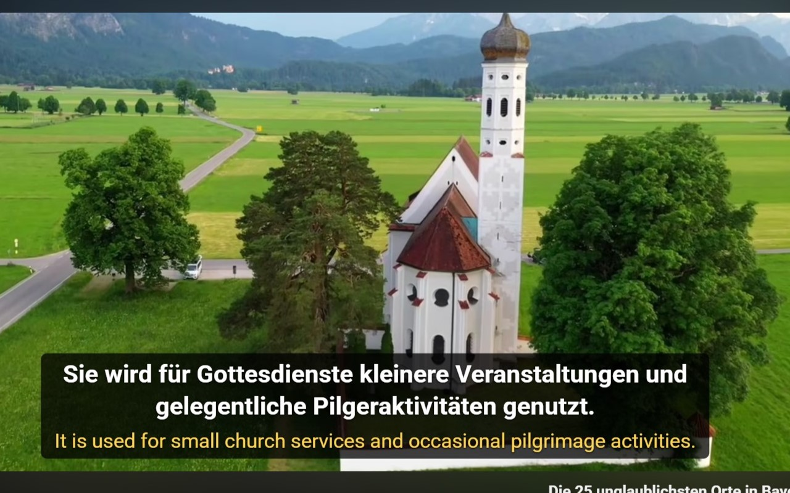
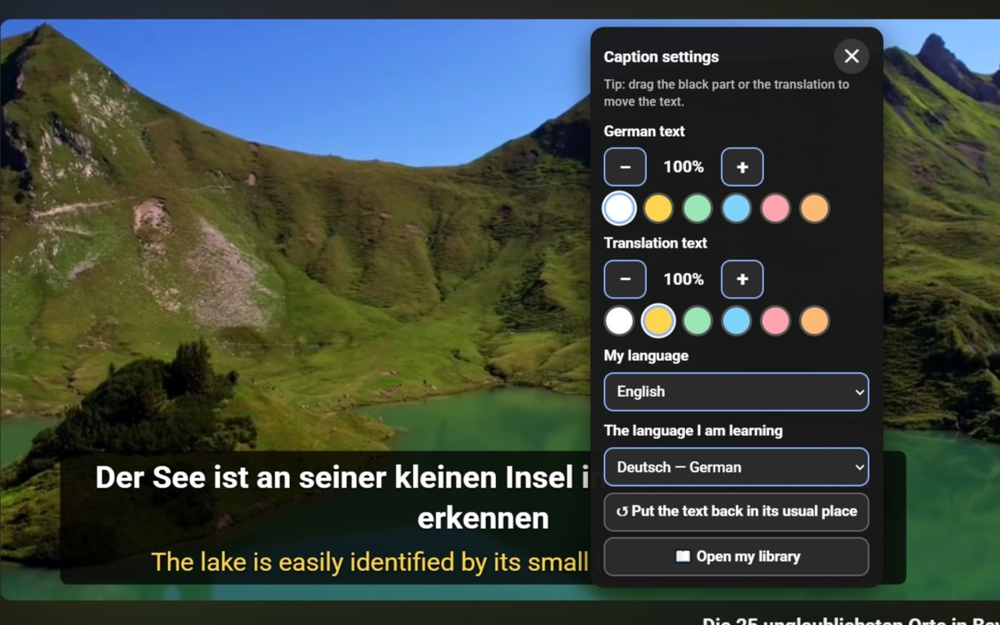
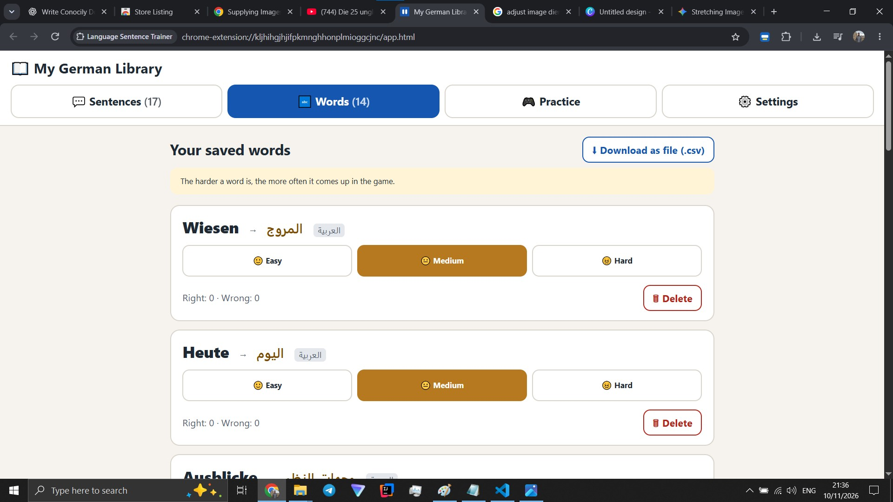

# 🎧 Learn Languages: YouTube Dual Captions & Sentence Capture

**A published Chrome extension that turns any YouTube video into a language lesson.**
Watch in your target language, see the translation underneath, save sentences and words with one key, then practice them in built-in games.

[](https://chromewebstore.google.com/detail/learn-languages-youtube-d/icbikjpimmfhofelddlfabbhpaombepm)


### 👉 [Install it from the Chrome Web Store](https://chromewebstore.google.com/detail/learn-languages-youtube-d/icbikjpimmfhofelddlfabbhpaombepm)



---

## ⚡ At a glance

| | |
|---|---|
| **What** | Chrome extension (Manifest V3) for learning languages from YouTube |
| **Status** | Shipped and live on the Chrome Web Store, v1.4.1 |
| **Stack** | JavaScript (ES2020+), Chrome Extensions API, Web Speech API, `Intl` APIs, `chrome.storage` |
| **Dependencies** | **None.** No framework, no build step, no backend |
| **Privacy** | All data stays on the user's device. No tracking, no analytics, no accounts |
| **Size** | ~12 source files, ~4,000 lines |

---

## ✨ What it does

1. **Dual captions.** The video's original subtitles are replaced by a clean overlay: target language on top, your language below. Drag it anywhere, resize it, recolor it.
2. **Smart sentence splitting.** Raw auto-captions are chopped into broken fragments. The extension rebuilds them into real sentences, with word-level timing.
3. **One-key capture.** Press **W** to save the current sentence with its translation, video title, and a link to that exact moment.
4. **Click any word** to translate it, rate its difficulty, and add it to your vocabulary.
5. **Sentence navigation.** **A** = previous, **S** = repeat, **D** = next, **C** = toggle captions.
6. **Practice games.**
   - 🔤 **Word game:** multiple choice in both directions. Words you rate *Hard* come up more often.
   - 🎧 **Listening game:** a computer voice reads a sentence, you try to understand it, then check yourself. Missed sentences return more often.
7. **Your library.** Browse saved sentences and words, export them as `.json` / `.csv`.
8. **Works in 49 languages**, including right-to-left ones (Arabic, Persian, Hebrew, Urdu, Kurdish). The whole interface translates itself into the user's language.

---

## 🖼️ Screenshots

| Dual captions | Caption settings | Saved sentences |
|---|---|---|
|  |  |  |

---

## 🚀 How to use it (30 seconds)

1. Install the extension from the [Chrome Web Store](https://chromewebstore.google.com/detail/learn-languages-youtube-d/icbikjpimmfhofelddlfabbhpaombepm).
2. Open any YouTube video that has subtitles in the language you are learning.
3. Press **W** to save sentences, click words you don't know.
4. Click the extension icon to open **My Library** and start practicing.

> In ⚙ **Caption settings** (or on the library's Settings tab) you choose *your language* and *the language you are learning*.

---

## 🧠 Technical highlights

These are the parts I'm proudest of, and the parts that show how I work.

### 1. Reading YouTube's captions without a private API
YouTube protects subtitle files with tokens that only the player's own request carries, so re-downloading them fails. `hook.js` runs in the page's **MAIN world** at `document_start`, wraps `fetch` and `XMLHttpRequest`, and **copies the player's own caption responses**. It then drives the player API to switch to the target-language track, retries until the player delivers, and **restores the player to its previous state**.

### 2. Sentence reconstruction (`sentences.js`)
- Parses three caption formats: `json3` (with per-word timing), `srv3`, and classic XML.
- Segments text with `Intl.Segmenter`, then fixes the mistakes it makes: abbreviations (*z. B.*, *Dr.*), dates (*3. März*), lowercase continuations.
- Splits overly long sentences at conjunctions and commas, with **per-language rules** (German, English, Spanish, French, Italian, Portuguese, Dutch) and a safe fallback for every other language.
- Handles unpunctuated auto-captions by grouping them by time.
- Maps every sentence back to precise start/end timestamps for seeking.

### 3. Self-translating UI (`i18n.js` + `background.js`)
There is only **one hand-written language: English**. Every other interface language is generated on first use, **validated** (a translation whose `{placeholders}` were lost is rejected and falls back to English), and **cached** in `chrome.storage`. Cache entries are versioned by a hash of the English source, so changing a string invalidates stale translations automatically.

### 4. Robust local storage (`store.js`)
A small data layer over `chrome.storage.local` with a **serialized write queue**, so two quick saves can never overwrite each other. It handles de-duplication, schema evolution (old items without a `learn` field still work), and CSV export with a UTF-8 BOM so Excel shows umlauts correctly.

### 5. Weighted spaced-repetition-style games (`game.js`)
Pure logic with no DOM, so it's testable on its own. Words are picked by difficulty weight, never repeat back to back, and distractors are chosen to avoid ambiguous answers (e.g., two words sharing one translation).

### 6. Accessibility and UX details
Large touch targets, visible focus states, full keyboard control, ARIA roles and live regions, RTL layout support, adjustable text size, and the caption box that never leaves the video bounds.

---

## 🗂️ Project structure

```
├── manifest.json     MV3 config, permissions (storage only + one host)
├── hook.js           Page-context script: intercepts caption responses, drives the player
├── content.js        Overlay UI, keyboard shortcuts, word panel, drag & settings menu
├── sentences.js      Caption parsing + sentence splitting + timing
├── background.js     Service worker: translation requests, UI-language cache
├── store.js          Settings / sentences / words storage + export
├── i18n.js           English source strings + translation loader
├── game.js           Word and listening game logic
├── audio.js          Speech Synthesis wrapper
├── app.html/js/css   The "My Library" page
└── docs/             Privacy policy + support page (hosted for the store listing)
```

**Minimal permissions:** only `storage`, plus access to `translate.googleapis.com`. The extension reads nothing outside YouTube and requests nothing it doesn't need.

---

## 🔒 Privacy

Saved sentences, words, scores, and settings live **only on the user's device**. The only data that leaves the browser is the subtitle text and words sent to Google Translate to produce translations. No ads, no trackers, no accounts.
Full policy: [`docs/index.html`](docs/index.html)

---

## 🛠️ Run it locally

No build step needed.

1. Clone this repo.
2. Open `chrome://extensions`, enable **Developer mode**.
3. Click **Load unpacked** and select the project folder.
4. Open a YouTube video with subtitles.

---

## 👋 About me

I'm **Sami**, a software developer with a Bachelor's degree in Electrical Engineering, based in Germany and learning German myself. I built this tool because I needed it, and then shipped it to the Chrome Web Store. It covers the full cycle: idea → design → implementation → store review → real users.

**I'm open to software developer roles.** Let's talk:

- 📧 sami000khaleel@gmail.com


---

*Built with plain JavaScript, a lot of curiosity, and too many German YouTube videos.*
