<div align="center">


# Language Sentence Trainer

**Learn languages from the YouTube videos you love.**

A Chrome extension that turns any YouTube video with captions into a language lesson. You get clean sentences with translations, replay with one key, a personal library and five games.


<a href="screenshots/showcase.mp4">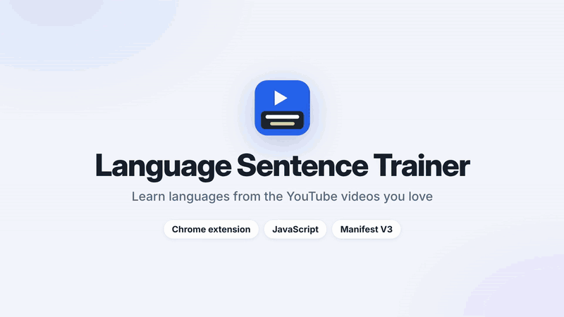</a>

<sub>▶ Click the animation for the full-quality video (MP4, 10 seconds)</sub>

[Features](#features) · [Screenshots](#screenshots) · [Install](#install) · [How it works](#how-it-works) · [Tests](#tests) · [Author](#author)

</div>

---

## Why I built it

I learn German from YouTube videos, and I kept running into the same problems. The captions cut sentences in half. Rewinding to hear a sentence again is fiddly. And the words I looked up were gone the next day. This extension fixes all three. Then it turns what you save into short games, so you practise the language you actually heard.

## Features

### 🎬 On YouTube
- **Dual captions.** The video's captions are rebuilt into complete sentences, with the translation under each one. You choose short, normal or long sentences.
- **Replay with S.** Pause the video and press **S**. The sentence plays once, then the video pauses again by itself. Press S as often as you like.
- **Accurate timing.** Sentence start and end times are matched to the spoken words, so a replay doesn't cut off words or run into the next sentence.
- **Click any word** to see its meaning, rate how hard it is and save it.
- **A movable caption box.** Drag it anywhere, and change its size and colours.

| Key | What it does |
|:---:|---|
| `W` | Save the sentence |
| `S` | Hear the sentence again (on a paused video: once, then pause again) |
| `A` / `D` | Go to the sentence before / after |
| `C` | Show or hide the text |

No keyboard? Point the mouse at the text and the same buttons appear under it.

### 📚 In your library
- Saved sentences and words, **grouped by the day you saved them**.
- **Original YouTube audio:** play exactly one saved sentence from the original video, or use the computer voice.
- **📅 "Saved when?"** Filter by Today, Yesterday, Past week, Past month or Past 3 months, or pick any days in a calendar. Then press **Practise these**.
- **Download** in five formats: Excel (.xlsx), plain text, Anki, CSV and JSON.

### 🎮 Five games
| Practise your words | Train your ears |
|---|---|
| **Word cards:** see a word and choose its meaning | **Listen:** hear a sentence, try to understand it, then check the translation |
| **Find the pairs:** a memory game with words and meanings | **Fill the gap:** hear the sentence, then pick the missing word |
| | **Put in order:** hear the sentence, then put its words in order |

- Before each game you choose **how many** items and **from which days**.
- After each game you get the **list of what you practised** and can fix a meaning, change how hard an item is, or delete it.
- Harder words come up more often.

### 💛 Easy for everyone
- A short **hands-on welcome wizard** opens when the extension is installed.
- **Seven colour themes**, including a dark theme and a high-contrast theme.
- **47 languages** to learn. The interface is translated into the user's own language.
- Large buttons and plain words.

## Screenshots

| | |
|---|---|
| 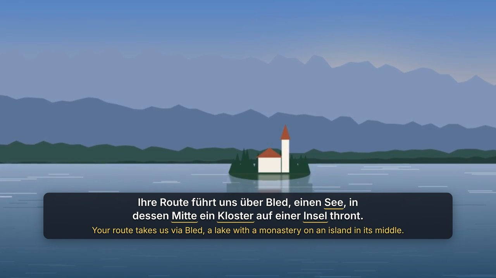<br>**Dual captions on YouTube** | 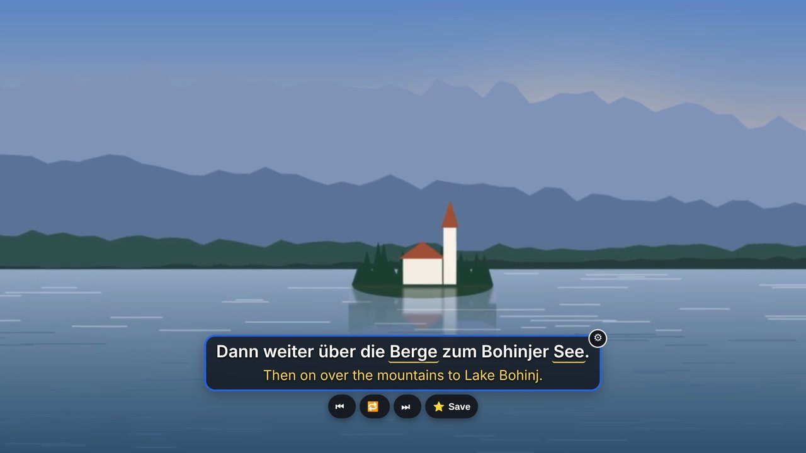<br>**Pause, press S, hear it again** |
| 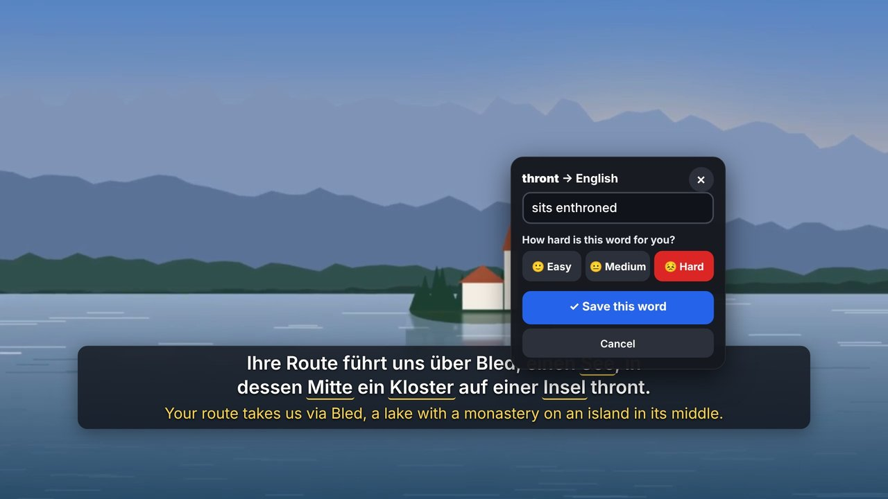<br>**Click a word to save it** | 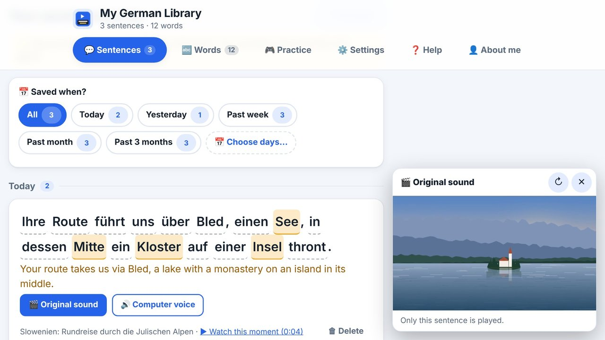<br>**Library with the original audio** |
| 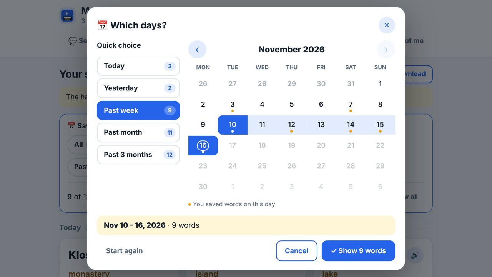<br>**Practise what you saved this week** | 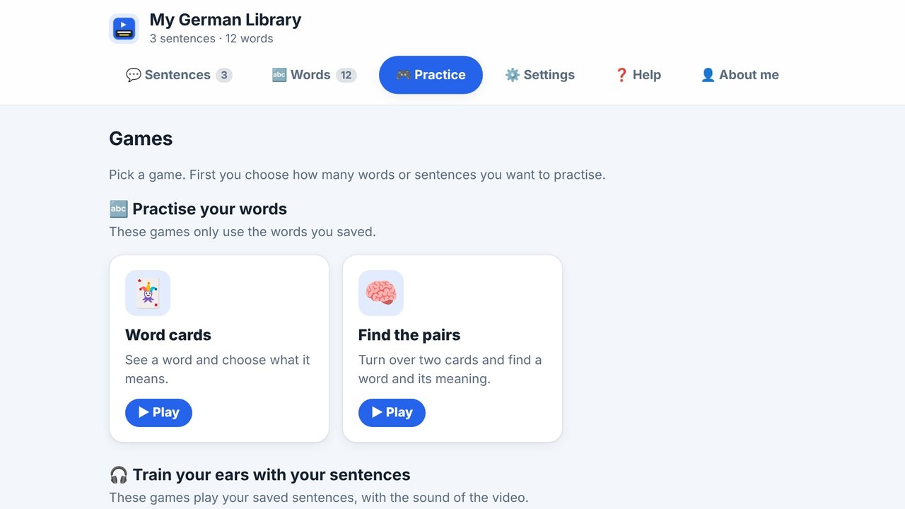<br>**Five games** |
| 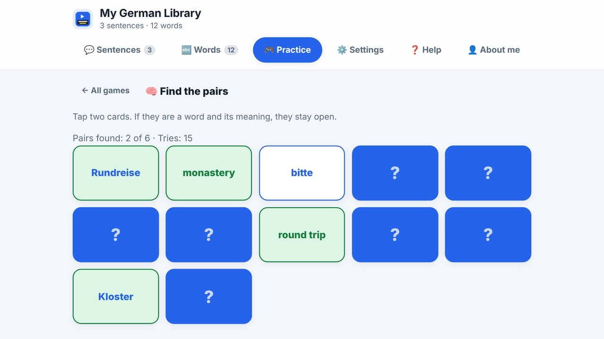<br>**Find the pairs** | 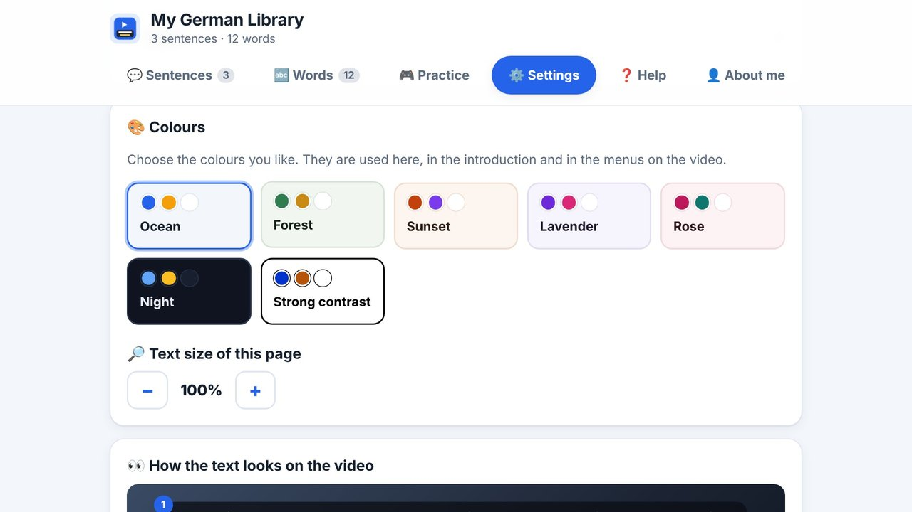<br>**Seven colour themes** |
| 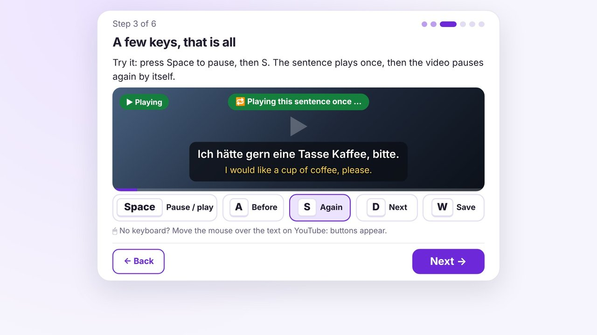<br>**Hands-on introduction** | |

## Install

1. Download or clone this repository.
2. Open `chrome://extensions` in Chrome.
3. Turn on **Developer mode** (top right).
4. Click **Load unpacked** and choose the folder that contains `manifest.json`.
5. The welcome wizard opens. Then open any YouTube video that has captions.

To update, replace the files and press the reload button **↻** on the extension card.

## How it works

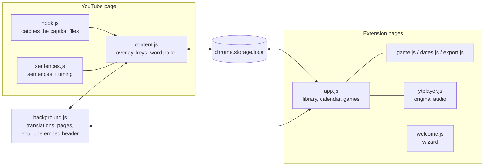

| File | What it does |
|---|---|
| `manifest.json` | Extension settings (Manifest V3) |
| `background.js` | Service worker: translations (Google Translate), opens the library and the wizard, lets the YouTube player play inside the extension |
| `hook.js` | Runs in YouTube's page and catches the caption files |
| `content.js` | The overlay on YouTube: sentences, translation, keys, word panel, settings menu |
| `sentences.js` | Splits captions into sentences of the chosen length and aligns them with the spoken words |
| `store.js` | Settings, saved items, colour themes, languages |
| `i18n.js` | All interface texts, translated automatically and cached |
| `game.js` | Game logic: picking questions, weighting by difficulty, checking answers |
| `dates.js` | Days and time windows for "Saved when?" and the calendar |
| `export.js` | Writes the download files (including a hand-built .xlsx: ZIP + XML) |
| `ytplayer.js` | Plays one saved sentence from the original YouTube video |
| `audio.js` | The computer voice (the browser's Speech Synthesis) |
| `ui.js` | Small helpers for building the page (`h()`, buttons, theme) |
| `app.*`, `welcome.*` | The library page and the welcome wizard |

📖 **Every line is explained in [CODE_GUIDE.md](CODE_GUIDE.md).** It covers each file's purpose, how the files work together, and then the code block by block.

## Tech

- **Vanilla JavaScript, HTML and CSS.** No framework, no build step, no dependencies.
- **Chrome Manifest V3:** a service worker, content scripts in the isolated and the page ("MAIN") world, and `declarativeNetRequest`.
- **`Intl.Segmenter`** for word and sentence boundaries, and **`Intl.DateTimeFormat`** for dates in every language.
- **Timing:** speech timing comes from YouTube's automatic captions and is aligned to the sentences with a longest-increasing-subsequence match.
- **Themes:** colour themes use CSS custom properties.

## Tests

The pure logic is tested with Node (no packages needed):

```bash
node tests/test-sentences.js   # sentence splitting
node tests/test-timing.js      # start and end times of sentences
node tests/test-games.js       # game logic
node tests/test-export.js      # download formats
node tests/test-dates.js       # "Saved when?" time windows and calendar
```

## Privacy

Everything you save stays in your browser (`chrome.storage.local`). There is no account, no server and no tracking. Only the text to be translated is sent to Google Translate. See the [privacy policy](docs/index.html).

## Author


**Sami Khaleel**, web developer in Germany.
I built this extension because I learn German from YouTube videos myself.

[XING](https://www.xing.com/profile/sami_khaleel031626) · [GitHub](https://github.com/sami000khaleel) · [sami000khaleel@gmail.com](mailto:sami000khaleel@gmail.com)

<br clear="left">
